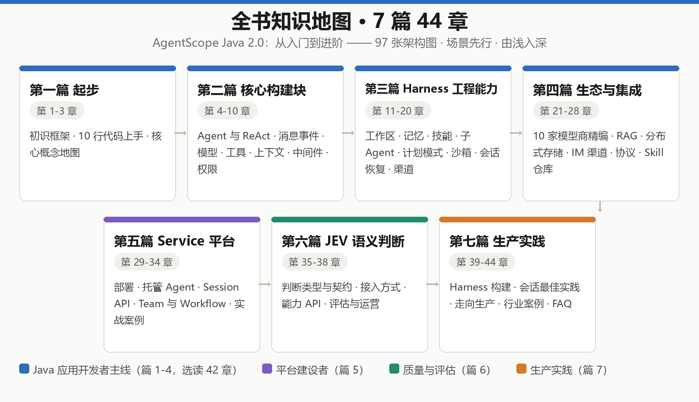

# AgentScope Java 2.0：从入门到进阶


<p align="center">
  
</p>

> 一本开源的 AgentScope Java 中文教程：**7 篇 44 章、900+ 页成书体量的完整 Markdown 源稿**，由浅入深覆盖从第一个 Agent 到生产级 Agent 平台的全部主题。

本书是对 [AgentScope Java](https://github.com/agentscope-ai/agentscope-java) 官方中文文档（v2）的**系统性重排与整合**：按学习曲线重新组织为教程结构，每章配有场景化导读与章首导览图，全书 97 张 mermaid 架构图 / 时序图 / 部署图（GitHub 原生渲染），并对 10 家模型提供商等重复性文档做了合并精编。**仅供学习与交流使用**，具体声明见 [NOTICE.md](NOTICE.md)。

## ✨ 这本书有什么不同

- **由浅入深的教程结构** —— 不是文档的搬运：序言给出三类读者（Java 应用开发者 / 平台建设者 / 质量与评估）的学习路线，每章有导读与前后衔接
- **97 张 mermaid 图** —— 章首导览图 + 时序图、流程图、部署图，全部可在 GitHub / VS Code / Typora 中直接渲染
- **案例驱动** —— 6 个 Service 实战案例（每个都配时序图）+ 4 个行业级案例（物流 / 金融 / AIDC / Coding Agent）
- **生产视角** —— 多副本部署、分布式存储选型、沙箱隔离、权限与人工介入（HITL）、上生产清单
- **进阶专题** —— JEV 语义判断（高频小决策的类型化处理）与 Agent 轨迹评估

## 🗺️ 目录

| 章节                                     | 链接                                                                        |
| ---------------------------------------- | --------------------------------------------------------------------------- |
| **序言**                           |                                                                             |
| 序言：AgentScope 2.0 与如何使用本书      | [chapters/preface.md](chapters/preface.md)                                   |
| **第一篇 起步**                    |                                                                             |
| 第 1 章 初识 AgentScope 2.0              | [chapters/01-overview.md](chapters/01-overview.md)                           |
| 第 2 章 快速开始                         | [chapters/02-quickstart.md](chapters/02-quickstart.md)                       |
| 第 3 章 核心概念地图                     | [chapters/03-concept-map.md](chapters/03-concept-map.md)                     |
| **第二篇 核心构建块**              |                                                                             |
| 第 4 章 Agent 与 ReAct 循环              | [chapters/04-agent.md](chapters/04-agent.md)                                 |
| 第 5 章 消息与事件                       | [chapters/05-message-event.md](chapters/05-message-event.md)                 |
| 第 6 章 模型接入                         | [chapters/06-model.md](chapters/06-model.md)                                 |
| 第 7 章 工具                             | [chapters/07-tool.md](chapters/07-tool.md)                                   |
| 第 8 章 上下文                           | [chapters/08-context.md](chapters/08-context.md)                             |
| 第 9 章 中间件                           | [chapters/09-middleware.md](chapters/09-middleware.md)                       |
| 第 10 章 权限系统与人工介入              | [chapters/10-permission.md](chapters/10-permission.md)                       |
| **第三篇 Harness 工程能力**        |                                                                             |
| 第 11 章 Harness 架构深入                | [chapters/11-architecture.md](chapters/11-architecture.md)                   |
| 第 12 章 工作区与文件系统                | [chapters/12-workspace.md](chapters/12-workspace.md)                         |
| 第 13 章 上下文管理                      | [chapters/13-context-mgmt.md](chapters/13-context-mgmt.md)                   |
| 第 14 章 记忆                            | [chapters/14-memory.md](chapters/14-memory.md)                               |
| 第 15 章 技能（Skill）                   | [chapters/15-skill.md](chapters/15-skill.md)                                 |
| 第 16 章 子 Agent 协作                   | [chapters/16-subagent.md](chapters/16-subagent.md)                           |
| 第 17 章 计划模式                        | [chapters/17-plan-mode.md](chapters/17-plan-mode.md)                         |
| 第 18 章 沙箱执行                        | [chapters/18-sandbox.md](chapters/18-sandbox.md)                             |
| 第 19 章 会话日志与恢复                  | [chapters/19-session-log.md](chapters/19-session-log.md)                     |
| 第 20 章 渠道（Channel）                 | [chapters/20-channel.md](chapters/20-channel.md)                             |
| **第四篇 生态与集成**              |                                                                             |
| 第 21 章 模型提供商精编                  | [chapters/21-model-providers.md](chapters/21-model-providers.md)             |
| 第 22 章 RAG 集成                        | [chapters/22-rag.md](chapters/22-rag.md)                                     |
| 第 23 章 长期记忆集成                    | [chapters/23-memory-integrations.md](chapters/23-memory-integrations.md)     |
| 第 24 章 会话存储与分布式部署            | [chapters/24-storage-distributed.md](chapters/24-storage-distributed.md)     |
| 第 25 章 IM 渠道集成                     | [chapters/25-im-channels.md](chapters/25-im-channels.md)                     |
| 第 26 章 Agent 协议                      | [chapters/26-protocols.md](chapters/26-protocols.md)                         |
| 第 27 章 Skill 仓库                      | [chapters/27-skill-repos.md](chapters/27-skill-repos.md)                     |
| 第 28 章 基础设施与生态工具              | [chapters/28-infra-ecosystem.md](chapters/28-infra-ecosystem.md)             |
| **第五篇 AgentScope Service 平台** |                                                                             |
| 第 29 章 Service 概览与部署              | [chapters/29-service-deploy.md](chapters/29-service-deploy.md)               |
| 第 30 章 创建并运行托管 Agent            | [chapters/30-managed-agents.md](chapters/30-managed-agents.md)               |
| 第 31 章 Session API：从调用到交付       | [chapters/31-session-api.md](chapters/31-session-api.md)                     |
| 第 32 章 编排：Team 与 Workflow          | [chapters/32-orchestration.md](chapters/32-orchestration.md)                 |
| 第 33 章 运维与运营                      | [chapters/33-operations.md](chapters/33-operations.md)                       |
| 第 34 章 Service 实战案例                | [chapters/34-service-cases.md](chapters/34-service-cases.md)                 |
| **第六篇 进阶：JEV 语义判断**      |                                                                             |
| 第 35 章 JEV 概念                        | [chapters/35-jev-concepts.md](chapters/35-jev-concepts.md)                   |
| 第 36 章 接入方式                        | [chapters/36-jev-integration.md](chapters/36-jev-integration.md)             |
| 第 37 章 核心能力 API                    | [chapters/37-jev-apis.md](chapters/37-jev-apis.md)                           |
| 第 38 章 评估与运营                      | [chapters/38-jev-evaluation.md](chapters/38-jev-evaluation.md)               |
| **第七篇 生产实践**                |                                                                             |
| 第 39 章 如何构建 Agent Harness          | [chapters/39-harness-series.md](chapters/39-harness-series.md)               |
| 第 40 章 最佳实践：可恢复会话聊天        | [chapters/40-session-chat.md](chapters/40-session-chat.md)                   |
| 第 41 章 会话执行控制与结构化决策        | [chapters/41-execution-control.md](chapters/41-execution-control.md)         |
| 第 42 章 走向生产                        | [chapters/42-production.md](chapters/42-production.md)                       |
| 第 43 章 行业案例                        | [chapters/43-cases.md](chapters/43-cases.md)                                 |
| 第 44 章 常见问题 FAQ                    | [chapters/44-faq.md](chapters/44-faq.md)                                     |
| **附录**                           |                                                                             |
| 附录 A：Release Notes（v2）              | [chapters/appendix-a-release-notes.md](chapters/appendix-a-release-notes.md) |
| 附录 B：术语表                           | [chapters/appendix-b-glossary.md](chapters/appendix-b-glossary.md)           |

每篇另有篇导读（`chapters/part-1-intro.md` … `part-7-intro.md`），概述本篇内容与阅读方式。

## 🧪 配套动手 Demo

[跨境电商 Agent 多租户平台 Demo](demo/cross-border-commerce/README.md) 与第五篇（第 29–34 章）配套，提供主线 8 步与延伸 2 步，每步包含教程和 Bash 脚本。支持一键运行、断点续跑、隔离断言与可逆停用；实测范围和剩余限制见 Demo 验证记录。

## 🚀 快速开始学习

**环境要求**：JDK 17+，Maven 3.9+，任一模型提供商的 API Key（推荐从 [第 2 章 快速开始](chapters/02-quickstart.md) 的 DashScope 开始）。

```java
// 10 行代码跑起第一个 Agent（详见第 2 章）
var builder = HarnessAgent.builder()
    .name("notes-assistant")
    .model("dashscope:qwen-plus")
    .workspace(Path.of(".agentscope/workspace"));

try (var agent = builder.build()) {
    agent.call(new UserMessage("你好，介绍一下你自己"), ctx).block();
}
```

**三条学习路线**（完整版见[序言](chapters/preface.md)）：

| 你是            | 建议路线                                                                  |
| --------------- | ------------------------------------------------------------------------- |
| Java 应用开发者 | 第 1-20 篇主线 → 第 22 章（RAG）→ 第 24 章（存储）→ 第 42 章（上生产） |
| 平台建设者      | 第 29-34 章（Service 平台）为主                                           |
| 质量与评估方向  | 第 35-38 章（JEV 语义判断）                                               |

## 📖 如何阅读 / 导出 PDF

- **GitHub 在线阅读**：直接点上方目录，mermaid 图原生渲染
- **本地阅读**：`git clone` 后用 VS Code（装 Markdown Preview Mermaid Support 插件）或 Typora 打开
- **导出 PDF**：本仓库只含 Markdown 源稿。可用任意 Markdown 工具链自行导出，例如：

```bash
pandoc chapters/*.md -o book.pdf --pdf-engine=xelatex -V CJKmainfont="Microsoft YaHei"
```

> 本书的 900+ 页 PDF 版本由一条 Markdown → HTML → Edge 打印的构建管线生成；如你需要该管线，欢迎提 Issue 交流。

## 🤝 参与贡献

发现错别字、内容过时、链接失效，或希望补充某章内容，欢迎提 Issue / PR：

1. Fork 本仓库 → 新建分支 → 修改对应章节
2. 注意保持章节 frontmatter（`chapter` / `title` / `source`）与图片相对路径规范
3. 提交 PR 并说明修改动机

## 📣 关于作者 / 交流

- **GitHub**：[github.com/ybak](https://github.com/ybak)
- **交流群**：打开小红书扫码加入「AgentScopeJava 学习群」 👇

<p align="center">
  
</p>

如果这本书对你有帮助，欢迎点一个 ⭐ Star，或分享给身边正在做 Agent 开发的同学——这是我持续整理更新的最大动力。

## 📄 声明

本书基于 [AgentScope Java](https://github.com/agentscope-ai/agentscope-java) 官方文档（Apache License 2.0）整理而成，包含大量重组与增补，**非官方文档**，与原项目及其维护者无隶属关系。技术内容以[官方文档](https://github.com/agentscope-ai/agentscope-java/tree/main/docs/v2/zh)为准。完整的来源、许可与用途声明见 [NOTICE.md](NOTICE.md)。本书仅供学习与技术分享，禁止用于商业用途。
