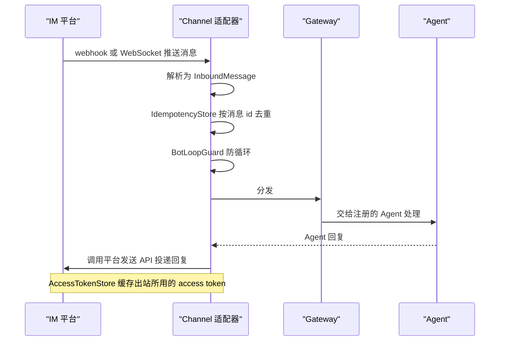

# 第 25 章 IM 渠道集成

> 本章导读：让用户在钉钉、飞书、企业微信里直接 @ 你的 Agent，而不是打开另一个网页——Channel 适配器负责这件事。本章讲清五个官方适配器共享的工作原理（入站去重、防循环、出站投递）、多副本部署时的共享存储要求，以及每个平台的传输形态差异。各平台的逐步接入（应用创建、凭据、回调配置）见在线文档。

## 五个平台怎么选

所有适配器通过 Harness 的 Channel 接口（第 20 章）接入，每个适配器负责平台特有的认证、webhook 签名校验、消息解析和回复投递——Agent 代码不感知平台差异：

| 扩展 | 平台 | 传输方式 | 选它的理由 |
| --- | --- | --- | --- |
| 钉钉 | DingTalk | Stream 协议（持久 WebSocket）或 HTTP 回调 | 内部协作在钉钉；Stream 模式无需暴露公网端点 |
| 飞书 | Feishu / Lark | 事件订阅回调（HTTP） | 内部协作在飞书 |
| 企业微信 | WeCom | 加密回调（HTTP） | 对客服务或企业微信生态 |
| GitHub | GitHub | Webhook（HTTP） | 研发流程：issue/PR 里驱动 Agent |
| GitLab | GitLab | Webhook（HTTP） | 同上，GitLab 环境 |

选择依据基本只有一条：**用户在哪里对话**。研发场景 GitHub/GitLab 的 webhook 事件天然携带代码上下文，适合代码评审类 Agent；IM 平台适合问答与审批流。

## 工作原理：所有适配器共享的三件事

无论哪个平台，适配器都遵循同一模式：**入站**——从平台接收消息（webhook 或 WebSocket），解析为统一的 `InboundMessage`，去重、防循环，经 Gateway 分发给 Agent；**出站**——调用平台发送 API 投递回复。三个通用组件由 `agentscope-extensions-channel-common` 提供：

- **IdempotencyStore** — 按消息 id 去重，防止 webhook 重试导致重复处理；
- **BotLoopGuard** — 按 peer 限速，防止 bot 之间的消息死循环（两个 Agent 互相 @ 是真实发生过的事故）；
- **AccessTokenStore** — 缓存出站调用平台 API 所用的 access token。



*图 25-1：Channel 渠道消息流时序*

## 多副本部署：必须共享存储

上述通用组件默认把状态存在 JVM 内，只在单进程可见。当适配器跑在多个副本上（负载均衡后多实例，或每个 bot 一个进程），必须通过接受共享存储实现的 `fromProperties` 重载构造适配器：

```java
FeishuChannel.fromProperties(channelId, routing, rawProperties, deduplicator, tokenStore);
```

共享的 `InboundEventDeduplicator` 让平台重试投递在所有实例间都能被识别；共享的 `AccessTokenStore` 让任一副本的 token 刷新服务于整个部署，而不是每个副本为同一凭据各自获取、各自缓存——否则就会出现"副本 A 刷新了 token、副本 B 还在用过期缓存"这类难排查的故障。这是本域最容易踩的坑，也是为什么它值得写进书里：**单机能跑不等于多副本能跑**。

每个适配器都依赖 `agentscope-extensions-channel-common`（传递依赖自动引入）与 `agentscope-harness`（由应用运行时提供）。

各平台的逐步接入——应用创建、凭据与签名配置、回调地址、消息格式——见在线文档 `docs/integration/channel/` 对应小节。

## 本章小结

1. 五个平台一个模式：入站去重防循环、出站统一投递，Agent 代码零平台感知；
2. 平台选择由"用户在哪"决定，传输形态（Stream 免公网 / HTTP 回调）是部署约束；
3. 多副本必须共享去重与 token 存储——单机能跑是多副本事故的开始。
