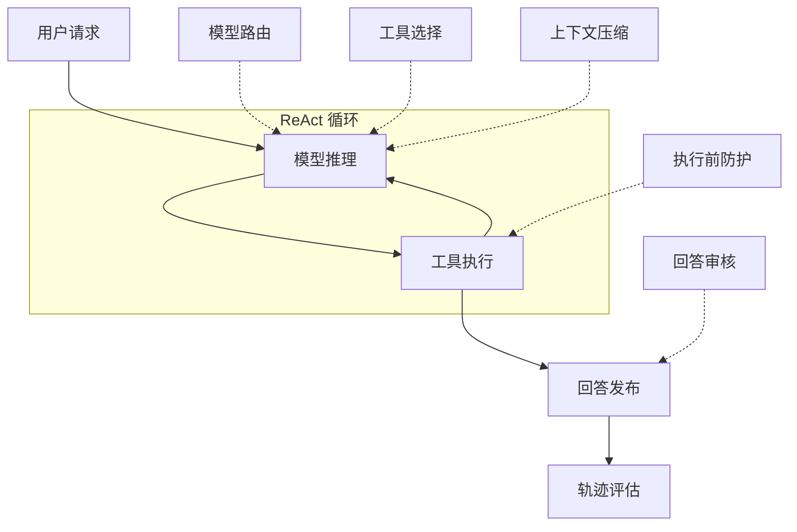

# 第 35 章 Agent 为什么需要独立的判断能力

> 本章导读：前两篇里你已经掌握了 Agent 的全部骨架——模型推理（第 6 章）、工具调用（第 7 章）、中间件（第 9 章）、权限（第 10 章）。本章引入这套骨架上的最后一块常用拼图：JEV，一个专门做"判断"的决策模型与组件集。先看一个十行的例子，亲眼见到 JEV 返回什么；再把它与你已学过的四类机制逐一对照，说清它解决什么、不解决什么；然后解释为什么"高频小判断"值得一个独立的模型；最后给出全书 JEV 能力的地图与三条接入路径。读完本章，你能判断自己的业务里哪些环节适合 JEV，并知道到后面三章的哪里去深入。

## 先看它返回什么

不讲定义，先跑一段代码。场景来自客服业务：业务记录说"尚未发起退款"，Agent 却生成了"退款已完成"。我们让 JEV 判断：业务记录是否支持这个回答？

```java
var client = JevClient.builder()
    .apiKey(System.getenv("TYPESAFE_API_KEY"))
    .build();

var request = SystemOneRequest.builder()
    .state(Map.of(
        "answer", "退款已完成",
        "record", "尚未发起退款"))
    .question("supported", new NoulQuestion(
        "Does the business record support the answer?", null))
    .build();

var result = client.systemOne(request).block();
var answer = (NoulAnswer) result.answers().get("supported");
System.out.println("记录支持回答的概率：" + answer.noul());   // 例如 noul: 0.02
```

返回的是一个数值：`noul: 0.02`——"记录支持回答"的概率约 2%，即这段回答几乎必然是无依据的。注意两件事：**判断由模型完成**，但你的应用拿到的不是一段"经过分析，该回答与记录不符……"的自由文本，而是一个可直接写进 `if` 的概率；**JEV 不负责后续动作**——是拦截、改写还是转人工，仍由你的应用或 Agent 组件决定。

刚才这一问是三种问题类型之一。JEV 的全部输入输出都建立在这三种类型上：

| 类型 | 你问的是 | 返回 | 典型用途 |
|---|---|---|---|
| 是非判断（Noul） | "这个陈述成立吗？" | 成立的概率 | 回答是否有依据、工具是否适用 |
| 单选（Choice） | "选哪个？" | 各候选的概率分布与置信度 | 模型路由、动作选择 |
| 评分（Score） | "几分？" | 等级分布、加权分数 | 风险严重度、分级评估 |

为什么强调"类型化"？如果你让生成模型顺便判断，它的输出是自由文本——你让它返回 JSON，它可能在前面加一句"好的，我来分析一下"；而 JEV 是专门的结构化决策模型，返回值经过客户端严格校验（概率分布、答案类型、题目完整性），拿到就能用。这个差别在"每次调用都要做分支"的场景里会被放大，下一节展开。

## JEV 与你已经学过的机制

JEV 最容易引起的疑问是："这些事前面的章节不是已经做了吗？"逐一对齐：

**与第 6 章（模型）——分工，不是替代。** `JevClient` 不实现 `Model` 接口：`Model` 面向聊天推理、返回 `ChatResponse`，而 JEV 只回答"可以吗"和"选哪个"，不生成面向用户的文本。用户看到的回答仍由你配置的生成模型产出；JEV 的判断结果决定"这条回答能不能发出去"。

**与第 7 章（工具）——判断工具是否适用，不授予执行权限。** 第 7 章的元工具（`enableMetaTool`）让模型自己发现和切换工具组，代价是占用推理路径、选择质量取决于模型本身。JEV 的工具选择在推理**之前**用独立判断裁剪候选——但它只决定"模型能看见哪些工具"，筛选不会创建工具，更不会绕过执行侧的任何检查。

**与第 9 章（中间件）——载体与内容。** JEV 的判断进入 Agent 链路的途径就是第 9 章讲的中间件（`.middleware(...)`），另有压缩（`.compaction(...)`）和 Toolkit 工具两种挂法。也就是说你不需要新学的接线机制——学会的第 9 章在这里直接复用。

**与第 10 章（权限）——语义风险判断叠加在确定性授权之上，两者都不缺席。** 这是最容易混淆的一对，值得一张表：

| | 权限系统（第 10 章） | JEV 执行防护 |
|---|---|---|
| 回答的问题 | "这个调用者**有没有资格**做这件事？" | "这个具体动作**在此刻的对话里**执行，语义上合适吗？" |
| 判断依据 | 身份、角色、显式授权规则 | 当前对话内容 + 本次工具调用的参数 |
| 确定性 | 确定性：规则命中与否 | 概率性：返回风险概率与阈值比较 |
| 典型拒绝 | 用户没有退款权限 | 用户有权限、参数也合法，但对话里还没有任何订单证据，模型就提出了 `refund(...)` |

第 10 章的经典场景（越权用户被拒）JEV 不管；JEV 拦的典型场景（"先查订单，没发货再退款"——模型跳过查询直接退款，工具名、参数、权限全部合法）权限系统也不管。两者串联工作：JEV 语义检查通过后，调用仍要过完整的权限链才执行；反过来，权限拒绝的调用轮不到 JEV 判断。**一个管资格，一个管时机，缺一不可。**

最后还有第四种"潜在替代品"——**硬编码规则**（"包含 `rm -rf` 一律拒绝"）。它有确定性，却覆盖不了语义长尾："列出这个目录下的所有文件"和"删掉这个目录"在规则层面难以区分，在语义层面一目了然。JEV 与规则不冲突：能写规则的继续写规则，规则覆盖不了的长尾交给判断。

## 为什么高频小判断值得一个独立的模型

一个 Agent 从收到请求到完成任务，看起来是在"推理"和"执行"之间循环，但拆开每一步会发现，真正密集发生的是**判断**：这个请求该用哪个模型？当前上下文里哪些工具该暴露给模型？这条 bash 命令能不能自动放行？这个回答的置信度够不够直接返回？这些判断每一个都不复杂，却出现在运行时的每个角落，加起来是一项被长期低估的系统性开销。

它们有三个共同特点：**高频、低复杂度、需要确定性输出**。不需要模型展开长链路推理，但需要系统快速拿到一个能做分支的结论——是与否、选哪个、打几分。

三条路摆在一起：

1. **让主模型顺便判断**：prompt 里加一句"先判断再回答"。能工作，但每次判断都走完整推理路径，返回自由文本还要二次解析，格式不受控；
2. **写硬编码规则**：确定性有了，语义长尾覆盖不了；
3. **交给专门优化的决策模型**：把判断从主模型的推理路径和业务硬编码中抽出来，用类型化接口和校准概率返回——这就是 JEV 的定位。问题的本质是：Agent 系统里大量需要的不是"更聪明的推理"，而是"更便宜、更可靠的判断"。

JEV 的来源是 TypeSafe AI 的结构化决策模型 Jev，AgentScope Java 将其集成为独立扩展模块 `io.agentscope:agentscope-extensions-jev`（代码在 `io.agentscope.extensions.judge.jev` 包下）——正因为不注册成 `Model` provider，你可以在不改动模型接入的前提下单独引入它。

## 判断点挂在链路的哪里

这些判断点不是一组游离的 API，而是挂在第 4 章讲过的 ReAct 循环的特定环节上（见图 35-1）：模型路由与工具选择发生在推理**之前**，上下文压缩在长任务中缩减工具历史（第 13 章），执行前防护发生在工具执行**之前**、权限链**之前**，回答审核在发布前检查输入与输出，轨迹评估在调用结束后统计质量。

## 判断错了怎么办：三档运行模式

在把这些判断点接进链路之前，还剩最后一个必须先回答的问题——**判断结果要不要真的影响业务流程？**

回到退款防护：用户有权限、参数也合法，但对话里还没有订单证据，模型就提出了 `refund(...)`。JEV 判断返回"安全概率 0.15"。然后呢？这笔退款到底执行吗？这不是技术细节，而是业务决策：判断是概率性的，可能对也可能错——**如果让一个还没被验证过的判断直接决定拦不拦退款，判断错了谁负责？**

三种回答，对应三档运行模式：

| 模式 | 判断发起吗 | 结果影响流程吗 | 一句话 |
|---|---|---|---|
| **OFF** | 不发起 | — | 完全关闭：流程照旧，什么都不发生 |
| **SHADOW** | 发起 | **不影响**——只把"建议拒绝"记录下来，退款照样走原流程 | 影子运行：只观察，不动手 |
| **ENFORCE** | 发起 | **影响**——不通过就不派发这笔退款 | 真正接管：判断说了算 |

这个设计的含义是：**"引入判断"和"让判断接管业务"被拆成了两个独立的决定。** 默认是 OFF——环境变量里配了密钥不会自动开启任何判断；SHADOW 让你在不影响任何真实业务的前提下积累"判断会怎么判"的对照样本；等样本证明判断质量可接受（怎么证明见第 38 章），再把个别用途切到 ENFORCE。直接 ENFORCE 可能把正常退款一起拦住（第 37 章有一个真实测试就是这种情况），完全 OFF 又永远不知道判断准不准——**先 SHADOW、后 ENFORCE 是贯穿后续三章的灰度路径**。

有了这层铺垫，重看图 35-1 就完整了：六类判断点回答"判断挂在哪"，三档模式回答"判断结果怎么用"——每个判断点都受同一组模式控制；事后评估只允许 OFF/SHADOW，因为它观察的是已经发生的行为，无从拦截。



*图 35-1：六类判断点在 ReAct 循环上的挂接位置；每个判断点都工作在 OFF / SHADOW / ENFORCE 三档模式之一（默认 OFF）。*

最后是失败兜底。概率性判断总有失手：判断不足或调用失败时，系统按用途回退而不是让 Agent 停摆——工具选择保留原候选工具，模型路由沿用原模型，执行前防护在 ENFORCE 下拒绝受保护调用、其他工具沿原流程。**判断失败不是停摆，而是降级到安全路径**——这也是"独立判断能力"的设计取向。

## 三条接入路径

- **直接调用**：应用已经有输入、证据或草稿时，调用 `JevClient`、`JevJudge` 等组件，自行消费结果——本章开头的例子就是这一条，上手细节见第 36 章；
- **Harness 集成**：通过 `.middleware(...)` 等方式把判断挂进 Agent 链路（工具选择、执行防护、内容审核等），见第 36 章的运行模式配置与第 37 章的三个精讲域；
- **AgentScope Service**：不改应用代码，通过 session 的 `agentOverrides.jev` 配置启用，见第 37 章末的 Service 集成。

一条边界先说在前面，后面各章不再重复：**JEV 判断不授予工具权限，也不证明业务操作已经成功**。工具授权、ACL、参数校验、幂等及独立完成验证仍由你的应用负责。

## 本篇地图：十个判断域

到这里，"判断点""运行模式""挂接方式"都已就位，可以给出 JEV 全部能力的地图。按"要解决什么问题"分十个域：

| 能力域 | 典型场景 | 深入位置 |
|---|---|---|
| 工具选择与执行防护 | 大工具集筛选；退款、发消息等执行前检查 | **第 37 章精讲** |
| 检索证据与知识问答 | 过滤提示注入、保留冲突证据、检查回答依据 | **第 37 章精讲** |
| 内容审核与回答修订 | 发布前审核输入输出，只修订未通过的草稿 | **第 37 章精讲** |
| 上下文治理与恢复 | 长任务中保留关键约束、缩减工具历史、记忆准入 | 第 37 章索引 → 在线参考 |
| 长任务进展与交付监督 | 持续识别偏航、停滞、验证缺失与交付复核 | 第 37 章索引 → 在线参考 |
| 模型、阶段与团队路由 | 按任务复杂度、工具能力、容量与配额选择候选 | 第 37 章索引 → 在线参考 |
| 代码评审与证据定位 | 对 diff 或源码快照筛选风险并定位证据区域 | 第 37 章索引 → 在线参考 |
| 浏览器只读导航与验证 | 从可见链接中导航，在授权页面查找信息 | 第 37 章索引 → 在线参考 |
| 业务分类与客服评审 | 多标签分流、条件性退款诉求与回复承诺检查 | 第 37 章索引 → 在线参考 |
| 评估与运营 | 校准阈值、轨迹评估、批量回归、基线对照 | 第 38 章 |

第 37 章**精讲前三个域**——它们恰好覆盖一条客服退款流程的三个判断点（执行前防护、依据检查、发布审核），读完你掌握的是"学任何新域"的完整方法，其余七个域是一套判断点的重复应用，索引即可。第 38 章回答一个更根本的问题：这些判断本身值得吗——怎么校准阈值、怎么证明接入 JEV 后业务真的变好了。

## 本章小结

1. JEV 为 Agent 运行时的高频小判断提供**类型化结果**：Noul 概率、Choice 分布、Score 评分，应用拿到数值即可分支，不需要解析自由文本；
2. 它与你已学的机制各司其职：不替代生成模型（第 6 章），不授予工具权限（第 7 章），以中间件为载体（第 9 章），叠加在权限链之上管"时机"而非"资格"（第 10 章）；
3. 判断点挂在 ReAct 循环的特定环节，运行模式分 OFF / SHADOW / ENFORCE 三档且默认 OFF，灰度路径是"先 SHADOW 观察、后 ENFORCE 接管"；
4. 判断失败按用途回退到安全路径，不是停摆；事后评估只允许观察。

下一步到第 36 章：把开头的例子跑起来，掌握客户端、问题类型与运行模式的完整生命周期。

**留给你的问题**——

- 你的业务里，哪些环节现在是"主模型顺便判断"或"硬编码规则"？它们符合"高频、低复杂度、需要确定性输出"吗？
- 对照第 10 章：你现有的权限规则挡住了哪些调用？这些被放行的调用里，有没有"资格没问题、但时机不对"的？
