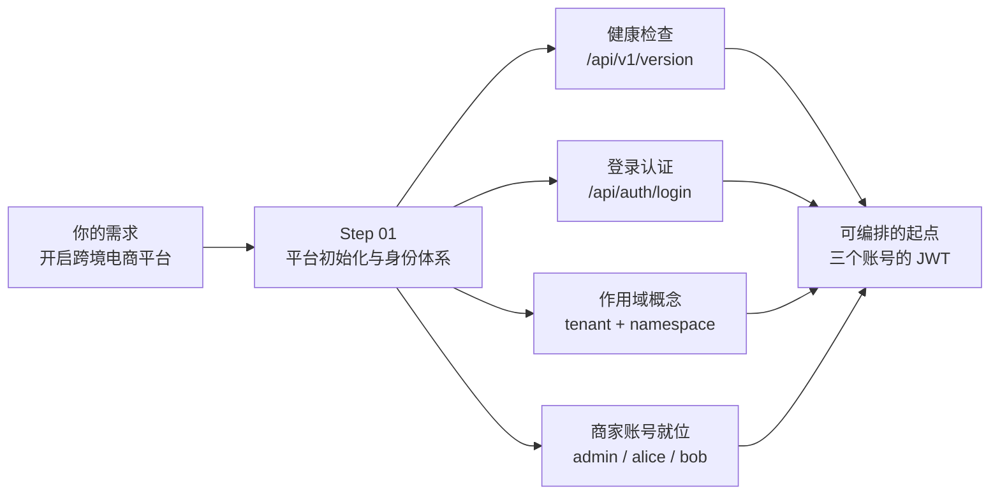

# Step 01 · 平台初始化与身份体系

> **本步导读**：作为平台运营方（「星帆出海」），搭建跨境电商多租户平台的第一件事不是创建 Agent，而是确认三件事：**平台的地基稳不稳**（服务健康与版本）、**我是谁**（登录认证与身份确认）、**我的请求落在哪个租户作用域里**（tenant 与 namespace）。这三件事分别对应本步的四个小节。



*图 1-1：Step 01 导览图*

本步所有命令均可复制执行。前置条件：本地已启动 agentscope-service dev 栈（见 demo [README](../README.md) 的快速开始）。

## 平台起来了吗：版本与健康

一切调用的前提是控制面可达。Gateway 是唯一对外入口，`/api/v1/version` 是无需认证的公开端点：

```bash
BASE_URL=http://localhost:18080
curl -sS "$BASE_URL/api/v1/version" | jq .
```

真实响应：

```json
{
  "apiVersion": "v1alpha1",
  "component": "aistio",
  "experimental": false,
  "version": "0.2.0"
}
```

`component: aistio` 就是控制面本体（Go 单体）。如果这一步超时或拒绝连接，先回到 `scripts/dev-up.sh` 检查栈状态，不要带病往下走。

## 运营方是谁：登录与身份

控制面用**用户名密码换 JWT**，后续所有平台用户请求都带 `Authorization: Bearer <token>`：

```bash
TOKEN=$(curl -sS -X POST "$BASE_URL/api/auth/login" \
  -H 'Content-Type: application/json' \
  -d '{"username":"admin","password":"admin"}' | jq -r '.token')
```

响应只有一个字段：`{"token":"eyJhbGciOiJIUzI1NiIs…"}`（7 天有效）。用 `/api/auth/me` 确认身份：

```bash
curl -sS "$BASE_URL/api/auth/me" -H "Authorization: Bearer $TOKEN" | jq .
```

真实响应（截取）：

```json
{
  "userId": "admin",
  "username": "admin",
  "roles": ["user", "admin"],
  "tenant": null
}
```

> **注意**：demo 脚本用 `jq -er '.userId // .id'` 显式提取字段——字段解析失败立即报错退出，而不是拿到空值继续跑。这是本 demo 所有脚本共通的习惯：**让错误在最早的一步炸出来**。

## 我的请求作用域是谁：tenant 与 namespace

这是全书多租户故事的地基概念。控制面用**二级作用域**：`tenant`（租户，部署级配置）+ `namespace`(命名空间，运行时的租户单元)。查看当前用户的作用域全貌：

```bash
curl -sS "$BASE_URL/api/v1/me/scope" -H "Authorization: Bearer $TOKEN" | jq .
```

真实响应（截取）：

```json
{
  "mode": "multi",
  "tenant": "default",
  "namespace": "default",
  "namespaces": [
    {
      "name": "default",
      "kind": "global",
      "owner": "system",
      "roles": ["member", "developer", "operator"],
      "tenant": "default"
    },
    {
      "name": "personal-admin-…",
      "kind": "personal",
      "owner": "admin",
      "roles": ["admin", "member", "developer", "operator"],
      "tenant": "default"
    }
  ]
}
```

两个要点：

1. 每个用户自动拥有一个 `personal-` 开头的个人 namespace；`default` 是系统预置的**全局** namespace。
2. 请求通过 **`X-AgentScope-Tenant` / `X-AgentScope-Namespace` 请求头**（或查询参数、body 字段）声明作用域——同一个 API，不同作用域头，看到的是不同租户的资源。demo 各步会反复用到这一点。

> **注意**：当前版本中 tenant 是**部署级配置**（aistiod 启动参数 `AISTIO_DEFAULT_TENANT`，默认 `default`），运行时 API 不能创建新 tenant；"多租户"在本地部署上由 **namespace 级隔离**承载。生产环境的多 tenant 部署形态见教程第 29 章。

## 商家账号就位：种子账号与兜底创建

dev 栈预置了三个演示账号：`admin/admin`（平台运营方）、`alice/alice`（商家①海岸优品）、`bob/bob`（商家②极光数码）。验证它们可用：

```bash
for u in alice bob; do
  curl -sS -X POST "$BASE_URL/api/auth/login" \
    -H 'Content-Type: application/json' \
    -d "{\"username\":\"$u\",\"password\":\"$u\"}" | jq -r '.token' | head -c 20 && echo " <- $u"
done
```

真实输出：

```
eyJhbGciOiJIUzI1NiIs <- alice
eyJhbGciOiJIUzI1NiIs <- bob
```

若某账号不存在（非 dev 栈部署），demo 脚本会以 admin 身份调用 `POST /api/admin/users` 兜底创建后再登录。

## 脚本执行

本步对应的脚本把这些动作串成一遍并缓存三个 JWT 到 `.state.env`，供后续步骤复用（重复执行幂等）：

```bash
bash steps/step-01-platform-init.sh
```

真实输出（节选）：

```
━━━━ Step 01 平台初始化与身份体系 ━━━━
--- 控制面版本
  ✓ 栈可达: http://localhost:28080
--- 平台运营方登录
  ✓ admin 登录成功
  ✓ admin 身份确认
  ✓ 当前作用域: {"tenant":"default","namespace":"default","mode":"multi"}
--- 商家账号
  ✓ 种子账号 alice 可登录
  ✓ 种子账号 bob 可登录
本步产出: 三个账号 JWT 已缓存（.state.env）；XBD_ADMIN_ID=admin
```

> **注意**：本 demo 基于源码构建的 agentscope-service（aistio 0.2.0）实测，教程正文（第 29-34 章）基于 2.1.0-BETA1 文档。两者 API 存在版本演进差异，凡有出入均以本 demo 实测为准并逐处标注。

## 本步小结

1. `/api/v1/version` 是公开健康端点；`aistio` 是控制面组件名。
2. `POST /api/auth/login` 以用户名密码换 7 天期 JWT；`/api/auth/me` 确认身份。
3. 作用域二级模型：tenant（部署级）+ namespace（运行时租户单元）；请求头 `X-AgentScope-*` 声明作用域。
4. dev 栈种子账号恰好映射 demo 三方角色：平台运营方（admin）与两家入驻商家（alice/bob）。

**验收清单**

- ☐ `GET /api/v1/version` 返回 aistio 版本信息
- ☐ admin/alice/bob 三个账号均能登录取得 token
- ☐ `GET /api/v1/me/scope` 能看到 `default` 与 personal 两个 namespace
- ☐ `step-01-platform-init.sh` 连跑两遍输出一致（幂等）

> **延伸阅读**：作用域与权限的四层模型（账号 → namespace 角色 → 资源权限 → 可见性）见教程第 29 章；demo 中我们只用其中最核心的 namespace 成员角色。下一步 → [Step 02 商家入驻](step-02-tenant-onboarding.md)。
