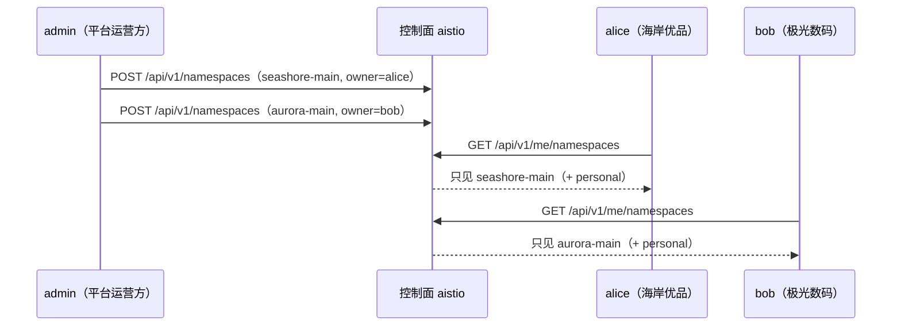

# Step 02 · 商家入驻：namespace 即租户单元

> **本步导读**：平台的地基就位后，第一批两家商家要入驻了——「海岸优品」（家居出海）与「极光数码」（3C 配件出海）。在 AgentScope Service 的多租户模型里，"入驻"不是建一张商家表，而是开立一个**共享 namespace** 并把商家的负责人授权为 owner：此后该商家的所有 Agent、会话、团队都归属这个 namespace，隔离边界由此而生。



*图 2-1：商家入驻与可见性隔离*

## 开立租户单元：POST namespaces

创建 namespace 是**平台 admin 专属操作**（"platform admin is required to provision shared namespaces"）。admin 以自身 JWT 调用，body 携带名称、显示名与 owner（接受用户名）：

```bash
curl -sS -X POST "$BASE_URL/api/v1/namespaces" \
  -H "Authorization: Bearer $ADMIN_TOKEN" -H 'Content-Type: application/json' \
  -d '{"name":"seashore-main","displayName":"海岸优品（家居出海）","owner":"alice","tenant":"default"}'
```

demo 脚本连开两个商家 namespace，真实输出：

```
  + 创建 namespace: seashore-main
  + 创建 namespace: aurora-main
```

重复执行时脚本先查后建，输出变为 `↺ namespace 已存在: seashore-main`——**入驻操作天然幂等**，这正是"先查后建"模式的意义。

回读租户档案确认归属：

```bash
curl -sS "$BASE_URL/api/v1/namespaces/seashore-main" -H "Authorization: Bearer $ADMIN_TOKEN" | jq '.namespace'
```

真实响应：

```json
{
  "name": "seashore-main",
  "displayName": "海岸优品（家居出海）",
  "owner": "alice",
  "kind": "shared"
}
```

三个 kind 值的含义：`personal`（用户自动拥有）、`global`（系统预置如 `default`）、`shared`（本步创建的商家租户单元）。owner 角色在创建时自动授予，无需再传 `members`。

## 隔离的第一课：me/namespaces 的可见性

以 alice 的身份（用她的 JWT）查看可见 namespace：

```bash
curl -sS "$BASE_URL/api/v1/me/namespaces" -H "Authorization: Bearer $ALICE_TOKEN" | jq '.items[].name'
```

真实输出：

```json
"seashore-main"
"personal-alice-…"
```

alice 能看到自己的 `seashore-main` 与个人 namespace，**看不到 `aurora-main`**。demo 脚本把这一点做成双向断言：

```
  ✓ alice 可见自己的 namespace（seashore-main）
  ✓ alice 不可见 aurora-main
  ✓ bob 可见自己的 namespace（aurora-main）
  ✓ bob 不可见 seashore-main
```

> **注意**：`me/namespaces` 列表与 `me/scope` 的细节略有不同——scope 还会列出用户有角色的 global namespace（如 `default`）。可见性以 `me/namespaces` 为准。

## 作用域通道的实测结论

声明请求作用域有三条通道：查询参数、请求头、body 字段。**实测发现三者并非处处通用**：

| 端点族 | 可用通道 | 实测证据 |
| --- | --- | --- |
| v5 catalog（`/api/v1/agents`、`/api/v1/chats`、`/api/v1/endpoints`） | 请求头 | body 通道报 `resource not found in authorized scope` |
| v1 协作（`/api/v1/orchestration-definitions`、`/api/v1/automations`、`/api/v1/approvals` 等的 GET） | 查询参数 | 缺省报 `tenant and namespace are required`，请求头亦被拒 |
| v1 协作的 POST 创建 | body 字段 | 沿用官方 smoke.sh 模式（`"tenant":…,"namespace":…`） |

demo 的 `lib/common.sh` 提供了 `scope_as`（请求头）与 `scope_q`（查询参数）两个助手，各步按端点族选用。选错通道会得到上面两种明确的 400 报错，按表对号入座即可。

## 脚本执行

```bash
bash steps/step-02-tenant-onboarding.sh
```

> **注意**：当前版本 tenant 为部署级配置（`AISTIO_DEFAULT_TENANT`），namespace 创建时 Tenant 字段取服务端默认值——本地部署以 **namespace 表达多租户**；多 tenant 生产部署形态见教程第 29 章。本步 API 与教程第 31 章写作时点的 `X-API-Key` 应用凭据体系亦属不同版本形态，demo 以实测为准。

## 本步小结

1. "商家入驻" = admin 创建共享 namespace 并授予 owner；owner 角色自动生效。
2. namespace 三种 kind：`personal` / `global` / `shared`；商家租户单元是 `shared`。
3. 可见性隔离由 namespace 成员关系决定，`me/namespaces` 是商家的可见世界。
4. 作用域通道按端点族分化：catalog 用请求头、协作 GET 用查询参数、协作 POST 用 body。

**验收清单**

- ☐ `seashore-main` 与 `aurora-main` 两个 namespace 创建成功（kind=shared，owner 各归其主）
- ☐ alice/bob 的 `me/namespaces` 双向隔离断言通过
- ☐ 脚本连跑两遍第二遍全部 `↺ 已存在`（幂等）

> **延伸阅读**：namespace 与四层权限模型见教程第 29 章。下一步 → [Step 03 商家 Agent 矩阵](step-03-agent-matrix.md)。
