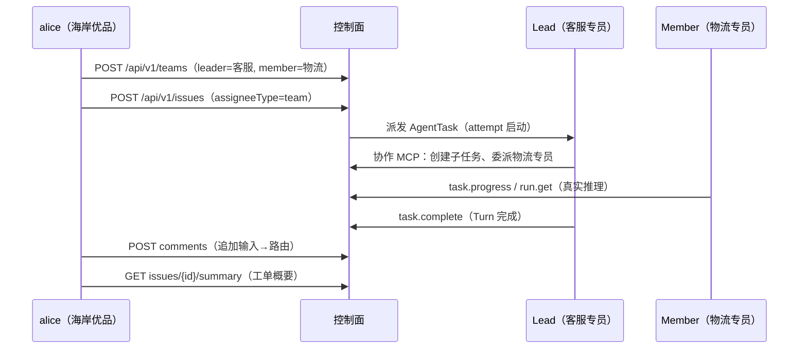

# Step 06 · Team 编排：客服协作团队与 Issue-first 协作

> **本步导读**：单个客服 Agent 应对不了复杂售后——订单 OD-2049 的客户已经第三次催单，需要**核实物流状态**（物流专员的事）再给出**补偿口径**（客服的事）。这一步把两个 Agent 编成一个持久团队，然后把一张工单派给团队：Lead Agent 接单、拆解、委派成员，平台负责消息路由与任务板。你会看到多 Agent 协作的关键不是"拉个群"，而是一套可运营的**任务治理面**。



*图 6-1：Team 编排的 Issue-first 协作链路*

## 建团队：Lead + Members + Policy

团队是**持久名册**（不是一次性任务分组）。创建时指定 Leader、成员与协作策略：

```bash
curl -sS -X POST "$BASE_URL/api/v1/teams" \
  -H "Authorization: Bearer $ALICE_TOKEN" -H 'Content-Type: application/json' \
  -d '{
    "tenant": "default", "namespace": "seashore-main",
    "name": "xbd-seashore-cs-team",
    "instructions": "客服 Lead 接待客户，物流问题委派物流专员核实后汇总答复。",
    "policy": { "maxActiveTasks": 8, "maxFanout": 4 },
    "leaderAgentId": "c5c56dc3-…（客服专员 UUID）"
  }' | jq '.team | {id, leaderAgentId, version}'
```

真实响应：

```json
{
  "id": "6364717e-072c-4366-8dd3-e79ede66fb92",
  "leaderAgentId": "c5c56dc3-8edf-41dc-92f6-aff8f5394756",
  "version": 1
}
```

追加物流专员为成员（`{agentId, role, instructions}`）：

```bash
curl -sS -X POST "$BASE_URL/api/v1/teams/$TEAM_ID/members" \
  -H "Authorization: Bearer $ALICE_TOKEN" -H 'Content-Type: application/json' \
  -d '{"agentId":"'"$LOGISTICS_ID"'","role":"member","instructions":"负责核实物流时效与异常件状态。"}'
# → 201 {"member":{…,"role":"member"}}
```

成员嵌在团队详情里，读取用 `GET /api/v1/teams/$TEAM_ID?tenant=default&namespace=seashore-main`（注意 query 作用域通道）。就绪度用 overview 查看：

```bash
curl -sS "$BASE_URL/api/v1/teams/$TEAM_ID/overview?tenant=default&namespace=seashore-main" \
  -H "Authorization: Bearer $ALICE_TOKEN" | jq '.overview.readiness, .overview.reason'
```

真实输出：

```
"ready"
"Leader and all Team members are dispatchable"
```

`readiness: ready` 表示 Lead 与所有成员都可被调度——派单前的健康检查。

## 派单：Issue 即任务

把工单派给团队（`assigneeType:"team"`）——这一个调用同时产生 Issue 与 Lead 的 AgentTask：

```bash
curl -sS -X POST "$BASE_URL/api/v1/issues" \
  -H "Authorization: Bearer $ALICE_TOKEN" -H 'Content-Type: application/json' \
  -d '{
    "tenant": "default", "namespace": "seashore-main",
    "title": "售后升级：订单 OD-2049 客户投诉物流延迟",
    "description": "客户第三次催单。请核实物流实际状态，给出补偿方案与答复口径。",
    "assigneeType": "team", "assigneeRef": "'"$TEAM_ID"'"
  }' | jq '{issueId:.issue.id, issueStatus:.issue.status, taskId:.agentTask.id, taskStatus:.agentTask.status}'
```

真实响应：

```json
{
  "issueId": "bf157002-032a-4315-8ef5-fa6be670db05",
  "issueStatus": "backlog",
  "taskId": "3d1435a1-20b8-41e2-9ad2-e7ad7244178e",
  "taskStatus": "queued"
}
```

Lead Agent 随即被调度（task `queued → 执行`）。**协作真实发生**：Lead 通过平台注入的协作 MCP 工具（`issue.child.create`/`task.progress`/`run.get` 等 25 个）创建子任务并委派物流专员。demo 脚本以 attempt 出现作为"协作启动"信号，实测一轮完整协作后：

```
  ✓ Task 完成（completed），issue 状态: in_progress
```

工单概要聚合了协作全貌：

```bash
curl -sS "$BASE_URL/api/v1/issues/$ISSUE_ID/summary" -H "Authorization: Bearer $ALICE_TOKEN" | jq '.summary'
```

真实响应：

```json
{
  "activeTasks": 1,      ← 物流专员的子任务在执行
  "childCount": 1,       ← Lead 创建了子 Issue
  "commentCount": 2,
  "status": "in_progress",
  "terminalTasks": 1,
  "title": "售后升级：订单 OD-2049 客户投诉物流延迟"
}
```

## 评论路由：协作的对话面

人在 Issue 上的评论会**结构化路由**给团队（新输入 → 新任务），而不是只给 UI 看的留言：

```bash
curl -sS -X POST "$BASE_URL/api/v1/issues/$ISSUE_ID/comments" \
  -H "Authorization: Bearer $ALICE_TOKEN" -H 'Content-Type: application/json' \
  -d '{"content":"补充：客户可接受部分退款，请评估补偿金额。"}'
```

响应含 `Comment` 与 `Routes`（路由到哪个 task）——这是"人继续参与协作"的通道。

> **注意**：教程第 31/32 章写作时点的 Team 会话以 `target:{type:"team"}` 表达；当前版本实测的协作底座是 **Issue-first**（ADR-0001）：Issue 是任务载体，Team 是名册，AgentTask 是执行单元，评论是路由通道。概念相通，端点与语义以本步实测为准。

## 本轮续接验证边界（2026-10-13）

本次回归 `aa358f0b-5d7a-466d-af7c-130f74b75dc0` 产生 attempt 后最终为 `failed`。上文 completed 与子任务示例属于此前运行记录，不能据此宣称当前环境团队业务闭环成功。本步脚本只把 attempt 出现作为硬断言，并另外报告实际任务状态。随后 Workflow 的 attempt 明确返回 `AllocationQuota.FreeTierOnly`；Team 本身的具体失败原因未在本轮进一步取证，不能直接归为相同错误。

## 排障实录：Task failed 怎么查

实测过程中真实遭遇过 `task.status=failed`，定位路径值得沉淀：

1. 查任务详情的 `errorCode`：`GET /api/v1/agent-tasks/{taskId}`。
2. 翻数据面日志：`.dev-stack/logs/data.log` 里 grep `Status: 400`——实测案例中是 DashScope 返回 `code:"Arrearage"`（**账户欠费**，所有模型调用被拒）。
3. 直接验证模型通道：用同 key curl DashScope 端点，确认是平台问题还是外部依赖问题。

一个思考：Agent 平台的故障 often 不是平台代码的错——**外部模型依赖的可用性**是运维新维度。

## 脚本执行

```bash
bash steps/step-06-team-orchestration.sh
```

幂等语义：**团队与成员先查后建（复用），工单每跑一次新派一张**——工单天然是业务增量，与 Step 04 的会话同理。

## 本步小结

1. Team = 持久名册（Leader + Members + Policy），`readiness` 是派单前健康检查。
2. Issue 是任务载体：`assigneeType:"team"` 一个调用产生 Issue + Lead AgentTask。
3. 协作工具（collaboration MCP）由平台注入，Lead 委派、Member 执行、summary 聚合全貌。
4. 评论是结构化路由的对话面，人可以持续给团队喂新输入。
5. `task failed` 的排障三板斧：errorCode → 数据面日志 → 直接探模型端点。

**验收清单**

- ☐ Team readiness=ready（Leader 与成员均可调度）
- ☐ Issue/AgentTask 派发成功（backlog/queued）
- ☐ Lead attempt 启动，等待窗口后 task 到达终态
- ☐ 评论路由成功，summary 可读（childCount/activeTasks 反映协作）
- ☐ 脚本连跑两遍：团队复用、工单增量

> **延伸阅读**：Team 治理与任务执行回报协议见教程第 32 章；Issue/Inbox 运营见教程第 33 章。下一步 → [Step 07 Workflow 编排](step-07-workflow-pipeline.md)。
