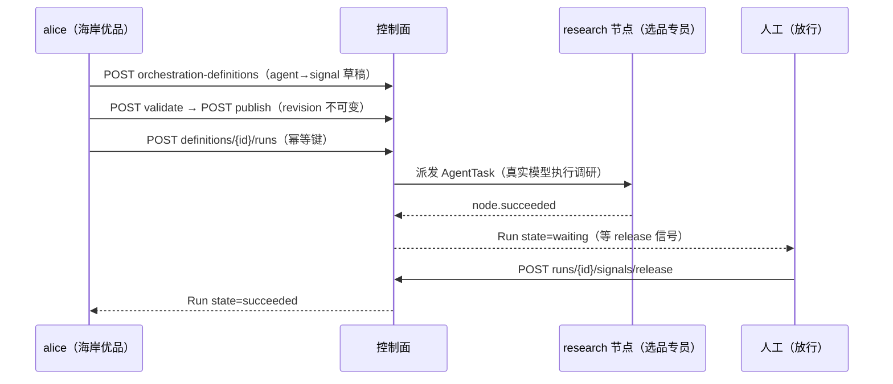

# Step 07 · Workflow 编排：选品上架流水线

> **本步导读**：Team 适合"边干边商量"的协作，而**固定流程**该用 Workflow：选品上架每月都要走一遍「市场调研 → 人工放行」。本步把这条流水线定义为不可变的发布版本，启动一次运行（Run），看着 Agent 节点真实执行市场调研、然后**停在人工放行门口**——直到运营显式放行才走完流程。



*图 7-1：选品流水线的定义-发布-运行-放行生命周期*

## 定义流水线：agent 节点 + signal 门

流程是**有向图**：`nodes`（节点）+ `edges`（连线）。research 是 agent 节点（绑定选品专员），release 是 signal 节点（等外部信号才放行）：

```bash
curl -sS -X POST "$BASE_URL/api/v1/orchestration-definitions" \
  -H "Authorization: Bearer $ALICE_TOKEN" -H 'Content-Type: application/json' \
  -d '{
    "tenant": "default", "namespace": "seashore-main",
    "name": "xbd-seashore-listing-pipeline",
    "description": "选品上架流水线：市场调研 -> 人工放行",
    "draftSpec": {
      "nodes": [
        { "key": "research", "type": "agent", "agentId": "'"$SCOUT_ID"'",
          "input": { "task": "\"调研欧美市场北欧风收纳盒的竞争格局与定价带，输出 200 字内的上架建议。\"" } },
        { "key": "release", "type": "signal", "signalName": "release" }
      ],
      "edges": [ { "from": "research", "to": "release" } ]
    }
  }' | jq '.definition.id'
```

> **注意（实测踩坑）**：节点 `input` 的值是 **CEL 表达式**而非自由文本——中文任务描述必须写成 CEL 字符串字面量（外层再包一层引号：`"\"调研欧美市场…\""`），否则服务端以 CEL 解析报出整段"Syntax error: token recognition error at: '调'"。这是教程 32 章"CEL 表达式映射输入"的实际形态：输入映射支持引用 Run 输入（如 `input.market`）做动态传参。

## 校验 → 发布：版本不可变

```bash
# 校验草稿
curl -sS -X POST "$BASE_URL/api/v1/orchestration-definitions/$DEF_ID/validate" \
  -H "Authorization: Bearer $ALICE_TOKEN" -H 'Content-Type: application/json' -d '{}' | jq '.valid'
# → true

# 发布（每次发布产生一个不可变 revision）
curl -sS -X POST "$BASE_URL/api/v1/orchestration-definitions/$DEF_ID/publish" \
  -H "Authorization: Bearer $ALICE_TOKEN" | jq '.revision.id'
# → "9f327d86-73df-4f61-af92-978e9357aa92"
```

demo 连跑两遍产生了两个 revision——**草稿可改、发布即冻结**，正在运行的 Run 永远引用它启动时的 revision。

## 启动 Run：幂等键的拒绝语义

```bash
curl -sS -X POST "$BASE_URL/api/v1/orchestration-definitions/$DEF_ID/runs" \
  -H "Authorization: Bearer $ALICE_TOKEN" -H 'Content-Type: application/json' \
  -d '{
    "idempotencyKey": "xbd-step-07-run-004",
    "issueId": "'"$RUN_ISSUE"'",
    "input": { "market": "US", "category": "storage-box" }
  }' | jq '.run | {id, mode, state}'
```

真实响应：

```json
{ "id": "a347990d-db5f-4ea1-9906-8fc24b475111", "mode": "declared", "state": "waiting" }
```

> **注意（实测）**：同一个 `idempotencyKey` 重复启动返回 **409 conflict**——键的语义是"防同一次启动被重复提交"，不是"幂等复用"。重跑演示应换新键（demo 脚本用 `xbd-step-07-run-001/002/…` 序号自增）。Run 挂在独立 Issue 上，Run 的完成不会自动完成 Issue（业务验收独立于执行完成——教程 34 章的"三条贯穿约束"在起作用）。

## 观察：Agent 节点真实执行

Run 启动后 research 节点被派发为 AgentTask，选品专员用真实模型执行调研。事件流是观察窗口：

```bash
curl -sS "$BASE_URL/api/v1/orchestration-runs/$RUN_ID/events" \
  -H "Authorization: Bearer $ALICE_TOKEN" | jq -c '[.events[] | (.type // .eventType)]'
```

实测完整序列：

```json
["run.started","agent-task.queued","attempt.queued","attempt.running","attempt.succeeded","node.succeeded","…（signal/完成事件）"]
```

`node.succeeded` 出现即 research 完成，Run 进入 `waiting`——**流水线停在人工放行门口**。

## 人工放行：signal

```bash
curl -sS -X POST "$BASE_URL/api/v1/orchestration-runs/$RUN_ID/signals/release" \
  -H "Authorization: Bearer $ALICE_TOKEN" -H 'Content-Type: application/json' \
  -d '{"idempotencyKey":"xbd-step-07-signal-004","payload":{"approved":true}}'
```

放行后 Run 走到 `succeeded` 终态。Run 图汇总执行轨迹（`GET .../graph`）：`{mode:"declared", tasks:1, attempts:1}`。

> **模型配置（实测）**：Agent 定义中 `definition.model` 支持 `<provider>:<model-name>` 前缀协议；demo 使用 `dashscope:deepseek-v4-flash-0731`（DashScope 免费额度模型）。注意不带前缀的裸名字只能解析 DashScope 扩展内置的已知模型清单；其他 provider（如 OpenAI 兼容端点）需要自定义 Dataplane 发行包——教程 30 章的提示在实测中得到验证。

## 脚本执行

```bash
bash steps/step-07-workflow-pipeline.sh
```

幂等语义：**定义复用、发布增量（新 revision）、Run 增量（新幂等键）**——与前两步的"治理资源复用、业务对象增量"一致。

## 本步小结

1. Workflow = 有向图（agent/signal/condition/join/approval/timer 等节点类型）；demo 用最小组合 agent+signal。
2. 草稿 → validate → publish（revision 不可变）→ runs：版本化是流程治理的根基。
3. `idempotencyKey` 重复提交是 409 拒绝；Run 完成不等于 Issue 完成。
4. 节点 `input` 是 CEL 表达式映射；事件流（run.started→…→node.succeeded）是执行观测窗口。
5. `signal` 节点把人工决策嵌入自动化流程——`waiting` 就是"等人"的机器可读状态。

**验收清单**

- ☐ 定义校验通过、发布产生 revision
- ☐ Run 启动后 research 真实执行（node.succeeded，模型调用可查）
- ☐ Run 停在 waiting，signals/release 放行后 succeeded
- ☐ Run 图与事件可回放
- ☐ 脚本连跑两遍：定义复用、revision/Run 增量

> **延伸阅读**：全部节点类型与 CEL 输入映射见教程第 32 章；Run 的运维接口（pause/resume/cancel/rerun）同章。下一步 → [Step 08 Endpoint 发布与对外调用](step-08-endpoint-publish.md)。
