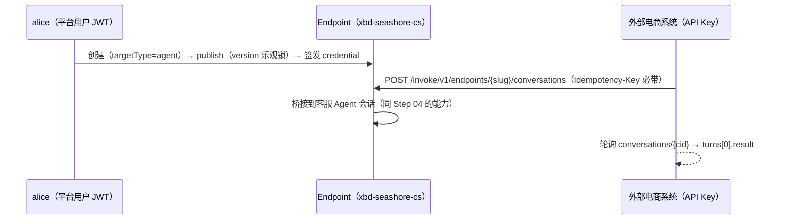

# Step 08 · Endpoint 发布与对外调用

> **本步导读**：平台闭环的最后一块拼图——把内部 Agent 变成**受治理的对外 API**。海岸优品的电商系统要接入客服 Agent，但不该拿着 alice 的平台 JWT 干这事：正确的姿势是发布一个 Endpoint（带 slug、输入 schema、认证策略），签发一把专属 API Key，让外部系统以自己的身份调用。对比 Step 04：同样的客服能力，两套调用面、两种身份。



*图 8-1：Endpoint 的治理面与调用面*

## 创建与发布：受治理的 API 门面

Endpoint 创建时显式绑定目标（targetType=agent）与输入契约（inputSchema 校验 `message` 字段），**slug 由调用方指定**（对外 URL 的稳定标识）：

```bash
curl -sS -X POST "$BASE_URL/api/v1/endpoints" \
  -H "Authorization: Bearer $ALICE_TOKEN" -H 'Content-Type: application/json' \
  -d '{
    "tenant": "default", "namespace": "seashore-main",
    "name": "xbd-seashore-cs-endpoint", "slug": "xbd-seashore-cs",
    "description": "海岸优品店铺客服对外 API",
    "targetType": "agent", "targetRef": "'"$CS_AGENT_ID"'",
    "invocationMode": "conversation",
    "inputSchema": { "type": "object",
      "properties": { "message": { "type": "string" } }, "required": ["message"] }
  }'
```

发布需要**当前 version**（乐观锁，防并发状态跃迁）；已发布的 Endpoint 再发一次会幂等返回现状：

```bash
curl -sS -X POST "$BASE_URL/api/v1/endpoints/$EP_ID/publish" \
  -H "Authorization: Bearer $ALICE_TOKEN" -H 'Content-Type: application/json' \
  -d '{"version": 1}' | jq '.endpoint | {slug, status}'
```

真实响应：

```json
{ "slug": "xbd-seashore-cs", "status": "published" }
```

## 签发凭据：明文只出现一次

```bash
curl -sS -X POST "$BASE_URL/api/v1/endpoints/$EP_ID/credentials" \
  -H "Authorization: Bearer $ALICE_TOKEN" -H 'Content-Type: application/json' \
  -d '{"name":"xbd-demo-key"}' | jq '.credential.name, (.secret | length)'
```

响应是 `{credential, secret}`——**`secret` 明文只在这一次响应里出现**（服务端只存哈希）。丢失只能 rotate 或新建，这是凭据管理的标准纪律。

## 外部调用：/invoke/v1

外部系统用 API Key（Bearer）调用，**不需要任何平台 JWT**：

```bash
curl -sS -X POST "$BASE_URL/invoke/v1/endpoints/xbd-seashore-cs/conversations" \
  -H "Authorization: Bearer $ENDPOINT_KEY" -H 'Content-Type: application/json' \
  -H "Idempotency-Key: xbd-step-08-conv-001" \
  -d '{"message":"你们的海绵收纳盒支持海外仓发货吗？发货到德国一般几天？"}'
```

真实响应（提交即返回）：

```json
{
  "conversationId": "d09c37ad-a698-4cae-8d96-70041bc9b2fd",
  "invocationId": "16455c1d-5dab-4a55-8d32-3a5f5b659efc",
  "status": "running",
  "sessionId": "sess_59ffbecbdf5f",
  "eventsUrl": "/invoke/v1/conversations/…/events?invocationId=…",
  "statusUrl": "/invoke/v1/conversations/…"
}
```

轮询会话详情拿结果——`turns[0].status=completed` 时 `result` 就是客服回复：

```bash
curl -sS "$BASE_URL/invoke/v1/conversations/$CID" -H "Authorization: Bearer $ENDPOINT_KEY" \
  | jq -r '.turns[0] | "\(.status): \(.result[0:60])…"'
```

真实输出：

```
completed: 您好，非常抱歉，我这边查询了相关资料，暂时没有找到关于海绵收纳盒海外仓发货和德国配送时效的具体信息，无法给您一个准确的答复，实在抱歉～🙏 …
```

客服 Agent 依然如实告知"查不到该商品信息"——**Endpoint 只是换了个门面，Agent 的人设与能力边界原样生效**。

> **注意（实测）**：`/invoke/v1` 的 `Idempotency-Key` 是**必填**（缺失 400），且语义为**幂等复用**——同键重复提交返回原 invocation（而非 409 或新会话）。这与 Workflow Run 的同键 409 拒绝（Step 07）形成对照：invoke 面向不可信重试的外部调用者，幂等复用是更安全的选择。

## 两种调用面的对比

| 维度 | Step 04：Chat API | 本步：Endpoint + /invoke/v1 |
| --- | --- | --- |
| 身份 | 平台用户 JWT | Endpoint API Key |
| 作用域声明 | tenant/namespace 通道 | slug 寻址，无需作用域 |
| 输入 | `{message}`（chat turns） | `{message}`（inputSchema 校验） |
| 幂等 | 无（业务层自管） | Idempotency-Key 必填、幂等复用 |
| 适用 | 平台内运营/调试 | 外部系统集成 |

## 脚本执行

```bash
bash steps/step-08-endpoint-publish.sh
```

脚本连跑两遍的输出变化：endpoint 复用（↺）、发布幂等返回、凭据"已存在"（明文不可再取）、invoke 复用既有结果——**全链路幂等**。

## 本步小结

1. Endpoint = 治理面（slug/schema/authPolicy/version 乐观锁）+ 调用面（/invoke/v1）的解耦。
2. 凭据明文只出现一次；slug 是对外稳定标识，由发布方指定。
3. `/invoke/v1` 的 Idempotency-Key 必填且幂等复用——外部集成的基本盘。
4. 对外调用不携带租户作用域头：Endpoint 本身就是租户边界的封装。

**验收清单**

- ☐ Endpoint 创建/发布成功（status=published，slug 可寻址）
- ☐ 凭据签发且明文已存本地 state
- ☐ 外部 API Key 调用 /invoke/v1 拿到真实客服回复
- ☐ 连跑两遍全幂等（第二遍零新增资源）

> **延伸阅读**：作业式调用（jobs 模式）与 Endpoint readiness/rollback 见教程第 33 章。下一步继续学习 [HITL 人工审批](step-09-hitl-approval.md) 与 [Automation 定时任务](step-10-automation.md)。
