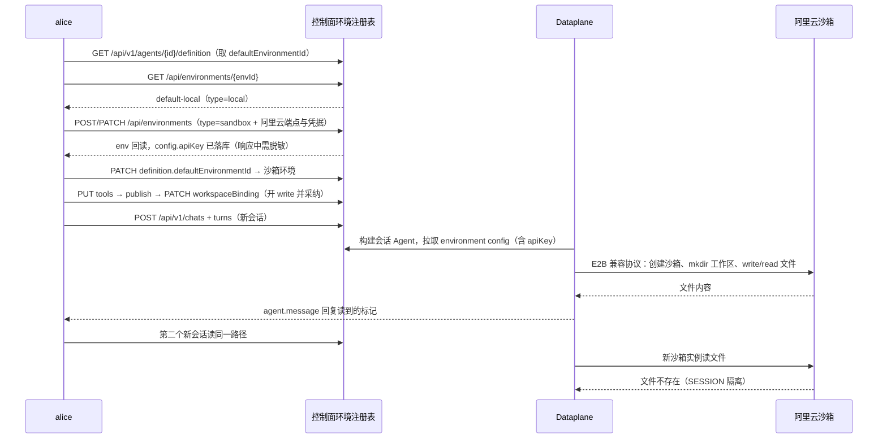

# Step 12 · 文件和命令究竟在哪里执行？

> 本步导读：主线创建 Agent 时自动关联了 `default-local`。这不代表已经启用了沙箱。本节从实际 Environment 反查执行位置，再通过控制面把一个 `type=sandbox` 环境直配为**阿里云沙箱（E2B 兼容 API）**，绑定独立实验 Agent，并用两个真实会话验收执行落点与 SESSION 隔离。前置：Step 11。先看下方调用链全景图。



*图 12-1：从环境反查到阿里云沙箱真实执行的完整调用链；凭据流转与两个"工作区根"的解释见正文第三、五步。*

## ⓪ 四种 Environment 怎么选？

| Service 类型 | 文件 / 命令执行方式 | 前提与用途 |
| --- | --- | --- |
| `local` | Dataplane 所在主机或容器上的本地文件系统 / Shell | 需部署允许 local；适合开发验证，不提供独立沙箱边界 |
| `sandbox` | 当前版本映射到 `E2bFilesystemSpec`（E2B 协议） | E2B 兼容端点、可达服务与正确模板；用于隔离执行。阿里云沙箱提供 E2B 兼容 API，直接复用该通道 |
| `remote` | 共享 KV 文件系统 | 服务需共享存储；没有本地 Shell 执行能力 |
| `self_hosted` | 外部 Environment Worker 领取工具任务 | 自建 Worker 在线，使用 Environment key 认证；隔离强度由 Worker 部署决定 |

SDK 第 18 章还提供 Docker、Kubernetes 等后端，但**SDK 支持某种沙箱，不表示 Service 的 `type` 字段也接受该值**。当前 Service 的 `sandbox` 是 E2B 协议；`type: docker` 会被拒绝。把 `image`、`cpus`、`network` 等 Docker 字段塞进沙箱 config，也不会产生预期的 Docker 配置。

## ① 第一步：核对当前默认环境

```bash
cd demo/cross-border-commerce
bash steps/step-12-sandbox.sh
```

默认只读：核对实验 Agent 当前环境、体检 `demo/.env` 的沙箱配置四项（缺项会逐条列出）、回读已登记的沙箱环境（凭据脱敏）。实测实验 Agent 当前环境的选取字段：

```json
{"id":"env_5c1ee6f847b3","name":"default-local","type":"local","ownerId":"namespace:default:seashore-main"}
```

文件写入发生在 Dataplane 的执行环境中，不会落到你运行 curl 的 Mac 当前目录。即使 Dataplane 本身运行在 Docker 内，也不等于每个商家的每次执行都有独立容器。

沙箱配置放在 `demo/.env`（已被 .gitignore 忽略），四项缺一不可：

| 变量 | 含义 | 示例 |
| --- | --- | --- |
| `SANDBOX_API_BASE_URL` | 沙箱控制 API 根地址 | `https://api.cn-shenzhen.sandbox.aliyuncs.com` |
| `SANDBOX_DOMAIN` | 沙箱内 envd 连接域 | `cn-shenzhen.sandbox.aliyuncs.com` |
| `SANDBOX_TEMPLATE_ID` | 沙箱模板（决定镜像与预装程序） | 阿里云控制台签发的模板 ID |
| `SANDBOX_API_KEY` | 沙箱 Key（`e2b_` 前缀） | 仅放本机 .env，不进 Git |

## ② 第二步：控制面初始化阿里云沙箱环境

```bash
bash steps/step-12-sandbox.sh --create
```

脚本先按名查 `xbd-seashore-e2b-lab`：不存在则 `POST /api/environments`，已存在则 `PATCH` 更新（config 是**全量替换**，始终以 .env 当前值整体覆盖）。提交：

```json
{
  "name": "xbd-seashore-e2b-lab",
  "type": "sandbox",
  "config": {
    "apiBaseUrl": "https://api.cn-shenzhen.sandbox.aliyuncs.com",
    "domain": "cn-shenzhen.sandbox.aliyuncs.com",
    "templateId": "kdzd…",
    "workspaceRoot": "/home/user",
    "sandboxTimeoutSeconds": 300,
    "isolationScope": "SESSION",
    "apiKey": "e2b_…"
  }
}
```

`POST /api/environments` 只是控制面登记；真实启动发生在数据面为新会话构建 Agent 时（见第五步）。**端点与凭据都写进 environment config 存入控制面数据库——这就是"通过控制面直接初始化"**：Dataplane 进程不需要配置任何沙箱变量，也不需要重启。

| 配置 | 含义 | 实测注意 |
| --- | --- | --- |
| `apiBaseUrl` / `domain` | 覆盖 E2B 客户端缺省的 `api.e2b.app` / `e2b.app`，指向阿里云沙箱 | `EnvironmentSpecFactory` 原生支持，无需改代码 |
| `templateId` | 沙箱模板，决定基础镜像和预装程序 | 用阿里云侧真实模板 ID；E2B 官方的 `base` 在阿里云不存在 |
| `workspaceRoot` | 沙箱内**数据根**：工作区准备（mkdir）、快照打包/恢复的目录 | 必须是模板里**已存在**的目录，实测用 `/home/user`；写成 `/workspace` 会因目录不存在导致 `WorkspaceStartException`（详见常见问题） |
| `sandboxTimeoutSeconds` | 沙箱存活超时 | 不等于模型超时或业务截止时间 |
| `isolationScope` | 会话间隔离粒度 | 源码把不识别的值回退为 SESSION，写错也会成功；显式用 `SESSION` 并按第五步验收 |
| `apiKey` | 沙箱 Key | `GET /api/environments` 会**原样回显** config，脚本展示时已脱敏；不要把含 Key 的响应贴进文档或日志 |

当前源码将不识别的 isolationScope 回退到 SESSION，所以写错后请求成功也不代表选择生效。课程建议显式使用 `SESSION`，再通过两个独立会话的文件读写检查隔离。

## ③ 第三步：理解凭据从哪里来

当前优先级是：Environment 的 `config.apiKey` → Dataplane `builder.e2b.api-key` / `BUILDER_E2B_API_KEY` → `E2B_API_KEY`。本教程走第一档：**凭据由控制面按环境下发**，数据面在为新会话构建 Agent 时拉取 environment config 并用它创建沙箱客户端——多租户平台上每个沙箱环境可以各配各的 Key，部署级 `BUILDER_E2B_API_KEY` 仅作为全体环境的缺省兜底。

两条路线的取舍：

| 路线 | 配置位置 | 生效方式 | 适用 |
| --- | --- | --- | --- |
| `config.apiKey`（本教程） | 控制面数据库，随环境走 | 保存即生效，下个新会话生效 | 多环境多凭据；不想动 Dataplane |
| `BUILDER_E2B_API_KEY` | Dataplane 进程环境 | 需重启 Dataplane | 全部署统一凭据；Key 不入库的场景 |

平台 JWT、模型网关 Key、Environment 创建响应顶层的 `apiKey`（Environment Worker 身份凭据）都与沙箱 Key 互不通用。

## ④ 第四步：只给实验 Agent 绑定环境

```bash
bash steps/step-12-sandbox.sh --bind
```

脚本读取实验 Agent 完整 definition，把 `defaultEnvironmentId` 改为沙箱环境后整体 PATCH（首次切换前把原环境存入 state，`--restore` 可回滚；重复执行幂等）。实测：

```
  + 默认环境 env_5c1ee6f847b3 → env_9eabd64e9e27（原环境已存 XBD_ENV_LAB_PREVIOUS）
  ✓ 默认环境已切换
```

保留完整 definition 与当前 version，不要只发 `defaultEnvironmentId`。旧 Session 不会自动迁移——**环境、模型、Workspace 版本的修改都只在新建会话构建 Agent 时生效**。本轮实测中把实验模型从额度耗尽的 `deepseek-v4-flash-0731` 换成 `qwen-flash` 后，复用旧 Chat 依然报旧模型的 403，直到用全新 Chat 才生效。

> **当前 API 差异**：`POST /api/v1/chats` 的请求结构没有 `environmentId` 字段。本 Demo 通过 Agent 默认环境配置后创建新 Chat，不能把旧教程 `/api/v1/agent-sessions` 的环境参数直接搬过来。

## ⑤ 第五步：真实执行验收

```bash
bash steps/step-12-sandbox.sh --run
```

`--run` 依次完成：给实验 Workspace 开启 read/write 工具（`PUT /api/workspaces/{id}/tools`，其它工具组原样保留）→ `publish` 出新版本 → PATCH `workspaceBinding` 让实验 Agent 采纳 → 创建**全新** Chat A 提交"写文件并读回"任务 → 创建全新 Chat B 读同一路径验证 SESSION 隔离。实测输出：

```
--- 3. Chat A 在沙箱内写入标记文件并读回
  + chat=df3186e4-…（每轮验收生成全新 Chat/Session）
  标记: XBD-SANDBOX-1791942204（文件 /workspace/xbd-sandbox-proof.txt）
  ✓ 沙箱真实执行：write 后 read 回读到本轮标记
--- 4. Chat B 新会话读同一路径（SESSION 隔离对照）
  + chat=9c037bde-…
  ✓ SESSION 隔离生效：Chat B 读不到 Chat A 刚写入的标记
  Chat B 回复（截断）: 文件 /workspace/xbd-sandbox-proof.txt 不存在，无法读取。
```

提示词里的路径前缀是 `/workspace` 而沙箱数据根是 `/home/user`，这不是笔误——上游当前版本有两个"工作区根"：

| 根 | 定义位置 | 实测取值 | 作用 |
| --- | --- | --- | --- |
| 工具视图根 | `WorkspaceSpec.root`（Service 未暴露配置，缺省） | `/workspace` | 模型可见的路径前缀：写/读路径必须以它开头，超出即被工具拒绝 |
| 数据根 | environment `config.workspaceRoot` | `/home/user` | 沙箱内真实目录：启动时 `mkdir -p` 与快照打包/恢复都指向它，必须已存在 |

上传实现把 `/workspace/xxx` 去掉前缀后落盘到数据根，读写自洽；模型按 `/workspace/...` 提路径即可正常工作。两根对齐属于上游待改进项，使用时记住"提示词写 `/workspace/...`，config 填已存在的 `/home/user`"。

验收表（本轮全部为实测结论，非配置假设）：

| 验收 | 操作与证据 | 本轮结果 |
| --- | --- | --- |
| 后端就绪 | 新 Chat 提交任务，数据面拉取沙箱 config 并创建云沙箱 | ✓ 无 `missing_e2b_api_key`，工具真实执行 |
| 文件落点 | 写入随机标记文件后 read 回读，回复包含本轮标记 | ✓ `XBD-SANDBOX-1791942204` 回读一致 |
| 会话隔离 | Chat B 新会话读同一路径 | ✓ 回复"文件不存在"，标记未泄漏 |
| 模板投影 | Workspace 发布的资料在沙箱内可读 | ✓ 采纳版本 2 后由 Agent 携带 |
| 生命周期 | 超时回收与再次执行时的持久化表现 | 留作手动观察（`sandboxTimeoutSeconds=300`） |

## 常见问题怎么定位？

| 现象 | 检查位置 |
| --- | --- |
| `missing_e2b_api_key` | environment config 是否带 `apiKey`；`BUILDER_E2B_API_KEY` 只在 Dataplane 进程配置才生效 |
| 沙箱已绑定但模型调用 403 `AllocationQuota.FreeTierOnly` | 这是**模型**额度耗尽（DashScope 免费额度），与沙箱无关；给实验 Agent 换模型或充值，且必须用全新 Chat 验证 |
| `WorkspaceStartException: Failed to start workspace at: …` | `config.workspaceRoot` 指向了模板里不存在的目录（如 `/workspace`）；改回 `/home/user` |
| 模型报"路径超出沙盒工作区范围，当前工作区根为 /workspace" | 提示词路径要以 `/workspace` 开头（工具视图根），不是 config.workspaceRoot |
| Environment 已创建但任务失败 | E2B 兼容端点可达性、模板 ID 是否为阿里云侧真实值、模型额度与工具开关 |
| `GET /api/environments` 响应里出现明文 Key | config.apiKey 会原样回显：展示用脚本（已脱敏），不要把原始响应贴进文档/日志 |
| 命令不存在 | 沙箱模板预装程序；修改提示词不会安装依赖 |
| 工具等待人工确认 | 工具 permissionPolicy 与审批状态；不是沙箱网络问题 |
| self_hosted 一直等待 | Worker 是否在线、Environment ID/key 是否匹配 |
| remote 不能执行 Shell | 后端本就不提供 Shell，需选择其它类型 |

## 本步小结

1. Workspace 定义"带什么材料"，Environment 定义"在哪里执行"；沙箱凭据可以完全由控制面按环境下发，Dataplane 零配置。
2. 阿里云沙箱是 E2B 兼容 API：`apiBaseUrl` / `domain` / `templateId` / `apiKey` 四项写入 environment config 即完成对接。
3. 两个"工作区根"各管一事：`/workspace` 是模型可见前缀，`/home/user` 是沙箱内数据根，别混用。
4. 配置变更（环境、模型、Workspace 版本）只对新建会话生效；验收必须用全新 Chat。
5. 资源保存、后端连通、实际工具执行和隔离验证是逐层验收——本轮已全部走到最后一层。

**验收清单**

- ☑ 当前默认 local 环境回读、阿里云沙箱配置登记与 PATCH 幂等复用。
- ☑ 控制面下发的 `config.apiKey` 在新会话真实生效（无 missing_e2b_api_key，沙箱创建成功）。
- ☑ 新会话工具执行、文件落点（标记回读一致）。
- ☑ 跨会话 SESSION 隔离（Chat B 读不到 Chat A 的标记）。
- ☐ 沙箱超时回收与快照恢复（留作手动观察）。

**继续阅读**：[第 18 章](../../../chapters/18-sandbox.md)、[第 29 章](../../../chapters/29-service-deploy.md)、[Step 13](step-13-model-channel.md)。

源码核对：`aistio/internal/product/handlers_env.go`（PATCH 全量替换 config）、`service-dataplane/.../managed/EnvironmentSpecFactory.java`（apiBaseUrl/domain/templateId/apiKey 优先级）、`agentscope-extensions-sandbox-e2b/.../E2bSandbox.java`（doSetupWorkspace 与快照根）、`agentscope-harness/.../sandbox/WorkspaceSpec.java`（工具视图根缺省 /workspace）。
