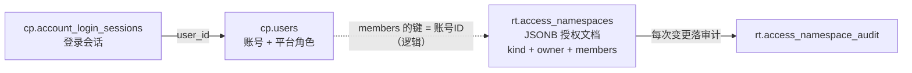
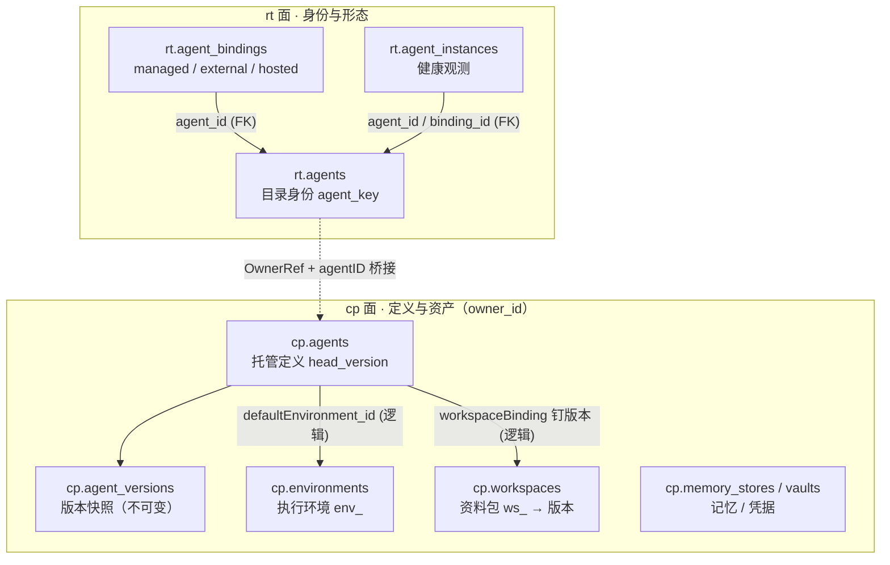
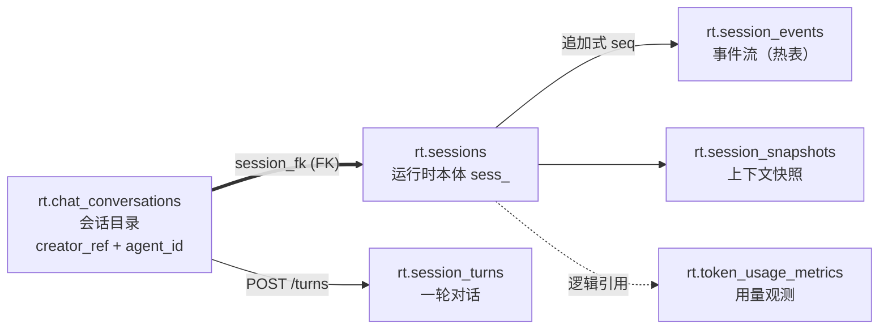
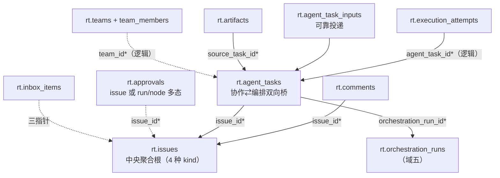
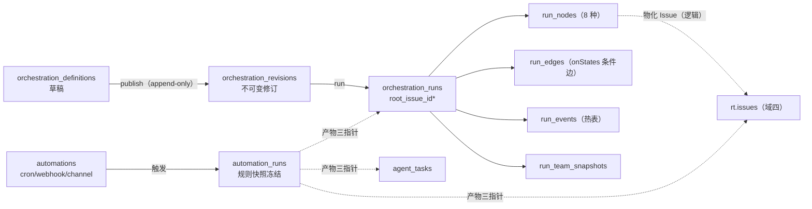
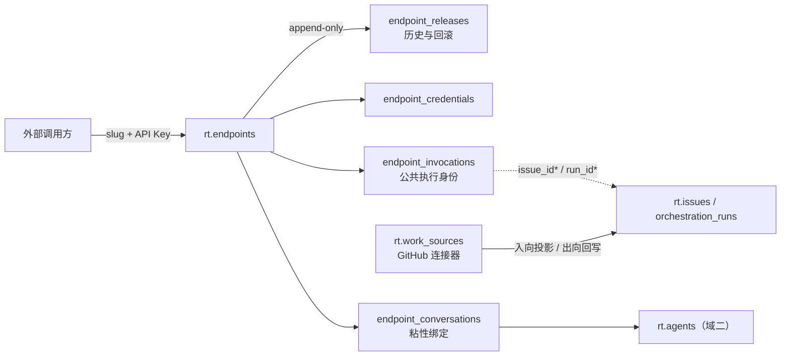

# AgentScope Service 数据库设计导览

> **这份文档回答**：AgentScope Service 的底层数据库分哪几块？每块支撑什么能力、怎么设计的、开发时怎么用？
>
> **读者**：第一次接触这套库的后端开发。读完你不需要背表名——你需要的是**遇到某个需求时知道该去哪个域找哪张表**。
>
> **数据基准**：agentscope-java **v2.0.4** 本地部署实测导出（PostgreSQL 17，118 张表），行数为一次真实 demo 运行后的快照，供判断表的性质（配置表 vs 事件热表）。

---

## 0. 30 秒版：这个库长什么样

**一套部署 = 一个 PostgreSQL 库 = 三个 schema = 七个业务域**。

| Schema | 名字 | 隔离键 | 谁在用 | 表数 |
| --- | --- | --- | --- | --- |
| `rt` | 运行时面（Runtime Store） | `tenant` + `namespace` | 控制面核心（Go）：目录、会话、协作、编排、端点 | 66 |
| `cp` | 产品面（Product Store） | `owner_id`（属主引用） | 产品 API（Go）：账号、环境、工作区、记忆、保险库、渠道 | 31 |
| `dp` | 数据面（Dataplane JPA） | 应用内逻辑键 | Java 数据面（service-dataplane）：Agent 构建状态、协调调度 | 21 |

七个业务域与能力/教程章节的对应：

| 业务域 | 支撑的能力 | 教程章节 | demo 步骤 | 表数 |
| --- | --- | --- | --- | --- |
| [① 租户与身份](#1-域一租户与身份谁在用平台) | 商家入驻、成员权限、账号 | 29 平台部署 | 01/02/05 | 5 |
| [② Agent 资产](#2-域二agent-资产配置了什么能力) | Agent 目录/绑定/定义、工作区、环境、记忆、保险库 | 29 Environment / 30 托管 Agent | 03/11/12 | 24 |
| [③ 会话与执行](#3-域三会话与执行一次对话怎么跑起来) | Chat、Session、事件流、执行尝试 | 31 Session API / 40 Chat | 04 | 11 |
| [④ 协作域](#4-域四协作人和-agent-一起干活) | 团队、工单、任务派发、审批、产物 | 32 编排协作 | 06/09 | 15 |
| [⑤ 编排与自动化](#5-域五编排与自动化流程化) | 工作流、cron/webhook 自动化 | 32 编排 | 07/10 | 10 |
| [⑥ 对外触达](#6-域六对外触达外部系统怎么进出) | Endpoint API 发布、消息渠道、外部同步 | 25 IM 渠道 | 08 | 13 |
| [⑦ 运行基础设施](#7-域七运行基础设施调度与消息底座) | 调度底座、outbox、分布式 KV/锁 | 33 运维 | — | 40 |

**怎么读后续章节**：每域五段式——**一句话定位 → 核心表速览表 → 实体关系图 → 设计要点 → 怎么用（能力触发路径）**。外围表在域内表格里一句话带过，不展开。

---

## 1. 全局设计决策（先懂这四条，所有表都好懂）

### 1.1 双面分离：`rt` 管运行授权，`cp` 管资产归属

这是理解全库最重要的一条。同一份"Agent 数据"拆在两个 schema：

| | rt 面（运行时） | cp 面（产品） |
| --- | --- | --- |
| Agent 的**身份** | `rt.agents`（tenant+namespace+agentKey，目录条目） | `cp.agents`（owner_id + definition 本体 + head_version） |
| 隔离语义 | "哪个商家空间里有什么" | "哪个属主名下有什么资产" |
| 桥接 | 控制面经 namespace 鉴权后，用 `(OwnerRef, agentID)` 到 cp 面取 definition | `OwnerRef` 在 shared 空间下是 `namespace:<tenant>:<name>` 字符串 |

**为什么这么拆**：授权边界（谁能看谁）和资产归属（东西是谁的）是两个正交问题。运行时面高频、按空间隔离；产品面低频、按属主隔离，还允许两库分实例部署（`--storage-dsn` / `--product-dsn` 分开配）。

### 1.2 逻辑引用模式：协作域和编排域没有外键，是故意的

实测全库 34 条外键，**全部集中在端点域、Agent 目录域、渠道域**。`issues`/`agent_tasks`/`orchestration_runs`/`automation_runs` 之间的引用（`issue_id`、`orchestration_run_id`、`root_issue_id`…）**没有数据库级外键**，由应用层维护。原因：

- 协作对象是**多态归属**（一条 Approval 可以挂在 Issue 或编排 Run/Node 上）；
- 引用目标是**逻辑键**（`creator_ref` 是账号字符串、`root_issue_id` 可空且可重指）；
- 协作域高频写（评论/任务），用乐观锁（`version` 列）代替外键开销。

**开发注意**：查这些关系不能依赖 JOIN 约束提示，要看应用层代码；删数据时引用完整性自己兜底。

### 1.3 身份三键速记

| 键 | 含义 | 出现位置 |
| --- | --- | --- |
| `tenant` | 部署级单值（本地恒为 `default`），全库无 tenants 表 | rt 面几乎所有表 |
| `namespace` | 商户租户单元（shared/personal/global 三种 kind） | rt 面几乎所有表 |
| `owner_id` | 属主引用：personal 空间=用户 ID；shared 空间=`namespace:<tenant>:<name>` | cp 面全部表 |

### 1.4 追加式事件 + 乐观锁 + Outbox

- 事件流（`session_events`、`orchestration_run_events`、`activity_log`）只追加不修改，带单调 `sequence`——支撑 SSE 续传与审计回放（这几张是库里最热的表）；
- 几乎所有聚合根带 `version` 列做乐观并发（PUT 带 version 不匹配即 409）；
- 跨域通知走 `rt.control_outbox`（至少一次投递，消费方按 `dedupe_key` 去重）。

---

## 2. 域一：租户与身份（谁在用平台）

**一句话**：回答"商户怎么入驻、成员怎么授权、账号是什么"。对应教程第 29 章与 demo 步骤 01/02/05。

| 表 | 职责 | 关键字段 | 行数量级 |
| --- | --- | --- | --- |
| `rt.access_namespaces` | **namespace 授权边界（核心）**：三种 kind、成员表、资源策略——整份授权状态是一个 JSONB 文档 | `(tenant,name)` PK、`kind`、`owner`、`payload` JSONB、`version` | 个位数 |
| `rt.access_namespace_audit` | namespace 每次变更的审计快照 | actor、整份 namespace 快照 | 随操作增长 |
| `cp.users` | 账号本体：登录名、bcrypt 密码、**平台角色**（user/admin/agent_developer/operator） | `user_id` PK、`roles_csv` | 个位数 |
| `cp.account_login_sessions` | 登录会话（JWT 吊销依据：accountVersion 机制） | expires_at、revoked_at | 登录数 |
| `cp.account_access_audit` | 账号管理操作审计 | user_id、action | 随操作增长 |

**设计要点**

1. **namespace 是文档不是关系表**：成员、用户组、资源策略全部内嵌在 `payload` JSONB 里，整读整写 + version 乐观锁。好处是授权判定一次读出、一致性天然；代价是不能 SQL 级查"某用户在哪些 namespace"（要扫 payload 或走应用索引）。
2. **两层角色**：JWT 里的**平台角色**（能开 namespace 的 admin）与 JSONB 里的**空间角色**（viewer/member/developer/operator/admin/auditor 六种）完全独立。同一个账号可在多家商户空间挂不同角色。
3. **personal / global 空间不开表**：personal namespace 惰性自动创建（`personal-<hash>`），global `default` 启动时创建并对所有登录用户自动授予三角色——都是 `access_namespaces` 里的普通行。

**怎么用**：商家入驻 = admin 向 `rt.access_namespaces` 插一条 kind=shared 的文档并指定 owner（demo 02 的 `POST /api/v1/namespaces`）；判断"用户 X 在空间 Y 能做什么" = 读 payload 按 `Roles()` / `NamespaceAllows` 矩阵判定（源码 `access.go`）。

---

## 3. 域二：Agent 资产（配置了什么能力）

**一句话**：回答"商户配了哪些 Agent、它们的人设/模型/工具/资料/执行地是什么"。这是**跨 rt/cp 两面**最大的域。对应教程 29/30 章与 demo 03/11/12。

### rt 面：目录身份与运行形态

| 表 | 职责 | 关键字段 | 行数量级 |
| --- | --- | --- | --- |
| `rt.agents` | Agent **目录身份**（稳定逻辑身份） | `agent_key`（不可变业务键，UNIQUE 三列）、`status` 五态、`owner_type/owner_ref` | 个位数 |
| `rt.agent_bindings` | **运行形态**：身份挂到哪种执行方式 | `kind`：managed / external-application / hosted-runtime、`configuration` JSONB 按 kind 判别 | 每Agent≥1 |
| `rt.agent_instances` | 运行实例观测（健康/容量/活跃会话，不写回 Agent 状态） | FK→agents+bindings、`health`、`active_sessions` | 动态 |
| `rt.agent_registration_credentials` | external 形态的注册凭据（只存 hash） | FK→agents | 每外部Agent |
| `rt.agent_runtime_policies` | Agent 的调度策略（候选绑定、并发、超时） | agent 引用、candidates JSONB | 可选 |
| `rt.runtime_hosts / runtime_pools / runtime_profiles` | hosted 形态三件套：自运营执行节点/资源池/模型 Provider 配置 | — | 进阶场景 |

### cp 面：定义本体与配套资产

| 表 | 职责 | 关键字段 | 行数量级 |
| --- | --- | --- | --- |
| `cp.agents` | **托管定义本体**（owner 维度）：system/model/tools/workspaceId/defaultEnvironmentId | `owner_id`、`agent_id`（rt 面的 UUID）、`head_version` | 每Agent 1 行 |
| `cp.agent_versions` | 定义版本快照（发布历史，不可变） | FK→cp.agents | 每次发布+1 |
| `cp.environments` | **执行环境注册表**：文件/命令在哪里执行 | `environment_id`（env_）、`type`：local/sandbox/remote/self_hosted、`config_json`（沙箱四件套+persistenceMode） | 每属主≥1 |
| `cp.workspaces / workspace_files / workspace_revisions` | 资料包与版本发布：草稿→publish→不可变 (version, digest) | workspace_id（ws_） | 每资料包 |
| `cp.memory_stores / memories / memory_versions` | 跨会话持久记忆 | owner 维度 | 按需 |
| `cp.vaults / vault_credentials` | 工具凭据保险库（secret 加密存储） | — | 按需 |
| `cp.files` | 通用文件存储元数据 | — | 按需 |
| `cp.deployments` | 产品面部署记录（定义→运行的发布轨迹） | environment_id | 随发布 |
| `cp.marketplaces / workspace_applications` | 模板市场与工作区应用（边缘） | — | — |

**设计要点**

1. **身份与定义分离**：`agentKey` 在 rt 面不可变、跨版本稳定（脚本幂等的匹配键）；定义（人设/模型/工具）在 cp 面带版本链。**升级定义 = cp 面加一个 version 快照，rt 面身份不动**。
2. **三种 binding 是三种商业形态**：managed（平台全托管，demo 主线）、external（外部自注册应用）、hosted（接你自己的 Coding Agent 节点）——对应教程 30 章"三种运行形态"。
3. **Environment 的默认环境是"按属主"自动开通的**：managed Agent 首次使用时按属主引用解析/创建 `default-local`（源码 `ensureDefaultLocalEnvironment`，advisory lock 防并发）。所以"同商家共享环境、跨商家隔离"是属主引用的推论。
4. **Workspace 消费的是发布版本**：Agent 定义里 `workspaceBinding{version, digest}` 钉住不可变版本，升级/回滚 = 改绑定（demo 11）。

**怎么用**：创建 Agent = rt 面 `POST /api/v1/agents`（catalog 身份）+ cp 面落定义版本；换执行沙箱 = PATCH definition 的 `defaultEnvironmentId`（demo 12）；升级资料 = workspace publish 新版本 → 改绑定。

---

## 4. 域三：会话与执行（一次对话怎么跑起来）

**一句话**：回答"客户的一个问题进来后，目录、运行时会话、事件流、执行尝试怎么协作"。对应教程 31 章与 demo 04。

| 表 | 职责 | 关键字段 | 行数量级 |
| --- | --- | --- | --- |
| `rt.chat_conversations` | **会话目录**（用户视角）：引用而不复制运行时会话 | `creator_ref`、`agent_id`、`session_fk` **外键→rt.sessions**、`runtime_session_id`(sess_) | 每次咨询 |
| `rt.sessions` | **运行时会话本体**：消息与状态的家 | `phase`（独立于 Chat 状态）、agent_name | 每次咨询 |
| `rt.session_events` | 事件流（**热表**）：追加式、带单调 seq，支撑 SSE 续传与回放 | session 引用、`seq`、event_type、tokens | **千级/天** |
| `rt.session_turns` | 一轮对话的记录（Chat API 的 Turn） | session 引用 | 每轮+1 |
| `rt.session_commands` | 会话级指令记录 | — | 低 |
| `rt.session_snapshots / rt.context_snapshots` | **会话上下文**快照（压缩/续传语义，与沙箱快照无关） | message_count、context_pressure | 按需 |
| `rt.token_usage_metrics / rt.agent_metrics` | Token 用量与 Agent 指标（观测，不做计费） | namespace 维度聚合 | 按天 |
| `rt.session_transcript_index` | 会话转录索引 | — | — |
| `cp.sessions` | 产品面会话记录（带 environment_id，属主维度） | environment_id NOT NULL | 与 rt 一一对应 |
| `dp.builder_session / builder_session_event` | 数据面的构建期会话与事件（**热表**） | — | 千级 |

**设计要点**

1. **Chat ≠ Session**：Chat 是目录条目（可归档、置顶、按 creator 过滤），Session 是运行时本体（消息/事件/上下文）。`chat_conversations.session_fk` 是全库少有的跨聚合真外键——**引用不复制**：数据面重启/换主机，Chat 依然在，Session 相位独立。
2. **"Agent 公共、会话私有"**：global 公共区的 Chat 按 `creator_ref` 过滤——共享的是 Agent 能力，不是对话记录（demo 03 实测）。
3. **配置变更只影响新会话**：环境/模型/Workspace 版本的修改，在新建 Chat 构建 Agent 时才生效——旧 Session 不会迁移（demo 12 实测踩过）。

**怎么用**：`POST /api/v1/chats`（自动桥接 Session）→ `POST /chats/{id}/turns` → SSE 订阅 `session_events` → 轮询终态。排障先看 `session_events` 的 seq 连续性与 event_type。

---

## 5. 域四：协作（人和 Agent 一起干活）

**一句话**：回答"多 Agent 团队怎么接工单、人怎么审批、产物放哪"。对应教程 32 章与 demo 06/09。

| 表 | 职责 | 关键字段 | 行数量级 |
| --- | --- | --- | --- |
| `rt.issues` | **中央聚合根**：一个工作项 | `kind` 四种（user_work/endpoint_job/automation_job/conversation_turn）、`parent_issue_id` 父子树、`identifier`（GH-12） | 每工作项 |
| `rt.comments / comment_mentions / comment_routes` | 评论流 + @提及 + **路由审计**（评论如何变成任务） | issue 引用、route outcome | 每工作项 |
| `rt.issue_subscribers` | 工单订阅者 | — | — |
| `rt.agent_tasks` | **协作⇄编排双向桥**：Agent 执行派发 | `issue_id*` + `orchestration_run_id*` + `run_node_id*`、`agent_id*`、委派/重试谱系、`hop_count` 深度防护 | 每任务 |
| `rt.agent_task_inputs` | 评论输入的可靠投递（outbox 语义，dead_letter 兜底） | task+comment、投递状态机 | 每输入 |
| `rt.execution_attempts` | **一次物理执行尝试**（九态状态机 + lease/fencing 防脑裂） | agent_task 引用、冻结的调度快照 | 每尝试 |
| `rt.teams / team_members` | 多 Agent 团队（leader + 成员 + TeamPolicy 护栏） | leader 引用、政策 JSONB | 每团队 |
| `rt.team_proposals` | LLM 组队提案（成员带 score+reasons） | issue 引用、FK→issues | 按需 |
| `rt.approvals` | 人工审批（HITL 否决点） | 多态归属：issue_id* 或 run/node_id* | 每审批 |
| `rt.artifacts / artifact_links` | 产出物元数据（实体在外部存储）+ 多对多挂接 | source_task*、storage_key | 按需 |
| `rt.inbox_items` | 人/Agent 的收件箱（needsAction 待办） | issue/comment/approval 三指针 | 随通知 |
| `rt.activity_log` | Issue 级审计流 | — | 随操作 |

**设计要点**

1. **四种 kind 的 Issue 复用同一张表**：人的工作（user_work）、端点任务（endpoint_job）、自动化任务（automation_job）、会话轮次（conversation_turn）都是 Issue——Team/Endpoint/Automation 的执行**刻意复用协作面**，后三种 `visibility=operational` 不进 Work Hub 列表。
2. **AgentTask 是全库枢纽**：同时持有 `issue_id + orchestration_run_id + run_node_id`，把"工单上的活"落到"编排图上的节点"。`hop_count/team_depth` 防委派死循环。
3. **没有外键是刻意的**（全局决策 1.2）：上图的虚线（*号引用）全部由应用层维护，配 version 乐观锁。

**怎么用**：demo 06 的链路 = 建 Team → 建 Issue → 评论 @团队 → CommentRoute 生成 AgentTask → ExecutionAttempt 调度执行 → 结果回写 Comment；demo 09 = 工具调用触发 Approval → Inbox 待办 → 人决批。

---

## 6. 域五：编排与自动化（流程化）

**一句话**：回答"多步工作流怎么定义/发布/运行，定时任务怎么触发"。对应教程 32 章与 demo 07/10。

| 表 | 职责 | 关键字段 | 行数量级 |
| --- | --- | --- | --- |
| `rt.orchestration_definitions` | 工作流定义（**可变草稿**） | draft_spec、draft_version | 每流程 |
| `rt.orchestration_revisions` | 发布的**不可变修订**（checksum） | FK→definitions、revision 单调递增 | 每次发布 |
| `rt.orchestration_runs` | 一次编排执行（九态，含 partial_succeeded） | `root_issue_id*`、`definition_revision_id*`、parent_run（subrun）、rerun_of | 每次运行 |
| `rt.orchestration_run_nodes` | 运行图节点（8 种类型：agent/team/approval/condition/join/timer/signal/subrun） | run 引用、`issue_id*`（agent/team 节点物化 Issue） | 每节点 |
| `rt.orchestration_run_edges` | 运行图边（`on_states` 条件边） | run 引用 | 每边 |
| `rt.orchestration_run_events` | 运行事件日志（**热表**，回放/诊断） | run 引用、seq | **百级/运行** |
| `rt.orchestration_run_team_snapshots` | 团队配置冻结快照（保证历史运行可复现） | run 引用 | 每团队节点 |
| `rt.automations` | 自动化规则（**宿主**：Trigger + Execution） | trigger_type: cron/webhook/channel、action_type 四种 | 每规则 |
| `rt.automation_runs` | 一次触发执行（内嵌**规则快照**，运行中改规则不影响在跑的） | automation 引用、产物三指针：issue*/task*/run* | 每触发 |
| `rt.automation_deliveries` | 投递幂等审计 + 重放谱系 | idempotency_key | 每投递 |

**设计要点**

1. **三层模型 = 可编辑、可复现、可审计**：草稿随便改；发布产生不可变 Revision（Endpoint 可以把 Revision 作为发布目标钉死）；运行时引用 Revision，历史运行永远可解释。
2. **运行图是实例不是模板**：RunNode/RunEdge 在运行时生成（声明式节点 + 动态节点混合），agent/team 节点物化出 Issue 并派 AgentTask——**编排域的执行产物又回到协作域**（域四的双向桥）。
3. **自动化是"规则 + 快照"**：AutomationRun 冻结触发时的规则快照；`idempotency_key` 防重复触发（demo 10 实测重复 409）。

**怎么用**：demo 07 = 定义→发布→运行→signal 放行（幂等键 409 验证）；demo 10 = cron 规则 → 测试工单 → 异步终态。

---

## 7. 域六：对外触达（外部系统怎么进出）

**一句话**：回答"外部系统怎么调平台能力（Endpoint）、消息渠道怎么接（Channels）、外部工单系统怎么同步（WorkSources）"。对应 demo 08 与教程 25 章。

| 表 | 职责 | 关键字段 | 行数量级 |
| --- | --- | --- | --- |
| `rt.endpoints` | **对外 API 契约**：slug 即公共地址 | `slug`、`target_type`（agent/team/**orchestration_revision**）、active_release | 每发布 |
| `rt.endpoint_releases` | 发布记录（append-only，回滚=追加旧目标） | FK→endpoints、number | 每次发布 |
| `rt.endpoint_credentials` | API Key（`asep_` 前缀，AES-GCM 加密，轮换链） | FK→endpoints、rotated_from | 每Key |
| `rt.endpoint_invocations` | **公共执行身份**（防内部 ID 泄漏）：映射到 issue/run/conversation | FK→endpoints、issue_id*、run_id* | 每调用 |
| `rt.endpoint_conversations` | 粘性会话绑定（钉 Agent+Binding+Instance） | 4 个 FK 全集 | 每会话 |
| `rt.endpoint_rate_windows` | 限流窗口 | endpoint 引用 | 动态 |
| `cp.channels + channel_* (6 张)` | 消息渠道（接入 IM）与配对/投递记录 | FK→channels/users | 每渠道 |
| `rt.work_sources + 4 张 Ref 表` | 外部工作项系统连接器（GitHub）：入向投影/出向回写/webhook 去重 | FK→issues/comments | 每外部源 |

**设计要点**

1. **Endpoint 是契约层**：slug 稳定，后端目标（Agent/Team/编排 Revision）通过 Release 切换——"发布"即追加一条 release，回滚同法。
2. **Invocation 是身份隔离墙**：外部 Job ID 永远是 invocation id，内部 Issue/Run/Session ID 不外泄——防枚举、防越权探测。
3. **WorkSource 是双向同步不是单向导入**：外部 Issue 进来投影成本地 Issue（`issue_external_refs`），本地评论可回写（`comment_external_refs` 带 sync_state），webhook 幂等去重。

**怎么用**：demo 08 = 发布 Endpoint（slug+Key）→ 外部 curl 调用（Idempotency-Key 幂等复用）→ Invocation 映射到内部 Issue/Run。

---

## 8. 域七：运行基础设施（调度与消息底座）

**一句话**：一般开发**不用管**，排障和进阶才看。40 张表里的大多数是底座。

| 分组 | 表 | 干什么 |
| --- | --- | --- |
| 数据面注册 | `rt.data_planes` | 数据面节点注册与健康 |
| 控制面托管存储 | `rt.dp_kv / dp_locks / dp_snapshots / dp_bus_entries / dp_async_tools / dp_tasks` | hosted 部署下控制面托管的 KV/分布式锁/快照/消息总线/异步工具/任务（沙箱快照若选"控制面托管"就落在 `dp_snapshots`，inline ≤32MiB） |
| 消息外送 | `rt.control_outbox`（**热表**） | 至少一次事件投递，dead-letter 可重放 |
| 自托管执行 | `rt.runtime_hosts / runtime_pools / runtime_profiles` | 自己的 Coding Agent 节点接入（教程 29 章进阶） |
| 数据面 JPA（dp schema） | `dp.builder_agent_state`（沙箱状态，含 E2B snapshotIds）、`dp.builder_coord_*`（HITL/租约/工作分配）、`dp.builder_user / builder_agent / builder_session / builder_memory / builder_vault / builder_environment / builder_deployment / builder_resource_share / agentscope_store` | Java 数据面自有存储：Agent 构建期状态与协调调度。**与 cp 面同名表是"两面各自记录"，不是冗余**（如 builder_vault 是数据面视角的保险库缓存） |
| 版本管理 | `rt.schema_migrations`（107 行） | Flyway 式迁移账本：**库结构演进的历史就是这张表** |
| 元数据杂项 | `rt.agent_metrics / rt.token_usage_metrics`（观测）、`cp.marketplaces / cp.oauth_provider_apps / cp.mcp_oauth_*`（MCP/OAuth 连接）、`dp.builder_user_marketplace` | 按需了解 |

> **排障入口速记**：任务卡住看 `execution_attempts` 状态与 lease；事件断流看 `session_events` 的 seq；通知丢失看 `control_outbox` 的 dead-letter；沙箱快照恢复看 `dp.builder_agent_state` 的 `state_data`。

---

## 9. 附录

### 9.1 能力 → 域 → 表 速查（遇到需求先查这里）

| 我要…… | 去哪个域 | 核心表 |
| --- | --- | --- |
| 入驻一家商户 / 调整成员权限 | ① | `rt.access_namespaces` |
| 创建/禁用一个 Agent，换它的人设和模型 | ② | `rt.agents` + `cp.agents/agent_versions` |
| 给 Agent 换执行沙箱 / 换资料包版本 | ② | `cp.environments` / `cp.workspaces` + cp.agents 绑定列 |
| 查一次客户咨询的完整事件轨迹 | ③ | `rt.chat_conversations` → `rt.sessions` → `rt.session_events` |
| 看某 Agent 任务为什么失败/重试 | ④ | `rt.agent_tasks` → `rt.execution_attempts` |
| 给流程加一个人工审批点 | ④ | `rt.approvals` + `rt.inbox_items` |
| 发布一个对外 API 给 ERP 调用 | ⑥ | `rt.endpoints` + `endpoint_releases/credentials` |
| 接 GitHub 工单自动进平台 | ⑥ | `rt.work_sources` 系 |
| 定时跑一个巡检流程 | ⑤ | `rt.automations` → `automation_runs` |
| 排查通知丢失 / 消息重复 | ⑦ | `rt.control_outbox` |

### 9.2 与教程/demo 的对照

| 学习路径 | 章节/步骤 | 触碰的域 |
| --- | --- | --- |
| 平台部署与账号 | 教程 29 章 / demo 01-02 | ① |
| 配 Agent、换沙箱、发资料 | 教程 30 章 / demo 03/11/12 | ② |
| 跑通一次会话 | 教程 31 章 / demo 04 | ③ |
| 团队协作与审批 | 教程 32 章 / demo 06/09 | ④ |
| 工作流与定时任务 | 教程 32 章 / demo 07/10 | ⑤ |
| 对外发布 | demo 08 | ⑥ |
| 运维与排障 | 教程 33 章 / demo 05 | ③④⑦ |

### 9.3 配套资料与再生成方式

- 领域结构体源码：`agentscope-service/aistio/internal/controlplane/model/*.go`；建表迁移：`internal/store/postgres/migrations/`（rt 面）与 `internal/product/migrate.go`（cp 面）
- **全量交互式 ER 图可随时再生成**：从库导出 DBML（列/PK/外键见 `information_schema` 与 `pg_constraint`）粘贴到 dbdiagram.io，免费档即可承载 118 表；表名与列名以本文档各域速览表为准
- **每表细节文档站可随时再生成**：`java -jar schemaspy-app.jar -t pgsql -host 127.0.0.1 -port <端口> -db builder -u builder -p builder -schemas rt -o <输出目录>`（需 graphviz + PostgreSQL JDBC 驱动）

---

> **维护说明**：基于 v2.0.4 实测（118 表）。表清单与行数随部署演进变化，但域划分与设计决策稳定；升级版本后按 §0 对照表复核。发现文档与实际不符时，以 `rt.schema_migrations` 的最新迁移为准。
