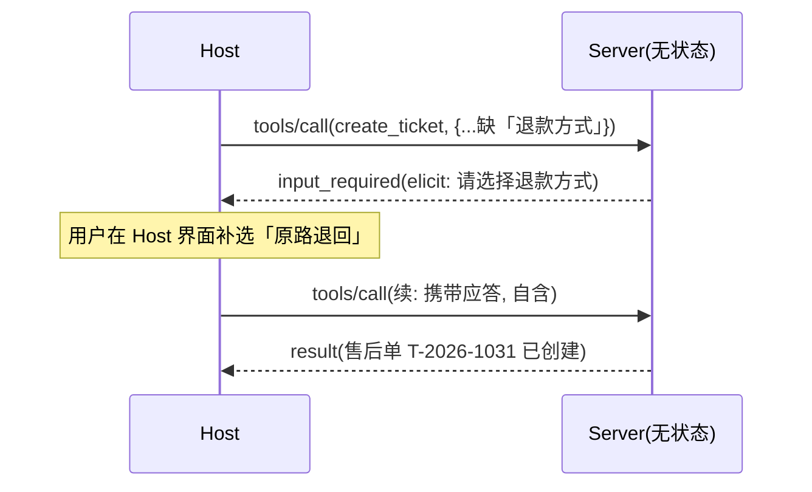

# 第 2 章 协议核心概念

> **初稿状态(2026-10-24)**:无状态模型、MRTR、header 路由依据 2026-07-28 官方发布文与生态解读,并以 TypeScript SDK v2.4.0 实测交叉印证;发布前对照 spec 原文逐节复核(见章末清单)。

读完本章你能回答四个问题:一次 MCP 调用里有哪些角色?为什么 2026-07-28 之后"没有会话了"反而更好部署?一个业务能力到底该建模成 tool、resource 还是 prompt?工具执行到一半要用户补输入,无状态协议怎么处理?

## 2.1 角色模型:Host、Client、Server

```
┌─────────────────────────────────────────────┐
│ Host(宿主应用)                              │
│  agentscope-java Agent / CopilotKit / CLI   │
│  ┌──────────────┐      ┌──────────────┐     │
│  │ MCP Client   │      │ MCP Client   │     │
│  └──────┬───────┘      └──────┬───────┘     │
└─────────┼─────────────────────┼─────────────┘
          │ JSON-RPC            │
   ┌──────▼───────┐      ┌──────▼───────┐
   │ MCP Server   │      │ MCP Server   │
   │ 售后域        │      │ 物流域        │
   └──────────────┘      └──────────────┘
```

- **Server**:能力的提供方。把一组业务能力(我们的售后域工具)以协议描述的形式暴露出去。无状态——收到自含请求、返回自含响应,不记得"上一次是谁调了什么"。
- **Client**:连接的维护方,活在 Host 进程内。负责传输、协议版本声明、把 Server 的能力清单转交给 Host。
- **Host**:用户直接面对的应用(agentscope-java 的 Agent、CopilotKit 前端、AI CLI)。它决定**挂哪些 Server、把哪些工具放进模型上下文、模型选择工具后怎么执行**。

职责分界一句话:**Server 管"能力是什么",Host 管"模型能看到什么"**。第 6 章规模化里最关键的"工具目录治理",治理的就是 Host 侧的可见性。

## 2.2 无状态核心:每个请求都是自含的

2026-07-28 最重要的变化:**协议级会话被整体移除**。v1 时代先 initialize 握手、建会话、后续消息挂会话 ID 的模式没有了;每个请求是一个自含的 JSON-RPC 消息,服务端处理完即忘。

这改变的不只是协议细节,是部署形态:

| | v1(≤2025-11-25) | 2026-07-28 |
| --- | --- | --- |
| 建连 | initialize 握手 + 会话 | 无握手,直接发业务请求 |
| 粘性路由 | 需要会话亲和 | 不需要,任意副本可接 |
| 水平扩缩容 | 会话迁移/粘滞成本 | **天然可扩缩**——每个 POST 自含 |
| 缓存 | 难(会话态) | 可缓存(自含请求) |
| 交互性(要用户补输入怎么办) | 会话内 server-to-client 请求 | **MRTR**(见 2.4) |

> 旧版 client 怎么办?SDK 的答案是在入口做**legacy 分类**——我们在 TS SDK v2.4.0 实测:同一 Server,2025-06-18 的 `initialize` 会被识别并以旧语义服务(默认 `legacy: 'serve'`),新式无握手 `tools/list` 走现代路由。兼容机制详见第 3 章。

## 2.3 三类能力建模:tool、resource、prompt 的边界

这是新手最容易混淆的一节,给一张决策表:

| 你要暴露的东西 | 建模为 | 判断依据 |
| --- | --- | --- |
| 模型要**执行**的动作(创建售后单、查询进度、发货) | **tool** | 有副作用或计算,由模型自主选择调用,输入经 schema 校验 |
| 模型要**读取**的数据(商品知识库文档、配置、日志文件) | **resource** | 只读,由应用/用户控制读取时机,URI 标识 |
| 复用的**提示模板**(「售后话术生成」「周报整理」) | **prompt** | 用户显式触发(斜杠命令/菜单选择),不是模型自主选 |

三条经验法则:

1. **动词归 tool,名词归 resource**。「查物流」是 tool(有查询动作、参数化),「物流知识手册」是 resource(只读内容)。
2. **模型选的是 tool,人选的是 prompt**。工具选择权在模型(prompt 描述质量决定选得准不准,第 5 章);prompt 由用户从菜单里点。
3. **拿不准时问:这件事有失败和重试吗?** 有 → tool(错误处理、幂等性是 tool 的工程主题);纯内容供给 → resource。

反例:把「获取用户资料」建模成 tool 让模型自己调——除非模型真的需要**自主决定何时查**(比如客服 Agent 中途查单),否则它只是数据供给,resource 或直接注入上下文更便宜(省一次工具调用往返)。

## 2.4 多轮请求(MRTR):无状态世界的交互性

没有会话了,工具执行到一半需要用户补充输入(确认操作、缺一个必填字段)怎么办?2026-07-28 的答案:**Multi Round-Trip Requests**——Server 返回一个特殊的 `input_required` 结果,内嵌它需要的请求(elicit 表单、确认、向 Host 模型发问等);Host 完成后,以**新的自含请求**携带应答回来继续。交互性保留,状态外置到 client 侧。



要点:**每一跳都是独立请求**,Server 侧不留"半成品会话"——续接靠 client 带回上下文,不靠 server 记忆。TS SDK 里工具处理器返回 `inputRequired`(带 `elicit` / `createMessage` / `listRoots` 等内嵌请求构造器)即对应此机制。

> 与 v1 的 elicitation 对比、以及 Tasks(长任务)为何移为扩展,第 3 章版本演进里讲。

## 2.5 消息结构:仍然是 JSON-RPC

传输层之上,消息就是 JSON-RPC 2.0:请求带 `method` + `params` + `id`,响应带 `result` 或 `error`。核心方法集合很小:

- `tools/list` / `tools/call`(本章主角)
- `resources/list` / `resources/read` / `resources/subscribe`
- `prompts/list` / `prompts/get`
- 分页游标、进度通知、取消等横切机制

v2.4.0 实测的 `tools/list` 响应形态(节选):

```json
{"result":{"tools":[{"name":"echo","title":"回声",
  "description":"原样返回输入文本,用于验证链路",
  "inputSchema":{"type":"object","$schema":"https://json-schema.org/draft/2020-12/schema",
    "properties":{"text":{"type":"string","description":"要回显的文本"}},"required":["text"]}}]},
 "jsonrpc":"2.0","id":1}
```

`inputSchema` 是标准 JSON Schema(2020-12)——这就是第 5 章"描述质量工程"的落点:模型看到的工具,就是这段 JSON。

## 2.6 header 路由:HTTP 世界的寻址方式

2026-07-28 配套引入基于 header 的路由:一个 HTTP 端点可以按请求头把流量分派到不同 Server 实例/域,配合无状态语义,让"一个网关域名后面挂多个域 Server"成为协议原生的部署形态(第 6 章 Gateway、第 8 章部署展开)。SDK 层面对应 per-request 无状态传输与请求级校验入口(如 TS SDK 的 `Mcp-Param-*` 预校验)。

## 2.7 小结

- 角色:Server 管能力、Host 管可见性、Client 管连接——治理发生在 Host 侧
- 无状态:自含请求、无握手、可任意扩缩;兼容旧 client 是入口分类问题(第 3 章)
- 建模:动词归 tool、名词归 resource、人选的归 prompt
- 交互性:MRTR 用 `input_required` + 自含续接替代会话
- 消息:JSON-RPC 2.0,工具即 JSON Schema 描述

→ **第 3 章**把五个版本串起来讲清"我们怎么走到无状态",以及存量 Server 的迁移路径。

## 复核清单(发布前)

- [ ] 角色定义逐句对照 2026-07-28 spec architecture 原文
- [ ] MRTR 的 `input_required` 字段名与结构对照 spec / SDK 文档
- [ ] 2.3 决策表与 spec 对 tools/resources/prompts 的定义无出入
- [ ] `Mcp-Param-*` 预校验的 SEP 编号(SEP-2243)与官方索引核对
