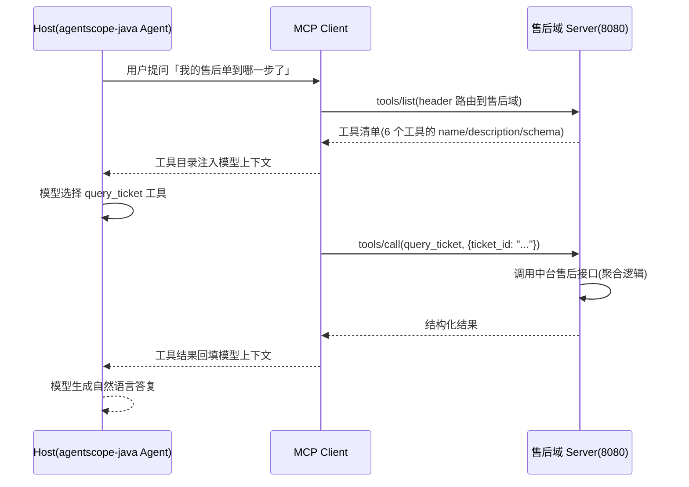

# 第 4 章 快速上手

> **初稿状态(2026-10-24)**:结构与事实性表述基于已查证的 SDK 版本现状;**全部代码为结构示意,未经实测**——发布前须按本章末「实测清单」逐项跑通校正。涉及 API 细节处以 ⚠️ 标注。

中台团队的真实处境:每个 Agent 项目都要把订单、物流、商品接口重新封装一遍——agentscope 项目封装一次,前端 CopilotKit 再封装一次,新起的 CLI 工具流又来一次。本章目标:20 分钟内,你把第一个 MCP Server 跑起来,让这个"封装一次、处处调用"的假设落地为可运行的事实,并初始化贯穿全书的案例——**中台售后域 Server**。

## 4.1 环境准备与 SDK 选型

2026-07-28 是一次断裂式升级:**v1 时代的 SDK 不会支持它**(官方明确 v1.x 不做 2026-07-28 支持),所以选型的第一原则是认准大版本:

| SDK | 2026-07-28 支持 | 关键事实(2026-10 查证) | 适用读者 |
| --- | --- | --- | --- |
| TypeScript `@modelcontextprotocol/*` | **v2.x 起**(当前 ~2.3.1) | v2 拆分为独立包(client/server),新增 stateless transport | 生态最大,前端同构场景 |
| Java `io.modelcontextprotocol.sdk:mcp-core` | **2.0.x 起**(当前 2.0.1,2026-10-17 发布) | 新 Server 在 `io.modelcontextprotocol.modern` 包,与 legacy `McpSchema` 并存;通过全部 37 个 2026-07-28 一致性场景 | **agentscope-java 读者主线** |
| Python `modelcontextprotocol` | ⚠️ 待核对 | 动笔实测时以官方 SDK 列表页为准 | 数据侧脚本 |

> ⚠️ 各 SDK 的"分层支持"官方口径见 [SDK 列表页](https://modelcontextprotocol.io/docs/2026-07-28/sdk)——它按 completeness / protocol support / maintenance 给每个 SDK 分级,选型前先看这一页。

**本书主线**:Java(贯穿案例的 Server 用 Java 写,与 agentscope-java 读者群一致),TypeScript 作为对照。

## 4.2 最小 MCP Server

### Java(mcp-core 2.0.x,`io.modelcontextprotocol.modern` 包)

```java
// ⚠️ 结构示意:方法签名以 mcp-core 2.0.x javadoc 实测为准
// build.gradle: implementation("io.modelcontextprotocol.sdk:mcp-core:2.0.1")
var server = McpServer.toolServer()                       // modern 包的 Server 构建入口(示意)
    .tool("echo", "原样返回输入文本,用于验证链路", (args) -> {
        return Map.of("text", args.get("text"));
    })
    .inputSchema("echo", """
        {"type":"object","properties":{"text":{"type":"string"}},"required":["text"]}
        """)
    .build();

server.startStreamableHttp(8080);                          // ⚠️ 2026-07-28 header 路由下的服务化入口(示意)
```

### TypeScript(v2.x 分包)

```typescript
// ⚠️ 结构示意:以 ts.sdk.modelcontextprotocol.io 的 v2 文档实测为准
// npm i @modelcontextprotocol/server@^2
import { McpServer } from "@modelcontextprotocol/server";

const server = new McpServer({ name: "after-sales", version: "0.1.0" });
server.tool("echo", { text: z.string() }, async ({ text }) => ({
  content: [{ type: "text", text }],
}));
// stateless transport 启动(示意)——2026-07-28 下无需会话保持
```

两个 SDK 的共同骨架:**声明工具 → 描述(schema + description)→ 挂传输启动**。2026-07-28 的无状态化让"启动"比 v1 时代轻得多——没有会话保持,天然适配容器水平扩缩容,这也是第 8 章部署选型的伏笔。

## 4.3 用 Inspector 调试

⚠️ MCP Inspector 对 2026-07-28 / v2 SDK 的支持状态以官方仓库现况为准(待实测核对)。调试要验证三件事,对应三类最常见的第一坑:

1. **连得上**:传输选型(stdio vs Streamable HTTP)与地址/头信息正确
2. **列得出**:`tools/list` 返回你的工具,schema 校验通过
3. **调得动**:手动 `tools/call` 返回结构化结果

任一环节失败,优先怀疑描述缺失——模型(和 Inspector 的一些调用路径)依赖 description 决定"要不要用这个工具",这是第 5 章的主题,这里先埋个种子。

## 4.4 首次工具调用:全链路时序



注意与 v1 教材的差异:**没有 initialize 握手环节**——2026-07-28 移除了协议级会话,每次交互自含。这个差异在第 3 章版本演进里系统展开。

## 4.5 贯穿案例初始化:售后域 Server 骨架

从本章起,全书围绕它展开(第 5 章完善工具、第 6 章规模化、第 7 章多框架消费):

```
after-sales-mcp/
├── src/main/java/.../AfterSalesServer.java   # Server 入口与工具注册
├── tools/                                     # 工具定义(一个任务级工具一个文件)
│   ├── query-ticket.json                      # 查询售后单进度
│   ├── create-ticket.json                     # 创建售后单(第 5 章实现)
│   └── ...
├── openapi/after-sales.yaml                   # 中台售后域 OpenAPI 原始资产(20 接口)
└── README.md                                  # 域归属、负责人、工具目录
```

第一个真实工具 `query_ticket`:封装中台「售后单查询」接口(该域 20 个接口之一)。⚠️ 它的完整实现(参数 schema、错误处理、对模型友好的错误消息)放在第 5 章——本章只放 echo 级占位跑通链路。

## 4.6 小结与衔接

- 认准 SDK 大版本:TS v2.x / Java mcp-core 2.0.x(modern 包),v1 时代材料(包括网上大量教程)对 2026-07-28 已失效
- 2026-07-28 无状态核心:无握手、无会话,Server 天然可水平扩缩容
- 贯穿案例骨架就位,下一章把 echo 占位换成真正"模型爱用"的工具

→ **第 5 章 工具接入实战**:schema 设计、描述质量、错误处理——把"能调通"做成"生产可靠"。

## 实测清单(发布前必须逐项完成)

- [ ] Java 示例:mcp-core 2.0.1 实测(坐标、modern 包 API 签名、Streamable HTTP 启动)
- [ ] TypeScript 示例:v2.x 实测(分包名、McpServer API、stateless transport 用法)
- [ ] Python SDK 行:补查 2026-07-28 支持现状并填表
- [ ] Inspector 对 v2/2026-07-28 的支持状态核实
- [ ] 4.4 时序图与真实消息流对照(抓包或 SDK 日志)
- [ ] SDK 列表页的分层支持口径复核(标注核实日期)
