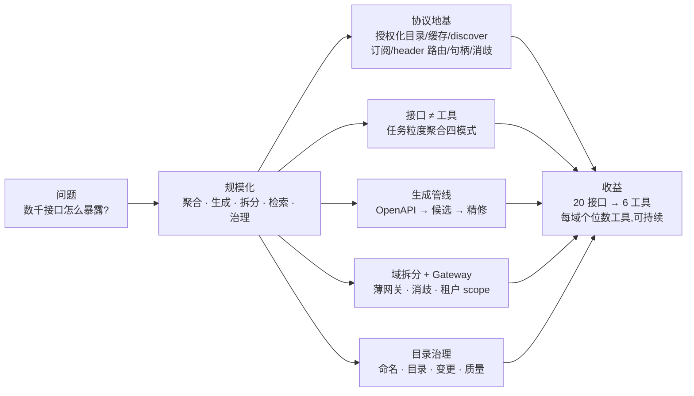
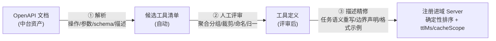
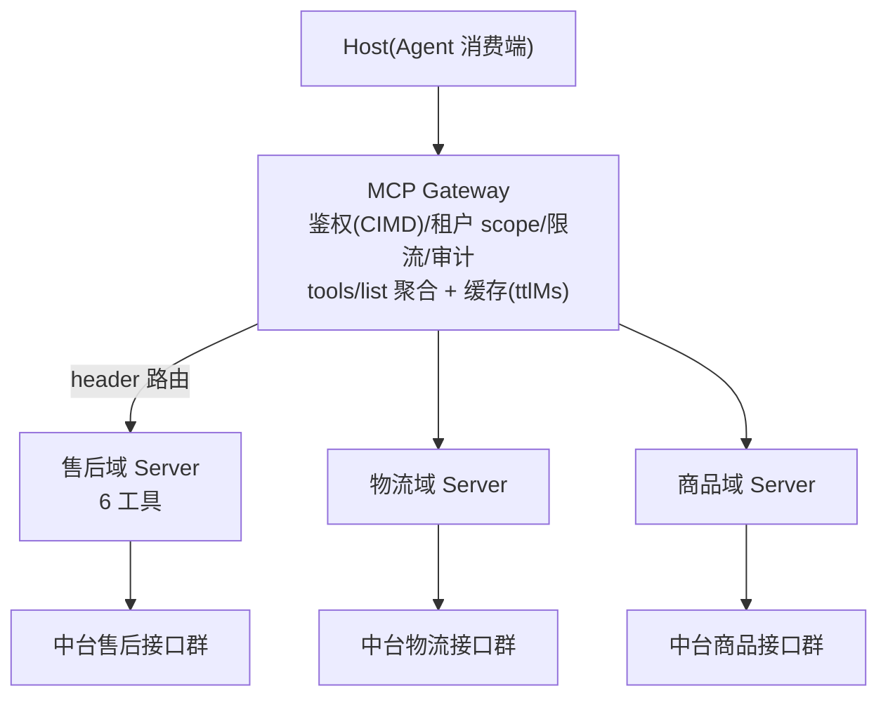

# 第 7 章 规模化:业务中台的 MCP 化

> 本章导读:售后域 Server 上线后,物流团队来了:「我们也要」。接着是商品、结算、营销……当中台的几十个业务域都想暴露能力时,问题从「怎么写一个工具」变成「怎么治理一千个工具」。本章回答那个最常被问错的问题——**数千个接口怎么通过 MCP 暴露?** 错误答案是暴露数千个工具;正确答案是一条工程化路径:聚合、生成、拆分、检索、治理。读完本章,你能:为业务域设计任务级工具的聚合方案;搭建 OpenAPI 到工具的生成管线;画出多域 Gateway 拓扑并说明每层的职责;为团队建立工具目录治理的四件套。

*本章导览图*

## 你什么时候需要它

**第一个域 Server 上线了,第二个域团队来问「我们怎么做」**——把本章当方法论手册:6.3 的聚合四模式给他们的接口分类,6.4 的管线让他们不必从零开始。

**有人提议「把中台接口全部自动暴露成工具」**——把本章开头搬给他:工具数由任务词汇表决定,不由接口数决定;自动暴露的结局是选择准确率崩、上下文爆、没人维护。

**要设计多域的 Gateway 架构**——看 6.5:协议为规模化准备的地基(授权化目录、缓存、header 路由)决定了网关可以多薄。

前置:第 5 章的完整 Server 手艺;第 6 章的工具建模标准(本章的「精修」环节以它为验收)。

## 概述:协议为规模化准备的地基

前几章的手艺都是「单个工具」级别的。放大到中台尺度前,先把 2026-07-28 规范内建的规模化地基盘出来——这些不是我们的发明,是协议的原生能力:

| 协议能力(规范原文) | 规模化用途 | 详见 |
|------|-----------|------|
| 工具集**随请求授权变化**(per-request 凭据) | 多租户可见性:租户 A 的 token 只看到租户 A 的工具——协议原生语义 | 第 8 章 |
| `tools/list` 的 `ttlMs` + `cacheScope` + 确定性排序 | 目录分发靠缓存;网关可共享缓存(public) | 第 3 章 |
| `server/discover` 一次拿到版本+能力+身份+`instructions` | 网关与消费端的接入握手点;`instructions` 是域的「自我介绍」 | 第 2 章 |
| `subscriptions/listen`(toolsListChanged) | 目录是活的:域上线新工具,消费端收到通知刷新 | 第 2 章 |
| `x-mcp-header`(参数 → `Mcp-Param-*` 头) | Gateway 不解析 body 按参数路由/限流/审计 | 第 5 章 |
| 显式句柄模式 | 跨调用状态不靠会话,靠参数传递的句柄 | 第 5 章 |
| 工具名唯一性 scope = 单 Server | 聚合层消歧是必需品,`serverInfo.name` 不可依赖 | 第 5 章 |

一句话:**2026-07-28 的无状态重构,本质上是把 MCP 从「两端的会话协议」改造成「可被基础设施承载的分布式协议」**——没有这版,本章的拓扑会重得多。

## 接口 ≠ 工具:任务粒度聚合

中台接口按**系统资源**切(REST CRUD),Agent 需要按**任务语义**的工具。两者的翻译有四种模式:

| 模式 | 何时用 | 例子(贯穿案例) |
|------|--------|----------------|
| N 接口 → 1 工具(纵向聚合) | 一个用户任务背后固定的一串调用 | `after_sales_create_ticket` = 校验 + 风控 + 创建——原子任务不拆给模型,Server 侧编排 |
| 1 接口 → 1 工具(直通) | 接口本身就是完整任务语义 | `after_sales_query_ticket` |
| 1 接口 → 不暴露(裁剪) | 纯系统内部接口、无 Agent 任务语义 | 批量对账导入、缓存刷新 |
| M 接口 → 1 工具 + 参数(归并) | 同一任务的多个变体接口 | 按 region/渠道拆的 4 个查询接口 → 1 个带 `region` 参数的工具 |

判定口诀:**模型需要「决定」的才做成参数,模型不需要知道的都收进 Server**。工具数量由任务词汇表决定(一个业务域通常 5-15 个任务),不由接口数量决定——数千接口的售后/物流/商品各域,落下来通常是**每域个位数的工具**。

反例值得记住:「创建售后单」被拆成「校验参数」「风控检查」「创建记录」三个工具——模型现在要自己编排三个调用,中间任何一步失败都需要模型理解中台的内部流程才能恢复。这些编排本来就该在 Server 里。

## 生成管线:OpenAPI 是起跑线

手工写几千个工具定义不现实,而中台几乎都有 OpenAPI/Swagger 资产——生成管线让它变成起点而非终点:

三个工程要点:

1. **生成的是「候选」,不是「成品」**。自动生成解决 schema 与结构,但 description 的任务语义重写无法自动化——**描述精修是人工环节**,也是质量所在。省略这一步的团队会得到「数量达标、模型不爱用」的工具集
2. **管线要幂等可重跑**:OpenAPI 变更 → 重新生成候选 → diff 出「接口变更影响的工具」清单——这个 diff 同时就是变更管理的输入
3. **绑定消费端做验证**:生成后立即用真实 Agent 冒烟(第 8 章),命中率不达标的工具打回精修

## 域拆分 + Gateway:拓扑设计

- **按业务域拆 Server**,不做「一个巨无霸 Server」:域是天然的迭代与责任边界(与中台团队组织结构对齐),故障隔离,工具目录清晰
- **Gateway 是治理点,不是业务点**:统一鉴权与租户识别(CIMD 消费端身份,第 8 章)、工具目录聚合与缓存、限流与审计(`Mcp-Name` 头免解析 body)、版本路由(第 3 章 Dual-era 兼容收敛一处)
- 2026-07-28 之前,这层需要会话亲和、重放缓冲;**无状态 + header 路由之后,Gateway 第一次「薄得起来」**——托管网关产品(AWS AgentCore Gateway 等)[待核实:动笔时以市场现况为准]
- **命名消歧**:多域聚合后必然撞名(两个域都有 `search`),协议明确说聚合层要加前缀消歧、且不能依赖 `serverInfo.name`——所以域前缀(`after_sales_`)从第一天就是强制的

## 工具检索与动态发现:过载的最终解

域内工具数控制住了,但 Host 侧仍可能挂多个域——工具总数仍会涨。分层解法,按需启用:

1. **按角色挂载**:客服 Agent 只挂售后+物流域,运营 Agent 挂商品+结算域。「角色 → 域」映射来自目录治理,这是成本最低、优先做的一层
2. **缓存式目录**:`ttlMs` 内直接用缓存目录;`cacheScope: public` 让网关层共享缓存——目录分发的正统机制,不用自建
3. **分页发现**:`tools/list` 游标分页,按「目录页」拉取
4. **search + load 模式**:工具真正巨大时,暴露一个 `search_tools` 元工具(按任务描述检索),模型先搜、对选中的再 `load` 详情、然后调用——上下文里只有 1 个工具,背后是全部目录。行业实践(Anthropic 的 tool search、程序化工具调用等)[待核实:以官方文档为准]
5. **动态目录**:域上线新工具 → `subscriptions/listen` 通知 → 消费端刷新。目录运营是日常,不是发版事件

## 目录治理:让规模化可持续

工具多了以后,治理问题会反噬技术问题。四件套:

- **命名规范全域强制**:`domain_action`(`after_sales_create_ticket`),域前缀即路由与归属
- **工具目录(Directory)**:每个工具一行——域、负责人、聚合了哪些接口、版本、状态(live/deprecated)。目录条目长什么样,第 4.6 节的 `query-ticket.json` 就是雏形;没有目录,半年后没人说得清「这个工具动不得还是能改」
- **变更管理**:描述与 schema 的修改走评审(它们直接改变模型行为);**破坏性变更新增工具名而非原地改**(工具名即 API,client 按名调用);OpenAPI diff(生成管线)驱动影响面清单
- **质量例行化**:命中率/失败率/重试率(第 6 章)按月出报表,连续垫底的工具走「精修或下线」;与协议特性生命周期(Active/Deprecated/Removed,12 个月窗口,第 3 章)对齐

## 贯穿案例完整复盘

| 步骤 | 动作 | 产出 |
|------|------|------|
| ① 输入 | 售后域 OpenAPI(20 接口) | 候选清单 |
| ② 聚合评审 | 任务词汇表讨论:售后单生命周期中模型真正要「决定」的事 | **6 个任务级工具**;3 接口裁剪;8 接口纵向聚合 |
| ③ 生成+精修 | 管线生成 schema 初稿;描述逐个任务语义重写 | 工具定义 + 目录条目 |
| ④ 域 Server | mcp-core / TS v2 实现,`instructions` 写清域职责与边界 | `after-sales` 域上线,缓存就绪 |
| ⑤ Gateway 纳管 | 域前缀消歧;租户 scope 过滤;`Mcp-Name` 限流 | 多域拓扑一员 |
| ⑥ 消费验证 | agentscope-java + TS Client 双端冒烟(第 8 章) | 命中率达标,发布 |

20 接口 → 6 工具:**压缩比 3:1 起步,且每个工具都是模型能准确选中的粒度**。把这个走查套到物流域、商品域,就是数千接口的全部真相。

## 本章小结

1. **协议已备好地基**(授权化目录/缓存/discover/订阅通知/header 路由/句柄/消歧)——用好它们,别自建。
2. **工具数由任务词汇表决定**;聚合、裁剪、归并是常态;「创建售后单」不该被拆成三个工具让模型编排。
3. **OpenAPI 管线生成候选,描述精修是人工质量关**。
4. **域 Server + 薄 Gateway**;过载解法分层上(角色挂载 → 缓存 → 分页 → search+load)。
5. **目录治理四件套**(命名/目录/变更/质量)让规模化可持续,并与协议生命周期对齐。

→ **第 8 章**把多域拓扑接上真实的异构消费端,验证「一次封装,处处调用」。

## 验收清单

读到这里,你应该能:

- ☐ 用四种聚合模式把一个业务域的接口清单分类,并说明每类的判定理由;
- ☐ 画出多域 Gateway 拓扑,标出每层职责(鉴权/缓存/消歧/租户过滤);
- ☐ 解释「工具数量由任务词汇表决定」的经济学含义(token 一次项);
- ☐ 为团队起草 OpenAPI 生成管线的三个环节与验收标准;
- ☐ 说出目录治理四件套,并解释每件防止什么问题;
- ☐ 按层级列出工具过载的五种解法与启用顺序。

## 参考速查

| 项 | 值 |
|----|----|
| 聚合四模式 | 纵向聚合 / 直通 / 裁剪 / 归并 |
| 管线三环节 | 解析生成 → 人工评审 → 描述精修 |
| 目录缓存 | `ttlMs`(新鲜度)+ `cacheScope`(public 可共享) |
| 标准头 | `Mcp-Method` / `Mcp-Name` / `MCP-Protocol-Version` |
| 消歧 | 域前缀 `domain_action`;`serverInfo.name` 不可依赖 |
| 检索分层 | 角色挂载 → 缓存 → 分页 → search+load |

## 延伸阅读

- **第 6 章(工具接入实战)**——管线「精修」环节的验收标准出自它的描述质量手艺。
- **第 8 章(构建 Client)**——多域拓扑的消费端视角与双端验证。
- **第 10 章(部署与安全)**——Gateway 的鉴权与租户隔离细节。
- **第 12 章(企业落地路线图)**——本章方法论如何分阶段落地与立项。

## 复核清单(发布前)

- [ ] 外部网关产品核实(标注核实日期);search+load 与 SDK 支持现状核对
- [ ] 团队中台真实数据(接口数、压缩比)替换贯穿案例的示例数字
- [ ] `subscriptions/listen` 的 toolsListChanged 订阅流程实测(v2.4.0)
- [ ] Gateway 场景的 `cacheScope: public` 共享缓存行为实测
