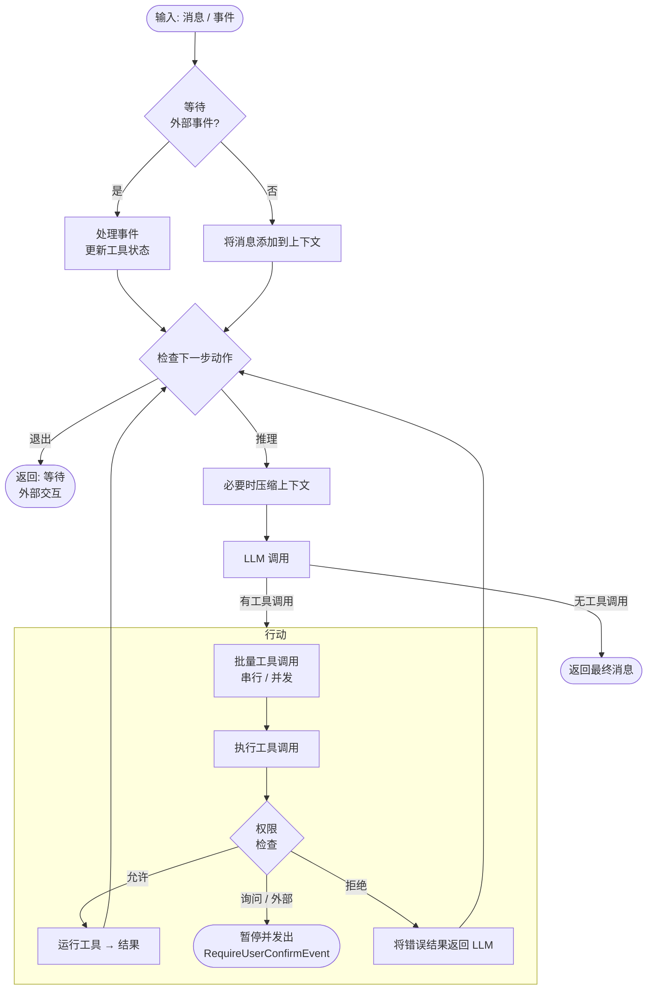
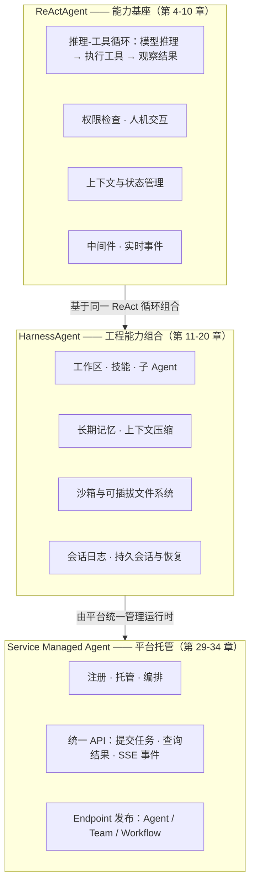

# 第 3 章 核心概念地图

> 本章导读：当你读完前两章、能跑通一个 `HarnessAgent`，却仍分不清 ReActAgent、HarnessAgent、Service Managed Agent 谁包含谁、什么情况下该用哪一层时，本章把全书概念画成一张三层地图。读完它，你再进入任何一章细节之前，都能先知道那个主题在地图上的位置。

AgentScope Java 2.0 的 API 面并不小：ReActAgent、HarnessAgent、Managed Agent、工作区、会话日志、Session API……初学时最容易迷失的不是某个具体用法，而是分不清这些概念谁包含谁、各自解决什么问题。

AgentScope 的能力是逐层叠加的。最底层是 ReActAgent：它实现“模型推理 → 执行工具 → 观察结果”的 ReAct 循环，并把权限、人机交互、中间件等基础能力挂在这一循环上。中间层是 HarnessAgent：它在同一个循环之上内置工作区、长期记忆、上下文压缩、技能、子 Agent、沙箱与会话恢复等工程能力，让长任务应用不必逐项自行装配。最上层是 AgentScope Service 平台上的 Managed Agent：它以 HarnessAgent 为内核，由平台统一管理运行时，业务应用通过 API 提交任务、接收事件并获取交付物。

三层之间是“同一内核、逐层装配”的关系，而不是三套独立的框架——这也是全书章节组织的暗线：第二篇讲基座，第三篇讲组合，第五篇讲托管。分工再说明白一点：本章只画地图、不教配置，各层细节分别从第 4 章、第 11 章和第 29 章展开。读完本章，你应当在翻开任何一章细节之前，先知道它在地图上的位置。

## 你什么时候需要它

这张地图解决的是“选型与定位”问题。三个典型时刻你会用到它：

**第一次决定“用哪一层”的时候。** 例如要给公司做一个能查工单、能接入业务流程的助手：想在应用代码里深度定制，就从 `HarnessAgent` 入手；只想由平台代管、通过 API 调用，就直接在 Service 上配置 Managed Agent；两者也不必二选一，已有的 Harness 应用还能作为 External Agent 接入 Service。框架本身的推荐是：业务 Agent 开发优先 `HarnessAgent`，需要自行组合基础能力时再用 `ReActAgent`。

**读后面章节迷路的时候。** 后面的章节各自深入某一层的某个能力，随时可以回到本章，确认当前主题属于哪一层、与哪些能力平级。

**向团队解释技术方案的时候。** “同一内核、逐层装配”的三层结构图可以直接用于选型评审：哪些能力开箱即用、哪些要自己装配、运行时由谁负责，图上一目了然。

与已学内容的关系：第 1 章从场景出发回答了“能做什么”，第 2 章带你跑通了 `HarnessAgent` 这一条线，本章补上完整的坐标系。地图先于细节——第 4-10 章把 ReActAgent 一层的基座能力逐个拆开，第 11 章讲 Harness 如何组合这些能力，第 29 章起进入平台托管；本章不展开任何配置项。

## ReActAgent：推理-工具循环与基础能力

AgentScope 通过 `Agent` 接口统一智能体的调用方式，提供底层的 `ReActAgent` 和在其基础上封装的 `HarnessAgent`，两者都支持 `call` 与 `streamEvents` 两种调用入口。**ReAct 是 AgentScope Harness 的执行基础**：`ReActAgent` 负责“模型推理 → 执行工具 → 将结果交回模型”的循环，直到返回结果或等待外部交互。权限检查、人机交互、上下文与状态管理、中间件、实时事件等基础能力，都围绕这一循环工作。

`ReActAgent` 和 `HarnessAgent` 都通过下面的推理-行动循环执行一次 `call`，Harness 的内置能力在相应阶段参与工作：

按业务场景选择调用入口：获取回复或把 Agent 接入工作流，用 `call`；在当前请求中逐步展示文本和工具进度，用 `streamEvents`；需要后台持续执行、忙时排队、运行中补充要求、中断后继续原任务时，使用仅 HarnessAgent 提供的 `AgentSession` 会话操作。三种方式的代码与细节见第 4 章与第 11 章。

## HarnessAgent：在同一循环上组合工程能力

看完基座，再往上走一层。`HarnessAgent` 内部封装 `ReActAgent`，沿用同一套推理与执行循环，并进一步内置工作区、长期记忆、上下文压缩、技能、子 Agent、沙箱以及会话日志与恢复等能力。因此，使用 Harness 后，**整体的推理、执行循环本质上没有变化**；更多运行能力由 Harness 统一装配，业务开发者可以直接配置使用。

一次执行会读取当前会话状态，构建模型输入，按需调用工具，再保存结果。工作区、记忆和压缩等能力在这些步骤中生效；业务通过 builder、工具和 middleware 定制行为。下表概括 HarnessAgent 内置的工程能力及对应主题章节（各能力的具体配置项在第 12-20 章逐一展开）：

| 能力 | 解决什么问题 | 详见 |
| --- | --- | --- |
| 工作区驱动的人格 | 人格、知识、子 Agent、技能、MCP 白名单都以文件形式存在 | 第 12 章 |
| 状态持久化与执行日志 | 完整事实、checkpoint、跨请求和跨节点恢复 | 第 19 章 |
| 会话任务管理 | 后台执行、持久排队、补充信息和恢复 | 第 19 章 |
| 双层长期记忆 | 长会话中有价值的事实自动沉淀 | 第 14 章 |
| 对话压缩与大工具结果卸载 | 上下文有界；过大的工具结果落盘并保留占位符 | 第 13 章 |
| 子 Agent 编排 | 委派给子 Agent，支持同步或后台，自动反向通知 | 第 16 章 |
| 可插拔文件系统与沙箱隔离 | 本机、共享存储、沙箱之间不改代码切换；文件与命令隔离执行 | 第 12、18 章 |
| 计划模式 | 只读思考阶段 + HITL 退出 | 第 17 章 |
| 技能装配 | 技能来自 Git / Nacos / MySQL / classpath / 工作区 | 第 15 章 |
| MCP 集成与工具白名单 | 声明式 MCP server，工具粒度允许 / 拒绝 | 第 12 章 |
| Channel 路由 | 会话管理、per-session 并发控制、多 Agent 路由、流式事件 | 第 20 章 |

选择建议：**业务 Agent 开发推荐优先使用 `HarnessAgent`**；需要自行组合基础能力时，也可以直接使用 `ReActAgent`。

## 能力叠加：从 ReActAgent 到 Service Managed Agent

把三层放在一起，就得到贯穿全书的能力叠加图：每一层都不替换下一层，而是在其上装配更多现成能力，并把运行管理的职责逐步上移。

- **ReActAgent（第 4-10 章展开）**：推理-工具循环，加上权限、中间件、消息与事件等基础能力，是所有上层的执行内核。
- **HarnessAgent（第 11-20 章展开）**：在同一循环上内置工作区、记忆、压缩、技能、子 Agent、沙箱与会话恢复，解决长任务与生产部署的工程问题。
- **Service Managed Agent（第 29-34 章展开）**：以 HarnessAgent 为内核的托管形态，由平台统一管理运行时，业务应用通过统一 API 提交任务、接收事件并获取交付物。

无论从哪一层切入，底层的消息结构、工具协议与事件模型都是一致的：`HarnessAgent` 对 `ReActAgent` 是一层薄包装，builder 接口大体一致；已有的 Harness 应用也可以作为 External Agent 接入 Service，保留自己的运行进程。变化的只是“谁来装配能力”与“谁来管理运行时”。
