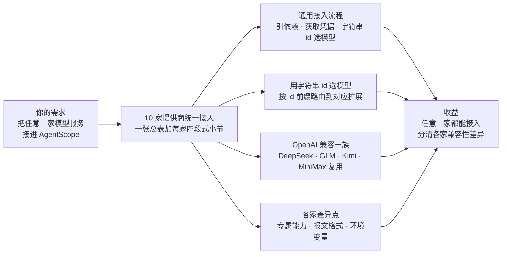
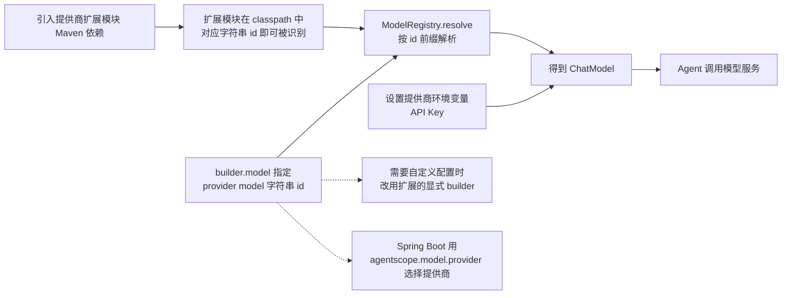

# 第 21 章 模型提供商精编

> 本章导读：全书唯一的"合并精编"章——把十家模型提供商的接入文档合并为一张总表加每家固定的四段式小节（Maven 依赖、获取凭据、配置示例、专属说明）。OpenAI 扩展同时承载 DeepSeek、GLM、Kimi、MiniMax 等 OpenAI 兼容端点的一等支持；OpenAI Official 走官方 SDK 的 Responses API；DashScope、Gemini、Anthropic、Ollama 各有独立模块与专属能力（Qwen 短名、服务端工具、Bearer Token、本地部署）。读完本章，你可以把任意一家模型服务接入 AgentScope，并掌握各家 formatter 与兼容性差异。



*本章导览图*

模型提供商扩展用于把 AgentScope Java 接入托管或本地 Chat Model API。对应扩展模块在 classpath 中时，可以通过 `ModelRegistry` 字符串 id 选择模型。所有模型提供商均已迁移到独立模型扩展模块中，`agentscope-core` 只保留共享模型契约。

## 提供商总表

| 提供商 | Maven artifact | `ModelRegistry` id | 标准环境变量 |
|--------|----------------|--------------------|--------------|
| OpenAI | `agentscope-extensions-model-openai` | `openai:<model>` | `OPENAI_API_KEY` |
| OpenAI Official | `agentscope-extensions-model-openai-official` | `openai-official:<model>` | `OPENAI_API_KEY` |
| DeepSeek | `agentscope-extensions-model-openai` | `deepseek:<model>` | `DEEPSEEK_API_KEY` |
| GLM | `agentscope-extensions-model-openai` | `glm:<model>` | `ZAI_API_KEY` / `GLM_API_KEY` / `ZHIPUAI_API_KEY` |
| Kimi | `agentscope-extensions-model-openai` | `kimi:<model>` | `MOONSHOT_API_KEY` / `KIMI_API_KEY` |
| MiniMax | `agentscope-extensions-model-openai` | `minimax:<model>` | `MINIMAX_API_KEY` |
| DashScope | `agentscope-extensions-model-dashscope` | `dashscope:<model>` / `qwen*` | `DASHSCOPE_API_KEY` |
| Gemini | `agentscope-extensions-model-gemini` | `gemini:<model>` | `GEMINI_API_KEY` |
| Anthropic | `agentscope-extensions-model-anthropic` | `anthropic:<model>` | `ANTHROPIC_API_KEY` |
| Ollama | `agentscope-extensions-model-ollama` | `ollama:<model>` | `OLLAMA_BASE_URL`（可选） |

> **注意**：`agentscope-extensions-model-e2e-tests` 是仓库测试模块，不是面向用户的模型集成依赖。

表中每家提供商的接入细节见本章后续各节。其中 DeepSeek、GLM、Kimi、MiniMax 复用 OpenAI 扩展模块（`agentscope-extensions-model-openai`），依赖与 OpenAI 一节相同，专属差异见各自小节。

如果还拿不准选哪家，一句话导航：接 OpenAI 或 DeepSeek、GLM、Kimi、MiniMax 这类遵循 OpenAI API 载荷格式的兼容服务，都用 OpenAI 扩展；要用 OpenAI 官方 Responses API 与其服务端内置工具（`web_search`、`code_interpreter` 等），选 OpenAI Official；阿里云 Qwen 走 DashScope（支持 `qwen*` 短名）；Google 模型用 Gemini（Gemini API 或 Vertex AI 路径均可）；Claude 及需要 Bearer Token 的兼容网关用 Anthropic；本地开发、私有化部署和离线模型服务用 Ollama。

## 通用接入流程

所有提供商的接入路径完全一致：

1. 引入对应扩展模块的 Maven 依赖（见各提供商一节）。
2. 设置该提供商的环境变量（API Key 等，见各节"获取凭据"）。
3. 在 builder 里用 `provider:<model>` 字符串 id 选择模型——底层由 `ModelRegistry.resolve(modelId)` 解析，对应扩展模块在 classpath 中时即可识别。
4. 需要自定义 endpoint、formatter、transport 或生成参数时，改用该扩展的显式 builder；Spring Boot 应用可直接引入对应的 `agentscope-*-spring-boot-starter`，用 `agentscope.model.provider` 一行选择提供商。

从引入依赖到调用模型服务的完整链路如图 21-1 所示。



*图 21-1：模型接入链路*

完整 builder 选项、formatter、credential 和 registry context 细节、模型创建方式与高级 registry 行为见第 6 章（模型接入）。

## OpenAI

`agentscope-extensions-model-openai` 接入 OpenAI Chat Completions 风格的模型。

### Maven 依赖

```xml
<dependency>
    <groupId>io.agentscope</groupId>
    <artifactId>agentscope-extensions-model-openai</artifactId>
    <version>${agentscope.version}</version>
</dependency>
```

Spring Boot 应用可以使用 OpenAI starter：

```xml
<dependency>
    <groupId>io.agentscope</groupId>
    <artifactId>agentscope-openai-spring-boot-starter</artifactId>
    <version>${agentscope.version}</version>
</dependency>
```

### 获取凭据

API Key 获取入口：[OpenAI 平台](https://platform.openai.com/api-keys)。

| 环境变量 | 说明 |
| --- | --- |
| `OPENAI_API_KEY` | OpenAI API Key（必填） |

### 配置示例

字符串 id 方式：

```java
ReActAgent agent = ReActAgent.builder()
    .name("assistant")
    .model("openai:gpt-4.1-mini") // 底层由 ModelRegistry.resolve(modelId) 解析
    .build();
```

需要自定义 endpoint、formatter、transport 或生成参数时，使用 builder：

```java
import io.agentscope.extensions.model.openai.OpenAIChatModel;

OpenAIChatModel model = OpenAIChatModel.builder()
    .apiKey(System.getenv("OPENAI_API_KEY"))
    .modelName("gpt-4.1-mini")
    .stream(true)
    .build();
```

### 专属说明

OpenAI 兼容端点也使用这个适配模块，例如 DeepSeek、GLM、Kimi、MiniMax 等遵循 OpenAI API 载荷格式的服务——这几家的一等支持同样由本模块提供，各自使用独立的 provider 前缀、默认 endpoint 与专属 formatter，见本章相应各节。

## OpenAI Official

`agentscope-extensions-model-openai-official` 通过官方 OpenAI Java SDK 集成 OpenAI 模型。暂时只支持 Responses API，未来会考虑支持 Chat Completions API。

### Maven 依赖

```xml
<dependency>
    <groupId>io.agentscope</groupId>
    <artifactId>agentscope-extensions-model-openai-official</artifactId>
    <version>${agentscope.version}</version>
</dependency>
```

Spring Boot 应用可以使用 OpenAI Official starter：

```xml
<dependency>
    <groupId>io.agentscope</groupId>
    <artifactId>agentscope-openai-official-spring-boot-starter</artifactId>
    <version>${agentscope.version}</version>
</dependency>
```

### 获取凭据

API Key 获取入口：[OpenAI 平台](https://platform.openai.com/api-keys)。

| 环境变量 | 说明 |
| --- | --- |
| `OPENAI_API_KEY` | OpenAI API Key（必填） |

### 配置示例

字符串 id 方式：

```java
ReActAgent agent = ReActAgent.builder()
    .name("assistant")
    .model("openai-official:gpt-4o")
    .build();
```

需要自定义 base URL、多 Agent formatter 时使用 Builder：

```java
import io.agentscope.extensions.model.openaiofficial.OpenAIResponsesChatModel;

OpenAIResponsesChatModel model = OpenAIResponsesChatModel.builder()
    .apiKey(System.getenv("OPENAI_API_KEY"))
    .modelName("gpt-4o")
    .stream(true)
    .build();
```

Spring Boot 配置示例：

```yaml
agentscope:
  model:
    provider: openai-official
  openai-official:
    api-key: ${OPENAI_API_KEY}
    model-name: gpt-4o
```

### 专属说明

#### 服务端内置工具

OpenAI 官方文档：https://developers.openai.com/api/docs/guides/tools#available-tools

Responses API 的 provider-executed built-in tools 可通过 `serverTools` 启用：

```java
import com.openai.models.responses.Tool;
import com.openai.models.responses.WebSearchTool;
import io.agentscope.extensions.model.openaiofficial.tool.OpenAIServerTool;

OpenAIResponsesChatModel model = OpenAIResponsesChatModel.builder()
    .apiKey(System.getenv("OPENAI_API_KEY"))
    .modelName("gpt-5")
    .serverTools(List.of(OpenAIServerTool.of(
        Tool.ofWebSearch(WebSearchTool.builder()
            .type(WebSearchTool.Type.WEB_SEARCH)
            .build()))))
    .build();
```

支持 `web_search`、`code_interpreter`、`image_generation` 和 `tool_search`。

模型返回的内置工具调用和结果会保留为 server-tool 标记的 `ToolUseBlock` / `ToolResultBlock`，并将原始 Responses item 存至 metadata 在后续轮次回放。

`tool_search` 仅支持 "Hosted" 模式，暂不支持 "Client-executed" 模式。可为单个本地函数工具标注 `@Tool(deferLoading = true)`，其参数 schema 会延迟到模型通过 hosted tool search 加载时才进入上下文。未标注的工具保持立即可用；配置了 `deferLoading` 但未启用 `tool_search` server tool 时会快速失败。

消息 annotations（包括 `container_file_citation`）会保留在 `openai.response.citations` 响应 metadata 中。Code Interpreter 的图片输出会表示为带 `URLSource` 的 `DataBlock`，容器 ID 会保留在工具结果 metadata 中。

`image_generation` 的结果会映射为带 `Base64Source` 的 `DataBlock`。启用 `partial_images` 后，每个 `response.image_generation_call.partial_image` 事件会以 `RUNNING` 状态的 server-tool result 输出预览 `DataBlock`，terminal response 会用最终图片替换它。

#### 推理

通过 `GenerateOptions.reasoningEffort` 控制推理力度（`low` / `medium` / `high` / `minimal`）。要在响应中看到推理内容，需显式开启 `reasoning.summary`：

```java
GenerateOptions options = GenerateOptions.builder()
    .reasoningEffort("high")
    .additionalBodyParam("reasoning.summary", "auto")
    .build();
```

前序轮次的加密推理内容会通过 `Msg.metadata` 自动在多轮对话中回放，无需手动管理。

#### 兼容性说明

本模块通过 OpenAI Java SDK 集成，暂时只支持 Responses API，未来会考虑支持 Chat Completions API。以下选项**不支持**，设置非空值时会 fail-fast：`frequencyPenalty`、`presencePenalty`、`topK`、`seed`、`cacheControl`、`thinkingBudget`、`endpointPath`、每请求级 `additionalHeaders` 和 `additionalQueryParams`。

Responses 专有参数通过 `GenerateOptions.additionalBodyParams` 白名单键透传：`reasoning.summary`、`reasoning.context`、`reasoning.mode`、`service_tier`、`prompt_cache_key`、`prompt_cache_options`、`max_tool_calls`、`safety_identifier`、`store`、`previous_response_id`。

`store` 控制服务端响应存储，默认为 `false`。如需使用 OpenAI 服务端会话续链，先存储第一轮响应，从响应 metadata 的 `openai.response.id` 读取 ID，并在后续请求中传入 `previous_response_id`。使用 `previous_response_id` 时应只发送本轮新增 input，不要重复完整会话历史。

原生结构化输出默认开启（`supportsNativeStructuredOutput()` 返回 `true`）。SDK 重试已禁用（`maxRetries=0`），重试由 AgentScope 管理。

## DashScope

`agentscope-extensions-model-dashscope` 接入阿里云 DashScope Qwen Model，包括多模态和推理能力的 Qwen 模型。

### Maven 依赖

```xml
<dependency>
    <groupId>io.agentscope</groupId>
    <artifactId>agentscope-extensions-model-dashscope</artifactId>
    <version>${agentscope.version}</version>
</dependency>
```

Spring Boot 应用可以使用 DashScope starter：

```xml
<dependency>
    <groupId>io.agentscope</groupId>
    <artifactId>agentscope-dashscope-spring-boot-starter</artifactId>
    <version>${agentscope.version}</version>
</dependency>
```

### 获取凭据

API Key 获取入口：[阿里云百炼控制台](https://bailian.console.aliyun.com/)。

| 环境变量 | 说明 |
| --- | --- |
| `DASHSCOPE_API_KEY` | 阿里云百炼 DashScope API Key（必填） |

### 配置示例

设置 `DASHSCOPE_API_KEY` 后，可以使用 `dashscope:<model>`：

```java
ReActAgent agent = ReActAgent.builder()
    .name("assistant")
    .model("dashscope:qwen-plus") // 底层由 ModelRegistry.resolve(modelId) 解析
    .build();
```

也可以使用 Qwen 短名：

```java
ReActAgent agent = ReActAgent.builder()
    .name("assistant")
    .model("qwen-plus") // 底层由 ModelRegistry.resolve(modelId) 解析
    .build();
```

需要 DashScope 专属配置时使用 builder，例如 endpoint type、thinking、search、encryption：

```java
import io.agentscope.extensions.model.dashscope.DashScopeChatModel;

DashScopeChatModel model = DashScopeChatModel.builder()
    .apiKey(System.getenv("DASHSCOPE_API_KEY"))
    .modelName("qwen-plus")
    .stream(true)
    .build();
```

## DeepSeek

`agentscope-extensions-model-openai` 通过 OpenAI 兼容模型栈提供 DeepSeek 的一等支持，通过 `ModelRegistry` 使用 `deepseek:<model>` 字符串 id。

### Maven 依赖

与 OpenAI 一节相同，复用 OpenAI 模型扩展模块，依赖 XML 见"OpenAI"一节的"Maven 依赖"，不再逐家重复给出。

### 获取凭据

API Key 获取入口：[DeepSeek 开放平台](https://platform.deepseek.com/api_keys)。

| 环境变量 | 说明 |
| --- | --- |
| `DEEPSEEK_API_KEY` | DeepSeek API Key（必填） |

### 配置示例

```java
ReActAgent agent = ReActAgent.builder()
    .name("assistant")
    .model("deepseek:deepseek-v4-flash") // 底层由 ModelRegistry.resolve(modelId) 解析
    .build();
```

### 专属说明

Provider 默认使用 `https://api.deepseek.com`，发送请求前会去掉 `deepseek:` 前缀，并使用 `io.agentscope.extensions.model.openai.compat.deepseek` 下的 DeepSeek formatter。

#### 思考模式

通过 `ModelCreationContext` 解析模型时可以开启 DeepSeek 思考模式：

```java
import io.agentscope.core.model.Model;
import io.agentscope.core.model.ModelCreationContext;
import io.agentscope.core.model.ModelRegistry;

Model model = ModelRegistry.resolve(
    "deepseek:deepseek-v4-flash",
    ModelCreationContext.builder()
        .enableThinking(true)
        .build());
```

流式调用时可以把 `ThinkingBlockDeltaEvent` 和 `TextBlockDeltaEvent` 分开渲染。

#### 兼容性说明

DeepSeek 兼容 formatter 会保留 DeepSeek 兼容的消息字段，包括 `system` 角色和支持的 `name` 字段。它会对所有 assistant 轮次完整回传 `reasoning_content`——包括框架合成的、不含思考内容的消息，这类消息会被补齐空字符串，避免携带 `tools` 的请求被 HTTP 400 拒绝。

DeepSeek 稳定端点默认不使用工具 schema 的 `strict` 字段，因此默认 formatter 会省略 `strict`，即使工具注册时开启了严格 schema 校验。结构化输出默认使用 AgentScope 的 fallback 行为；只有在你明确确认兼容端点支持 native structured output 时才需要手动开启。

使用 beta 或其他兼容端点时，可以通过 `ModelCreationContext` 传入 `baseUrl`、`endpointPath`、生成参数或 formatter 覆盖。

## GLM

`agentscope-extensions-model-openai` 通过 OpenAI 兼容模型栈提供 GLM（智谱 / Z.AI）的一等支持，通过 `ModelRegistry` 使用 `glm:<model>` 字符串 id。

### Maven 依赖

与 OpenAI 一节相同，复用 OpenAI 模型扩展模块，依赖 XML 见"OpenAI"一节的"Maven 依赖"，不再逐家重复给出。

### 获取凭据

API Key 获取入口：[智谱开放平台](https://open.bigmodel.cn/)。

| 环境变量 | 说明 |
| --- | --- |
| `ZAI_API_KEY` / `GLM_API_KEY` / `ZHIPUAI_API_KEY` | 任设其一即可（必填） |

### 配置示例

```java
ReActAgent agent = ReActAgent.builder()
    .name("assistant")
    .model("glm:glm-5.2") // 底层由 ModelRegistry.resolve(modelId) 解析
    .build();
```

### 专属说明

Provider 默认使用 `https://open.bigmodel.cn/api/paas/v4`，发送请求前会去掉 `glm:` 前缀，并使用 `io.agentscope.extensions.model.openai.compat.glm` 下的 GLM formatter。

#### 思考模式

通过 `ModelCreationContext` 解析模型时，可以用 `GenerateOptions` 传入 GLM 思考相关参数：

```java
import io.agentscope.core.model.GenerateOptions;
import io.agentscope.core.model.Model;
import io.agentscope.core.model.ModelCreationContext;
import io.agentscope.core.model.ModelRegistry;
import java.util.Map;

Model model = ModelRegistry.resolve(
    "glm:glm-5.2",
    ModelCreationContext.builder()
        .component(
            GenerateOptions.class,
            GenerateOptions.builder()
                .additionalBodyParam("thinking", Map.of("type", "disabled"))
                .reasoningEffort("max")
                .build())
        .build());
```

GLM-4.7 和 GLM-5 系列默认开启思考。GLM-5.2 还支持 `reasoning_effort`；如果需要流式工具调用参数，可以通过 `additionalBodyParam("tool_stream", true)` 开启。

#### 兼容性说明

GLM formatter 会把 OpenAI 风格请求适配为 GLM chat-completions API 支持的格式。它会确保至少存在一条 user 消息，移除 GLM 不支持的消息 `name` 字段，省略工具 schema 的 `strict` 字段，并移除 `frequency_penalty`、`presence_penalty`、`thinking_budget`、`stream_options` 等不支持的请求字段。

GLM 只支持 `max_tokens`，因此当只设置了 `max_completion_tokens` 且没有设置 `max_tokens` 时，会自动映射到 `max_tokens`。`temperature` 和 `top_p` 会被钳制到 GLM 支持的取值范围。

GLM 只接受 `tool_choice=auto`。强制工具选择会降级为 `auto`；`ToolChoice.None` 会从请求中移除 tools，以保留"不调用工具"的语义。

结构化输出默认使用 AgentScope 的 fallback 行为，因为 GLM 的 `response_format` 仅支持 `json_object`。只有在你明确确认目标端点支持所需行为时，才需要手动开启 native structured output。

使用兼容端点或自托管端点时，可以通过 `ModelCreationContext` 传入 `baseUrl`、`endpointPath`、生成参数或 formatter 覆盖。

## Kimi

`agentscope-extensions-model-openai` 通过 OpenAI 兼容模型栈提供 Kimi（月之暗面 / Moonshot AI）的一等支持，通过 `ModelRegistry` 使用 `kimi:<model>` 字符串 id。

### Maven 依赖

与 OpenAI 一节相同，复用 OpenAI 模型扩展模块，依赖 XML 见"OpenAI"一节的"Maven 依赖"，不再逐家重复给出。

### 获取凭据

API Key 获取入口：[Moonshot 开放平台](https://platform.moonshot.cn/)。

| 环境变量 | 说明 |
| --- | --- |
| `MOONSHOT_API_KEY` / `KIMI_API_KEY` | 任设其一即可（必填） |

### 配置示例

```java
ReActAgent agent = ReActAgent.builder()
    .name("assistant")
    .model("kimi:kimi-k3") // 底层由 ModelRegistry.resolve(modelId) 解析
    .build();
```

### 专属说明

Provider 默认使用 `https://api.moonshot.cn/v1`，发送请求前会去掉 `kimi:` 前缀，并使用 `io.agentscope.extensions.model.openai.compat.kimi` 下的 Kimi formatter。

#### 思考模式

通过 `ModelCreationContext` 解析模型时，可以用 `GenerateOptions` 传入 Kimi 思考相关参数：

```java
import io.agentscope.core.model.GenerateOptions;
import io.agentscope.core.model.Model;
import io.agentscope.core.model.ModelCreationContext;
import io.agentscope.core.model.ModelRegistry;
import java.util.Map;

Model model = ModelRegistry.resolve(
    "kimi:kimi-k2.6",
    ModelCreationContext.builder()
        .component(
            GenerateOptions.class,
            GenerateOptions.builder()
                .additionalBodyParam("thinking", Map.of("type", "disabled"))
                .maxCompletionTokens(16000)
                .build())
        .build());
```

`kimi-k3` 使用顶层 `reasoning_effort` 选项（`low`、`high` 或 `max`）。`kimi-k3` 和 `kimi-k2.7-code` 始终开启思考模式；`kimi-k2.6` 和 `kimi-k2.5` 默认开启思考模式，但可以通过 `additionalBodyParam("thinking", Map.of("type", "disabled"))` 关闭。

#### 兼容性说明

Kimi formatter 会把 OpenAI 风格请求适配为 Kimi chat-completions API 支持的格式。它会省略工具 schema 的 `strict` 字段，保留历史 assistant 消息中的 `reasoning_content`，并移除 `thinking_budget` 等不支持的请求字段。

在 `kimi-*` 模型上，`temperature`、`top_p`、`n`、`frequency_penalty`、`presence_penalty` 等采样参数由平台固定，formatter 会从请求中移除这些字段。`moonshot-v1` 系列仍会保留这些参数。Kimi 文档使用 `max_completion_tokens`，因此当只设置了 `max_tokens` 且没有设置 `max_completion_tokens` 时，会自动映射到 `max_completion_tokens`。

`reasoning_effort` 只会在 `kimi-k3` 上保留。K2.x 的思考控制参数需要通过 `GenerateOptions.additionalBodyParam` 传入 `thinking` body 参数。

`tool_choice=auto` 和 `tool_choice=none` 通常可以直接使用。K2.x 模型不支持 `tool_choice=required`，formatter 会将其降级为 `auto`。tool_choice 指定函数调用时与开启思考模式不兼容，因此在 `kimi-k3`、`kimi-k2.7-code`，以及未显式设置 `thinking.type=disabled` 的 `kimi-k2.6` / `kimi-k2.5` 上会降级为 `auto`。

结构化输出默认使用 AgentScope 的 fallback 行为。

使用兼容端点或自托管端点时，可以通过 `ModelCreationContext` 传入 `baseUrl`、`endpointPath`、生成参数或 formatter 覆盖。

## MiniMax

`agentscope-extensions-model-openai` 通过 OpenAI 兼容模型栈提供 MiniMax 的一等支持，通过 `ModelRegistry` 使用 `minimax:<model>` 字符串 id。

### Maven 依赖

与 OpenAI 一节相同，复用 OpenAI 模型扩展模块，依赖 XML 见"OpenAI"一节的"Maven 依赖"，不再逐家重复给出。

### 获取凭据

API Key 获取入口：[MiniMax 开放平台](https://platform.minimaxi.com/)。

| 环境变量 | 说明 |
| --- | --- |
| `MINIMAX_API_KEY` | MiniMax API Key（必填） |

### 配置示例

```java
ReActAgent agent = ReActAgent.builder()
    .name("assistant")
    .model("minimax:MiniMax-M3") // 底层由 ModelRegistry.resolve(modelId) 解析
    .build();
```

### 专属说明

Provider 的 base URL 默认使用 `https://api.minimaxi.com/v1`。`OpenAIClient` 会追加默认 chat completions endpoint，因此最终请求 URL 是 `https://api.minimaxi.com/v1/chat/completions`，与 MiniMax OpenAI 兼容 API 保持一致。发送请求前会去掉 `minimax:` 前缀，并使用 `io.agentscope.extensions.model.openai.compat.minimax` 下的 MiniMax formatter。

#### 思考模式

通过 `ModelCreationContext` 解析模型时可以传入 MiniMax 思考参数：

```java
import io.agentscope.core.model.Model;
import io.agentscope.core.model.ModelCreationContext;
import io.agentscope.core.model.ModelRegistry;

Model model = ModelRegistry.resolve(
    "minimax:MiniMax-M3",
    ModelCreationContext.builder()
        .enableThinking(false)
        .build());
```

`enableThinking(false)` 会发送 `thinking: {"type": "disabled"}`，`enableThinking(true)` 会发送 `thinking: {"type": "adaptive"}`。MiniMax-M3 在省略 `thinking` 时默认使用 adaptive thinking；M2.x 模型即使请求 disabled 也会保持思考开启。Formatter 默认开启 `reasoning_split`，这样 MiniMax 的思考内容可以被解析为 `ThinkingBlock`。

#### 兼容性说明

MiniMax formatter 会把 OpenAI 风格请求适配为 MiniMax OpenAI 兼容 Chat Completions API 支持的格式。由于 MiniMax 标记 `max_tokens` 为 deprecated，formatter 会把 `max_tokens` 映射为 `max_completion_tokens`。

MiniMax 的工具定义支持 function tools，但官方 schema 没有工具 schema 的 `strict` 字段，因此默认 formatter 会省略 `strict`，即使工具注册时开启了严格 schema 校验。MiniMax 也没有文档化 `tool_choice`，因此显式工具选择会从 MiniMax 请求中移除。

Formatter 会移除 MiniMax 不支持的 OpenAI-only 请求字段，例如 `reasoning_effort`、`frequency_penalty`、`presence_penalty`、`thinking_budget`、`parallel_tool_calls`、`response_format` 和 `seed`。结构化输出默认使用 AgentScope 的 fallback 行为，因为 MiniMax 没有文档化 OpenAI `response_format` 的 schema 约束输出能力。

使用兼容端点或自托管端点时，可以通过 `ModelCreationContext` 传入 `baseUrl`、`endpointPath`、生成参数或 formatter 覆盖。

## Gemini

`agentscope-extensions-model-gemini` 接入 Google Gemini 模型。它支持 Gemini API，也可以通过显式配置走 Vertex AI 路径。

### Maven 依赖

```xml
<dependency>
    <groupId>io.agentscope</groupId>
    <artifactId>agentscope-extensions-model-gemini</artifactId>
    <version>${agentscope.version}</version>
</dependency>
```

Spring Boot 应用可以使用 Gemini starter：

```xml
<dependency>
    <groupId>io.agentscope</groupId>
    <artifactId>agentscope-gemini-spring-boot-starter</artifactId>
    <version>${agentscope.version}</version>
</dependency>
```

### 获取凭据

API Key 获取入口：[Google AI Studio](https://aistudio.google.com/apikey)。

| 环境变量 | 说明 |
| --- | --- |
| `GEMINI_API_KEY` | Gemini API Key（必填） |

### 配置示例

字符串 id 方式：

```java
ReActAgent agent = ReActAgent.builder()
    .name("assistant")
    .model("gemini:gemini-2.0-flash") // 底层由 ModelRegistry.resolve(modelId) 解析
    .build();
```

需要自定义 API 设置、Vertex AI credentials、formatter、transport 或生成参数时，使用 builder：

```java
import io.agentscope.extensions.model.gemini.GeminiChatModel;

GeminiChatModel model = GeminiChatModel.builder()
    .apiKey(System.getenv("GEMINI_API_KEY"))
    .modelName("gemini-2.0-flash")
    .streamEnabled(true)
    .build();
```

### 专属说明

#### 服务端工具

Gemini 内置工具由模型服务商执行，不会通过 AgentScope 本地 Toolkit 执行。使用显式 model builder 配置这些工具：

```java
import io.agentscope.extensions.model.gemini.tool.GeminiServerTool;
import com.google.genai.types.GoogleSearch;
import com.google.genai.types.Tool;
import com.google.genai.types.UrlContext;

GeminiChatModel model = GeminiChatModel.builder()
    .apiKey(System.getenv("GEMINI_API_KEY"))
    .modelName("gemini-3.8-flash")
    .serverTools(List.of(
        GeminiServerTool.of(Tool.builder()
            .googleSearch(GoogleSearch.builder()
                .excludeDomains(List.of("example.com"))
                .build())
            .build()),
        GeminiServerTool.of(Tool.builder()
            .urlContext(UrlContext.builder())
            .build())
    ))
    .build();
```

`GeminiServerTool.of(...)` 可用于包装 Google GenAI SDK `Tool` builder 构建的内置服务端工具定义，例如 Google Search、Google Maps、URL Context、Code Execution、File Search 和 Enterprise Web Search。

配置至少一个服务端工具后，AgentScope 会自动启用 Gemini 服务端调用上下文，并在对话历史中保留返回的工具调用和结果。服务端工具与本地 function tools 相互独立，因此可以在同一次请求中同时提供。不要用它包装自定义 function tools；`GeminiServerTool.of(...)` 会拒绝这类定义。

## Anthropic

`agentscope-extensions-model-anthropic` 接入 Anthropic Claude Model，并提供 Anthropic 专属 formatter 和请求 DTO 支持。

### Maven 依赖

```xml
<dependency>
    <groupId>io.agentscope</groupId>
    <artifactId>agentscope-extensions-model-anthropic</artifactId>
    <version>${agentscope.version}</version>
</dependency>
```

Spring Boot 应用可以使用 Anthropic starter：

```xml
<dependency>
    <groupId>io.agentscope</groupId>
    <artifactId>agentscope-anthropic-spring-boot-starter</artifactId>
    <version>${agentscope.version}</version>
</dependency>
```

### 获取凭据

API Key 获取入口：[Anthropic Console](https://console.anthropic.com/settings/keys)。

| 环境变量 | 说明 |
| --- | --- |
| `ANTHROPIC_API_KEY` | Anthropic API Key（必填） |
| `ANTHROPIC_AUTH_TOKEN` | 可选。兼容网关的 Bearer Token，见下文"Bearer Token 鉴权" |

### 配置示例

字符串 id 方式：

```java
ReActAgent agent = ReActAgent.builder()
    .name("assistant")
    .model("anthropic:claude-sonnet-4.5") // 底层由 ModelRegistry.resolve(modelId) 解析
    .build();
```

需要自定义 endpoint、formatter、transport、prompt caching、thinking 或生成参数时，使用 builder：

```java
import io.agentscope.extensions.model.anthropic.AnthropicChatModel;

AnthropicChatModel model = AnthropicChatModel.builder()
    .apiKey(System.getenv("ANTHROPIC_API_KEY"))
    .modelName("claude-sonnet-4.5")
    .stream(true)
    .build();
```

通过 Bearer Token 接入网关的 Spring Boot 配置示例：

```yaml
agentscope:
  model:
    provider: anthropic
  anthropic:
    base-url: https://gateway.example.com/anthropic
    auth-token: ${ANTHROPIC_AUTH_TOKEN}
    model-name: claude-sonnet-4.5
```

`agentscope.anthropic.auth-token` 为可选配置，未设置或为空白时不启用 Bearer 鉴权。原有的 `agentscope.anthropic.api-key` 配置仍然可用，但同时配置两个非空白凭据会导致启动失败。Builder customizer 在校验前执行，可以通过 `apiKey(null)` 或 `authToken(null)` 清除其中一种凭据。

### 专属说明

#### 服务端工具

Anthropic 内置工具由 Anthropic 在模型服务端执行，不会进入 AgentScope 本地 Toolkit。使用 SDK 的强类型工具定义构造 `ToolUnion`，再交给 `AnthropicServerTool.of(...)` 包装：

```java
import com.anthropic.models.messages.ToolUnion;
import com.anthropic.models.messages.WebSearchTool20250305;
import io.agentscope.extensions.model.anthropic.tool.AnthropicServerTool;

AnthropicChatModel model = AnthropicChatModel.builder()
    .apiKey(System.getenv("ANTHROPIC_API_KEY"))
    .modelName("claude-sonnet-4.5")
    .addServerTool(AnthropicServerTool.of(
        ToolUnion.ofWebSearchTool20250305(WebSearchTool20250305.builder().build())))
    .build();
```

服务端工具可以与本地 function tools 同时配置；Anthropic 按工具名称选择工具，因此两者名称冲突时会快速失败。`AnthropicServerTool.of(...)` 只接受 SDK 内置工具定义，不接受自定义 client tool。

#### Bearer Token 鉴权

对于需要 `Authorization: Bearer <token>` 的 Anthropic 兼容网关，通过模型 builder 设置 `authToken`：

```java
AnthropicChatModel model = AnthropicChatModel.builder()
    .baseUrl("https://gateway.example.com/anthropic")
    .authToken(System.getenv("ANTHROPIC_AUTH_TOKEN"))
    .modelName("claude-sonnet-4.5")
    .build();
```

传入的 Token 不需要包含 `Bearer ` 前缀，SDK 会自动添加。`apiKey` 设置 `X-Api-Key`，`authToken` 设置 `Authorization`；两者只能配置一个，同时配置会在创建模型时抛出 `IllegalArgumentException`。这些鉴权请求头由 SDK 管理，请通过 builder 配置，不要通过 `GenerateOptions.additionalHeaders` 添加。

## Ollama

`agentscope-extensions-model-ollama` 接入本地托管的 Ollama 模型，适合本地开发、私有化部署和离线模型服务。

### Maven 依赖

```xml
<dependency>
    <groupId>io.agentscope</groupId>
    <artifactId>agentscope-extensions-model-ollama</artifactId>
    <version>${agentscope.version}</version>
</dependency>
```

Spring Boot 应用可以使用 Ollama starter：

```xml
<dependency>
    <groupId>io.agentscope</groupId>
    <artifactId>agentscope-ollama-spring-boot-starter</artifactId>
    <version>${agentscope.version}</version>
</dependency>
```

### 获取凭据

Ollama 为本地服务，无需 API Key；安装与模型下载见 [Ollama 官网](https://ollama.com/)。

| 环境变量 | 说明 |
| --- | --- |
| `OLLAMA_BASE_URL` | 可选。Ollama 服务地址，不设置时默认使用本地 Ollama endpoint |

### 配置示例

字符串 id 方式：

```java
ReActAgent agent = ReActAgent.builder()
    .name("assistant")
    .model("ollama:llama3") // 底层由 ModelRegistry.resolve(modelId) 解析
    .build();
```

需要非默认 Ollama endpoint、formatter、transport、proxy 或 Ollama options 时，使用 builder：

```java
import io.agentscope.extensions.model.ollama.OllamaChatModel;

OllamaChatModel model = OllamaChatModel.builder()
    .modelName("llama3")
    .baseUrl("http://localhost:11434")
    .build();
```

通过 `agentscope.model.provider=ollama` 配置本地 Ollama 模型。base URL 为可选项，默认是 `http://localhost:11434`：

```yaml
agentscope:
  model:
    provider: ollama
  ollama:
    model-name: llama3
    # base-url: http://localhost:11434
```

## 本章小结

作为选型参考章，本章的回顾方式是"按任务索引"而不是复述叙事。接入任何一家的路径都相同，就是"通用接入流程"的四步：引入扩展模块 Maven 依赖 → 设置该提供商的环境变量 → 用 `provider:<model>` 字符串 id 选择模型（底层 `ModelRegistry.resolve` 解析）→ 需要自定义 endpoint、formatter、transport 或生成参数时改用显式 builder；差别只在各家的凭据入口、id 前缀与 formatter 兼容性行为。

| 你的任务 | 去哪里看 |
| --- | --- |
| 第一次接入，尽快跑通一家 | "通用接入流程" + 该家的"配置示例" |
| 用 OpenAI 及其兼容栈（DeepSeek / GLM / Kimi / MiniMax） | "OpenAI"一节拿依赖；四家各看"获取凭据 / 配置示例 / 专属说明" |
| 用 OpenAI Responses API 的服务端内置工具（`web_search`、`code_interpreter`、`image_generation`、`tool_search`） | "OpenAI Official"一节的"专属说明" |
| 用阿里云 Qwen（`qwen*` 短名，endpoint type / thinking / search / encryption 专属配置） | "DashScope"一节 |
| 用 Google Gemini（Gemini API 或 Vertex AI 路径） | "Gemini"一节 |
| 用 Claude 或接入 Bearer Token 兼容网关 | "Anthropic"一节的"专属说明" |
| 本地开发、私有化部署、离线模型服务 | "Ollama"一节 |
| 排查请求被对端拒绝或字段被改写 | 该家的"兼容性说明"（formatter 对 `strict`、`tool_choice`、采样参数与结构化输出的处理） |

接入排查先看三个检查点：扩展模块在不在 classpath、环境变量设没设、id 前缀对不对。formatter、credential 与 registry 的机制解释不在本章，统一见第 6 章（模型接入）。
