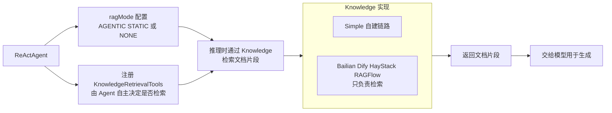

# 第 22 章 RAG 集成

> 本章导读：讲解 AgentScope 接入外部知识库的统一接口 `Knowledge`——Agent 在推理时通过它检索文档片段，再交给模型生成。先以一张扩展选型表比较五种实现（自建链路的 Simple、阿里云百炼、Dify、HayStack、RAGFlow），说明"接入方式都是同一套"的设计；再逐个展开各实现的依赖、快速上手、检索参数与限制。读完本章，你可以为 Agent 选配任意一种 RAG 后端，并理解"除 Simple 外只负责检索"的管控分离设计。

RAG（Retrieval-Augmented Generation，检索增强生成）——先从外部知识库检索资料，再让模型据此作答——就是本章要接入的能力。`io.agentscope.core.rag.Knowledge` 是 AgentScope 用于"接入外部知识库"的接口。Agent 在推理时通过它检索文档片段，再交给模型用于生成。`agentscope-extensions-*` 仓库下提供了多种实现：

| 扩展 | 类型 | 适合场景 |
| --- | --- | --- |
| Simple | 自建：embedding + 向量库 | 对接自家向量库（PgVector / Milvus / Qdrant / Elasticsearch / 内存） |
| Bailian | 阿里云百炼知识库 | 用百炼托管的企业级知识库 |
| Dify | Dify 数据集 | 已经在 Dify 上维护知识库的场景 |
| HayStack | 自托管 HayStack RAG | 已经基于 HayStack 搭建索引流水线 |
| RAGFlow | RAGFlow 服务 | 需要 OCR、知识图谱增强的复杂文档场景 |

表中各实现的接入细节见本章后续各节。

Agent 推理时通过 Knowledge 检索的管线如图 22-1 所示。



*图 22-1：RAG 检索管线与 Agent 集成*

## 接入方式都是同一套

```java
ReActAgent agent = ReActAgent.builder()
    .name("Assistant")
    .model(model)
    .knowledge(knowledge)        // 任选一种 Knowledge 实现
    .ragMode(RAGMode.AGENTIC)    // 或 STATIC、NONE
    .build();
```

也可以包装成工具供 Agent 自主选择是否检索：

```java
KnowledgeRetrievalTools tools = new KnowledgeRetrievalTools(knowledge);
Toolkit toolkit = new Toolkit();
toolkit.registerObject(tools);
```

## 选型建议

| 需求 | 建议 |
| --- | --- |
| 自己掌控全部链路（embedding + 向量库） | **Simple** |
| 阿里云生态、企业级托管 | **Bailian** |
| 团队已经在用 Dify 编排 | **Dify** |
| 需要复杂 ETL（PDF 表格、图片 OCR、知识图谱） | **RAGFlow** |
| 已基于 HayStack 落地 RAG 流水线 | **HayStack** |

> 除 Simple 外，其余实现都**只负责检索**（retrieve），文档导入/更新请走对应平台的控制台或服务侧 API；这样设计是为了让多个 Knowledge 在使用侧完全可替换。

## Simple

`agentscope-extensions-rag-simple` 提供一个"自己掌控全部链路"的 RAG 实现：自带文档读取器、分块策略、Embedding 模型适配、以及 5 个开箱即用的向量库适配器。

适合：你愿意自己跑 embedding + 向量库，不想接入第三方 RAG 平台。

### 添加依赖

```xml
<dependency>
    <groupId>io.agentscope</groupId>
    <artifactId>agentscope-extensions-rag-simple</artifactId>
    <version>${agentscope.version}</version>
</dependency>
```

### 快速上手

```java
import io.agentscope.core.embedding.dashscope.DashScopeTextEmbedding;
import io.agentscope.core.rag.knowledge.SimpleKnowledge;
import io.agentscope.core.rag.store.InMemoryStore;
import io.agentscope.core.rag.model.RetrieveConfig;

// 1) Embedding 模型
EmbeddingModel embeddings = DashScopeTextEmbedding.builder()
    .apiKey(System.getenv("DASHSCOPE_API_KEY"))
    .modelName("text-embedding-v3")
    .dimensions(1024)
    .build();

// 2) 向量库（这里用进程内的实现）
VDBStoreBase store = InMemoryStore.builder().dimensions(1024).build();

// 3) 组装 Knowledge
SimpleKnowledge knowledge = SimpleKnowledge.builder()
    .embeddingModel(embeddings)
    .embeddingStore(store)
    .build();

// 4) 写入文档
List<Document> docs = new TikaReader().read(input).block();
knowledge.addDocuments(docs).block();

// 5) 检索
List<Document> hits = knowledge.retrieve(
    "什么是 AgentScope？",
    RetrieveConfig.builder().limit(5).scoreThreshold(0.5).build()
).block();
```

### 内置文档读取器

`io.agentscope.core.rag.reader` 包提供了一组常见格式的 Reader，全部产出 `List<Document>`：

| Reader | 输入 |
| --- | --- |
| `TextReader` | 纯文本 |
| `PDFReader` | PDF（基于 PDFBox） |
| `WordReader` | Word 文档 |
| `ImageReader` | 图片，配合多模态 embedding 使用 |
| `TikaReader` | Apache Tika 通用解析（兜底） |
| `ExternalApiReader` | 调外部 API 解析（OCR / 自定义流水线） |

读取出来的 `Document` 已经带有元数据，配合 `TextChunker` 与 `SplitStrategy` 做分块。

### 内置 Embedding 提供方

| 类 | 服务 | 模式 |
| --- | --- | --- |
| `DashScopeTextEmbedding` | 阿里云百炼 DashScope | 文本 |
| `DashScopeMultiModalEmbedding` | 阿里云百炼 DashScope | 多模态（文本/图像） |
| `OpenAITextEmbedding` | OpenAI 兼容接口 | 文本 |
| `OllamaTextEmbedding` | Ollama 本地 | 文本 |

也可以实现 `EmbeddingModel` 自行扩展。

### 内置向量库适配

| 实现 | 部署 |
| --- | --- |
| `InMemoryStore` | 进程内（开发/测试用） |
| `PgVectorStore` | PostgreSQL + pgvector |
| `MilvusStore` | Milvus |
| `QdrantStore` | Qdrant |
| `ElasticsearchStore` | Elasticsearch（dense_vector） |

切换向量库只需要换一个 `VDBStoreBase` 实现，传给 `SimpleKnowledge.builder().embeddingStore(...)`。

### 检索参数

`RetrieveConfig` 控制检索行为：

| 字段 | 说明 |
| --- | --- |
| `limit` | TopK |
| `scoreThreshold` | 最低分数阈值（0~1） |
| `metadata` | 按文档 metadata 做过滤 |

### 与 Agent 集成

```java
ReActAgent agent = ReActAgent.builder()
    .name("Assistant")
    .model(model)
    .knowledge(knowledge)
    .ragMode(RAGMode.AGENTIC)   // Agent 自行决定何时检索
    .build();
```

## Dify

`agentscope-extensions-rag-dify` 接入 [Dify](https://dify.ai/) 的数据集（Dataset）API，复用 Dify 上已经维护的知识库。

### 何时使用

- 团队已经在 Dify 上做内容运营和文档管理。
- 想直接复用 Dify 的多种检索模式（关键词 / 语义 / 混合 / 全文）。

### 添加依赖

```xml
<dependency>
    <groupId>io.agentscope</groupId>
    <artifactId>agentscope-extensions-rag-dify</artifactId>
    <version>${agentscope.version}</version>
</dependency>
```

### 快速上手

```java
import io.agentscope.core.rag.integration.dify.DifyKnowledge;
import io.agentscope.core.rag.integration.dify.DifyRAGConfig;
import io.agentscope.core.rag.integration.dify.RetrievalMode;
import io.agentscope.core.rag.model.RetrieveConfig;

DifyRAGConfig config = DifyRAGConfig.builder()
    .apiKey(System.getenv("DIFY_RAG_API_KEY"))
    .datasetId("your-dataset-id")
    .retrievalMode(RetrievalMode.HYBRID_SEARCH)
    .enableRerank(true)
    .build();

DifyKnowledge knowledge = DifyKnowledge.builder()
    .config(config)
    .build();

List<Document> hits = knowledge.retrieve(
    "如何续费会员？",
    RetrieveConfig.builder().limit(5).scoreThreshold(0.5).build()
).block();
```

### 检索模式

`RetrievalMode` 决定 Dify 在数据集上的检索方式：

| 枚举 | 说明 |
| --- | --- |
| `KEYWORD_SEARCH` | 仅关键词检索 |
| `SEMANTIC_SEARCH` | 仅向量语义检索 |
| `HYBRID_SEARCH` | 关键词 + 向量混合（推荐） |
| `FULL_TEXT_SEARCH` | 全文检索 |

### 自托管 Dify

如果你部署了自己的 Dify，把 `baseUrl` 指过去：

```java
DifyRAGConfig config = DifyRAGConfig.builder()
    .apiKey("dataset-xxx")
    .baseUrl("https://dify.mycompany.com")
    .datasetId("ds-xxxx")
    .retrievalMode(RetrievalMode.HYBRID_SEARCH)
    .build();
```

### metadata 过滤

通过 `MetadataFilter / MetadataFilterCondition` 可以按 Dify 上配置的元数据字段过滤：

```java
DifyRAGConfig config = DifyRAGConfig.builder()
    .apiKey(apiKey)
    .datasetId(datasetId)
    .retrievalMode(RetrievalMode.HYBRID_SEARCH)
    .metadataFilter(MetadataFilter.builder()
        .conditions(List.of(
            MetadataFilterCondition.builder()
                .name("category").comparisonOperator("=")
                .value(List.of("faq")).build()))
        .logicalOperator("and")
        .build())
    .build();
```

### 仅支持检索

`addDocuments(...)` 不可用——文档管理请去 Dify 控制台：登录 → 知识 → 选择数据集 → 上传文档 → 等待索引完成。这与 Bailian、HayStack、RAGFlow 保持一致。

### 关键参数

| 字段 | 说明 |
| --- | --- |
| `apiKey` | Dify 数据集 API Key（必填） |
| `datasetId` | 数据集 ID（必填） |
| `baseUrl` | 默认 `https://api.dify.ai/v1`，自托管时改为你的地址 |
| `retrievalMode` | 见上表 |
| `enableRerank` | 是否启用 rerank |
| `metadataFilter` | 元数据过滤条件 |

## HayStack

`agentscope-extensions-rag-haystack` 把 [HayStack](https://haystack.deepset.ai/) RAG 服务接进 AgentScope。文档管理和索引由 HayStack 那边负责，AgentScope 只负责调用其检索接口。

### 何时使用

- 已经在 HayStack 上落地 RAG（包括索引流水线、ChromaDB、Reranker 等）。
- 想要直接复用 HayStack 的端到端检索能力。

### 添加依赖

```xml
<dependency>
    <groupId>io.agentscope</groupId>
    <artifactId>agentscope-extensions-rag-haystack</artifactId>
    <version>${agentscope.version}</version>
</dependency>
```

### 快速上手

```java
import io.agentscope.core.rag.integration.haystack.HayStackConfig;
import io.agentscope.core.rag.integration.haystack.HayStackKnowledge;
import io.agentscope.core.rag.model.RetrieveConfig;

HayStackConfig config = HayStackConfig.builder()
    .baseUrl("http://localhost:8080")  // 你的 HayStack 服务
    .topK(10)
    .build();

HayStackKnowledge knowledge = HayStackKnowledge.builder()
    .config(config)
    .build();

List<Document> hits = knowledge.retrieve(
    "What is AI?",
    RetrieveConfig.builder().limit(5).build()
).block();
```

### 与 Agent 集成

```java
ReActAgent agent = ReActAgent.builder()
    .knowledge(knowledge)
    .ragMode(RAGMode.AGENTIC)
    .build();
```

### 文档不通过本插件管理

`addDocuments(...)` 抛 `UnsupportedOperationException`。要新增/更新文档，请：

1. 准备好原始数据放入 HayStack 流水线的 source 目录。
2. 触发 / 重新执行 HayStack 的索引流水线。
3. 索引完成后，本插件即可检索到新文档。

这种"管控分离"避免了双侧索引状态不一致。

### 关键参数

| 字段 | 说明 |
| --- | --- |
| `baseUrl` | HayStack 服务地址（必填） |
| `topK` | 默认返回的最大条数 |
| `filterPolicy` | 过滤策略（见 `FilterPolicy`） |

`HayStackConfig` 还提供超时、自定义 header、API Key 等扩展项，按 HayStack 部署侧的鉴权方案配置即可。

## RAGFlow

`agentscope-extensions-rag-ragflow` 接入 [RAGFlow](https://ragflow.io/)。RAGFlow 在文档解析侧做得比较深（OCR、表格识别、知识图谱增强），适合非结构化文档比例高的场景。

### 何时使用

- 知识库以扫描件、复杂排版 PDF、含图片表格为主。
- 希望使用 RAGFlow 的 chunk 切分策略与重排能力。

### 添加依赖

```xml
<dependency>
    <groupId>io.agentscope</groupId>
    <artifactId>agentscope-extensions-rag-ragflow</artifactId>
    <version>${agentscope.version}</version>
</dependency>
```

### 快速上手

```java
import io.agentscope.core.rag.integration.ragflow.RAGFlowConfig;
import io.agentscope.core.rag.integration.ragflow.RAGFlowKnowledge;
import io.agentscope.core.rag.model.RetrieveConfig;

RAGFlowConfig config = RAGFlowConfig.builder()
    .apiKey("ragflow-xxxxxxxx")
    .baseUrl("http://localhost:9380")
    .knowledgeBaseId("kb-xxxxx")
    .topK(10)
    .similarityThreshold(0.5)
    .enableRerank(true)
    .build();

RAGFlowKnowledge knowledge = RAGFlowKnowledge.builder()
    .config(config)
    .build();

List<Document> hits = knowledge.retrieve(
    "AI 是什么？",
    RetrieveConfig.builder().limit(5).build()
).block();
```

### 工作机制

底层调用 RAGFlow 的 `POST /api/v1/datasets/{dataset_id}/retrieve-chunks` 接口：

- 向量相似度搜索 + 可配置 `topK`
- 服务端 `similarityThreshold` 过滤
- 通过 `RAGFlowConfig` 中的 metadata 字段做过滤
- 可选启用 RAGFlow 的 rerank

> 注意：当前 RAGFlow 的 retrieve-chunks API 不支持把对话历史传过去做上下文感知检索；如果你需要这种能力，请自己在 query 拼接前置指令。

### 文档管理走 RAGFlow 控制台

`addDocuments(...)` 同样不可用——上传与索引请到 RAGFlow 控制台或 RAGFlow 自身的 API 完成。

### 关键参数

| 字段 | 说明 |
| --- | --- |
| `apiKey` | RAGFlow API Key（必填） |
| `baseUrl` | RAGFlow 服务地址（必填） |
| `knowledgeBaseId` | 数据集 / 知识库 ID（必填） |
| `topK` | 服务端 TopK |
| `similarityThreshold` | 服务端最低相似度阈值 |
| `enableRerank` | 是否启用 rerank |

## 百炼知识库

`agentscope-extensions-rag-bailian` 接入阿里云百炼知识库，所有 embedding、索引、检索都由百炼托管。Agent 这边只负责把 query 抛过去、把文档拿回来。

### 何时使用

- 文档已经在百炼控制台上传/解析完成。
- 想要企业级特性：rerank、过滤、结构化/非结构化/图片三类知识库。
- 不想自维护向量库。

### 添加依赖

```xml
<dependency>
    <groupId>io.agentscope</groupId>
    <artifactId>agentscope-extensions-rag-bailian</artifactId>
    <version>${agentscope.version}</version>
</dependency>
```

### 快速上手

```java
import io.agentscope.core.rag.integration.bailian.BailianConfig;
import io.agentscope.core.rag.integration.bailian.BailianKnowledge;
import io.agentscope.core.rag.model.RetrieveConfig;

BailianConfig config = BailianConfig.builder()
    .accessKeyId(System.getenv("ALIBABA_CLOUD_ACCESS_KEY_ID"))
    .accessKeySecret(System.getenv("ALIBABA_CLOUD_ACCESS_KEY_SECRET"))
    .workspaceId("llm-xxxxxx")
    .indexId("kb-xxxxxx")
    .build();

BailianKnowledge knowledge = BailianKnowledge.builder()
    .config(config)
    .build();

List<Document> hits = knowledge.retrieve(
    "如何申请发票？",
    RetrieveConfig.builder().limit(5).scoreThreshold(0.5).build()
).block();
```

### 与 Agent 集成

```java
ReActAgent agent = ReActAgent.builder()
    .name("Assistant")
    .model(chatModel)
    .knowledge(knowledge)
    .ragMode(RAGMode.AGENTIC)
    .build();
```

或者通过工具暴露：

```java
KnowledgeRetrievalTools tools = new KnowledgeRetrievalTools(knowledge);
Toolkit toolkit = new Toolkit();
toolkit.registerObject(tools);
```

### rerank / rewrite 配置

`BailianConfig.builder()` 可选传入 `rerankConfig(...)` 与 `rewriteConfig(...)`：

```java
BailianConfig config = BailianConfig.builder()
    .accessKeyId(ak).accessKeySecret(sk)
    .workspaceId("llm-xxx").indexId("kb-xxx")
    .rerankConfig(RerankConfig.builder().enable(true).topN(5).build())
    .rewriteConfig(RewriteConfig.builder().enable(true).build())
    .build();
```

启用后百炼侧会在原始召回上再做一遍重排或 query 改写，提升相关性，但延迟和费用也会上升，按需打开。

### 仅支持检索

`BailianKnowledge.addDocuments(...)` 不可用——文档管理请通过百炼控制台或百炼平台 SDK 完成。这是和 Dify、HayStack、RAGFlow 一致的设计：第三方 RAG 平台保留索引能力，Java 侧只做读取。

### 配置参数

| 配置 | 说明 |
| --- | --- |
| `accessKeyId / accessKeySecret` | 阿里云访问凭证（必填） |
| `workspaceId` | 百炼业务空间 ID（必填） |
| `indexId` | 知识库索引 ID（必填） |
| `rerankConfig` | rerank 开关与参数 |
| `rewriteConfig` | query rewrite 开关与参数 |

## 本章小结

这一章把给 Agent 接知识库变成了一道选型题——接入方式都是同一套（`knowledge(...)` + `ragMode(...)`，或包装为 `KnowledgeRetrievalTools`），真正要选的是后端：

1. **Simple**：自己掌控全部链路，自带读取器、分块、Embedding 适配与 5 个向量库适配器，是唯一支持写入文档（`addDocuments`）的实现；
2. **Bailian**：embedding、索引、检索全由百炼托管，可选 rerank / rewrite 增强（延迟与费用上升，按需打开）；
3. **Dify**：复用 Dify 上已维护的数据集，检索模式有关键词 / 语义 / 混合 / 全文四种，支持 metadata 过滤；
4. **HayStack**：复用已落地的 HayStack 检索服务，文档管理与索引留在 HayStack 侧；
5. **RAGFlow**：解析能力深（OCR、表格识别、知识图谱增强），适合扫描件与复杂排版 PDF 为主的场景。

记住那条管控分离的设计：**除 Simple 外，其余实现只负责检索**——文档导入/更新走对应平台的控制台或服务侧 API，换来的是多个 Knowledge 在使用侧完全可替换。拿不准时回到本章"选型建议"表，按链路掌控权、已有平台、文档复杂度三个维度对号入座。

**验收清单**——读到这里，你应该能：

- ☐ 用 `.knowledge(knowledge)` 加 `.ragMode(...)` 把任一种 Knowledge 挂入 ReActAgent，或包装为 `KnowledgeRetrievalTools` 让 Agent 自主决定是否检索；
- ☐ 对照"选型建议"表，为自己的团队说出选哪个实现、为什么；
- ☐ 解释除 Simple 外 `addDocuments(...)` 为什么不可用，以及文档导入/更新分别应走哪里；
- ☐ 在 Simple 中完成读取器 → 分块 → Embedding → 向量库的组装，并说出切换向量库时换的是哪个组件；
- ☐ 为 Dify 设置检索模式与 metadata 过滤，为百炼打开 rerank / rewrite，并说清各自的代价。

## 延伸阅读

- 第 23 章（长期记忆集成）—— 知识检索之外，另一种跨会话外部状态的接入：`LongTermMemory` 的三个后端
- 第 28 章（基础设施与生态工具）—— 集成扩展全览表，本章五种实现的一览入口
- 第 44 章（常见问题）—— "2.0 还会提供 RAG 和 long-term memory 吗"
