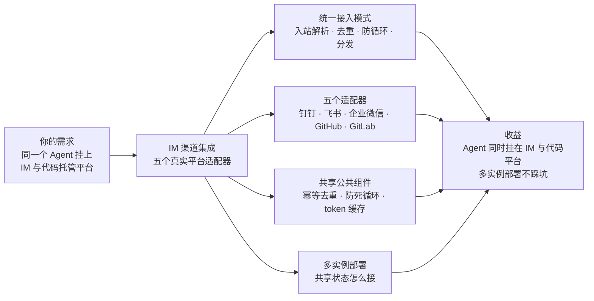
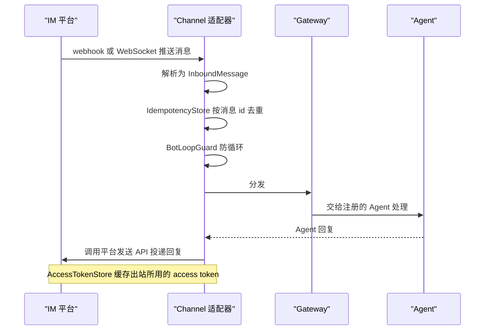

# 第 25 章 IM 渠道集成

> 本章导读：讲解通过 Harness 的 Channel 接口把 Agent 接入真实消息平台的五个适配器——钉钉（Stream WebSocket / HTTP 回调）、飞书（事件订阅回调）、企业微信（加密回调）、GitHub 与 GitLab（issue / PR 评论 webhook）。所有适配器共享同一套模式：入站解析为统一的 InboundMessage、去重、防循环、经 Gateway 分发，出站调用平台 API 投递回复；公共的幂等去重、防死循环、access token 缓存组件也在本章概览一并说明。读完本章，你可以让同一个 Agent 同时挂在 IM 与代码托管平台上，并了解多实例部署时共享状态的接法。



*本章导览图*

这些扩展通过 Harness 的 Channel 接口（见第 20 章）将你的 Agent 接入真实的消息平台。每个适配器负责平台特有的认证、webhook 签名校验、消息解析和回复投递——你的 Agent 代码无需感知平台差异。

| 扩展 | 平台 | 传输方式 |
| --- | --- | --- |
| 钉钉 | DingTalk（钉钉） | Stream 协议（持久 WebSocket） |
| 飞书 | Feishu / Lark（飞书） | 事件订阅回调（HTTP） |
| GitHub | GitHub | Webhook（HTTP） |
| GitLab | GitLab | Webhook（HTTP） |
| 企业微信 | WeCom（企业微信） | 加密回调（HTTP） |

表中各适配器的接入细节见本章后续各节。

## 工作原理

所有 channel 适配器遵循相同模式：

1. **入站** — 从平台接收消息（通过 webhook、WebSocket 等），解析为统一的 `InboundMessage`，去重、防循环，然后通过 Gateway 分发。
2. **出站** — 通过平台的发送 API 把 Agent 回复投递回去。

所有适配器共享 `agentscope-extensions-channel-common` 中的三个通用组件：

- **IdempotencyStore** — 按消息 id 去重，防止 webhook 重试导致重复处理。
- **BotLoopGuard** — 按 peer 限速，防止 bot 之间的消息死循环。
- **AccessTokenStore** — 缓存出站调用平台 API 所用的 access token。

入站与出站的完整消息流如图 25-1 所示。



*图 25-1：Channel 渠道消息流时序*

## 多实例部署

上述通用组件默认将状态保存在 JVM 内（`IdempotencyStore`、`InMemoryAccessTokenStore`），只在单进程内可见。当 channel 适配器运行在多个副本上（负载均衡后多实例，或每个 bot 一个进程）时，请通过接受共享存储实现的 `fromProperties` 重载构造适配器：

```java
FeishuChannel.fromProperties(channelId, routing, rawProperties, deduplicator, tokenStore);
```

- 共享的 `InboundEventDeduplicator` 使平台重试投递在所有实例间都能被识别。
- 共享的 `AccessTokenStore`（飞书、企业微信、钉钉）让任一副本的 token 刷新或失效服务于整个部署，而不是每个副本为同一凭据各自获取、各自缓存。

## 共享依赖

每个 channel 适配器都依赖 `agentscope-extensions-channel-common`（传递依赖自动引入）和 `agentscope-harness`（由你的应用在运行时提供）。

## 钉钉 Channel

`agentscope-extensions-channel-dingtalk` 将你的 Agent 接入钉钉，支持两种接收模式：**Stream**（默认）——持久 WebSocket 实时接收机器人消息，无需暴露公网 webhook 端点；**HTTP 回调**——钉钉将消息以 App Secret 加签后 POST 到你的 Spring 应用。

### 适用场景

- Agent 需要响应钉钉机器人消息（单聊和群 @提醒）。
- 倾向 WebSocket 推送模型（Stream，默认）：无需公网端点、无需接入层配置。
- 倾向 HTTP 回调：应用已暴露公网回调端点，或机器人/凭据需运行时动态增删（多租户部署），希望用单一无状态入口替代一组 WebSocket 连接。

### 添加依赖

```xml
<dependency>
    <groupId>io.agentscope</groupId>
    <artifactId>agentscope-extensions-channel-dingtalk</artifactId>
    <version>${agentscope.version}</version>
</dependency>
```

### 前置准备

1. 在[钉钉开发者后台](https://open-dev.dingtalk.com/)创建一个**企业内部应用**。
2. 启用**机器人**能力并订阅机器人消息 topic。
3. 记下 **App Key**、**App Secret** 和 **Robot Code**。
4. HTTP 回调模式：将机器人的消息接收配置为 HTTP 模式，回调地址填 `https://your-host/api/channels/dingtalk/{channelId}/callback`；若开启了消息体加密，另记下 **aes_key**。

### 快速开始

```java
DingTalkChannel channel = DingTalkChannel.fromProperties(
    "my-dingtalk",
    ChannelConfig.of("my-dingtalk", "main"),
    Map.of(
        "appKey",    "your-app-key",
        "appSecret", "your-app-secret",
        "robotCode", "your-robot-code"
    ));

GatewayBootstrap gw = GatewayBootstrap.builder()
    .agent("main", agent)
    .channel(channel)
    .build();

gw.start();   // 打开 Stream WebSocket，开始接收消息
```

改用 HTTP 回调模式（要求 Spring Web 应用；`DingTalkCallbackController` 由组件扫描装配）：

```java
DingTalkChannel channel = DingTalkChannel.fromProperties(
    "my-dingtalk",
    ChannelConfig.of("my-dingtalk", "main"),
    Map.of(
        "appKey",    "your-app-key",
        "appSecret", "your-app-secret",
        "robotCode", "your-robot-code",
        "mode",      "http",
        "aesKey",    "your-43-char-aes-key"   // 仅在开启消息体加密时需要
    ));
```

### 配置属性

| 属性 | 必填 | 默认值 | 说明 |
|------|------|--------|------|
| `appKey` | 是 | — | 企业内部应用 App Key |
| `appSecret` | 是 | — | 企业内部应用 App Secret |
| `robotCode` | 是 | — | 机器人编码，用于出站消息发送 |
| `mode` | 否 | `stream` | 接收模式：`stream`（持久 WebSocket）或 `http`（加签 HTTP 回调） |
| `aesKey` | 否 | — | 43 位 base64 AES 密钥，用于回调消息体解密；仅 `http` 模式，且仅在机器人开启加密时必填 |
| `apiBase` | 否 | `https://api.dingtalk.com` | OpenAPI 基地址 |
| `streamRegisterUrl` | 否 | `https://api.dingtalk.com/v1.0/gateway/connections/open` | Stream 网关注册地址 |

> **注意**：面向公网的 `http` 回调建议开启消息体加密（`aesKey`）：请求签名仅认证 `timestamp` 请求头，不开启加密时，被截获的签名对在有效时间窗口内仍可重放。

### 消息流转

**入站（Stream）：** `DingTalkStreamClient` 通过 WebSocket 连接钉钉网关，接收机器人消息回调，ACK 每个帧后进入 `DingTalkInboundMapper` → 幂等去重 → 防循环 → Gateway。

**入站（HTTP 回调）：** 钉钉携带 `timestamp`/`sign` 请求头将消息 POST 到 `DingTalkCallbackController`。控制器先校验 HMAC-SHA256 签名（并拒绝过期时间戳），配置了 `aesKey` 时解密 `encrypt` 信封，随后进入与 Stream 模式相同的 去重 → 映射 → 防循环 → Gateway 管线。回复经由出站 API 发送，不通过 HTTP 响应返回。

**出站：** 通过 `DingTalkOutboundClient` 使用 OpenAPI 的 `batchSend` 接口发送回复——`oToMessages/batchSend` 用于单聊，`groupMessages/send` 用于群聊。文本和 Markdown 格式自动识别。

### 断线重连

Stream 模式下，客户端在 WebSocket 断开时自动以指数退避（1s → 60s 上限）重连。

## 飞书 Channel

`agentscope-extensions-channel-feishu` 通过**事件订阅 v2** 回调机制将你的 Agent 接入飞书 / Lark。一个 Spring `@RestController` 接收 webhook 回调，可选地解密加密载荷，然后通过 Gateway 分发消息。

### 适用场景

- Agent 需要响应飞书机器人消息（单聊和群 @提醒）。
- 你的应用已经运行 Spring Boot（回调控制器自动注册）。

### 添加依赖

```xml
<dependency>
    <groupId>io.agentscope</groupId>
    <artifactId>agentscope-extensions-channel-feishu</artifactId>
    <version>${agentscope.version}</version>
</dependency>
```

### 前置准备

1. 在[飞书开发者后台](https://open.feishu.cn/)创建一个**自建应用**。
2. 启用**机器人**能力。
3. 配置**事件订阅**回调地址指向你的应用：
   `https://your-host/api/channels/feishu/{channelId}/callback`
4. 记下 **App ID** 和 **App Secret**。可选地配置 **Encrypt Key** 和 **Verification Token**。

### 快速开始

```java
FeishuChannel channel = FeishuChannel.fromProperties(
    "my-feishu",
    ChannelConfig.of("my-feishu", "main"),
    Map.of(
        "appId",     "cli_xxxxx",
        "appSecret", "your-app-secret"
    ));

GatewayBootstrap gw = GatewayBootstrap.builder()
    .agent("main", agent)
    .channel(channel)
    .build();

gw.start();
```

`FeishuCallbackController` 是一个 Spring `@RestController`，自动注册在 `/api/channels/feishu/{channelId}/callback`，并自动处理 URL 验证握手。

### 配置属性

| 属性 | 必填 | 默认值 | 说明 |
|------|------|--------|------|
| `appId` | 是 | — | 飞书自建应用 ID（cli_xxx） |
| `appSecret` | 是 | — | 飞书自建应用密钥 |
| `encryptKey` | 否 | — | AES-256-CBC 加密密钥；启用载荷加密 |
| `verificationToken` | 否 | — | URL 验证 token |
| `callbackPath` | 否 | `/api/channels/feishu/{channelId}/callback` | 自定义回调路径 |
| `apiBase` | 否 | `https://open.feishu.cn` | 飞书开放平台 API 基地址 |

### 加密

配置 `encryptKey` 后，回调 body 以 `{"encrypt":"<base64>"}` 形式到达。适配器自动解密（AES-256-CBC + SHA-256 密钥派生）并校验 `X-Lark-Signature` 头。

### 消息流转

**入站：** `FeishuCallbackController` → 可选解密 → URL 验证检查 → event_id 去重 → `FeishuInboundMapper`（当前仅支持文本消息） → 防循环 → Gateway。

**出站：** `FeishuOutboundClient` 通过 `POST /open-apis/im/v1/messages` 发送回复，使用 `FeishuAccessTokenProvider` 获取 `tenant_access_token`。Token 自动缓存并在约 80% TTL 时主动刷新。

## 企业微信 Channel

`agentscope-extensions-channel-wecom` 通过**加密回调**机制将你的 Agent 接入企业微信（WeCom / WeChat Work）。一个 Spring `@RestController` 接收消息回调，解密后通过 Gateway 分发。

### 适用场景

- Agent 需要响应企业微信机器人消息（单聊和群聊）。
- 你的应用已经运行 Spring Boot。

### 添加依赖

```xml
<dependency>
    <groupId>io.agentscope</groupId>
    <artifactId>agentscope-extensions-channel-wecom</artifactId>
    <version>${agentscope.version}</version>
</dependency>
```

### 前置准备

1. 在[企业微信管理后台](https://work.weixin.qq.com/)创建一个**应用**。
2. 启用**接收消息** API 并配置回调 URL：
   `https://your-host/api/channels/wecom/{channelId}/callback`
3. 记下 **Corp ID**、**Agent ID**、**Secret**、**Token** 和 **EncodingAESKey**。

### 快速开始

```java
WeComChannel channel = WeComChannel.fromProperties(
    "my-wecom",
    ChannelConfig.of("my-wecom", "main"),
    Map.of(
        "corpId",         "your-corp-id",
        "agentId",        "1000002",
        "secret",         "your-secret",
        "token",          "your-callback-token",
        "encodingAesKey",  "your-encoding-aes-key"
    ));

GatewayBootstrap gw = GatewayBootstrap.builder()
    .agent("main", agent)
    .channel(channel)
    .build();

gw.start();
```

### 配置属性

| 属性 | 必填 | 默认值 | 说明 |
|------|------|--------|------|
| `corpId` | 是 | — | 企业 Corp ID |
| `agentId` | 是 | — | 应用 Agent ID |
| `secret` | 是 | — | 应用密钥，用于获取 access token |
| `token` | 是 | — | 回调 token，用于签名校验 |
| `encodingAesKey` | 是 | — | AES 密钥，用于消息加解密 |
| `callbackPath` | 否 | `/api/channels/wecom/{channelId}/callback` | 自定义回调路径 |
| `apiBase` | 否 | `https://qyapi.weixin.qq.com` | 企业微信 API 基地址 |

### 加密

所有企业微信回调都是加密的。适配器使用 `WeComCrypto` 自动处理解密和签名校验，实现了[企业微信回调加密规范](https://developer.work.weixin.qq.com/document/path/90238)。

### 消息流转

**入站：** `WeComCallbackController` → URL 验证（echostr） → 解密 → MsgId 去重 → `WeComInboundMapper`（文本消息） → 防循环 → Gateway。

**出站：** `WeComOutboundClient` 通过 `/cgi-bin/message/send`（单聊）或 `/cgi-bin/appchat/send`（群聊）发送回复，使用 `WeComAccessTokenProvider` 获取 `access_token`。

## GitHub Channel

`agentscope-extensions-channel-github` 将你的 Agent 接入 GitHub issue 和 PR 评论线程。当有人在 issue 或 pull request 中评论时，Agent 以新评论的形式回复。

### 适用场景

- 你需要一个能响应 GitHub issue / PR 评论的 AI 机器人。
- 你需要 HMAC-SHA256 webhook 签名校验和 bot 自身回复检测。

### 添加依赖

```xml
<dependency>
    <groupId>io.agentscope</groupId>
    <artifactId>agentscope-extensions-channel-github</artifactId>
    <version>${agentscope.version}</version>
</dependency>
```

### 前置准备

1. 创建一个具有 `issues:write` 和 `pull_requests:write` 权限的 **Personal Access Token**（PAT）。
2. 在仓库或组织上配置 **webhook**：
   - Payload URL：`https://your-host/api/channels/github/{channelId}/webhook`
   - Content type：`application/json`
   - Secret：用于 HMAC-SHA256 签名校验的共享密钥
   - Events：勾选 **Issue comments** 和 **Pull request review comments**

### 快速开始

```java
GitHubChannel channel = GitHubChannel.fromProperties(
    "my-github",
    ChannelConfig.of("my-github", "main"),
    Map.of(
        "token",         "ghp_xxxxxxxxxxxx",
        "webhookSecret", "your-webhook-secret"
    ));

GatewayBootstrap gw = GatewayBootstrap.builder()
    .agent("main", agent)
    .channel(channel)
    .build();

gw.start();   // 通过 GET /user 解析 bot 身份，开始接收 webhook
```

### 配置属性

| 属性 | 必填 | 默认值 | 说明 |
|------|------|--------|------|
| `token` | 是 | — | REST API 的 Personal Access Token（PAT） |
| `webhookSecret` | 是 | — | `X-Hub-Signature-256` 校验用的共享密钥 |
| `apiBase` | 否 | `https://api.github.com` | REST API 基地址（GitHub Enterprise Server 设为对应地址） |
| `webhookPath` | 否 | `/api/channels/github/{channelId}/webhook` | 自定义 webhook 路径 |
| `botUserLogin` | 否 | （自动解析） | 覆盖 bot 账号的 login，用于循环检测 |

### 防循环保护

启动时，channel 通过 PAT 调用 `GET /user` 解析 bot 的 GitHub 用户 id。来自该 id 的评论会被静默丢弃，防止 bot 之间的无限循环。

### 消息流转

**入站：** `GitHubWebhookController` → HMAC-SHA256 签名校验 → 事件类型过滤（`issue_comment`、`pull_request_review_comment`） → comment.id 去重 → bot 自身评论过滤 → `GitHubInboundMapper`（仅 `action=created`） → 防循环 → Gateway。

**出站：** `GitHubOutboundClient` 通过 `POST /repos/{owner}/{repo}/issues/{number}/comments` 发送回复。

### Peer 模型

每个 issue/PR 线程建模为 `THREAD` peer，id 格式为 `owner/repo#number`。这意味着 Gateway 为每个 issue/PR 线程创建独立的 session——Agent 在同一线程内可以看到完整的对话历史。

## GitLab Channel

`agentscope-extensions-channel-gitlab` 将你的 Agent 接入 GitLab 评论（Note）hook。当有人在 issue 或 merge request 中评论时，Agent 以新 note 的形式回复。

### 适用场景

- 你需要一个能响应 GitLab issue / merge request 评论的 AI 机器人。
- 你使用 GitLab SaaS 或自建的 GitLab 实例。

### 添加依赖

```xml
<dependency>
    <groupId>io.agentscope</groupId>
    <artifactId>agentscope-extensions-channel-gitlab</artifactId>
    <version>${agentscope.version}</version>
</dependency>
```

### 前置准备

1. 创建一个具有 `api` 权限的 **Personal Access Token**（或 Project/Group Access Token）。
2. 在项目或群组上配置 **webhook**：
   - URL：`https://your-host/api/channels/gitlab/{channelId}/webhook`
   - Secret token：（可选，用于签名校验）
   - Trigger：勾选 **Note events**

### 快速开始

```java
GitLabChannel channel = GitLabChannel.fromProperties(
    "my-gitlab",
    ChannelConfig.of("my-gitlab", "main"),
    Map.of(
        "token", "glpat-xxxxxxxxxxxx"
    ));

GatewayBootstrap gw = GatewayBootstrap.builder()
    .agent("main", agent)
    .channel(channel)
    .build();

gw.start();
```

### 配置属性

| 属性 | 必填 | 默认值 | 说明 |
|------|------|--------|------|
| `token` | 是 | — | GitLab API 访问令牌 |
| `apiBase` | 否 | `https://gitlab.com` | API 基地址（自建实例设为对应地址） |
| `webhookPath` | 否 | `/api/channels/gitlab/{channelId}/webhook` | 自定义 webhook 路径 |

### 防循环保护

启动时，channel 通过 `GET /api/v4/user` 解析 bot 的 GitLab 用户 id。来自 bot 自身的 note 会被丢弃，防止无限循环。

### 消息流转

**入站：** `GitLabWebhookController` → note.id 去重 → bot 自身 note 过滤 → `GitLabInboundMapper` → 防循环 → Gateway。

**出站：** `GitLabOutboundClient` 通过 GitLab Notes API 发送回复。

## 本章小结

五个适配器接的是五个平台，走的是同一条管线：入站解析为 `InboundMessage`、幂等去重、防循环、经 Gateway 分发给 Agent，出站调用平台 API 投递回复。`IdempotencyStore`、`BotLoopGuard`、`AccessTokenStore` 三个通用组件分别防重试重复、防 bot 死循环、缓存出站凭据；多副本部署时通过 `fromProperties` 重载传入共享存储，让去重与 token 在所有实例间生效。

各适配器的接收机制与选型依据如下（均出自本章各节的适用场景与配置说明）：

| 平台 | 接收机制 | 什么时候选它 |
| --- | --- | --- |
| 钉钉 | Stream 持久 WebSocket（默认，断线指数退避重连）或加签 HTTP 回调 | 响应钉钉机器人消息；无公网端点条件选 Stream，已暴露回调端点或多租户动态增删选 HTTP 回调 |
| 飞书 | 事件订阅 v2 回调（HTTP），可选 AES-256-CBC 载荷解密 | 响应飞书机器人消息；应用已运行 Spring Boot，回调控制器自动注册 |
| 企业微信 | 加密回调（HTTP），所有回调强制加密 | 响应企业微信机器人消息；应用已运行 Spring Boot |
| GitHub | Webhook（HTTP），HMAC-SHA256 签名校验 | 响应 issue / PR 评论，需要 bot 自身回复检测与按线程独立的 session |
| GitLab | Webhook（Note hook） | 响应 issue / merge request 评论；SaaS 与自建实例都支持 |

选好平台后，接入动作是固定的四步：添加依赖 → 开发者后台创建应用并配置回调 → `fromProperties` 构造适配器 → 挂入 `GatewayBootstrap` 启动。

**验收清单**——读到这里，你应该能：

- ☐ 说出一条入站消息从平台到 Agent 要经过哪几步，以及三个通用组件各自防什么；
- ☐ 为钉钉在 Stream 与 HTTP 回调之间做选择，并说出两者对公网端点与 Spring 应用的要求差异；
- ☐ 解释多实例部署时为什么要共享 `InboundEventDeduplicator` 与 `AccessTokenStore`；
- ☐ 说明面向公网的钉钉 HTTP 回调为什么建议开启消息体加密；
- ☐ 描述 GitHub 与 GitLab 各自如何识别并丢弃 bot 自身的评论；
- ☐ 解释 GitHub 的 `THREAD` peer 模型给 Agent 带来的对话历史边界。

## 延伸阅读

- 第 20 章（渠道）—— Channel 接口与 Gateway 分发机制，本章五个适配器的共同基础
- 第 28 章（基础设施与生态工具）—— 集成扩展全览表，本章五个适配器的一览入口
- 第 31 章（Session API）—— Service 平台内的 Channel 资源：与本章应用内适配器的定位差异
- 第 43 章（案例）—— 多入口通道接入在组织级场景中的组合用法
