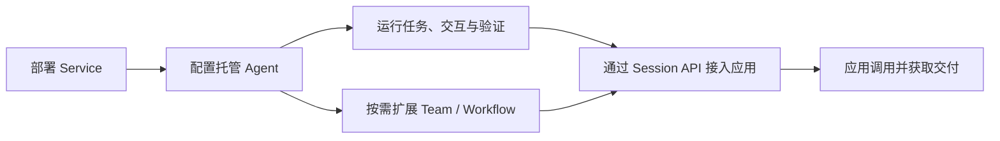
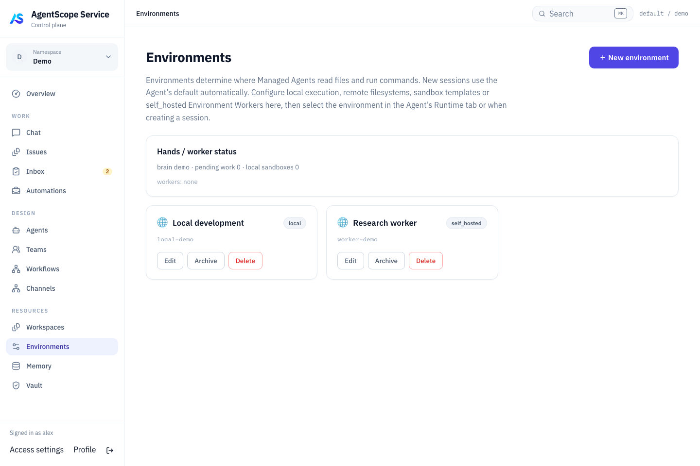
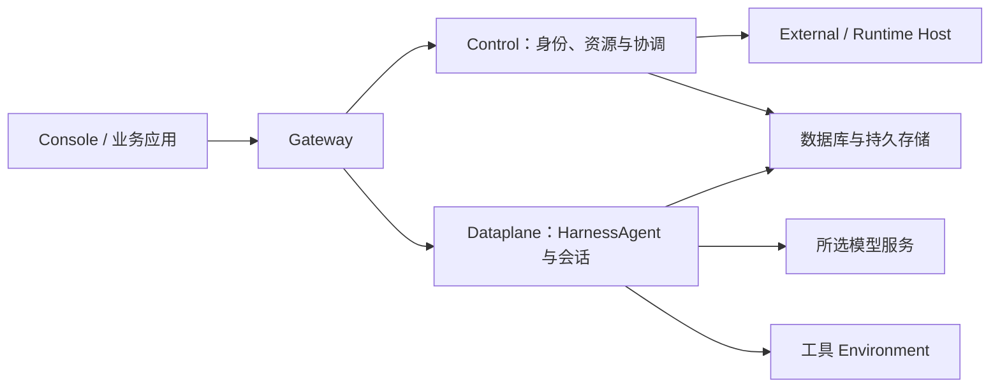

# 第 29 章 Service 概览与部署

> 本章导读：本章从"什么是 AgentScope Service"讲起：它与 Harness SDK 共用同一个 HarnessAgent 内核，区别在于谁来管理运行——这一分工由开篇的"两种使用方式"对照表说清，随后的部署流程图给出从部署到业务交付的完整路径。之后按部署顺序展开四个实操主题：Docker Compose 本机部署、Environment 工具执行环境、账号与 Namespace 权限体系、Kubernetes/Helm 生产安装，最后是接入 Coding Agent 所需的 Runtime Host 安装与运维。读完本章，你可以部署一个可用的 Service，并为后续章节准备好转接的模型、工具执行与账号环境。

## 什么是 AgentScope Service

> **注意**：当前 Service 版本为 `2.1.0-BETA1`，属于预发布版本。

**AgentScope Service 是面向业务应用、可自托管的 Agent as a Service 平台。平台上的托管 Agent（Managed Agent）基于 AgentScope HarnessAgent 内核。** 你在平台中定义 Agent 要完成的工作，并为它配置合适的模型和工具。应用提交任务后，由 Service 运行 Agent 并保存执行过程，使应用能够跟踪进展、参与必要的交互，直到获得结果。

**自托管是目前主要推荐的部署方式。** 团队先在自己的基础设施上部署 Service，再让多个业务应用共享它提供的 Agent 服务。这里的"托管"是指平台替应用管理 Agent 运行时，因此业务团队无需为每个 Agent 应用分别建设和维护运行服务。平台管理员可以根据实际部署接入模型、工具和业务数据，为这些应用提供共用的执行环境。

本章后续小节对应两条入门路径：

- **部署自己的 Service**：从 Docker Compose 开始，完成登录、模型和执行环境准备（见本章"部署 AgentScope Service"一节）。
- **运行第一个托管 Agent**：已有 Service 地址与账号？直接创建 Agent，执行工具并核对结果（见第 30 章）。

### 与 AgentScope Harness 的关系：两种使用方式

Harness SDK 和 Service 托管 Agent 使用同一个 HarnessAgent 内核，你可以根据应用需要选择如何开发和管理运行。下面的对照表概括了两种方式各自需要承担的工作。

| 方式 | 你如何开发 | 谁管理运行 |
| --- | --- | --- |
| Harness SDK | 将 HarnessAgent 嵌入 Java / Spring Boot 应用，用代码组合业务逻辑 | 应用团队负责应用进程、部署与运维 |
| Service 托管 Agent | 在平台配置基于 HarnessAgent 内核的 Agent，通过 Console 或 API 使用 | Service 管理 Agent 执行与会话；平台团队统一维护基础设施 |

如果需要将 Agent 深度嵌入自己的 Java 或 Spring Boot 应用，并在代码中控制运行逻辑，可以从快速开始（见第 2 章）入手 Harness SDK，由应用团队负责部署和运维。如果希望把运行管理交给共享平台，则可以直接在 Service 中配置 Managed Agent，通过 API 或 Console 使用它，而无需先开发一个独立 SDK 应用。已经用 SDK 开发好的 Agent 也有接入路径，可以作为 External Agent 纳入平台，继续复用原有实现。

本机快速体验默认使用 Docker Compose（见本章"部署 AgentScope Service"一节）；Kubernetes 生产安装使用已发布的 Helm Chart（见本章"生产安装"一节）。接入 Hosted Agent 时，通过 Go 安装 CLI 与 Runtime Host（见本章"Runtime Host 安装与运维"一节）。

### 从部署到业务交付



使用 Service 从准备一个可运行的平台开始。完成部署并接通模型和工具执行环境后，你就可以创建 Managed Agent，通过会话验证它是否理解任务、能否正确使用工具，以及交付是否符合预期。随着任务要求逐渐清晰，再为它补充所需的专业知识和能力，让配置的调整有实际执行结果作为依据。

验证完成后，业务应用可以直接使用同一个 Agent，通过 Session API 创建会话并提交任务。后来即使需要增加 Team 或 Workflow，应用仍然使用 Session 和 Turn 来跟踪工作，只需在创建新 Session 时选择合适的执行目标。文档从本章的部署服务与第 30 章的运行第一个托管 Agent 开始，再进入第 31 章"通过 Session API 接入应用"，了解如何把工作交给 Agent 并接入自己的应用。

### 理解 Agent、Session 和 Turn

Agent 描述一项可以反复使用的能力，包括指令、模型、工具以及运行所需的配置。Session 则代表应用围绕一项工作建立的交互记录。创建 Session 时，应用选择要使用的 Agent、Team 或 Workflow，Service 会保存当时的配置，使后续工作有明确的执行依据。

应用在 Session 中提交的每一轮任务称为 Turn。Service 接收输入后会在后台执行，应用可以读取这一轮的状态与结果，也可以通过 Session 的快照和事件流恢复完整交互。Managed Agent 会在同一个 Session 内保留对话上下文；Team 和 Workflow 的 Turn 则分别启动协作任务或流程执行。它们共用调用方式，但内部如何延续上下文以及支持哪些中途操作，仍取决于执行目标的能力。

平台还会用 Issue、Run、Task 和 Attempt 保存协作目标、执行图、成员任务和具体尝试。这些记录帮助使用者定位问题、处理工作和运营平台。应用接入时可以先围绕 Session、Turn 和 Events 完成提交、观察、交互与交付，在需要诊断时再进入这些执行详情。

### 面向哪些应用场景

AgentScope Service 面向希望将 Agent 能力嵌入现有产品和业务流程的开发团队。这些应用中的工作往往需要 Agent 根据上下文持续处理，并通过工具获取信息或执行操作，直到形成可以交付的结果。应用需要知道工作进行到了哪里，也需要在用户补充信息后继续推进。将这类执行交给 Service 后，应用可以围绕业务目标组织交互，并通过平台保留的任务记录了解执行过程。

在面向用户的产品中，Agent 可以伴随用户持续处理一项工作，应用负责把执行进展和待确认事项呈现在合适的位置。对于由业务事件或定时计划发起的后台工作，应用则更关注任务能否被追踪，以及完成后如何接回原有业务流程。这两种使用方式都可以建立在同一套 Agent 服务之上，让团队根据产品需要决定何时调用、如何交互和怎样使用结果。具体的接入方式见第 33 章"场景案例"。

### 扩展到其他 Agent 与协作

Managed Agent 是使用 Service 的主要起点，协作方式则取决于工作如何分解。当一项工作仍由单个 Agent 负责，只需要将其中一部分委派出去时，可以使用 HarnessAgent 内部的 Subagent，由主 Agent 汇总结果并继续执行。随着不同专业能力逐渐成为独立维护的 Agent，就可以通过 Team 建立明确的分工，由负责人协调成员共同完成目标。Service 会保留协作中的任务和交付记录，使团队能够围绕同一项工作持续推进。

在明确分工之后，有些业务还需要约束工作的推进顺序。Workflow 可以将这种要求表达为明确的流程，让 Agent 或 Team 在指定步骤中执行，并在需要人工审批时等待处理。因此，团队协作与流程编排可以配合使用：团队负责完成分派给它的目标，流程决定何时开始这项工作，以及满足什么条件后才能进入下一步。如何选择和组合这些方式，见第 32 章"多 Agent 编排概览"。

参与协作的 Agent 可以全部由 Service 托管，也可以复用团队已有的实现。通过 SDK 或其他框架开发的 Agent，可以作为 External Agent 接入（见第 30 章"注册 External Agent"），在保留原有部署和运行方式的同时接受平台任务并回报结果。对于已有的 Coding Agent，Service 则通过 Runtime Host 将其连接为 Hosted Agent（见第 30 章"连接 Hosted Agent"），由 Host 启动和管理执行。接入后，平台可以在它们实际支持的能力范围内统一分派工作。这些 Agent 既可以参与 Team，也可以独立接受 Session 调用，让已有能力逐步融入平台。

### Service 与应用各自负责什么

Service 将 Agent 的运行管理作为多个业务应用共用的基础能力。应用提交工作后，平台负责协调执行并保留相应记录，应用可以通过 API 了解进展，并在需要时把用户的反馈交回执行过程。这样，用户界面就能围绕一项持续的工作组织体验，后端也可以根据同一份调用记录跟进结果，无需每个应用分别实现 Agent 的会话和任务管理。

业务应用仍然决定 Agent 要完成什么工作，以及结果如何被使用。它需要将用户需求转化为合适的任务输入，并通过业务工具或数据接口，让 Agent 在当前用户获准的范围内开展工作。调用 Service 的凭据用于控制 Agent 服务的访问，业务数据本身的授权仍应落实在相应的业务系统中。Agent 完成执行后，应用还需要依据业务标准判断结果是否可以采用，并决定如何进入后续流程；这也是应用团队定义 Agent 能力时需要一起考虑的部分。

在推荐的自托管模式下，这种分工也延伸到部署和运维。平台团队集中维护 Service 及其依赖的运行资源，为业务团队提供可用的 Agent 服务环境。业务团队在这一环境中配置和改进自己的 Agent，再把它接入产品。多个应用由此可以共享平台的运行管理能力，同时保留各自的业务逻辑和使用体验。

完成 Agent 配置后，可以按第 31 章"通过 Session API 接入应用"连接业务应用。应用保存业务对象与 Session 的关联后，就能持续展示这项工作的进展，在 Agent 需要确认时让用户参与，并在执行结束后取得实际交付。用户离开页面再返回时，应用也可以读取已有记录，继续同一段工作。

### 从哪里开始

从一个你能判断结果是否合格的小任务开始。先按本章"部署 AgentScope Service"一节部署服务，再按第 30 章创建第一个托管 Agent，跑通提交、执行和检查结果的过程。如果团队已有可用的 Service，直接从创建 Agent 开始；希望通过页面完成操作，可以跟随第 33 章"可视化 Console"。

## 部署 AgentScope Service

使用 Docker Compose 在本机启动 AgentScope Service，然后在浏览器中创建并使用 Agent。本节使用已发布的 `2.1.0-BETA1` 预发布版本。

准备好 Docker Engine 或 Docker Desktop（含 Compose v2）、Bash、curl、OpenSSL，以及一个 DashScope API Key。如果团队已有 Service，可直接使用管理员提供的地址和账号，从第 3 步开始。

### 1. 下载并配置

下载 Compose 安装包，解压后生成配置文件：

```bash
curl -fLO https://github.com/agentscope-ai/agentscope-java/releases/download/v2.1.0-BETA1/agentscope-service-2.1.0-BETA1-compose.tar.gz
tar -xzf agentscope-service-2.1.0-BETA1-compose.tar.gz
cd agentscope-service
./init-env.sh 2.1.0-BETA1 sca-registry.cn-hangzhou.cr.aliyuncs.com/agentscope
```

编辑生成的 `.env`，填入自己的 DashScope API Key，并为本地体验启用工具执行：

```dotenv
DASHSCOPE_API_KEY=YOUR_DASHSCOPE_API_KEY
BUILDER_ALLOW_LOCAL_ENVIRONMENT=true
```

Local 工具在 Dataplane 容器内执行。其他模型和执行环境的配置见第 30 章"配置 Agent 与模型"与本章"Environments：配置执行位置"一节。

### 2. 启动服务

```bash
docker compose up -d --wait --wait-timeout 600
```

Compose 会自动拉取镜像并启动数据库和全部 Service 组件。命令成功结束后，打开 [http://localhost:18080](http://localhost:18080)。

若启动失败，运行 `docker compose ps -a` 查看状态，再用 `docker compose logs --tail=100` 查看错误。

### 3. 登录并开始使用

首次部署使用用户名 **`admin`**，密码是 `.env` 中 **`CONTROL_PLANE_BOOTSTRAP_PASSWORD`** 的值。登录后在 **Profile** 中修改密码。

打开 **Design → Agents → New agent**，填写名称（例如 `notes-assistant`）和 **Instructions**，将 **Runtime** 选择为 **AgentScope Managed**，然后点击 **Create & open agent**。**Model** 留空即可使用刚才配置的默认模型。

在 Agent 详情页进入 **Connections → Session API**，填写 **Task message**（例如"把这段会议记录整理成待办：小李周五完成安装说明，下周一评审"），点击 **Create Session and submit**。首次体验可将 **Application API key** 留空，使用当前登录身份。等待 Turn 完成并查看回复，即可确认模型调用成功；完整页面操作见第 33 章"可视化 Console"。

接下来可以按第 30 章"运行第一个托管 Agent"通过 API 完成文件工具验证与应用接入准备。生产部署、网络和远程访问见本章"生产安装"，持久化、升级与备份见第 33 章"运维、恢复与排障"。

## Environments：配置执行位置

> **注意**：此为预览文档，正式版本尚未发布。

Environment 为 Managed Agent 选择文件、Shell 等工具的执行后端。创建 Environment 后，还需要把它的 ID 保存到 Agent 定义的 `defaultEnvironmentId`，或在创建 Session 时通过 `environmentId` 指定。前者为该 Agent 的新会话提供默认值，后者只为这次会话选择执行位置。工具是否启用和是否需要确认，仍由第 31 章"工具、MCP 与权限"决定。

Environment 与 Workspace（见第 30 章）一起参与执行，但分工不同：Workspace 提供指令、Skills 和工具定义，Environment 决定文件和命令实际在哪里执行。即使使用 self_hosted Worker，Managed Agent 的模型调用和推理仍由 Dataplane 承担。Hosted Agent 的 Runtime Host 则负责运行另一类 Agent 运行时，不能用它的注册凭据代替 Environment Worker 凭据。

下面沿用第 30 章"运行第一个托管 Agent"中的平台身份变量（`BASE_URL`、`TOKEN`、`TENANT`、`NAMESPACE`），并使用其中的 `AGENT_ID` 验证文件工具。如果已有合适的 Environment，可以直接取得它的 ID，跳到"绑定与配置"。自行创建时，需要同时准备对应的执行后端；资源创建成功不代表 Worker 已经上线或沙箱凭据已经可用。

### 选择类型

| 类型 | 适用方式 |
| --- | --- |
| local | 在 Dataplane 所在环境执行；管理员必须启用 Local |
| sandbox | 使用 E2B 云沙箱隔离 Shell/文件执行 |
| remote | 共享 BaseStore 文件系统，不提供 Shell |
| self_hosted | 通过自行运行的 Worker 提供执行能力 |

Docker 下 Local 指 Dataplane 容器内部，并不是宿主机的任意目录。生产环境按工具隔离和网络需求选择后端。

### 创建执行环境

下面创建一个 `self_hosted` Environment。Service 返回资源 ID 和只显示一次的 `apiKey`；ID 用于 Agent 或 Session 的资源选择，key 用于 Worker 连接平台。两者与执行管理 API 的用户 `TOKEN` 用途不同。

```bash
ENVIRONMENT_JSON=$(curl --fail-with-body -sS "$BASE_URL/api/environments" \
  -H "Authorization: Bearer $TOKEN" -H 'Content-Type: application/json' \
  -H "X-AgentScope-Tenant: $TENANT" -H "X-AgentScope-Namespace: $NAMESPACE" \
  --data '{"name":"Report worker","type":"self_hosted","config":{}}')
ENVIRONMENT_ID=$(printf '%s' "$ENVIRONMENT_JSON" | jq -er '.id')
ENVIRONMENT_KEY=$(printf '%s' "$ENVIRONMENT_JSON" | jq -er '.apiKey')
```

请保留 `ENVIRONMENT_ID` 和 `ENVIRONMENT_KEY`，并继续启动下面的 Worker。若选择其他类型，应按该类型准备执行后端；Local 需要管理员允许本地执行，Sandbox 需要可用的 E2B 配置。修改 JSON 中的 `type` 不会替你完成这些准备。

### 从发布镜像运行 self-hosted Worker

创建 self_hosted Environment 并保存 API key。设置下列变量：`SCHEDULER_IMAGE` 为发布清单中的 scheduler 镜像全名，`BASE_URL` 为 Worker 可访问的 Gateway URL，`ENVIRONMENT_ID` 和 `ENVIRONMENT_KEY` 为刚创建环境的值。

```bash
docker run --rm \
  --name agentscope-hands \
  -v agentscope-hands:/data \
  --entrypoint java "$SCHEDULER_IMAGE" \
  -Dloader.main=io.agentscope.builder.worker.HandsWorkerMain \
  -cp /app.jar org.springframework.boot.loader.launch.PropertiesLauncher \
  --base-url "$BASE_URL" \
  --environment-id "$ENVIRONMENT_ID" \
  --environment-key "$ENVIRONMENT_KEY" \
  --hands-root /data/hands \
  --worker-id hands-1
```

该进程只向 Gateway 发起出站请求，不需要暴露 Worker 端口。将 Managed Agent 绑定到此 Environment，发起一个读取并写回小文件的任务，观察工具挂起后由 Worker 回传结果并继续。Worker 工作目录位于命名卷中；任务需要的系统程序应预装到你的 Worker 镜像。

正式运行由你的进程或容器管理器负责重启，多个 Worker 使用不同 worker ID。停止前检查已领取的工作，避免将停止进程误认为已取消业务任务。

### 绑定与配置

#### 为一个 Session 选择环境

Worker 或其他执行后端就绪后，下面的请求把 `ENVIRONMENT_ID` 传给新 Session。它不会修改 Agent 的默认环境，因此适合验证一个新环境，或让同一个 Agent 在不同环境中处理各自的任务。请求中的资源 ID 必须对当前身份可用。

```bash
SESSION_JSON=$(curl --fail-with-body -sS "$BASE_URL/api/v1/agent-sessions" \
  -H "Authorization: Bearer $TOKEN" -H 'Content-Type: application/json' \
  -H "X-AgentScope-Tenant: $TENANT" -H "X-AgentScope-Namespace: $NAMESPACE" \
  --data "$(jq -n --arg agent "$AGENT_ID" --arg env "$ENVIRONMENT_ID" \
    '{target:{type:"agent",id:$agent},environmentId:$env}')")
SESSION_ID=$(printf '%s' "$SESSION_JSON" | jq -er '.id')
SESSION_URL="$BASE_URL/api/v1/agent-sessions/$SESSION_ID"
printf '%s' "$SESSION_JSON" | jq '{id, target, environmentId}'
```

#### 设为 Agent 的默认环境

如果希望这个 Agent 后续的新会话默认使用该环境，把下面的内容写入 `resource-defaults.json`，再按第 30 章"设置 Agent 的默认资源"中的完整 GET/PATCH 步骤保存。该步骤会保留 Agent 的工具、指令及其他资源绑定，并携带当前定义版本，避免只修改环境时清空其他配置。

```bash
jq -n --arg env "$ENVIRONMENT_ID" '{defaultEnvironmentId:$env}' > resource-defaults.json
```

保存后，新 Session 省略 `environmentId` 就会使用该默认值；显式传入其他 ID 时，只覆盖本次会话的环境。修改默认值不会把已有 Session 移到新环境。已有 Managed Session 可以通过自身的 PATCH 接口调整 `environmentId`，建议在当前任务结束后操作，并验证后续任务；切换绑定不会自动复制原环境中的工作文件。

#### 检查实际执行

创建 Session 只记录环境选择，还没有执行文件工具。使用第 30 章创建的 Managed Agent 已经启用的读写工具，向 `$SESSION_URL/turns` 提交写入 `environment-check.txt` 并读回的任务，再检查快照和事件中的工具记录。文件应位于所选后端的工作目录，而不是运行 curl 的终端目录。对于 Worker，还应核对它领取和回传工具任务的记录。

如果 Agent 可以回复但文件操作失败，先查看 Session 返回的 `environmentId`，再检查对应 Worker 或沙箱的连接、目录挂载、程序依赖和权限。仅更换 Agent 指令不能修复后端缺失的文件或程序。所需工具没有启用时，则按第 31 章"工具、MCP 与权限"修改 Agent 定义，并创建新 Session 验证。

### E2B sandbox 配置示例

管理员先在部署配置中提供 `BUILDER_E2B_API_KEY`。创建 sandbox 环境后，Config 可使用：

```json
{
  "templateId": "base",
  "isolationScope": "SESSION",
  "sandboxTimeoutSeconds": 300
}
```

需要额外程序时选择包含这些依赖的自定义 E2B template。`workspaceRoot` 设置沙箱工作路径；`persistenceMode` 可选择 `TAR` 或 `NATIVE_SNAPSHOT`，按模板与后端能力验证保存和恢复。remote 类型只有文件系统能力，不能作为远程 Shell Worker 使用。

#### Sandbox 参数

下列字段填写在 Environment 的 Config 中；未填写的 E2B 连接项沿用管理员的部署配置。

| 字段 | 含义与缺省行为 |
| --- | --- |
| `templateId` | E2B 模板；没有部署覆盖时使用 `base` |
| `workspaceRoot` | 沙箱工作路径；没有部署覆盖时使用 `/home/user` |
| `sandboxTimeoutSeconds` | 沙箱存活超时秒数；没有部署覆盖时使用 300 |
| `isolationScope` | Harness 文件系统隔离范围，默认 `SESSION` |
| `persistenceMode` | `TAR` 或 `NATIVE_SNAPSHOT`；默认 TAR，可由部署覆盖 |
| `apiBaseUrl` / `domain` | 自定义 E2B 接入地址；通常沿用部署配置 |
| `apiKey` | 按环境覆盖 E2B 认证；通常由管理员统一配置 |

Config 中填写 `packages`、Docker 镜像或网络参数不会自动安装依赖或落实网络限制。所需程序应准备在 E2B template 中，网络策略由实际后端配置。这些 sandbox 参数不用于配置 local 或 self_hosted 的容器。

### 界面导览

*当前控制台截图，使用固定演示数据。*



在 **Resources → Environments** 创建和维护执行环境，然后在 Managed Agent 的 **Runtime configuration → Session defaults → Default environment** 选择它。保存后创建新会话，核对环境选择再提交任务。资源页面和 Agent 页面分别负责维护后端与选择默认值，因此只完成资源创建还不能确认目标 Agent 正在使用它。

### 无法执行时

排查时先区分资源关联错误和后端执行错误。前者通常需要检查 Agent 默认值、Session 显式选择和当前账号的资源权限；后者需要检查 Worker 在线状态、沙箱凭据、目标目录及工具依赖。环境归档、删除或配置更新可能影响其他引用者，维护前应检查使用情况；它们都不能替代 Turn 的取消接口。

Environment 的 `config` 是资源级配置，PATCH 会替换整个对象，因此更新前应读取并保留其他字段。它没有像 Workspace 那样的发布版本；修改同一个 Environment 时，不应把已有 Session 的固定 Agent 版本理解为对后端配置的隔离。验证配置变更时优先使用新 Session，轮换 Worker key 后同步更新所有连接者。

`config.memoryAccess` 接受按 Store ID 配置的 `read_only` 或 `read_write`，但当前 Managed HarnessAgent 运行路径对共享知识统一使用只读挂载。设置 `read_write` 不会让该路径获得共享知识写入能力，也不会自动绑定 Store。知识读取与管理 API 更新的区别见第 31 章"读取与写入权限"一节。

### 管理 API

使用平台用户 Bearer token 和 `X-AgentScope-Tenant`、`X-AgentScope-Namespace` 请求头，变量准备见第 30 章"运行第一个托管 Agent"中的 API 身份准备。列表按当前身份可检查的资源过滤；读取需要 inspect，修改需要 edit，创建需要空间资源创建权限。

| 操作 | API | 参数与响应 |
| --- | --- | --- |
| 列表 | `GET /api/environments` | 返回数组；可用 `limit`（1–500）、`offset`（非负，须同时提供 limit）；总数在 `X-Total-Count` |
| 创建 | `POST /api/environments` | `name`、`type`、可选 `config`；返回 Environment 和只显示一次的 `apiKey` |
| 详情 | `GET /api/environments/{id}` | `id`、`name`、`type`、`config`、`ownerId`、`archivedAt`、时间戳；不返回 key |
| 更新 | `PATCH /api/environments/{id}` | 可选 `name`、`config`；config 整体替换，type 不可变 |
| 归档 | `POST /api/environments/{id}/archive` | 返回带 `archivedAt` 的 Environment；不再出现在活动列表 |
| 轮换 key | `POST /api/environments/{id}/rotate-key` | 返回新的 `apiKey`，旧 key 随即失效 |
| 删除 | `DELETE /api/environments/{id}` | 返回 204 |

这些 Environment 修改接口没有版本条件参数。更新 config 前先读取并保留其他需要的设置；归档后的资源不能继续 PATCH。删除或归档前检查 Agent 与 Session 的使用情况，资源维护不是取消正在运行任务的接口。

## 账号、Namespace 与权限 API

> **注意**：此为预览文档，正式版本尚未发布。

Service 的权限分为账号身份、Namespace 成员角色、资源操作权限和工作可见性。业务应用应分别检查"用户能否调用这个 Agent"和"用户能否查看这项工作"。Agent、Team 或 Workflow 可见，并不代表其他用户的私人 Issue、会话和文件也可见。

### 初始化账号

部署时配置自己的 bootstrap 管理员，首次登录后更改密码。平台管理员通过账号 API 建立日常账号；业务调用使用日常账号或应用凭据。

| 操作 | API | 关键参数 / 返回 |
| --- | --- | --- |
| 登录 | `POST /api/auth/login` | `username`、`password`；返回 `token` |
| 当前身份 | `GET /api/auth/me` | 当前账号与角色 |
| 修改自己的密码 | `POST /api/user/change-password` | `currentPassword`、`newPassword` |
| 列出 / 创建账号 | `GET/POST /api/admin/users` | 创建传 `username`、可选 `initialPassword`、`roles`；返回 `user`，自动生成密码时另返回 `generatedPassword` |
| 管理员重置密码 | `PATCH /api/admin/users/{id}/password` | `newPassword` |
| 管理员修改平台角色 | `PATCH /api/admin/users/{id}/roles` | `roles`、当前账号 `version` |

平台角色与下文 Namespace 角色是两组权限。账号引用使用返回的稳定 ID，不使用可修改的显示名称。管理员重置密码后，原登录凭据可能失效，应重新登录获取 token。

### Namespace

Namespace 是资源与授权边界，Workspace 是 Agent 读写文件的环境，两者职责不同。账号可同时属于多个空间，请求通过空间 header 选择操作范围。

以下示例使用 Bash、`curl` 和 `jq`。先按第 31 章"认证与空间"一节准备 `SERVICE_URL`（Service 地址）、`TOKEN`（用户 Bearer token）、`TENANT`、`NAMESPACE`，并定义请求函数：

```bash
api() {
  curl --fail-with-body --silent --show-error \
    -H "Authorization: Bearer $TOKEN" \
    -H "X-AgentScope-Tenant: $TENANT" \
    -H "X-AgentScope-Namespace: $NAMESPACE" \
    -H 'Content-Type: application/json' "$@"
}
```

先读取当前可用空间，不假设安装中一定存在某个共享空间：

```bash
api "$SERVICE_URL/api/v1/me/namespaces"
api "$SERVICE_URL/api/v1/me/scope"
```

`/me/namespaces` 返回 `items`，每项包含 `tenant`、`name`、`kind`、`roles`、`owner`、`accessVersion`。`/me/scope` 返回当前默认范围及可选空间。后续请求的 header、query 和 JSON 中的 tenant/namespace 要保持一致。

平台管理员可创建共享空间。下面将 `OWNER_ID` 设置为空间所有者的账号 ID：

```bash
api "$SERVICE_URL/api/v1/namespaces" --data "$(jq -n --arg owner "$OWNER_ID" \
  '{name:"engineering",displayName:"研发空间",owner:$owner,members:{}}')"
```

创建响应为 `{namespace}`。`name` 使用小写字母、数字和连字符，以字母或数字开头，最长 63 字符，不能使用保留的 `personal-` 前缀。owner 省略时使用当前管理员；tenant 由当前安装决定。个人空间和全局空间由平台管理，不能按普通共享空间修改成员和生命周期。

### 配置成员和角色

空间管理者读取 `GET /api/v1/namespaces/{name}`，再通过 PUT 提交 `version` 与新的成员映射。`members` 是完整替换，先保留原成员再加入同事：

```bash
current=$(api "$SERVICE_URL/api/v1/namespaces/$NAMESPACE")
api "$SERVICE_URL/api/v1/namespaces/$NAMESPACE" -X PUT \
  --data "$(jq --arg user "$COLLEAGUE_ID" \
    '{version:.namespace.version,members:(.namespace.members + {($user):["member"]})}' \
    <<<"$current")"
```

| Namespace 角色 | 主要用途 |
| --- | --- |
| `viewer` | 发现和读取授权资源 |
| `member` | 使用资源、发起与跟进工作 |
| `developer` | 配置 Agent 等资源，同时可使用资源 |
| `operator` | 执行运维操作 |
| `admin` | 管理成员、资源配置与操作权限 |
| `auditor` | 显式的工作审计能力，不因 admin 身份自动获得 |

一个成员可拥有多个角色。资源策略可进一步限制可发现、可使用和可编辑的内容。授予或移除 auditor 只能由空间所有者或平台管理员完成；归档/恢复共享空间也要求这两种身份之一。

更新空间还可提交 `displayName` 或 `archived`。发生 409 版本冲突时重新读取，不能用旧成员列表覆盖别人的更改。

### 配置具体资源的权限

调用 `GET /api/v1/namespaces/{name}/resources` 查看资源与依赖。对单个 Agent，读取以下接口会返回当前用户的 `decisions`、配置版本及可能的 `dependencyError`；有管理权限时还返回 `policy`：

```bash
permission=$(api "$SERVICE_URL/api/v1/namespaces/$NAMESPACE/resources/agent/$AGENT_ID/access")
printf '%s\n' "$permission" | jq .
```

资源管理员可用 PUT 更新 `{version,policy}`。例如将一个 Agent 限制为指定同事可发现、可使用：

```bash
api "$SERVICE_URL/api/v1/namespaces/$NAMESPACE/resources/agent/$AGENT_ID/access" -X PUT \
  --data "$(jq -n --arg user "$COLLEAGUE_ID" \
    --argjson version "$(jq '.version' <<<"$permission")" \
    '{version:$version,policy:{mode:"restricted",users:{($user):["discover","use"]}}}')"
```

该请求替换资源策略，应保留仍需使用的其他用户、用户组与依赖授权。`mode:"inherit"` 继承空间角色，`restricted` 使用资源授权。可授予的动作是 `discover`、`use`、`inspect`、`edit`、`publish`、`manage`。受权用户必须已是空间成员。

| policy 字段 | 用途 |
| --- | --- |
| `users` | 账号 ID 到动作列表 |
| `groups` | 本空间用户组 ID 到动作列表 |
| `consumers` | 允许使用该依赖的资源，格式为 `kind:id`，必须存在真实依赖关系 |
| `exportTo` | Workflow 模板可导入的目标空间，不授予跨空间执行权限 |

例如 Team 依赖成员 Agent，Managed Agent 还可能依赖 Memory、Vault 和 Environment。检查依赖授权后再让普通成员试用，不能只检查 Team 本身的 `use`。

用户组通过 `GET/PUT /api/v1/namespaces/{name}/groups` 管理，PUT 使用 `{version,groups}`；每组包含 `name`、账号 ID 列表 `members`、`roles`。用户组管理人的授权，Team 编排 Agent，两者不是同一个概念。

### 工作自身的共享范围

Issue 创建时的 `access` 支持 `private`、`namespace` 或 `shared`；shared 的 `members` 将账号 ID 映射为 `reader` 或 `contributor`。只有根 Issue 创建者可通过 `PUT /api/v1/issues/{issueId}/access` 修改共享，提交 `{version,access}`，版本来自最新 Issue。

工作共享不会授权使用新的 Agent，也不会绕过 Namespace 成员检查。平台管理员不是所有私人工作的默认读者；审计应通过相应授权进行。

### 排查访问失败

先确认身份和空间，再读取资源的 `decisions` 与依赖错误，最后检查 Issue 共享。资源不可见时可能返回 404，已可见但操作不被允许时可能返回 403；用正确账号和返回的原因排查，不要替换成内部服务令牌。

普通成员可通过 `POST /api/v1/namespaces/{name}/requests` 提交 `version`、`resource`（`kind:id`）、`action`、`reason` 申请授权。管理员向 `/requests/{requestId}/review` 提交 `{version,approve}` 决策，相关记录可通过 `/requests` 查询。

用两个日常账号验证第 34 章"在 CRM 中生成客户方案"案例：一个配置资源，另一个只负责调用并查看自己的工作。应用凭据按目标资源授权和 scope 检查访问，不能替代对用户 Namespace 权限的验证。控制台对应入口见第 33 章"可视化 Console"。

## 生产安装

> **注意**：当前发布版本为 `2.1.0-BETA1`，属于预发布版本。用于生产前请验证实际部署。

本节介绍面向生产环境的 Kubernetes 与 Helm 安装。正式 Service Chart 安装 Gateway、Control、Dataplane 和 Scheduler。PostgreSQL、持久存储、入口域名和 TLS 由你管理。应用每组件默认单副本并采用 Recreate 更新，部署和升级需要维护窗口。

### 1. 准备依赖

准备 Kubernetes、Helm、可达的 PostgreSQL，以及 Workspace 所需的 RWX StorageClass 或已有共享 PVC。Artifact 默认使用 RWO。工作目录会被多个组件挂载；只在单节点可用的 RWO 卷不能替代跨节点共享存储。

可以直接从公开 Helm 仓库安装 Chart，无需下载源码。先下载与版本配套的配置模板和初始化 SQL：

```bash
curl -fLO https://chickenlj.github.io/helm-charts/examples/2.1.0-BETA1/kubernetes.env.example
curl -fLO https://chickenlj.github.io/helm-charts/examples/2.1.0-BETA1/postgres-init.sql
```

用应用数据库所有者在目标数据库执行 SQL，创建 `cp`、`rt`、`dp` 三个 schema。为数据库、文件和密钥建立备份策略。如需离线安装，从 [GitHub Release](https://github.com/agentscope-ai/agentscope-java/releases/tag/v2.1.0-BETA1) 下载 `agentscope-service-2.1.0-BETA1-kubernetes.tar.gz` 和 `SHA256SUMS`，核对校验和后解压；包中包含 Chart 和相同的配置文件。

### 2. 创建 Secret

复制 `kubernetes.env.example` 到私有文件并替换全部占位值：数据库连接、随机 JWT/internal/Vault 密钥、初始管理员密码及需要的模型凭据。URI 中的密码 URL 编码，JDBC 密码单独提供原值。根据数据库证书设置 TLS。

```bash
kubectl create namespace agentscope
kubectl -n agentscope create secret generic agentscope-service --from-env-file=/private/path/service.env
```

Secret 是运行配置；不要把明文文件或含 Secret 的渲染结果提交到仓库。

### 3. 准备 values

以下是 `production-values.yaml` 起点，替换域名、StorageClass、Ingress class 和 TLS Secret。TLS Secret 必须预先存在或由你的证书控制器创建。

```yaml
existingSecret: agentscope-service
allowLocalEnvironment: false
publicURL: https://agentscope.example.com
persistence:
  workspaces:
    storageClass: shared-rwx
    size: 20Gi
  artifacts:
    storageClass: standard
    size: 20Gi
ingress:
  enabled: true
  className: nginx
  host: agentscope.example.com
  tls:
    - hosts: [agentscope.example.com]
      secretName: agentscope-service-tls
```

已有 PVC 时设置对应 `existingClaim`。私有镜像配置 `imagePullSecrets`；Ingress annotations 按实际控制器设置 SSE 超时和缓冲行为。资源 requests/limits 可分别通过 `control`、`dataplane`、`scheduler`、`gateway` 调整，按实际任务负载压测定容。

### 4. 安装指定版本

添加公开 Helm 仓库并更新索引，无需登录仓库：

```bash
helm repo add agentscope https://chickenlj.github.io/helm-charts
helm repo update agentscope
helm search repo agentscope/agentscope-service --versions --devel
```

已发布的 [Helm 仓库](https://github.com/chickenlj/helm-charts) 在 GitHub Pages 托管索引与安装包。使用 `--version 2.1.0-BETA1` 固定版本；查询命令的 `--devel` 会包含预发布版本。Chart 通过 `appVersion` 使用配套的镜像版本。

安装指定 Chart 版本，并配置对应的镜像命名空间：

```bash
helm upgrade --install service agentscope/agentscope-service \
  --version 2.1.0-BETA1 \
  --namespace agentscope \
  --set imageRepository=sca-registry.cn-hangzhou.cr.aliyuncs.com/agentscope \
  -f production-values.yaml \
  --wait --timeout 10m
```

离线安装时，将 `agentscope/agentscope-service` 和 `--version 2.1.0-BETA1` 替换为下载的 `./agentscope-service-2.1.0-BETA1.tgz`。保持 Chart 与组件镜像版本配套。Chart 会在你的集群创建工作负载；发布 Helm 仓库本身不会部署运行中的 Service。

### 5. 验证用户路径

```bash
kubectl -n agentscope get pods,pvc,svc,ingress
kubectl -n agentscope port-forward service/service-agentscope-gateway 18080:8080
```

确认 PVC Bound、Pod Ready，使用初始管理员登录公开域名并修改密码。验证模型连接、执行 Environment、第一次 Chat、Issue 交付和长连接。port-forward 用于排障，不替代公开回调地址验证。

### 升级、卸载与运行模式

Secret 更新后重启相关 Deployment；升级前按第 33 章"运维、恢复与排障"备份，并保留原 Chart、values 和镜像版本。Chart 保留 PVC；重新安装时显式指定保留的 existingClaim。

此 Chart 提供完整 Service standalone HTTP。Kubernetes-native ControlPlane/ASDP 是另外的部署模式，应按 SDK 网络契约规划，不把两个 Chart 直接叠装为同一服务。当前 Chart 的单副本安装不提供无停机迁移或多副本 HA 保证。

### 部署边界与生产规划

本章"部署 AgentScope Service"一节中的 Compose 命令部署了完整 Service。用户通过 Gateway 访问平台，Control 管理身份和资源并协调工作，Dataplane 运行 HarnessAgent 和会话，Scheduler 承担调度相关工作。数据库和持久存储则保存平台运行所需的数据。维护这套共享服务，是平台自托管时需要承担的运维工作。

工具执行环境可以与平台服务分开准备。即使文件或 Shell 工具运行在沙箱、远端文件后端或 `self_hosted` Worker 中，Managed Agent 的推理过程仍由 Dataplane 承担。接入 External Agent 或 Hosted Agent 时，执行工作还会涉及原有应用或 Runtime Host。这些资源连接到已部署的 Service，分别提供对应的执行能力。



部署位置确定后，还需要检查各组件实际连接到哪里。自托管 Service 仍然可以调用远程模型，工具也可能通过 MCP 或其他接口访问外部系统。规划网络时，应结合所选模型、工具和存储逐一确认数据流向，并为需要从外部到达平台的 OAuth 等回调准备入口。

本地体验可以使用 Compose 部署（见本章"部署 AgentScope Service"一节）；由平台团队长期维护的环境，可以根据基础设施选择 Kubernetes。下表列出各条路径需要准备的资源，已有团队平台的使用者通常只需完成账号和执行环境的准备。

| 路径 | 当前用途 | 需要准备 |
| --- | --- | --- |
| Docker Compose | 本机体验、开发与集成验证 | 发布包、Docker、模型凭据、持久磁盘 |
| Kubernetes / Helm | 由平台团队管理的安装 | PostgreSQL、共享 Workspace 存储、Artifact 存储、Secret、域名与 TLS |
| 已有团队平台 | 应用开发者直接使用 | 服务地址、账号、授权空间、可用模型与 Environment |

当前完整 Service Chart 为每个组件配置一个副本，并采用 Recreate 方式更新，所以升级时需要安排维护窗口，不能据此假定服务具备多副本高可用或无停机升级能力。Kubernetes-native ControlPlane/ASDP 是为相应 SDK 和运行传输提供的另一种部署模式，应根据接入要求选择；它并不是需要叠加到完整 Service Chart 上的一组必装组件。

平台交付给业务团队时，管理员需要提供可访问的 Service 地址和账号，并说明该账号可以使用哪个 Namespace。使用者还需要知道默认模型是否可用、应选择哪个工具环境，以及业务资料放在哪里、如何获得访问权限。有了这些信息，就可以按第 30 章"运行第一个托管 Agent"完成模型与文件工具验证，再通过第 31 章"通过 Session API 接入应用"检查业务应用的调用过程。

进入生产使用前，应进一步验证用户能否持续接收执行事件、刷新页面后能否恢复已有内容，以及交付文件是否可以按权限下载。如果业务依赖 Webhook，还需确认接收端能够收到通知。数据库和文件备份则需要配合恢复演练，并覆盖未完成工作如何继续处理。这样才能确认平台在实际使用和故障恢复时都能按预期工作。

### 入口与网络

Compose 默认只将 Gateway 暴露在宿主机的 `127.0.0.1:18080`，用户请求由这个入口转发到内部服务。其余组件通过内部网络通信，容器端口及暴露方式如下。

| 组件 | 容器端口 | 暴露方式 |
| --- | --- | --- |
| Gateway | 8080 | 默认宿主 `127.0.0.1:18080` |
| Control | 8081 | 内部网络 |
| Dataplane | 8082 | 内部网络 |
| Scheduler | 8083 | 内部网络 |
| PostgreSQL | 5432 | 内部网络 |

如果反向代理运行在同一台宿主机上，可以将请求转发到 `127.0.0.1:18080`。如果代理运行在另一个容器中，它看到的 `localhost` 指向代理容器自身，因此需要配置共享网络，或使用该容器能够到达的宿主地址。对外入口仍应指向 Gateway，内部组件和数据库通过私网提供服务。

### 启用远程访问

需要从其他设备访问这套部署，或联调 OAuth、Channel 的公网回调时，可以为 Gateway 配置 HTTPS 入口。先准备域名和 TLS 证书，再让反向代理将请求转发到 Gateway。随后在 `.env` 中把 `BUILDER_OAUTH_PUBLIC_URL` 设置为实际的外部地址，例如 `https://agentscope.example.com`；如果 Gateway 还需要调整监听地址或端口，再修改 `BIND_ADDRESS` 和 `GATEWAY_PORT`，并重建容器使配置生效。

执行进度通过 SSE 长连接传输，因此代理需要及时转发事件，关闭事件流缓存，并允许足够长的读取超时。配置完成后，除了确认能够登录，还应运行一次持续生成内容的任务，检查事件是否陆续到达、刷新后能否重新连接，以及业务所需的回调是否正常。

## Runtime Host 安装与运维

> **注意**：本页使用 `2.1.0-BETA1` 预发布版本。

Runtime Host 运行在安装 Coding Agent 的电脑或服务器上。控制面负责派发和记录工作，Host 使用本地 provider 执行。

### 使用 Go 安装

在目标 Linux 或 macOS 主机安装 [Go](https://go.dev/doc/install) 1.26 或更新版本。从同一个已发布版本安装两个命令，无需下载仓库源码或在该主机部署 Service：

```bash
go install github.com/agentscope-ai/agentscope-java/agentscope-service/service-controlplane/v2/cmd/as@v2.1.0-BETA1
go install github.com/agentscope-ai/agentscope-java/agentscope-service/service-controlplane/v2/cmd/agentscope-runtime-host@v2.1.0-BETA1
```

Go 为当前机器编译二进制，安装到 `GOBIN`；未设置时使用 `$(go env GOPATH)/bin`。将该目录加入 PATH，并检查两个命令：

```bash
AS_CLI_BIN_DIR="$(go env GOBIN)"
if [ -z "$AS_CLI_BIN_DIR" ]; then
  AS_CLI_BIN_DIR="$(go env GOPATH)/bin"
fi
export PATH="$AS_CLI_BIN_DIR:$PATH"
as version
agentscope-runtime-host -help
```

将 PATH 配置写入 shell 配置文件，以便新终端使用。`as version` 应显示 `2.1.0-BETA1`。`/v2` 模块路径和 `@v2.1.0-BETA1` 指定本次已发布的预发布版本。

另外在这台主机安装、登录所需的 Coding Agent provider，并确认它能完成一次请求。CLI 和 Runtime Host 连接已有 Service，不负责部署平台。升级时先停止 Runtime Host，将两个 `go install` 命令中的版本一起更新，安装后重启，并保留原状态目录。

### 连接

```bash
as connect https://agentscope.example.com
as runtime status
as runtime probe
```

按 CLI 提示完成登录或 enrollment。连接会保存本机配置并启动守护进程；用户正常使用无需反复传递共享内部令牌。

### 日常操作

```bash
as runtime logs
as runtime stop
as runtime start
```

配置与状态默认在 `~/.agentscope/runtime-host/`。保留 Host 身份和状态文件，避免把已有主机错误地注册为新实例。不要把该目录当成公开的配置样例。

连接成功后，通过管理 API 检查 Host 在线、provider 可用，再绑定 Hosted Agent 并派发一项小任务。失败时同时查看 Task Attempt 和 Host 日志。

Runtime Host 不是托管 Agent 的 Hands Worker；有关执行环境见本章"Environments：配置执行位置"一节。

### 无交互服务器连接

由有权限的操作者生成短期 enrollment token，再交给待连接主机使用：

```bash
as runtime enrollment-token create
```

在目标主机将该值放入 `AGENTSCOPE_ENROLLMENT_TOKEN` 环境变量，再执行 connect。服务交换出绑定 Host 身份和范围的凭据。不要把 enrollment token 或 `config.json` 放进共享脚本。

### CLI 参考

| 命令 | 用途 |
| --- | --- |
| `as connect URL` | 登录/注册本机，保存配置并启动 daemon |
| `as runtime status` | 查看运行状态 |
| `as runtime probe` | 检查 provider 可用性 |
| `as runtime logs -f` | 跟踪日志 |
| `as runtime restart` | 重启 daemon |
| `as runtime stop` / `start` | 停止或启动 |
| `as connect --help` | 查看该版本提供的高级参数 |

配置目录中的 `config.json` 含连接身份，`state/host.id` 保存稳定 Host ID，`daemon.log` 用于排障，`workspaces/` 保存任务工作目录。升级 CLI 前检查活跃任务，再替换配套二进制并重新启动，保留这些持久状态。

### 主机接入与管理 API

CLI 使用同一套 Host API。平台账户凭据用于授权接入和管理主机；enrollment token 用于首次交换；`runtimeToken` 只供对应 Host 的运行协议使用。

| 方法与路径 | 请求字段/查询参数 | 响应 |
| --- | --- | --- |
| `POST /api/v1/runtime-host-enrollment-tokens` | 平台 Bearer；JSON `tenant`、`namespace` | 201；`enrollmentToken`、scope、`expiresAt` |
| `POST /api/v1/runtime-host-enrollments/exchange` | enrollment Bearer；JSON `hostKey`，最长 200 字符 | 201；`runtimeToken`、`hostKey`、scope、`expiresAt`；范围来自 token |
| `POST /api/v1/runtime-host-enrollments` | 平台 Bearer；JSON `hostKey`、`tenant`、`namespace` | 直接签发对应 Host 的 `runtimeToken` |
| `GET /api/v1/runtime-hosts` | 平台 Bearer；查询 `tenant`、`namespace`，可选 `poolName`、`state` | `items`；包含 `id`、`hostKey`、`state`、`capacity`、`active`、`lastSeenAt`、`capabilities` |
| `GET /api/v1/runtime-hosts/{hostId}` | 平台 Bearer；Host UUID | `host` |
| `PATCH /api/v1/runtime-hosts/{hostId}/capacity` | 平台 Bearer；`capacity` 为 1–50，`expectedCapacity` 为当前值 | 更新后的 `host`；并发修改冲突时重新读取 |
| `POST /api/v1/runtime-hosts/{hostId}/drain` | 平台 Bearer | `host`；停止领取新工作 |
| `POST /api/v1/runtime-hosts/{hostId}/resume` | 平台 Bearer | `host`；恢复可调度状态 |

单 scope 部署使用服务配置的固定 scope；多 scope 部署创建 enrollment token 时必须指定 `tenant`、`namespace`。交换请求不能更改 token 中的范围。drain 用于维护前停止接收新任务，取消正在执行的任务仍使用第 33 章"工作分派、审批与验收"的 AgentTask API。

例如，在已经配置管理访问的终端生成接入凭据：

```bash
curl -sS "$SERVICE_URL/api/v1/runtime-host-enrollment-tokens" \
  -H "Authorization: Bearer $TOKEN" \
  -H 'Content-Type: application/json' \
  -d '{"tenant":"default","namespace":"default"}'
```

把响应的 `enrollmentToken` 安全地传到目标主机，再运行 `as connect`，无需业务应用手动调用 Host register、heartbeat 或 claim。

#### Runtime Host 协议接口

下面的接口由 daemon 使用 Host 范围的 Bearer 凭据调用。需要实现自定义 Host 时才直接对接它们；业务任务分派应调用 Issue 或 Session API。

| POST 路径 | 关键请求字段 | 行为 |
| --- | --- | --- |
| `/api/v1/runtime-hosts/register` | `hostKey`、`poolName`、scope、`capacity`，可选 `daemonVersion`、`os`、`arch`、`labels`、`capabilities` | 返回 `host` 与 `heartbeatIntervalSeconds`，保存 `host.id` 与 `host.leaseGeneration` |
| `/api/v1/runtime-hosts/{hostId}/heartbeat` | `generation`、`active`、可选 `capabilities` | 更新存活与能力，返回 `host` |
| `/api/v1/runtime-hosts/{hostId}/state` | `generation`、`state` | 更新状态，返回 `host` |
| `/api/v1/runtime-hosts/{hostId}/execution-attempts/claim` | `tenant`、`namespace`、`runtimePoolName`、`generation`、`leaseOwner`、`leaseToken`，可选 `leaseSeconds` | 无任务返回 204；成功返回 `task`、`context`、`attempt`、`taskToken`、`attemptToken`、`runtimeProfile`、`executionOverrides`、`definition` |

领取后，以下相对路径均位于 `/api/v1/runtime-hosts/{hostId}/execution-attempts/{attemptId}` 下。除 Host Bearer 外，必须在 `X-Execution-Attempt-Token` Header 传入 claim 返回的 `attemptToken`。请求 JSON 至少携带本次 `leaseToken`、`fencingToken`，daemon 同时传入 `generation`、`leaseOwner`；不能使用另一次执行的值。

| POST 相对路径 | 额外字段 | 用途 |
| --- | --- | --- |
| `/renew` | 可选 `leaseSeconds`，默认 30 秒 | 续租，读取服务端取消/终态 |
| `/preparing` | 无 | 报告正在准备 |
| `/running` | 可选 `providerSessionId`、`workspaceKey` | 报告已开始 provider 执行 |
| `/checkpoint` | `checkpoint`、可选 `providerSessionId` | 记录 provider 恢复信息 |
| `/events` | 正整数 `ordinal`、`provider`、`eventType`、可选 `providerSessionId`、`raw` | 提交执行事件；`raw` 最大 256 KiB |
| `/complete` | 可选 `result`、`checkpoint` | 报告完成 |
| `/fail` | `failureCode`、`failureMessage`、可选 `checkpoint` | 报告失败 |
| `/cancelled` | 无 | 确认执行已取消 |

普通状态方法返回 `attempt`；事件接收响应应按 `accepted` 判断，Attempt 已封存时停止继续提交。Host checkpoint 是 provider 恢复材料，不是统一 Agent API 已支持的 checkpoint 恢复入口。能力区别见本章"Runtime Host 安装与运维"一节中关于 Hosted 执行的说明。

### 主机注册和任务选择

连接时 Host 注册稳定身份、范围、池、provider 描述与容量。调度结合 Agent 绑定、能力要求和运行策略产生 Attempt；Host 领取符合条件的工作并维持租约。Host 在线、provider 能 probe、Agent 可派发是三个不同检查点。

Runtime Profile 决定 provider 参数，Pool 提供可选执行主机。并发受 Host capacity 和上层调度策略共同约束。

### 准备与执行

Host 为执行准备任务工作目录，将平台支持的指令和能力文件映射到 provider 格式，再用该目录启动 provider。它不会默认切换到用户正在编辑的本地仓库；仓库、输入资料与分支需要在任务准备中明确。

任务范围凭据和工作上下文通过环境及 MCP/CLI 提供给执行者。provider 可以读取工作、发表评论和上传产物。把文件留在 Host 磁盘上并不等于其他协作者可以访问，应使用 Artifact 交付需要共享的结果。

### 事件、确认与恢复

适配器将 provider 事件转换为平台执行记录。支持的平台确认由 Host 转发工具请求并等待决定；不支持的平台确认必须按 provider 自身的权限方式处理。

Host 保留日志、provider 会话标识和 checkpoint，用于支持的恢复路径。重启时保留状态目录与 Host 身份；只声明 Resume 支持不能保证任意中断都能恢复，目标 provider 的会话仍需存在且可访问。OpenClaw 当前适配器不提供 Session resume。

### 重试和取消

取消会向执行链路传播，应检查 Attempt 终态以及 provider 进程是否结束。重试是新的 Attempt；只有符合恢复条件时才使用原 provider 会话。跨后端 fresh fallback 依赖持久 Issue、评论和 Artifact 重建上下文，不能搬迁进程内记忆。

使用 `as runtime logs -f` 配合 Task/Attempt 诊断。若无任务可领，检查范围、池、绑定、容量与所需能力；若领取后失败，检查 provider 登录、参数、工作目录和工具依赖。

相关内容：本章即安装连接文档；支持的 provider 见第 30 章"选择运行类型"；Team 协作见第 32 章。

### 使用 API 跟踪和控制工作

平台账户通过 Issue 或 Session 分派任务；Host 凭据仅用于 daemon 领取、续租和回报。业务调用者无需接触 `leaseToken` 或 provider 进程。

| 场景 | API 与参数 | 响应/用途 |
| --- | --- | --- |
| 读取 AgentTask | `GET /api/v1/agent-tasks/{taskId}` | 当前任务状态与执行关联 |
| 查询物理尝试 | `GET /api/v1/execution-attempts?tenant=...&namespace=...&taskId=...`，可选 `state`、`limit` | `attempts`，每次重试有独立记录 |
| 读取单个 Attempt | `GET /api/v1/execution-attempts/{attemptId}` | `attempt`，包含 backend、Host、租约、失败与恢复信息 |
| 请求任务取消或重试 | `POST /api/v1/agent-tasks/{taskId}/cancel`、`/retry` | 按 Issue API（见第 33 章）提交版本等参数；随后读取最终状态 |
| 查看 Workflow 运行过程 | `GET /api/v1/orchestration-runs/{runId}/graph`、`/events` | 节点图和运行事件，反映 Host 的执行结果 |
| 恢复应用画面 | `GET /api/v1/agent-sessions/{sessionId}/turns/{turnId}/snapshot`，再连接 `/events/stream` | 按 snapshot 游标接续 SSE；使用对应业务调用凭据 |

Host 运行协议中的 `/checkpoint` 保存 `providerSessionId` 和 checkpoint，供适配器与任务恢复路径使用。它不是供应用任意选择 checkpoint 并恢复所有后端的接口。统一 invocation 的 `checkpoint_restore` 当前为 false；Hosted conversation 支持取消，补充输入、审批与 resume 则不能套用 Managed 的能力承诺。始终读取 `/api/v1/agent-sessions/{sessionId}/turns/{turnId}/capabilities` 的 `available_commands` 后再显示交互操作。

SSE 断线续传只恢复已经记录的输出，不重新执行工具，也不等于恢复 Host 进程。需要保留的交付物应上传为 Artifact；Host 磁盘、provider 会话和框架内部状态仍有各自生命周期。Host 接口与参数见本节上文"主机接入与管理 API"。
