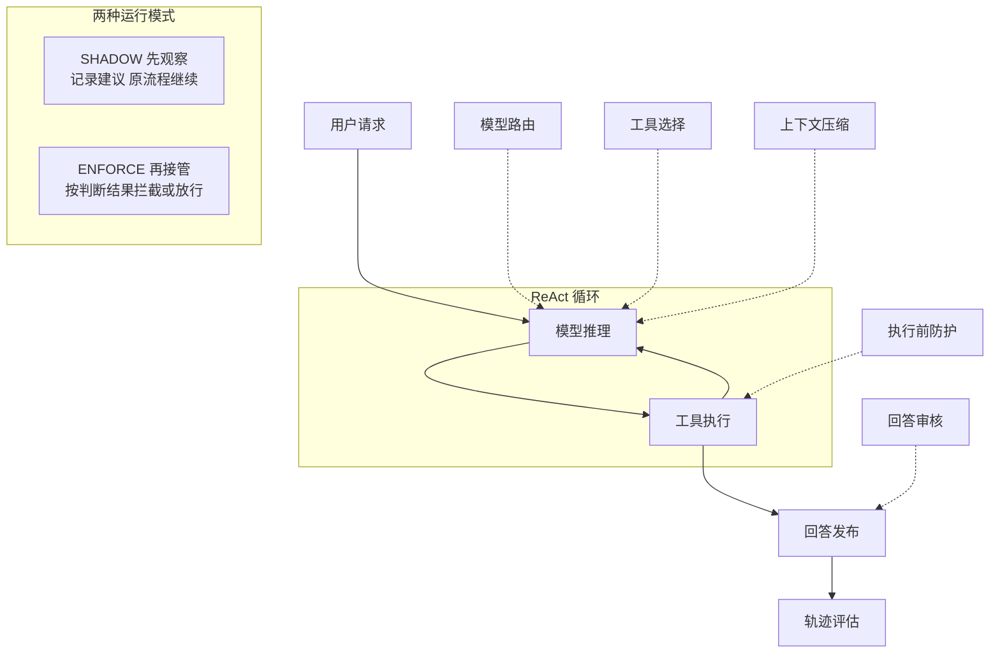

# 第 35 章 JEV 概念

> 本章导读：Agent 运行时大量出现的不是长链路推理，而是"该用哪个模型、哪些工具该暴露、这个操作能否放行"一类高频小判断。JEV 为这类判断提供类型化结果——判断由模型完成，应用拿到的是概率、选择或评分，而不是需要二次解析的自由文本。本章先讲清 JEV 是什么、为什么 Agent 需要独立的判断能力、以及它在 Agent 运行链路中的位置（图 35-1）；再给出全书 JEV 能力的分类总表（第 37、38 章的阅读地图），并用一个客服退款流程演示各能力如何组合；最后讲清三种接入方式与 Noul / Choice / Score 三种问题类型契约，区分评审结果与执行决策、学会在判断不足时保留不确定性。读完本章，你就掌握了后续三章共同的语言。

## JEV 是什么

JEV 为 Harness 中需要语义判断的环节提供类型化结果：哪些工具适用、回答是否有依据、历史材料是否需要保留、任务是否需要验证。你可以直接调用组件，也可以注册中间件或只读工具，让判断参与 Agent 的运行流程。

它的来源是 TypeSafe AI 推出的结构化决策模型 Jev，AgentScope Java 已将其集成为独立扩展模块。AgentScope 团队在实践文章中这样描述这个模型：它不是聊天模型，不生成文本，也不做工具调用，做的事情只有一件——接收上下文和一组结构化问题，返回类型化的答案和校准概率。集成方式上，AgentScope 没有把它注册成 `Model` provider——`Model` 接口面向聊天推理、返回 `ChatResponse`，与结构化判断在调用频率、超时预期和类型系统上都不匹配；Jev 以扩展模块 `io.agentscope:agentscope-extensions-jev` 的方式存在，代码位于 `io.agentscope.extensions.judge.jev` 包前缀之下。

所谓"类型化结果"，指的是判断由模型完成，但应用消费的不是一段分析文本，而是带类型、可直接做分支的结构：是非判断（JEV 中称为 Noul 问题）返回陈述为真的概率（例如直接返回 `noul: 0.92`），单选（Choice）返回各候选的概率分布和整体置信度，评分（Score）返回等级评分。应用拿到数值即可做分支、路由或阈值判断，不需要再做自由文本解析，也不用担心模型在 JSON 前面多输出一句"好的，我来分析一下"。

JEV 与生成的关系也需要划清：`JevClient` 只产出判断，它返回概率、选择或评分；生成用户回答仍由你配置的生成模型完成。是否发布、修订或转人工，由上层组件根据判断结果决定。换句话说，Jev 回答的是"可以吗"和"选哪个"，不是"为什么"，更不代替面向用户的文本生成。

本章后续内容也对应这套结构：根包提供 `JevClient`、`JevJudge`、`JevExecution`、`JevGuardrail` 等入口，其余能力按 example、evaluation、context 等子包组织。下一节先回答一个更基本的问题——Agent 为什么需要这样一套独立的判断能力。

## 为什么 Agent 需要独立的判断能力

AgentScope 团队在实践文章中指出：一个 Agent 从收到请求到完成任务，看起来是在"推理"和"执行"之间循环，但拆开每一步会发现，真正密集发生的是判断。这个请求该用哪个模型处理？当前上下文里哪些工具应该暴露给模型？这个 bash 命令能不能自动放行？这个回答的置信度够不够直接返回？这些判断每一个都不复杂，却出现在 Agent 运行时的每一个角落，加起来是一项被长期低估的系统性开销。

这些判断有三个共同特点：高频、低复杂度、需要确定性输出。它们不需要模型展开长链路推理，但需要系统快速得到一个可以做分支的结论——是与否、选哪个、打几分。

文章同样分析了两种现有做法的问题。第一种是让主模型顺便判断：在 prompt 里加一句"先判断该用哪个模型，再回答"。这确实能工作，但每次判断都要走完整的推理路径，返回的是一段自由文本，系统还要再做一次解析；更麻烦的是主模型的输出格式不受控——你让它返回 JSON，它可能在 JSON 前面加一段"好的，我来分析一下"。第二种是写硬编码规则："包含 `rm -rf` 的命令一律拒绝"。这解决了确定性问题，却覆盖不了长尾——"列出这个目录下的所有文件"和"删掉这个目录"在规则层面很难区分，在语义层面一目了然。

问题的本质是：Agent 系统里大量需要的不是"更聪明的推理"，而是"更便宜、更可靠的判断"。JEV 提供的是第三条路：把这些判断从主模型的推理路径和业务硬编码中抽出来，交给一个专门优化的决策模型，用类型化接口和校准概率返回结果。这一动机的完整展开，包括三个参考中间件的设计与"什么时候不该用"的边界讨论，见第 41 章。

## JEV 在 Agent 运行链路中的位置

这些判断点不是一组游离的 API，而是挂在 Agent 运行链路的特定环节上——通过 `.middleware(...)`、`.compaction(...)` 或 Toolkit 注册工具，把判断放在对应执行环节，如图 35-1 所示。

*图 35-1：JEV 判断点在 Agent 运行链路中的挂接位置与 SHADOW、ENFORCE 两种运行模式（另有 OFF 档不启用判断）*

如图 35-1 所示，图中标注的六类判断点分布在链路各处：模型路由与工具选择发生在推理之前，执行前防护发生在工具执行之前，回答审核对应发布前对输入输出的审核，上下文压缩在长任务中缩减工具历史、保留关键约束，轨迹评估则在调用结束后统计工具使用和回答质量。AgentScope 提供的三个参考中间件正落在其中三个位置——Agent 入口的模型路由、推理前的工具选择、行动前的执行防护。

运行模式、总预算与观察器由 `JevExecution` 统一配置（细节见第 36 章），模式共三档：OFF 不调用判断，沿原流程；SHADOW 实际发起判断并记录建议，同时把原输入继续交给后续流程；ENFORCE 按防护结果阻止或放行受保护调用。中间件默认 OFF——环境变量中存在密钥不会自动启用能力；不同用途可以采用不同模式，例如工具选择保持 SHADOW，退款防护单独接管。需要注意，轨迹事后评估与长任务监督只允许 OFF/SHADOW，它们不能撤销已经发生的行为。

判断不足或失败时，系统按用途回退，而不是让 Agent 停摆：工具选择保留原候选工具，模型路由使用原模型不重跑，执行前防护在 ENFORCE 下拒绝受保护调用、其他工具沿原流程。这也是"独立判断能力"的设计取向——判断失败不是停摆，而是降级到安全路径。

## 按要解决的问题选择能力

| 能力分类 | 典型场景 | 功能入口 |
|---|---|---|
| Agent 轨迹评估与定义复用 | 检查工具使用、回答依据和需求覆盖；离线与在线复用指标 | 评审定义、轨迹评估、自定义指标、批量评估 |
| 上下文治理与恢复 | 长任务中保留关键约束、缩减工具历史、恢复原始材料 | 压缩与归档、显式交换对规划、记忆准入 |
| 长任务进展与交付监督 | 持续识别偏航、停滞、验证缺失和交付复核需求 | 持续监督、接入验证证据、单次任务复核 |
| 工具选择与执行防护 | 大工具集筛选；退款、发消息等执行前检查 | 工具选择、执行防护 |
| 模型、阶段与团队路由 | 按任务复杂度、工具能力、容量与配额选择候选 | 调用级路由、显式阶段、团队建议 |
| 检索证据与知识问答 | 过滤提示注入、保留冲突证据、重排结果、检查引用支持 | 证据处理、相关性与依据检查、Knowledge 适配 |
| 内容审核与回答修订 | 发布前审核输入输出，只修订未通过的草稿 | 内容护栏、Agent 回答修订、独立草稿管线 |
| 代码评审与证据定位 | 对 diff 或源码快照筛选风险并定位证据区域 | 分阶段代码评审 |
| 浏览器只读导航与验证 | 从可见链接中导航，在授权页面查找信息 | 浏览器执行、仅生成动作建议 |
| 业务分类与客服评审 | 多标签分流、条件性退款诉求与回复承诺检查 | 候选分类、客服评审 |

表中功能入口的展开位置只有两处：首行的四项评估能力在第 38 章；其余各行的功能入口都在第 37 章。

## 用一个客服流程理解组合方式

用户说"未发货就退款"时，先用工具选择保留查询和退款工具，再用执行前防护检查退款建议是否得到当前证据支持。Agent 形成回答后，用草稿审核检查是否虚构到账或遗漏退款条件；调用结束后，再用轨迹评估统计工具使用和回答质量。

这些能力可独立启用。第一次接入可从退款工具防护（见第 37 章）学习场景、配置和失败处理，也可以直接运行第 36 章"运行案例与功能入口"一节的离线案例，观察审核失败后仅修订草稿的过程。

## 选择接入方式

- **直接调用**：应用已经有输入、证据或草稿时，调用 Judge、评估器、证据处理器等组件，自行消费结果。
- **Harness 集成**：通过 `.middleware(...)`、`.compaction(...)` 或 Toolkit 注册工具，把判断放在对应执行环节（见第 36 章）。
- **AgentScope Service**：通过 session 的 `agentOverrides.jev` 配置用途；检索源、模型目录、浏览器和验证证据仍由宿主提供。Service 配置见第 37 章"在 AgentScope Service 中配置 JEV"一节。

JEV 判断不授予工具权限，也不证明业务操作已经成功。工具授权、ACL、参数校验、幂等及独立完成验证仍由你的应用负责。后续各功能节分别说明建议、实际输入和执行结果的关系。

## 选对问题类型：仍以条件性退款为例

构建一个判断时，先决定你需要的是概率、单选结果还是分级评分；再决定应用如何使用它。结果符合结构并不保证语义正确。

用户要求"查订单，未发货再退款"。判断"退款工具是否适用"时，订单查询和退款都可能适用，应分别问是非题；判断"这次分析选哪个模型"时才用单选；评估一项风险的严重程度则用分级评分。

即使 JEV 认为退款操作合适，也要检查订单事实与执行权限。把业务输入、语义建议和执行结果分开，后面各项 API 的状态才不会被误读。

## 三种问题类型

| 类型 | API | 返回值 | 典型用途 |
|---|---|---|---|
| 是非判断 | `NoulQuestion` / `NoulAnswer` | 陈述为真的概率 | 工具是否适用、回答是否有依据 |
| 单选 | `ChoiceQuestion` / `ChoiceAnswer` | 选项、完整分布和置信度 | 模型路由、动作选择 |
| 评分 | `ScoreQuestion` / `ScoreAnswer` | 等级分布、加权分数和置信度 | 风险严重度、分级评估 |

一个 `SystemOneRequest` 包含共享 `state` 和按 ID 命名的多个问题。把业务材料放入 state，把判断标准写进问题；不要把金标答案（预先标注的期望结果）或隐式授权混入待评输入。多选适用性应逐候选判断，不能用一次互斥 Choice 代替。

## 区分评审结果与执行决策

`JevJudge` 对 Noul 条件聚合：`PASS`、`FAIL`、`INCONCLUSIVE`、`ERROR`。它适合全部条件都必须满足的审核。期望为 false 时按 `1-p` 计算满足条件的概率。定义与阈值见第 38 章。

`JevExecution.Decision` 表达组件是否形成有效建议：`DECIDED`、`INCONCLUSIVE`、`ERROR`、`CANCELLED`、`SKIPPED`。`DECIDED` 不等于任务成功，也不等于内容通过；应读取具体组件的结果。模式与预算见第 36 章。

`JevMetricResult` 把状态、分类 label、分数 score 和可空 passed 分开。没有通过策略的分类指标不应被强制转成 PASS/FAIL。轨迹指标见第 38 章。

## 判断不足时保留不确定性

低置信度、明确否定和请求失败是不同情况。工具选择可能回退原候选，执行防护可能拒绝受保护调用，事后评估则保留错误或弃权。按具体用途处理，不能把"没有有效判断"统一解释为允许。

概率和置信度需要按场景校准。文本模型模拟概率时尤其要保留其自报值属性，不把它当成测得的准确率。完整比较方法见第 38 章"评测自己的 Harness 与判断后端"一节。

## 从一个判断开始

先按第 36 章"创建客户端与发起类型化判断"提交"退款已完成"与"尚未发起退款"的记录，读取 Noul 概率；再按第 38 章"用条件定义评审标准"加入阈值和结果处理。可运行的 `JevApplicationScenarios judge` 用预设值展示 PASS、FAIL、INCONCLUSIVE 三种结果，帮助确认应用分支，而非验证模型准确率。

第 36 章的运行案例无需密钥，展示检索、审核和有限修订；所有可运行源码位于 `agentscope-examples/jev`，入口包为 `io.agentscope.examples.jev`。文档中的概率阈值是示例值，应使用自己的业务样本校准。

接入真实模型前，先了解本章的 Noul、Choice、Score 与状态契约（本章下半部分），再按第 36 章"创建客户端与发起类型化判断"与"配置运行模式、预算与决策观察"两节完成客户端与运行模式配置。

## 本章小结

JEV 把 Agent 运行时高频出现的"该用哪个模型、哪些工具该暴露、这个操作能否放行"从主模型推理和硬编码规则中抽出来，交给专门的决策模型，返回可直接分支的类型化结果。判断点通过中间件、压缩配置或只读工具挂在 ReAct 循环的特定环节上，运行模式分 OFF / SHADOW / ENFORCE 三档且默认 OFF；判断不足或失败时按用途回退到安全路径，而不是让 Agent 停摆。

读到这里，你应当能：说出 JEV 与生成模型的分工——`JevClient` 只产出判断，不代替面向用户的文本生成；按"概率、单选还是评分"为一个判断选对问题类型；区分 `JevJudge` 的评审状态与 `JevExecution.Decision` 的执行状态，并且不把"没有有效判断"统一解释为允许。下一步就到第 36 章，发出第一个类型化判断。
