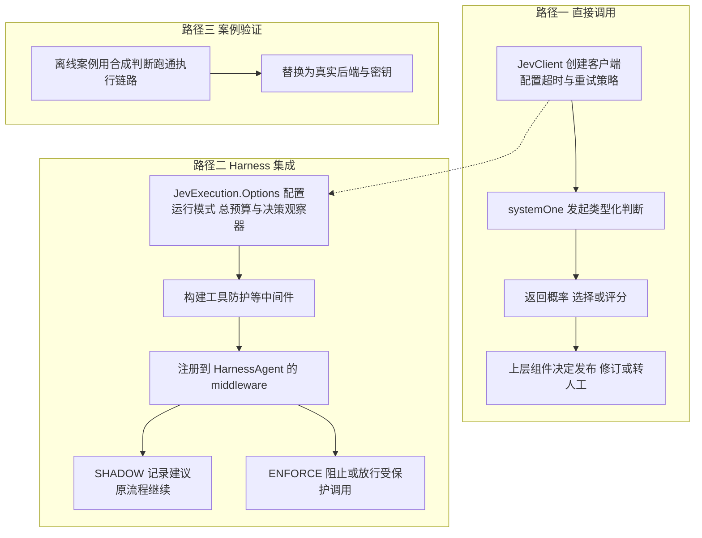

# 第 36 章 接入方式

> 本章导读：第 35 章回答了 JEV 是什么、能解决哪几类判断问题；本章回答工程落地的问题——怎么把它接进你自己的 Java 工程。接入分三步，对应本章三节：先用 `JevClient` 创建客户端并发起类型化判断；再为工具选择、防护、路由等 Harness 能力统一配置运行模式（OFF/SHADOW/ENFORCE）、总预算与决策观察器；最后用官方离线案例在无需密钥的情况下跑通全部执行链路，再替换为真实后端。三节都可以当作操作手册逐条照抄——Java 代码与命令行原样可运行。

> **注意**：本章有两件事先说在前面。其一，本章多处示例使用离线案例：它们注入预设概率、不调用 HTTP、不读取密钥，只用于演示状态与执行分支，离线结果不能作为模型效果、准确率或性能的证据；接入真实后端的方式见各节说明。其二，环境变量中存在密钥不会自动启用任何中间件——工具选择、防护等 Harness 能力需要显式注册并设置运行模式。

JEV 的三条接入路径如图 36-1 所示。



*图 36-1：JEV 的三条接入路径*

## 创建客户端与发起类型化判断

这一节解决的问题是：业务代码需要的不是一段自由文本，而是一次可编程消费的结构化判断——概率、选择或评分。做完这一节，你会得到一个配置好超时与重试策略的 `JevClient`，以及在响应中读取类型化答案的最小代码路径。

使用 `JevClient` 调用结构化判断接口。它返回概率、选择或评分；生成用户回答仍由你配置的生成模型完成。

### 添加依赖

```xml
<dependency>
  <groupId>io.agentscope</groupId>
  <artifactId>agentscope-extensions-jev</artifactId>
  <version>${agentscope.version}</version>
</dependency>
```

涉及 Harness 中间件、压缩或 Agent 案例时，还需要同版本 `agentscope-harness`；扩展中的 Harness 依赖为 optional。

### 场景：检查"退款已完成"是否有证据

业务记录是"尚未发起退款"，Agent 却生成了"退款已完成"。这里把回答与记录放在同一份 state 中，询问记录是否支持回答。客户端负责发起并校验类型化请求；是否发布、修订或转人工，由上层组件根据结果决定。

### 发起判断并读取概率

```java
import io.agentscope.extensions.judge.jev.*;
import java.time.Duration;
import java.util.Map;

var client = JevClient.builder()
    .apiKey(System.getenv("TYPESAFE_API_KEY"))
    .model("jev-latest")
    .timeout(Duration.ofSeconds(5))
    .retryPolicy(new JevRetryPolicy(2, Duration.ofMillis(500)))
    .build();
var request = SystemOneRequest.builder()
    .state(Map.of("answer", "退款已完成", "record", "尚未发起退款"))
    .question("supported", new NoulQuestion(
        "Does the business record support the answer?", null))
    .build();
var pending = client.systemOne(request); // Mono<SystemOneResult>
var result = pending.block();            // 独立命令行案例可阻塞等待
var answer = (NoulAnswer) result.answers().get("supported");
System.out.println("记录支持回答的概率：" + answer.noul());
```

这里返回的数值不是退款状态，也不会改变业务记录。若需要 PASS/FAIL/INCONCLUSIVE 与阈值处理，直接使用条件评审（见第 38 章），避免各业务重复实现分支。

在响应式服务中返回或组合 `Mono`，避免为了记录结果重复订阅。共享 state 在请求完成前不要修改。需要多个判断时，在同一个 builder 上按不同 ID 添加 `.question(...)`。

### 配置与错误

默认端点为 `https://api.typesafe.ai`，默认模型为 `jev-latest`，单次请求超时 5 秒。没有显式 key 时，依次读取 `TYPESAFE_API_KEY`、`JEV_API_KEY`。

客户端向 `/v1/systemone` 发请求，对 HTTP 429、529 和 5xx 按策略退避重试；非重试错误、重试耗尽和响应校验失败抛出 `JevException`。它检查题目集合、答案类型、概率分布和 Score 等级。应用不应从缺失答案中补造成功结果。

单次 HTTP 超时与一次逻辑判断的总预算不同。多批次、重试和退避的总上限由 `JevExecution`（见本章"配置运行模式、预算与决策观察"一节）、Judge 或对应组件设置。取消可以停止本地订阅，远端请求是否中断取决于传输实现。

### Spring Boot 配置

```xml
<dependency>
  <groupId>io.agentscope</groupId>
  <artifactId>agentscope-jev-spring-boot-starter</artifactId>
  <version>${agentscope.version}</version>
</dependency>
```

```yaml
agentscope:
  jev:
    api-key: ${TYPESAFE_API_KEY:}
    model: jev-latest
    timeout: 5s
    retry:
      max-retries: 2
      initial-backoff: 500ms
```

可用 `JevClientBuilderCustomizer` bean 定制构建器。Starter 配置客户端；具体 Harness 能力仍需显式注册和设置模式。

### 使用文本模型做同题对照

`JevTextBackend(model, transport)` 接收 `SystemOneRequest`，生成兼容 Chat Completions 的请求。transport 是由应用提供的 `Function<String, Mono<String>>`，负责端点、鉴权、超时和取消。

适配器严格校验 JSON、题目和分布，不补缺项、不自动归一化非法概率；文本模型自报概率需单独校准。可运行的 HTTP 对照入口见第 38 章"评测自己的 Harness 与判断后端"一节。

### 先运行离线案例

`JevApplicationScenarios` 的 `judge` 场景展示同类退款证据检查的三种状态。按本章"构建一次，运行多个案例"一节设置 `JEV_CP` 后执行：

```bash
java -cp "$JEV_CP" io.agentscope.examples.jev.JevApplicationScenarios judge
```

上面的客户端代码会访问真实接口，需要显式配置密钥；接口失败应走错误处理，不能用离线结果替代真实判断。

到这里，第一条接入路径已经通了：给定 state 和问题，拿到一个带概率的类型化结果。但一条能发判断的通道只覆盖了"直接调用"——第 35 章讲过，JEV 更大的价值发生在 Agent 运行链路里：工具选择、执行前防护、模型路由。这些 Harness 能力默认都是关闭的（章首"注意"说过，密钥不会替你打开它们）。怎么打开、又怎么避免一个还不成熟的判断直接干扰线上流程？这就是下一节的主题。

## 配置运行模式、预算与决策观察

`JevExecution.Options` 为工具选择、防护、模型路由等能力统一配置运行模式、总预算和观察器。你可以先记录建议，再按用途决定是否让判断影响 Agent 流程。做完这一节，你会得到一套按用途隔离的中间件配置：每个用途有自己的模式、预算、版本标识和观察器，可以独立验证、独立灰度。

本节反复出现三种运行模式，先把含义说清：**OFF** 不发起判断，沿原流程执行；**SHADOW** 实际发起判断并记录建议，但无论建议如何，原输入都继续交给后续流程；**ENFORCE** 发起判断，并按防护结果阻止或放行受保护调用。怎么选：拿不准判断质量时从 SHADOW 开始——直接 ENFORCE 可能误拦正常请求，完全 OFF 又积累不了对照样本；等"建议拦截"与业务预期的偏差可接受后，再把需要硬约束的用途单独切到 ENFORCE，其余用途保持各自合适的模式。

### 示例场景：先观察退款防护，再开启实际拦截

你准备给客服 Agent 增加退款前检查，但尚不知道判断会不会误拦正常请求。直接接管可能影响业务，完全关闭又无法积累样本。

SHADOW 会实际发起判断并记录建议，同时把原输入继续交给后续流程。这样可比较"建议拦截"与业务预期；验证和校准后，再把退款防护单独切到 ENFORCE。

### 1. 为这项用途设置预算和版本

```java
import io.agentscope.extensions.judge.jev.JevExecution;
import io.agentscope.extensions.judge.jev.example.JevAutoModeMiddleware;
import java.time.Duration;

var options = new JevExecution.Options(
    JevExecution.Mode.SHADOW, Duration.ofSeconds(2), "refund-guard-v1",
    (ctx, record) -> System.out.println(record));
var guard = JevAutoModeMiddleware.builder(client)
    .execution(options)
    .guardedTool("refund")
    .build();
```

`client` 按"创建客户端与发起类型化判断"一节（见本章）创建，`guard` 注册到 `HarnessAgent.builder().middleware(guard)`。版本用于区分不同配置的观察结果；改了评审用途或阈值时不要沿用无法区分的版本标识。

2 秒覆盖一次逻辑判断的所有批次、客户端重试和退避，不包含之后 Agent 执行工具的时间。客户端单次 HTTP 超时不能代替这个总预算。

### 2. 区分建议与实际动作

| 模式 | 是否发起判断 | 退款例子中的实际行为 |
|---|---|---|
| OFF | 不调用 | 沿原流程，可能不产生观察记录 |
| SHADOW | 需要判断时调用 | 即使建议拒绝，退款仍进入原执行链 |
| ENFORCE | 需要判断时调用 | 按防护结果阻止或放行受保护调用 |

切换模式需要应用明确更新配置并重新装配中间件；不同用途可以采用不同模式，例如工具选择保持 SHADOW，退款防护单独接管。

### 3. 记录足以比较的决策元数据

观察器收到当前 RuntimeContext 和 Record：

| 字段 | 如何使用 |
|---|---|
| `purpose / version / mode` | 区分工具选择、防护等用途及当时配置 |
| `status / reason` | 区分明确判断、不确定、调用失败和取消 |
| `elapsed` | 查看这次检查耗时，不误当成整个 Agent 时间 |
| `recommendation` | 记录推荐模型、拒绝调用 ID 等建议，与实际执行记录对照 |

Record 不包含消息全文、工具参数、密钥或原始错误。宿主可以用 RuntimeContext 关联 run/session；观察器应快速返回，数据库写入需自行排队。观察器抛出的 RuntimeException 不会阻断 Agent，但同步阻塞不会自动转成后台任务。

### 运行与验证

按本章"构建一次，运行多个案例"一节设置 `JEV_CP`：

```bash
java -cp "$JEV_CP" io.agentscope.examples.jev.JevHarnessExample
```

这个离线例子对相同的工具选择、防护与路由输入依次运行三种模式。观察输出可以看到 SHADOW 的拒绝建议仍进入模拟派发，ENFORCE 才产生拒绝工具结果。完整源码为示例模块中的 `JevHarnessExample`。

需要真实模型对照时，使用退款防护用例（见第 37 章"在工具执行前检查受保护操作"的"退款场景对比测试"小节）。

### 按用途理解失败策略

| 用途 | ENFORCE 判断失败时 |
|---|---|
| 工具选择 | 保留原候选工具 |
| 模型路由 | 使用原模型，不重跑 Agent |
| 执行前防护 | 拒绝受保护调用，其他工具沿原流程 |
| 内容及质量审核 | 不发布未通过的文本 |

公共状态包括 DECIDED、INCONCLUSIVE、ERROR、CANCELLED、SKIPPED；TIMEOUT 和 CALL_OR_RESPONSE_ERROR 是故障原因。取消只通知观察器，不伪造一个回退结果继续派发；底层阻塞 HTTP 是否立即终止取决于传输实现。

轨迹事后评估与长任务监督只允许 OFF/SHADOW，不能撤销已经发生的行为。直接调用 Judge、记忆评审等应用 API 会立即进入各自评审流程，不隐式读取全局模式；应用的用途开关应包围完整工作流。

模式、预算和观察器现在都配置好了，但声明不等于运行。真实后端的验证既需要密钥，结果也不可复现；官方案例把同样的链路做成了离线可跑——先在合成判断上确认 SHADOW 记录建议、ENFORCE 产生拦截，再替换为真实后端。下一节就是这条验证路径。

## 运行案例与功能入口

这一节解决验证与上手的问题：前两节的代码都面向真实接口，最好先在不接网络、不读密钥的前提下，确认整条执行链路按声明的方式运行。做完这一节，你会得到一条可复现的本地运行路径，以及每个 JEV 能力的独立演练入口。

所有案例都位于 `agentscope-examples/jev`，包名为 `io.agentscope.examples.jev`。你可以先用合成判断跑通 Harness 链路，再替换为真实后端与业务证据。

### 构建一次，运行多个案例

在仓库根目录执行：

```bash
mvn -pl agentscope-dependencies-bom,agentscope-distribution/agentscope-bom,agentscope-examples/jev -am install -DskipTests
mvn -pl agentscope-examples/jev dependency:build-classpath -Dmdep.outputFile=/tmp/jev-examples-cp.txt
JEV_CP="agentscope-examples/jev/target/classes:$(cat /tmp/jev-examples-cp.txt)"
java -cp "$JEV_CP" io.agentscope.examples.jev.JevIntegrationExample
```

该组合案例查询退款条件、取回授权证据、生成遗漏条件的草稿、审核失败后仅修订文本，最后返回保留退款条件的回答。它使用内存检索、脚本生成模型和合成判断，不读取密钥或访问模型服务。

### 先确认这个例子发生了什么

预期最终回答保留"未使用、七天内"两项退款条件。生成模型共调用三次：提出检索工具、生成不完整草稿、仅重写文本；修订阶段不携带工具。控制台中的合成评审统计用于确认预设分支，不是线上准确率。

如果只想理解一个功能，可以先运行对应的独立场景（目录见本章末"参考速查"），再进入第 37 章对应 API 节替换业务输入和后端。

### 按能力运行

做法不变：把上面 java 命令末尾的类名换成目标入口即可。除单独说明的本地浏览器案例外，默认均可离线运行；每个入口的完整源码位于示例模块 `agentscope-examples/jev`。全部入口收拢在本章末"参考速查"的功能入口表中，便于随查随换。

### 使用本地浏览器

`JevBrowserLocalExample` 启动 loopback 页面并使用显式提供的 Chromium 可执行文件。默认仍使用合成判断，不访问外部网站或模型接口：

```bash
java -cp "$JEV_CP" io.agentscope.examples.jev.JevBrowserLocalExample \
  --browser "/Applications/Google Chrome.app/Contents/MacOS/Google Chrome"
```

浏览器路径按你的系统替换。会话导航到政策页，由独立验证器检查目标内容，再关闭页面和本地服务。浏览器 API 见第 37 章。

### 接入真实调用

客服案例追加 `--live` 才调用客户端。其他普通案例没有统一 live 开关，应按相应 API 节替换脚本调用器和模型。浏览器与基准程序使用各自显式 `--live-jev` / `--live-qwen` 参数；仅设置环境变量不会将离线案例切换为真实请求。

## 本章小结

JEV 的接入是一条三步路径：

1. **直接调用**：引入 `agentscope-extensions-jev`，用 `JevClient` + `SystemOneRequest` 发起类型化判断，读取概率、选择或评分；默认端点、模型与重试策略开箱即用，失败统一抛出 `JevException`；
2. **Harness 集成**：`JevExecution.Options` 为工具选择、防护、路由等用途统一配置 OFF/SHADOW/ENFORCE、总预算与决策观察器，按"先 SHADOW 观察、后 ENFORCE 接管"的路径灰度，判断失败时的行为按用途区分；
3. **案例验证**：构建一次 `agentscope-examples/jev`，用合成判断离线跑通全部执行链路（`JevIntegrationExample` 及各独立场景），再通过密钥与 `--live` 类开关替换为真实后端。

两条边界贯穿全章：离线结果只演示分支，不证明模型效果；环境变量里存在密钥不会自动启用任何能力，Harness 能力必须显式注册并设置模式。逐个能力深入是第 37 章的主题；要在自己的数据上度量 JEV 与 Harness 的表现，见第 38 章。

**验收清单**——读到这里，你应该能：

- ☐ 在 Maven 工程中引入 `agentscope-extensions-jev`，创建 `JevClient` 并发起一次 `systemOne` 判断，读出 `NoulAnswer` 中的概率；
- ☐ 说出 OFF/SHADOW/ENFORCE 各自的行为，以及为什么灰度路径是"先 SHADOW、后 ENFORCE"；
- ☐ 为退款防护这类用途配置预算、版本与决策观察器，把中间件注册到 `HarnessAgent`，并说清观察器里该记录哪些字段、哪些内容 Record 不包含；
- ☐ 本机构建示例模块并用 `$JEV_CP` 跑通 `JevIntegrationExample`，说出它验证了什么、不能证明什么；
- ☐ 知道把离线案例换成真实后端要动哪些开关（密钥、`--live`、`--live-jev` / `--live-qwen`）。

## 参考速查

本节收拢正文中随查随用的内容；正文主线中的最小路径不依赖本节。

### 案例功能入口

先按"构建一次，运行多个案例"一节构建并设置 `JEV_CP`，再把 java 命令末尾的类名换成表中入口。除单独说明的本地浏览器案例外，默认均可离线运行；每个入口的完整源码位于示例模块 `agentscope-examples/jev`。

| 能力 | 入口 |
|---|---|
| 工具选择与模型路由的独立场景 | `JevHarnessScenarios`，参数 `selection` 或 `routing` |
| 工具选择、防护与调用级路由 | `JevHarnessExample` |
| 客服 Judge | `JevCustomerSupportExample` |
| 检索、护栏与回答修订组合 | `JevIntegrationExample` |
| 轨迹评估 | `JevTraceEvaluationExample` |
| 上下文压缩与恢复 | `JevContextCompactionExample` |
| 持续监督与验证证据 | `JevSupervisionExample` |
| 代码评审 | `JevCodeReviewExample` |
| 检索证据与草稿修订 | `JevEvidenceExample` |
| 自动与显式阶段路由 | `JevPhaseRoutingExample` |
| 只读浏览器工具 | `JevBrowserExample` |
| 单独运行应用与评审场景 | `JevApplicationScenarios`，不带参数运行全部；也可指定 `classification`、`context`、`memory`、`support`、`team`、`browser`、`judge`、`evaluation`、`task-review`、`rag` 或 `draft` |
| 分类、记忆、团队与应用组件 | `JevApplicationExample` |

脚本概率用于演示状态与执行分支，不能用其结果计算真实模型准确率；基准程序的固定输入与真实后端开关见第 38 章"评测自己的 Harness 与判断后端"一节。
