# 第 43 章 行业案例

> 本章导读：四个来自真实团队与产品的实践样本，共同回答一个问题——Agent 从 demo 走进生产，工程上要补哪些课。案例一是海外物流业财团队的长文复盘：从"付款审批 Agent 其实只是 Chatbox"的反省出发，归纳 Agent 工程的七类坏味道，在对比 LangChain、Google ADK 与 AgentScope 后，自建配置驱动的 Agent 运行引擎——DB 驱动的注册与快照、草稿/发布双轨版本管理、运行链路四大 SPI 定制、工程级 HITL、进化闭环与灰度体系。案例二是金融级智能体底座 FinXScope：六层 AI 原生架构、十大核心能力与高码/低码协同，已在多家头部金融机构投产。案例三只作说明：《AIDC 物流》与案例一实为同稿的两个发布版本，不重复收录正文。案例四以 agentscope-codingagent 示例为线索，讲组织级 Coding Agent 要翻过的五面墙（执行隔离、状态续接、上下文治理、多租户并发、多入口接入）与从单机到企业的演进路线。案例文章中的截图已下载至本地，随书离线呈现。
>
> 四个案例视角互补，不必按序通读：**平台建设者**（要为多个业务团队搭运行底座）重点读案例一与案例二——前者是一份完整的自建决策记录，后者是产品化底座的设计蓝图，对照着读收获最大；**应用开发者**（在框架之上做业务 Agent）重点读案例二的核心能力解析与案例四的演进路线；**质量与评测团队**重点读案例一的"Agent 整体效果进化"与案例二的"落地实践指南"；任何想把 Coding Agent 推广到团队层面的读者，案例四都值得一读。案例观点与结论均属原团队，与教材正文互为印证：正文讲"框架给了什么"，案例讲"生产还要补什么"。
>
> 两点阅读提示：案例保留了大量阿里内部生态名词（Aone、HSF、Normandy、BUC、Sunfire、SchedulerX2 等），分别指代研发平台、服务调用框架、登录认证、监控告警与任务调度等内部基础设施，不影响理解工程主线；案例中评述的第三方项目（LangChain、Google ADK、Hermes、Open SWE 等）是原文观点的引用对象。各案例的框架机制细节可回查前面章节——相关位置在文中的"对照教材"指引里标出。

## 案例一 从配置驱动到业务原生：企业级 Agent 开发实践

### 01 背景

#### 1.1 出发点

##### 1.1.1 业务思考

> tips：笔者是海外物流业财团队，所以付款流程是非常核心的能力。

最近的一次需求规划讨论，引发了团队对现有产品的深刻反思。产品同事针对我们之前上线的"付款审批 Agent"提出了几个关键问题，直指当前系统的局限性：

**首先，Agent 是否具备真正的"记忆"与"智慧"？**

目前的审批场景中存在大量重复性的拒绝原因。例如，当因为供应商存在未处理的负数账单而拒绝付款 A 后，几天付款 A+ 再次提交时，Agent 能否记得之前的拒绝原因，并自动检查该问题是否已解决？此外，Agent 能否通过分析审批轨迹，发现像用户 A 那样"一次性清晰反馈"的高效模式，并将这种最佳实践推荐给像用户 B 那样需要多次往复才能通过审批的用户，从而提升整体效率？

**其次，交互能否更加个性化？**

Agent 能否自动记忆个人的操作习惯，在对话中根据用户平常关注的重点，提供定制化的提示信息？

**第三，能否实现运营自助式的快速定制？**

我们希望未来在非技术人员的参与下运营同学也能快速定制专属 Agent。例如在"已计费溯源分析"场景中，帮助业务人员理解"为什么这笔费用是这样计算的"。理想状态下应具备快速配置、快速测试、快速上线的能力。

**第四，如何确保财务级的操作安全？**

财务安全是第一要义，任何写操作都需要苛刻的审批和确认。目前依靠 Prompt 提示模型进行二次确认的做法无法做到百分百拦截。我们需要一种更精准的机制，在自规划、自执行的工作流中，严格控制哪些写操作必须经由用户确认。

**最后，是否支持精准的灰度与实验？**

系统需要支持针对特定用户群体进行灰度发布，甚至开展 A/B Test，以验证不同策略的效果。

这些问题让我们猛然醒悟：原来我们之前做的只是一个简单的 Chatbox（聊天框），而非真正的智能 Agent。这一认知激发了团队的沉思。在接下来的一个多月里我们采访了其他团队的案例，展开了多轮分析与讨论，最终沉淀出了以下的技术思考方向。

##### 1.1.2 技术思考

###### 1.1.2.1 思考

先问一句：您的高代码长什么样？

我们观察了几个基于 Google ADK、AgentScope 等框架构建的 Agent 应用（Java）。它们呈现出惊人的相似结构：

```text
my-agent-app/
├── FinanceAgent.java ← new ReActAgent(), 硬编码 prompt
├── HRAgent.java ← new ReActAgent(), 硬编码另一个 prompt
├── SalesAgent.java ← new ReActAgent(), 又一个 prompt
├── FinanceTool.java ← @Tool 注解，直接注册
├── HRTool.java ← @Tool 注解，直接注册
├── SessionManager.java ← 自建会话管理
├── ContextCompressor.java ← 自建上下文压缩
├── SSEController.java ← 自建 SSE 流式输出
└── ...
```

每个团队都在做同样的事：

1. **手写 Agent 类**：每个应用有 10+、甚至几十个手写 Agent；每个 Agent 对应一个 Java 类，在构造函数里写死 prompt、指定模型、注册 tool。
2. **手建基础设施**：会话持久化、上下文压缩、SSE 协议适配、HITL 框架——每个团队各搭一套。
3. **修改需要发版**：改个 prompt、新加一个 SKILL、新增一个 MCP tool，要改代码、编译、部署，一个简单的提示词调优变成一次完整的研发流程。

这是一个工程问题，不是 AI 问题。

###### 1.1.2.2 Agent 工程中的典型坏味道

在实际的 Agent 系统落地过程中，由于缺乏统一的工程化规范与平台支撑，代码库中往往充斥着大量重复、僵化且难以维护的实现模式。以下总结了七类典型的"坏味道"，它们不仅增加了研发成本，更引入了严重的稳定性与安全风险。

**坏味道 1：样板代码泛滥——"克隆"而非"创建"**

现象描述：每个 Agent 都被实现为一个独立的 Java 类，且每个类都包含完全一致的双重检查锁定（DCL）单例模式、`@PostConstruct` 初始化逻辑以及硬编码的依赖注入。

```java
// BAD：每个 Agent 类都复制了 200+ 行的样板代码
@Component
public class FinanceMasterAgent {
    private static volatile LlmAgent instance;
    // ... 标准的 DCL getInstance() 实现 ...
    @PostConstruct
    public void initializeOnStartup() {
        AgentRegistry.register(getInstance());
    }
}
```

问题分析：在一个拥有 20+ 个 Agent 的项目中，`private static volatile instance` 出现了 30+ 次，`getInstance()` 逻辑被复制了 20+ 次。新增一个 Agent 的本质变成了"复制粘贴 -> 修改类名/Prompt/工具列表 -> 修正 `@DependsOn`"。这种"克隆式开发"导致代码冗余度极高，任何底层框架的升级都需要修改所有 Agent 类，维护成本呈线性增长。

**坏味道 2：核心配置硬编码——Prompt 迭代受阻**

现象描述：Agent 的三大核心要素——Prompt（指令）、模型参数（Temperature 等）、API Key——全部以 Java 常量或字符串字面量的形式写死在代码中。

```java
// BAD：500+ 行的业务决策树硬编码在 Java 方法中
private static String buildInstruction() {
    return """
        你是一个专业的财务诊断助手...
        ## Act 0: 识别用户输入...
        ## Act 1: 诊断问题根因... (30+ 个错误码逻辑)
        """;
}
// BAD：敏感信息与模型配置硬编码
public class ModelFactory {
    public static final String API_KEY = "sk-xxxxxxxx"; // 甚至提交到了 Git
}
```

问题分析：

- 研发瓶颈：Prompt 的微调需要经历"改代码 -> Code Review -> 编译 -> 部署"的全流程，周期以周计，而业务对 Prompt 的迭代需求以天计。
- 安全隐患：API Key 等敏感信息直接暴露在代码仓库中。
- 灵活性缺失：不同 Agent 的 Temperature 参数散落在各处，无法统一管控或动态调整。

**坏味道 3：能力绑定僵化——工具与 Skill 无法动态编排**

现象描述：Agent 拥有的工具集（Tools）和技能（Skills）在代码构建阶段即被固定，通过硬编码列表或 Classpath 路径加载。

```java
// BAD：工具列表焊死在代码里
.tools(List.of(
    AgentTool.create(OrderAgent.getInstance()),
    AgentTool.create(RefundAgent.getInstance())
))
// BAD：Skill 路径硬编码
Skill diagnosisPlan = factory.createSkillFromResource("skills/diagnosis/diagnosis_plan");
```

问题分析：

- 运维困难：若某个 MCP 服务故障需临时下线，或需灰度发布新工具，必须修改代码并重新发版，无法做到运行时热插拔。
- 耦合度高：上百处散落的能力绑定使得全局视角下的依赖关系难以梳理，阻碍了 Agent 能力的复用与组合。

**坏味道 4：MCP 管理缺失——连接泄露与环境混淆**

现象描述：MCP Server 的地址硬编码在代码中，且每次工具调用都重新建立连接，缺乏连接池管理。

```java
// BAD：预发环境地址硬编码，极易引发生产事故
private static final String ORDER_MCP_URL = "https://...pre-region...";
// BAD：每次调用都执行 TCP 握手 + 初始化 + 关闭
public static String invokeMcpTool(...) {
    McpSyncClient client = McpClient.sync(transport).build();
    client.initialize();
    // ... execute ...
    client.closeGracefully();
}
```

问题分析：

- 高风险配置：硬编码的环境地址（如 `pre-`）若在发布时未清理，将导致生产环境调用预发服务，引发 P1 级事故。
- 性能低下：ReAct 循环中频繁短连接导致额外的 100-500ms 延迟，且无熔断机制，高并发下易拖垮 MCP Server。

**坏味道 5：身份透传断裂——"上帝视角"的安全隐患**

现象描述：用户身份仅在 Session 层标识，未透传至下游工具或 MCP 调用中，所有操作均以应用服务账号身份执行。

```java
// BAD：工具调用时操作人为空，或使用应用级认证
request.put("creatorNo", "");
ClientMcpRequestAuth auth = ClientMcpRequestAuth.of(serverUrl).generateAuthMaterial(); // 应用身份
```

问题分析：

- 审计缺失：无法追踪具体是哪个用户通过 Agent 执行了敏感操作（如创建规则、审批）。
- 权限失控：缺乏用户粒度的数据隔离与权限控制，违背零信任安全原则。在财务等敏感场景下，这是不可接受的红线问题。

**坏味道 6：HITL（人工确认）逻辑分散且脆弱**

现象描述：人工确认逻辑由各个工具自行实现，方式五花八门：有的返回魔术字符串期望 LLM 识别，有的阻塞线程轮询 Redis，有的抛异常中断流程。

```java
// BAD 6a：依赖 LLM 理解魔术字符串，易陷入死循环
return "NEED_CONFIRM: 金额过大，请确认";
// BAD 6b：阻塞 Agent 线程等待确认
Thread.sleep(1000); // 占用宝贵线程资源
```

问题分析：

- 不可靠：LLM 不一定能正确解析停止信号，可能导致死循环或误执行。
- 资源浪费：阻塞式等待严重消耗服务器线程资源。
- 体验割裂：不同工具的确认交互不一致，前端适配困难。
- 覆盖不全：外部 MCP 工具无法嵌入本地 HITL 逻辑，导致高危操作缺乏必要的人工把关。

**坏味道 7：配置版本管理缺失——回滚如"考古"**

现象描述：即使配置外置到数据库或配置中心，也缺乏完整的版本快照、审计日志和灰度机制。

问题分析：

- 回滚困难：Prompt、模型参数、工具集往往联动变更。当出现幻觉或效果下降时，无法一键回滚到"上周的稳定状态"，因为相关配置散落在不同的 Commit 或记录中，恢复过程如同"考古"。
- 无迹可寻：缺乏"谁在何时改了什么"的审计链路，也无法进行 A/B 测试或灰度发布，导致优化效果无法量化，风险不可控。

**总结**：上述坏味道反映了 Agent 工程从"原型演示"向"生产系统"演进过程中的典型阵痛。解决之道在于构建统一的 Agent Runtime 平台，将单例管理、配置外置、动态编排、连接池、身份透传、HITL 拦截及版本控制下沉为平台基础能力，让开发者专注于业务逻辑与 Prompt 优化，而非重复造轮子。

##### 1.1.3 结论总结

基于以上的业务思考和技术思考，我们总结出来：

1. 长期记忆需要结构化、持久化、定制化。
2. Agent 自进化需要定义到业务维度，而且要做到自动闭环就需要具体灵活的高定制。
3. 真正做到运营可随时定制 Agent，就要零代码配置化接入：新增 Agent/SKILL/MCP 无需编写代码，仅通过页面配置即可实现即时上线，降低使用门槛。
4. hitl 的能力要做到工程级别的精确匹配，就要在框架级别做改造，研发工程级别的 hitl。
5. 灰度策略的定制自然也是工程级别的研发。

我们一开始希望在内部的各类 AI 平台寻找最优解，后来慢慢发现要做到以上几点，很难依托 AI 技术平台来完成全链路闭环，原因有以下节点：

1. 比如长期记忆的业务定制化，一般平台提供的往往是 RAG 的模式，这往往很难做到精准可控。
2. 再比如运营可用更是难上加难，毕竟 Agent 的配置平台充斥着大量的技术要点，且如何和业务平台精准绑定需要有技术做大量改造。
3. hitl 工程级别的定制更不可能依靠技术平台了。

有了以上的思考，一个难以自控的想法不断在脑海间滋生，我们要基于高代码开发一套完全和业财平台深度融合，快配置、快发布、灰度、自进化的 Agent 平台！

#### 1.2 平台建设要点总结

**1. 完全由配置驱动的 Agent 运行引擎**

- **零代码配置化**接入：新增 Agent/SKILL/MCP 无需编写代码，仅通过页面配置即可实现即时上线，降低使用门槛。
- **轻量级隔离运行时 Runtime**：采用"即用即建"机制，运行时动态构建轻量级 Agent 实例外壳。该机制复用了底层的 Skill、SKILL 及 MCP 实例，在确保①资源高效共享、②性能卓越的同时，实现 Agent 会话执行环境的完全隔离，保障稳定性与安全性。

**2. 低成本兼容各个生态平台**

- 通用的 Skill 市场扩展能力：可快速支持其他 Skill 市场
    - 生产环境：对接 Aone Skill 市场，满足高可用、高标准的生产级需求。
    - 研发测试：建设 OSS Skill，提供灵活便捷的调试与验证环境，加速迭代周期。

**3. 多方位推动 Agent 整体效果进化**

- 内循环：对话和用户操作轨迹持久化、结构化，定时自动进行偏好和 case 整理。
    - 支持配置化开启和定制搜集策略
    - 特点：自闭环
- 外循环：用户反馈闭环优化，自动收集会话评价、工具调用成功率与任务完成率等指标，结合人工标注数据驱动 Prompt 与 Skill 策略迭代，让 Agent 越用越准。
    - 非自动闭环，需要人工介入
- A/B 实验与灰度发布：支持多版本 Agent 并行运行与流量切分，通过真实业务数据验证改进效果，确保每次升级都带来可量化的体验提升。
    - 非自动闭环，需要人工介入

**4. 完全垂直的业务 Agent 配置，和业财平台综管打通，实现完全自由化定制页面**

- **业务语义原生映射**：Agent 配置项直接对应业财领域的业务对象（如发票类型、结算主体、费用科目），而非抽象的技术参数，业务人员无需理解底层模型结构即可精准定义 Agent 行为边界。
- **综管平台一体化管控**：Agent 的创建、发布、权限分配与版本管理全部集成至业财综管后台，与现有组织架构、角色体系及审批流程无缝衔接，确保智能体治理与企业管理体系同频共振。
- **零代码页面自定义**：支持通过可视化编辑器自由编排对话界面、表单字段、结果展示卡片及操作按钮，不同业务线可独立打造专属交互体验，无需前端开发介入即可快速响应个性化需求。

**5. 全链路身份标识和建立细粒度权限控制机制**

在原有系统中，我们基于 Web 层实现了权限管控，采用 ACL、数据标识以及用户白名单等方式进行分层管理。但随着 MCP 逐步下沉至 HSF 接口层，并由 Agent 主导调用链路，传统的 Web 层权限模型已难以覆盖新的调用路径。

### 02 技术选型

在 Agent 运行时框架的选型上，我们系统评估了 LangChain、Google ADK 与 AgentScope 三大主流技术体系，最终选择 AgentScope 作为核心底座，是基于企业级生产诉求、阿里内部生态适配性及业财业务特殊性三重维度的综合决策。

#### 2.1 三大框架核心能力对比

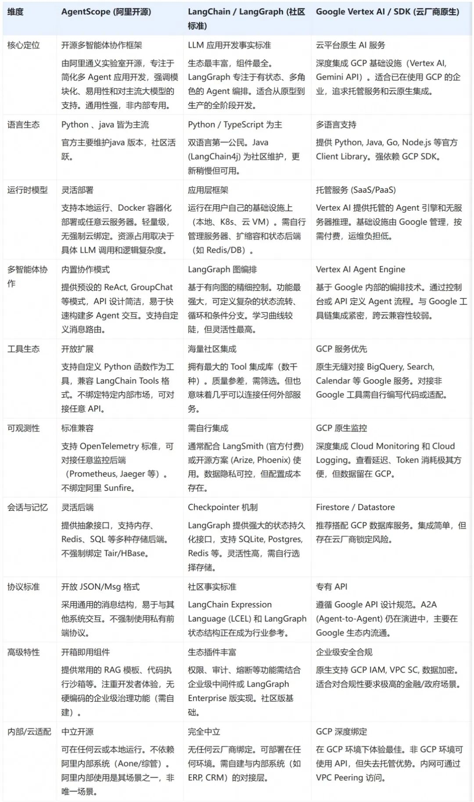

#### 2.2 最终选择

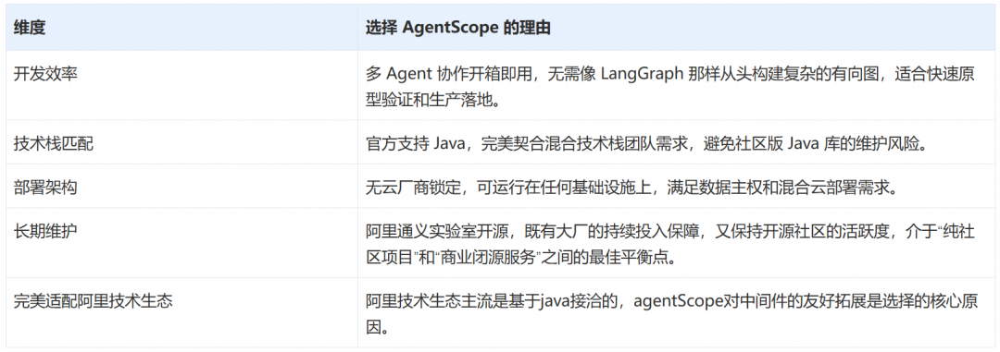

### 03 AgentScope 的三层架构框架能力分析

我认为 AgentScope 分为三层能力，模型层、ReAct 推理循环层和对外抽象体系层：

> **对照教材**：这三层是 AgentScope 框架自身的机制，教材正文有系统讲解——模型层见第 6 章，ReAct 推理循环见第 4 章，工具与对外协议见第 7 章和第 26 章。本节的价值在于一线工程师对同一套机制的源码级解读，视角与教材互补。

#### 3.1 模型层

作为最底层的架构，它的核心是和 LLM 的打交道，它的核心是以下 5 点：

**1. 统一抽象与协议解耦**

- 规则：所有模型实现必须继承 `ChatModelBase`，通过 Formatter 机制将平台无关的 Msg 转换为特定厂商的请求/响应格式。
- 源码分析：`OpenAIChatModel` 内部持有 `Formatter<OpenAIMessage, OpenAIResponse, OpenAIRequest>`，新增模型只需实现对应 Formatter，无需修改核心调用逻辑，天然支持 OpenAI 兼容协议及各类国产模型。

**2. 精细化参数控制与多层级配置合并**

- 规则：生成参数通过 `GenerateOptions` 标准化封装，支持"运行时参数 > 构建时默认参数"的优先级合并，并允许透传厂商特有扩展字段。
- 源码分析：`GenerateOptions.mergeOptions(primary, fallback)` 实现配置合并；additionalHeaders/BodyParams/QueryParams 三类扩展 Map 确保框架不滞后于 API 演进。

**3. 内置企业级调用治理**

- 规则：超时、重试、熔断等治理能力下沉至模型层，作为数据流的一部分自动注入，而非外部包装。
- 源码分析：`ModelUtils.applyTimeoutAndRetry()` 在 Flux 链上直接注入 `.timeout()` 与 `.retryWhen(Retry.backoff(...))`，基于 ExecutionConfig 自动生效，业务代码零侵入。

**4. Reactor Flux 原生流式输出**

- 规则：整个模型调用链路完全基于 Project Reactor 构建，流式/非流式同接口返回 Flux，支持背压与非阻塞 I/O。
- 源码分析：`doStream0()` 根据 stream 参数动态切换 SSE 流式响应或 `Flux.defer().subscribeOn(boundedElastic())` 同步调用；治理操作符无缝嵌入流中，上游感知为连续数据流。

**5. 可观测性与高级推理能力零侵入集成**

- 规则：Trace 埋点、Prompt 缓存、工具调用增强等能力在模型层自动完成，业务代码无需手动处理。
- 源码分析：`ChatModelBase.stream()` 通过 `TracerRegistry.get().callModel()` 自动包裹调用；cacheControl=true 时 formatter 在格式化消息时自动添加缓存标记；toolChoice 与 parallelToolCalls 参数直接控制工具行为。

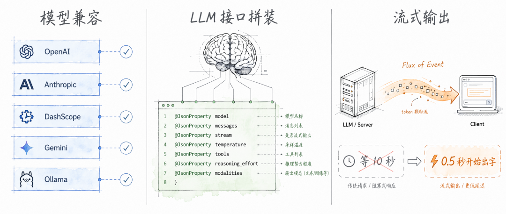

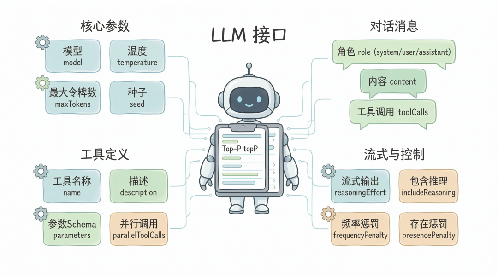

#### 3.2 ReAct 推理循环——从"一问一答"到"多步自主决策"

1. **标准化三阶循环**：严格遵循"Thought → Action → Observation"状态机，由模型自主判断终止或达到 `maxIterations` 强制退出，避免无限递归。
2. **动态上下文注入**：每轮推理前自动将可用工具 Schema 与历史轨迹格式化注入 Prompt，确保模型决策基于最新信息，减少幻觉调用。
3. **流式中间态暴露**：返回 `Flux<AgentResponse>`，实时推送思考、工具调用、执行结果等事件，支持前端逐字展示推理过程，打破黑盒体验。
4. **工具执行安全隔离**：工具调用独立执行、参数校验、返回值过滤，异常作为 Observation 反馈给模型自修正，防止崩溃或数据泄露。
5. **资源边界硬约束**：通过 `maxIterations`、`maxTokensPerStep`、`toolTimeout` 等配置在 Flux 链中自动拦截超限请求，保障生产环境 SLA 可控。

**核心价值**：将 LLM 推理转化为可监控、可约束、可交互的工程化服务，支撑业财复杂任务的自主完成。

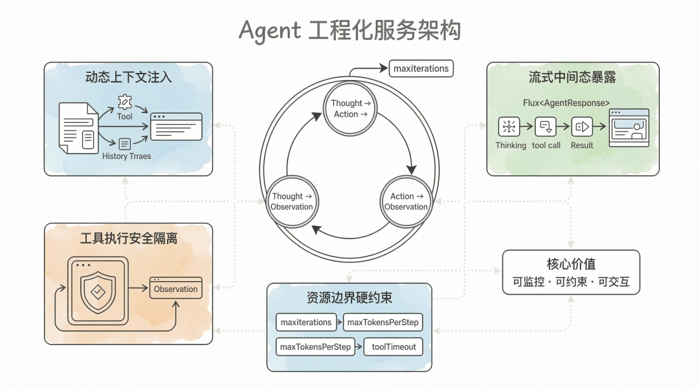

#### 3.3 对外抽象体系

##### 3.3.1 核心大类

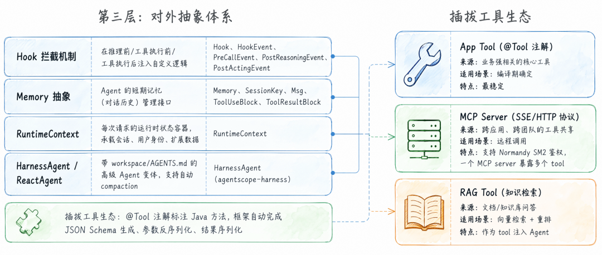

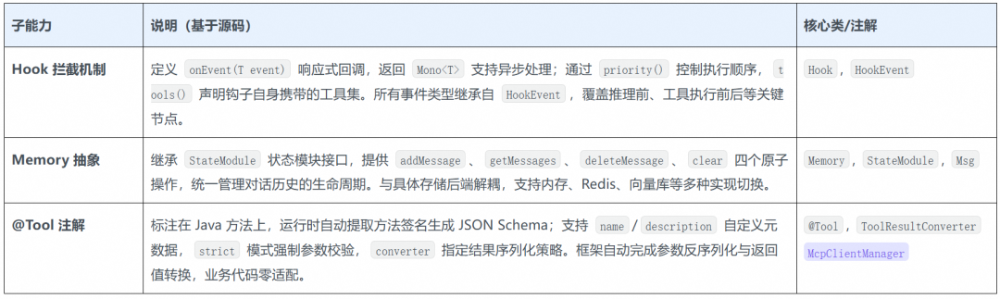

##### 3.3.2 tool 快捷机制

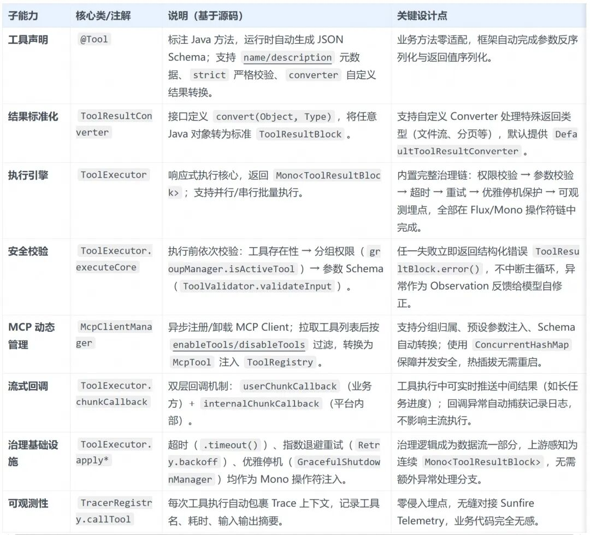

### 04 复用层的三层架构

除了考虑平台建设的要点，我们在实践之前会考虑复用层的建设，这是为了做到在阿里生态结合后，更高层次的开箱即用！

也会考虑未来其他业务想要参考我们的 Agent 实现可以更方便的进行快速定制！

#### 4.1 tools 类与阿里生态平台的结合

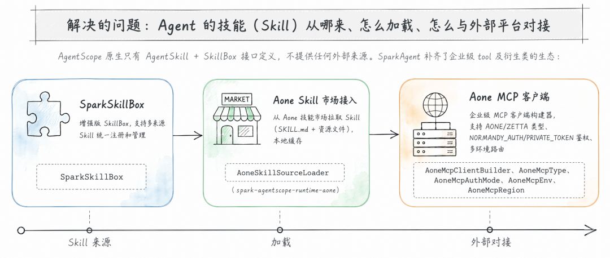

AgentScope 原生只有 `AgentSkill` + `SkillBox` 接口定义，不提供任何外部来源。复用层补齐了企业级 tool 及衍生类的生态：

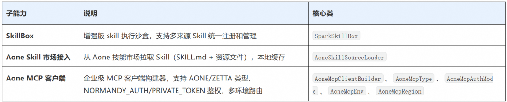

这一层为了提供阿里市场的简单接入的能力。

#### 4.2 Agent 和相关生态注册与发现、调用

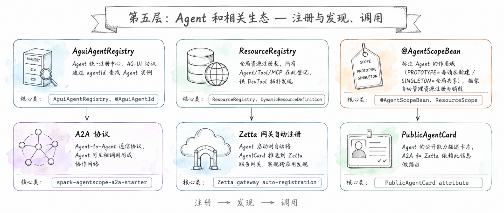

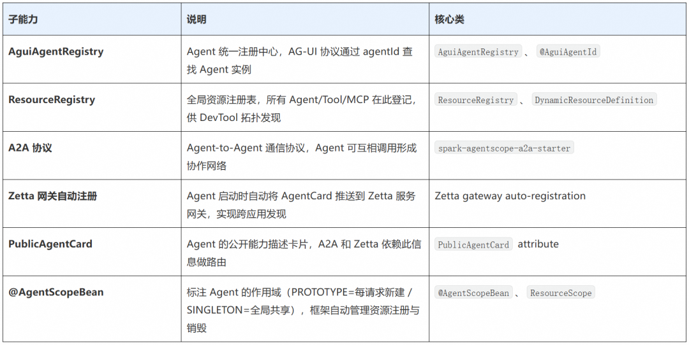

#### 4.3 链路串联、管理丨AG-UI 协议链路串联

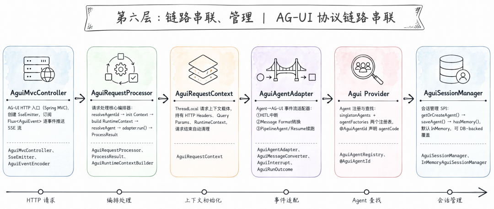

复用层基于 AG-UI 协议（SSE）实现了前端到 LLM 的端到端流式链路：对外暴露 AG-UI 标准输入输出（`AguiMvcController` 处理 `RunAgentInput` / 发射 `AguiMessage` 事件流）；对内以 `ReActAgent` 为核心编排引擎驱动 LLM 推理-工具调用循环，通过 `AguiRuntimeContextBuilder` SPI 和 `RuntimeContext` 承载请求级上下文（用户身份、RAG query），通过 `Session` SPI 和 `AguiSessionManager` 管理会话级状态持久化（Memory / Toolkit / AgentMeta）。

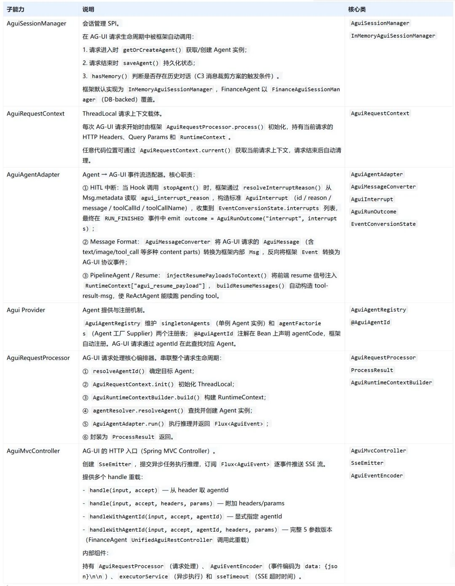

运行层的概念有点多，我会在后续的时间过程结合细节来阐明实战的思路。

#### 4.4 全链路观测


### 05 基于开发要点的实践过程

前文梳理了 AgentScope 和复用层的核心架构与能力边界。基于此，我们围绕五大建设要点，逐一展开实践过程——遇到了什么问题、如何拆解、如何设计并落地解决方案。

#### 5.1 要点一：基于 DB 驱动的 Agent 运行引擎

##### 5.1.1 聚焦目标

俗话说，"功能服务于价值"。在深入探讨技术实现之前，让我们先共同描绘一幅属于物流成本业财团队的未来工作图景。

想象一下，在我们的平台上，活跃着上百位深耕一线的运营小二。他们每天穿梭于计费、结算、资金流转、发票处理及财务核算这五大核心链路之间。当前的现状是，尽管系统庞大，但大量高价值的精力被消耗在低效的"人工校验"与"重复搬运"中——眼神在屏幕间疲惫切换，数据在表格间机械复制。他们渴望解放，急需一位不知疲倦、精准高效的数字助手。

因此，我们的目标不仅仅是交付几个固定的自动化工具，而是要构建一个生机勃勃的 Agent 使用生态。

在这个生态中，最懂业务痛点的不再是远程的开发人员，而是身处一线的小二同学。我们将赋予他们 Agent 手动配置的能力，让他们能够像搭积木一样，根据当下的业务波动和个性化需求，亲手定义并训练专属的 Agent。无论是应对大促期间的结算高峰，还是处理复杂的异常账单，他们都能按需配置、即时发布、快速迭代。

这不仅是一次效率的革命，更是一场角色的重塑：让每一位小二从繁琐的操作者，进化为智能流程的设计师，真正实现"人人都是开发者，处处皆有智能化"。

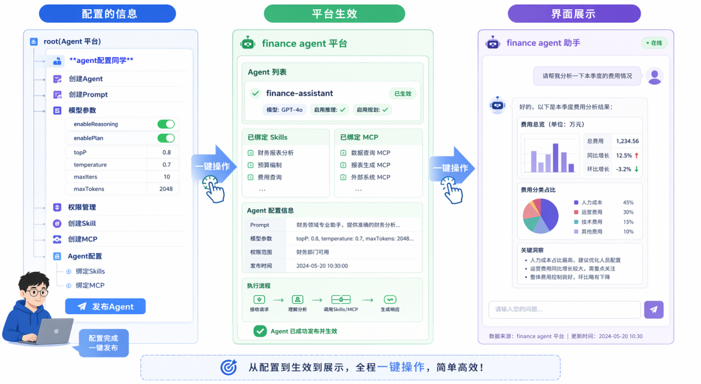

##### 5.1.2 DB 设计

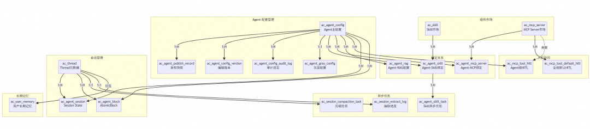

项目全部 19 张表，按功能域分为 7 个模块：

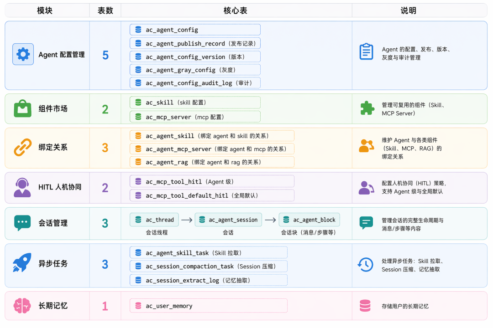

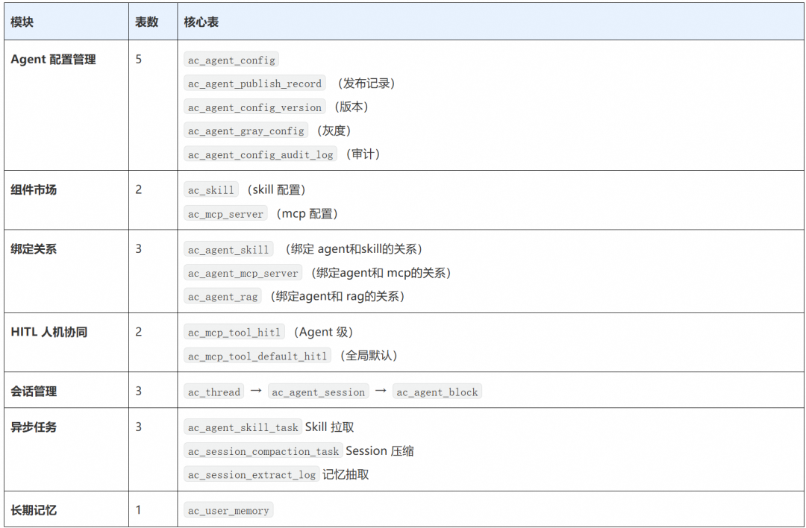

##### 5.1.3 整体流程核心设计（结合复用层来看）

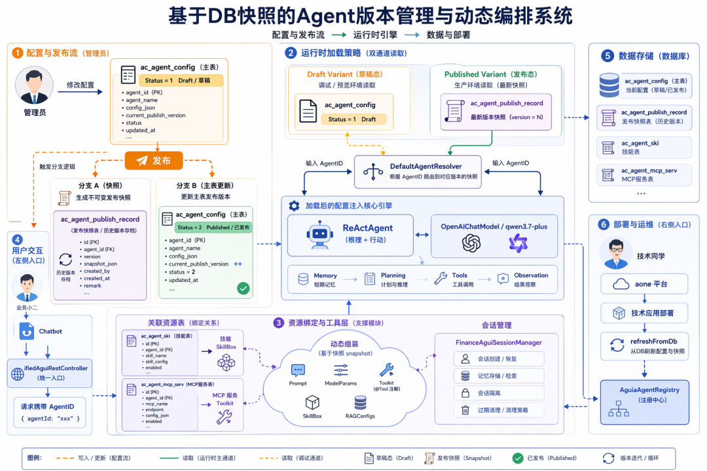

如何达到 DB 驱动 Agent 运行的核心设计有以下几点：

DB 驱动 Agent 平台的整体架构如图 43-1 所示。

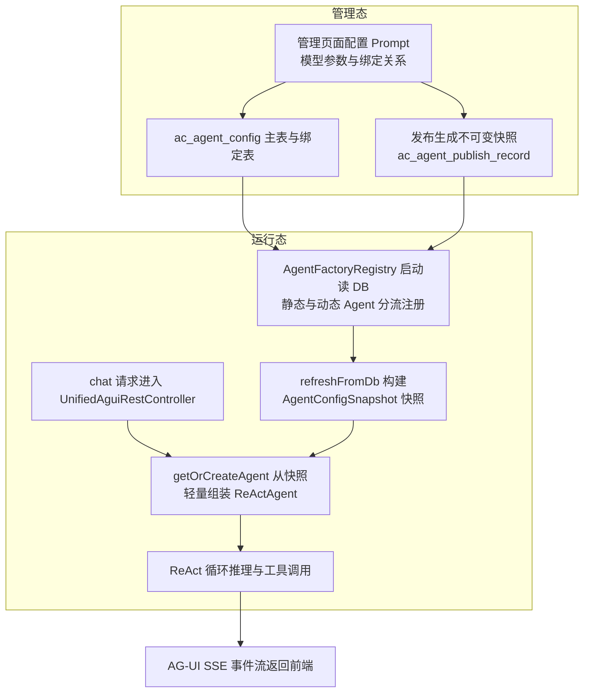

*图 43-1：DB 驱动的 Agent 平台整体架构*

###### 5.1.3.1 核心链路一：启动注册 —— 从 DB 到内存快照

复用层会有大量的注册能力存在，DB 驱动的设计核心，自然是需要通过讲 DB 数据接洽到注册点，这是设计模式的插座模式的典型设计！

那什么时机做接洽比较合适？答：应用启动和更新核心 sql 属性，都需要通过注册中心出发点整体 Agent 配置的更新！

先说说应用启动时，我们会统一基于一个超级基类出发，扫描 DB 并实现接洽，他就是 `AgentFactoryRegistry`！

`AgentFactoryRegistry` 除了要做接洽，其另外一个核心目标是构建一个运行时的 snapshot，该 snapshot 在后续的 chat 对话当中会起着关键作用！

`AgentFactoryRegistry`（实现 `SmartInitializingSingleton`）在所有 Spring Bean 初始化完成后执行三阶段启动：

1. **建静态索引**：收集所有 `BaseFinanceAgentFactory` 子类 Bean（代码中定义的静态 Agent），按 `agentCode` 入 `staticIndex`。
2. **读 DB 分流**：从 `ac_agent_config` 读取全量启用配置，与静态集合取交集：
    - **静态 Agent**（有对应 Factory 类）→ 调用 `factory.refreshFromDb()`
    - **动态 Agent**（DB 中有但代码中无 Factory 类）→ 调用 `dynamicRegistry.register(agentCode)` 自动创建 `DynamicAgentEntry`，最后也会调用 refreshFromDb
3. **失败聚合**：所有 Agent 跑完后，失败列表一次抛 fail-fast。

先看看 `AgentFactoryRegistry`：

```java
@Component
@Order(Ordered.HIGHEST_PRECEDENCE)
public class AgentFactoryRegistry implements SmartInitializingSingleton {
    private static final Logger logger = LoggerFactory.getLogger(AgentFactoryRegistry.class);
    @Resource
    private List<BaseFinanceAgentFactory> staticFactories;
    @Resource
    private DynamicAgentRegistry dynamicRegistry;
    @Resource
    private AcAgentConfigMapper acAgentConfigMapper;
    @Resource
    private DynamicAgentProperties dynamicProperties;
    private final Map<String, BaseFinanceAgentFactory> staticIndex = new LinkedHashMap<>();
    @Override
    public void afterSingletonsInstantiated() {
        // ==================== 阶段 1: 建静态索引（排除 DynamicAgentEntry 防御性兜底） ====================
        for (BaseFinanceAgentFactory f : staticFactories) {
            if (f instanceof DynamicAgentEntry) continue;
            String agentCode = f.simpleName();
            BaseFinanceAgentFactory previous = staticIndex.put(agentCode, f);
            if (previous != null) {
                logger.warn("[AgentFactoryRegistry] duplicated static agentCode '{}': {} replaced by {}",
                        agentCode, previous.getClass().getName(), f.getClass().getName());
            }
        }
        logger.info("[AgentFactoryRegistry] static factories ({}): {}",
                staticIndex.size(), staticIndex.keySet());
        // ==================== 阶段 2: 读 DB 全集，分流 ====================
        List<AcAgentConfigDO> allEnabledConfigs;
        try {
            allEnabledConfigs = acAgentConfigMapper.selectAllEnabled();
        } catch (Exception e) {
            throw new IllegalStateException(
                    "Failed to load active configs (status>=1) from ac_agent_config", e);
        }
        if (allEnabledConfigs == null) {
            allEnabledConfigs = Collections.emptyList();
        }
        // 2a. 启动期自检：禁止存量 agentCode 含 _published 子串（防御后缀法 R1 命名撞 key）
        List<String> illegalCodes = allEnabledConfigs.stream()
                .map(AcAgentConfigDO::getAgentCode)
                .filter(c -> c != null && c.contains(AgentVariant.PUBLISHED_SUFFIX))
                .collect(Collectors.toList());
        if (!illegalCodes.isEmpty()) {
            String msg = "ac_agent_config 存在含保留子串 '" + AgentVariant.PUBLISHED_SUFFIX
                    + "' 的 agent_code（与 PUBLISHED variant 后缀冲突）：" + illegalCodes;
            if (dynamicProperties.isStrictMode()) {
                throw new IllegalStateException(msg);
            } else {
                logger.warn("[AgentFactoryRegistry] strict-mode=false, continuing despite illegal agent_code: {}", msg);
            }
        }
        List<String> dbCodes = allEnabledConfigs.stream()
                .map(AcAgentConfigDO::getAgentCode)
                .collect(Collectors.toList());
        Set<String> dbCodeSet = new LinkedHashSet<>(dbCodes);
        Map<String, Throwable> failures = new LinkedHashMap<>();
        // 2b. 静态：DB 中必须有对应启用行（与 V1 强约束一致）；调 refreshFromDb
        for (Map.Entry<String, BaseFinanceAgentFactory> e : staticIndex.entrySet()) {
            String code = e.getKey();
            if (!dbCodeSet.contains(code)) {
                failures.put(code, new IllegalStateException(
                        "static factory exists but ac_agent_config has no active row (status>=1) for agent_code='" + code + "'"));
                continue;
            }
            tryRefresh(code, e.getValue()::refreshFromDb, failures);
        }
        // 2c. 动态：DB 全集 - 静态集合，自动创建 DynamicAgentEntry（DRAFT variant）
        List<String> dynamicCodes = dbCodes.stream()
                .filter(c -> !staticIndex.containsKey(c))
                .collect(Collectors.toList());
        for (String code : dynamicCodes) {
            tryRefresh(code, () -> dynamicRegistry.register(code), failures);
        }
        // 2d. 为 current_publish_version > 0 的 agent 注册 PUBLISHED variant（key=${code}_published）
        //     注：PUBLISHED variant 失败不影响 DRAFT 服务可用，单独聚合，仅告警不 fail-fast
        Map<String, Throwable> publishedFailures = new LinkedHashMap<>();
        List<String> publishedCodes = new ArrayList<>();
        for (AcAgentConfigDO cfg : allEnabledConfigs) {
            Integer cpv = cfg.getCurrentPublishVersion();
            if (cpv == null || cpv <= 0) {
                continue;
            }
            String code = cfg.getAgentCode();
            String publishedKey = AgentVariant.PUBLISHED.registryKey(code);
            tryRefresh(publishedKey,
                    () -> dynamicRegistry.registerPublishedVariant(code),
                    publishedFailures);
            publishedCodes.add(code);
        }
        if (!publishedFailures.isEmpty()) {
            String summary = publishedFailures.entrySet().stream()
                    .map(e -> "  - " + e.getKey() + " → " + e.getValue().getMessage())
                    .collect(Collectors.joining("\n"));
            // PUBLISHED variant 失败仅告警，不抛 fail-fast（DRAFT 仍可服务）
            logger.warn("[AgentFactoryRegistry] PUBLISHED variant init failed for {} agent(s), DRAFT remains available:\n{}",
                    publishedFailures.size(), summary);
        }
        // ==================== 阶段 3: 失败聚合 + strict-mode 控制（仅 DRAFT 失败参与 fail-fast） ====================
        if (!failures.isEmpty()) {
            String summary = failures.entrySet().stream()
                    .map(e -> "  - " + e.getKey() + " → " + e.getValue().getMessage())
                    .collect(Collectors.joining("\n"));
            String msg = "Agent init failed for " + failures.size() + " of " + dbCodes.size()
                    + " agent(s):\n" + summary;
            if (dynamicProperties.isStrictMode()) {
                throw new IllegalStateException(msg);
            } else {
                logger.warn("[AgentFactoryRegistry] strict-mode=false, continuing despite failures:\n{}", msg);
            }
        }
        logger.info("[AgentFactoryRegistry] init OK. static={}, dynamic={}, published={}, total={}, strict-mode={}",
                staticIndex.size(), dynamicCodes.size(), publishedCodes.size() - publishedFailures.size(),
                dbCodes.size(), dynamicProperties.isStrictMode());
    }
    private static void tryRefresh(String agentCode, Runnable r, Map<String, Throwable> failures) {
        try {
            long start = System.currentTimeMillis();
            r.run();
            logger.info("[AgentFactoryRegistry] init OK for '{}' in {} ms",
                    agentCode, System.currentTimeMillis() - start);
        } catch (Throwable t) {
            logger.error("[AgentFactoryRegistry] init FAILED for '{}': {}", agentCode, t.getMessage(), t);
            failures.put(agentCode, t);
        }
    }
    // ==================== 对外查询 / 派发 API ====================
    /**
     * 统一查找：静态优先，未命中再查动态。
     */
    public BaseFinanceAgentFactory find(String agentCode) {
        BaseFinanceAgentFactory f = staticIndex.get(agentCode);
        return f != null ? f : dynamicRegistry.get(agentCode);
    }
    /**
     * 按注册 key 派发刷新（key 可能是 DRAFT 的业务 agentCode，也可能是 PUBLISHED 的
     * {@code agentCode_published}）。
     *
     * <p>已注册 → {@link BaseFinanceAgentFactory#refreshFromDb}；未注册 → on-demand 动态注册：</p>
     * <ul>
     *   <li>PUBLISHED key（命中 {@link AgentVariant#PUBLISHED_SUFFIX}）→
     *       {@link DynamicAgentRegistry#registerPublishedVariant}（按发布快照路径加载）；</li>
     *   <li>DRAFT key → {@link DynamicAgentRegistry#register}（按草稿路径加载）。</li>
     * </ul>
     *
     * <p>这样集群广播 {@code AGENT/xxx_published} 在其他节点接收时也能正确注册 PUBLISHED
     * variant，而不会被误认为是新建 DRAFT agent。</p>
     */
    public void refresh(String key) {
        BaseFinanceAgentFactory f = find(key);
        if (f != null) {
            f.refreshFromDb();
            return;
        }
        AgentVariant.ParsedKey parsed = AgentVariant.parse(key);
        if (parsed != null && parsed.variant() == AgentVariant.PUBLISHED) {
            logger.info("[AgentFactoryRegistry] PUBLISHED key '{}' not registered yet, attempting on-demand register", key);
            dynamicRegistry.registerPublishedVariant(parsed.agentCode());
        } else {
            // 运行期 DB 新增了一行 → on-demand 动态注册 DRAFT variant
            logger.info("[AgentFactoryRegistry] '{}' not registered yet, attempting on-demand dynamic register", key);
            dynamicRegistry.register(key);
        }
    }
    /**
     * 全量刷新所有已注册 Agent。
     * <p>单个失败不影响其他 Agent；失败的 agentCode 通过返回值告知调用方。</p>
     */
    public Map<String, String> refreshAll() {
        Map<String, String> failures = new LinkedHashMap<>();
        for (String code : allAgentCodes()) {
            try {
                find(code).refreshFromDb();
            } catch (Exception ex) {
                logger.error("[AgentFactoryRegistry] refresh failed for agentCode='{}'", code, ex);
                failures.put(code, ex.getMessage());
            }
        }
        return failures;
    }
    /** 已注册的全部 agentCode（静态 ∪ 动态，去重，保序）。*/
    public Set<String> allAgentCodes() {
        Set<String> all = new LinkedHashSet<>(staticIndex.keySet());
        all.addAll(dynamicRegistry.agentCodes());
        return Collections.unmodifiableSet(all);
    }
    /** Controller 的 GET endpoint 用：按 agentCode 拿 Factory（用于查看 snapshot）。 */
    public BaseFinanceAgentFactory get(String agentCode) {
        return find(agentCode);
    }
    /** 已注册的 agentCode 列表，保留旧方法名以兼容现有 Controller。 */
    public Set<String> agentCodes() {
        return allAgentCodes();
    }
}
```

为什么要用 afterSingletonsInstantiated？

首先 `AgentFactoryRegistry` 需要收集所有静态 `BaseFinanceAgentFactory` 并且获取 DB 的配置数据，如果这里用 `@PostConstruct` 或 `InitializingBean.afterPropertiesSet()`，会有时序问题。

可以通过下图来了解：

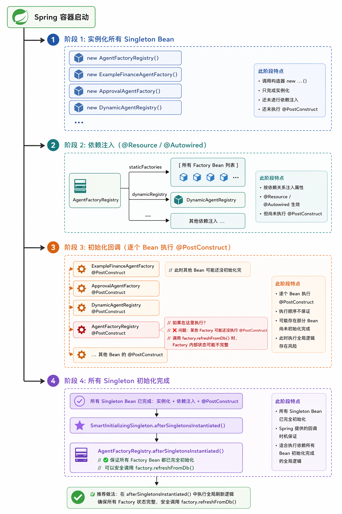

无论是静态 Agent 还是动态 Agent 最终都会做 `refreshFromDb()` 操作，`refreshFromDb()` 的核心动作是构建 `AgentConfigSnapshot` —— 一个不可变的 volatile 快照对象，聚合了 Prompt、模型参数、Toolkit（含 MCP Client）、SkillBox（含 Skill 内容）。后续 `createAgent()` 只做一次 volatile 读即可获得跨字段一致的视图，无 DB 调用。

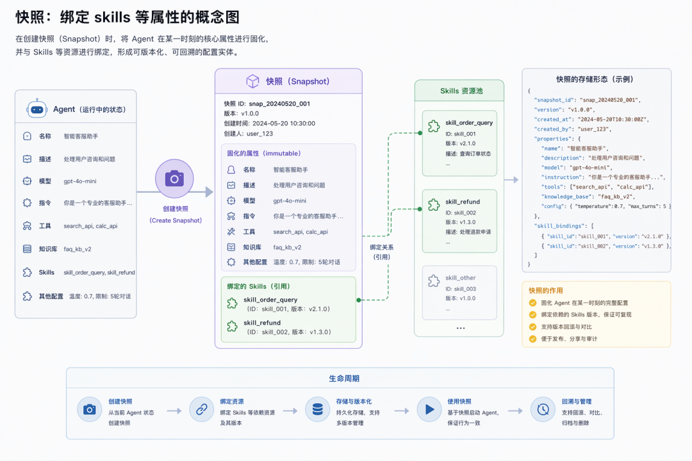

除了快照还有注册，注册环节做三件事：

- 注册到 `AguiAgentRegistry`：`sparkRegistry.registerFactory(agentCode, entry::createAgent)`，以方法引用实现 PROTOTYPE 语义（每次请求创建新实例），后续由框架 `DefaultAgentResolver` 按 agentCode 查找。
- 注册到 `ResourceRegistry`：使 Agent 出现在 DevTool 拓扑图中。
- 注册到 A2A 网关：通过 `DynamicA2ARegistrationAdvice` 暴露为 A2A 协议端点。

###### 5.1.3.2 核心链路二：所有主表和关联性质都是在管理态，管理员通过页面去持久化

在管理态（Management State）下，所有 Agent 相关配置均通过前端页面进行操作，并持久化至关系型数据库。运行时（Runtime）仅作为只读消费者，根据配置的发布状态加载相应的配置快照或草稿，确保配置变更与线上运行的解耦。

配置体系分为主配置域（独立实体）与绑定关系域（关联实体），具体映射如下：

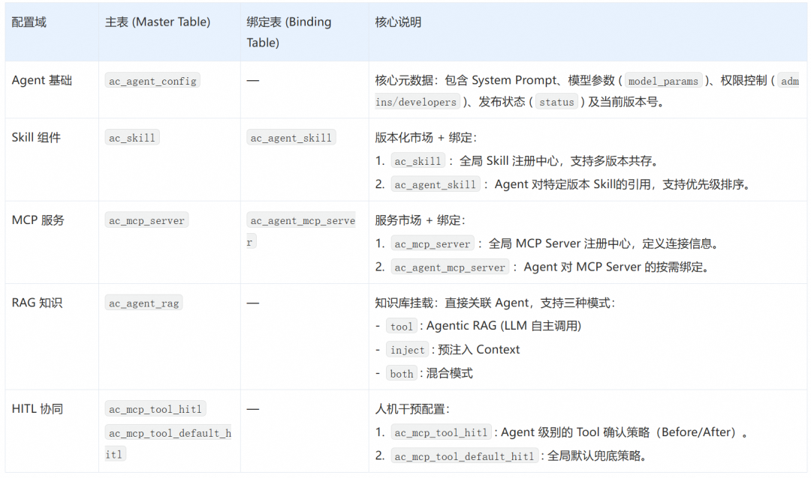

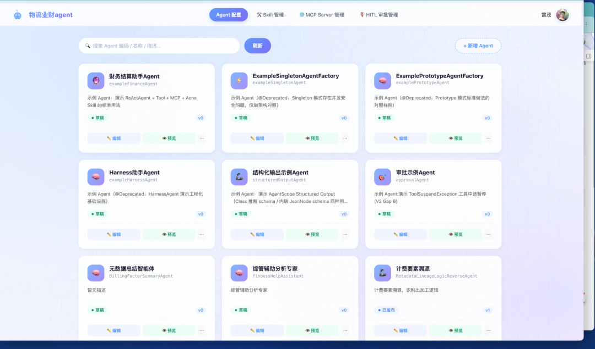

为平衡"配置灵活性"与"线上稳定性"，系统采用严格的双轨制版本管理机制。

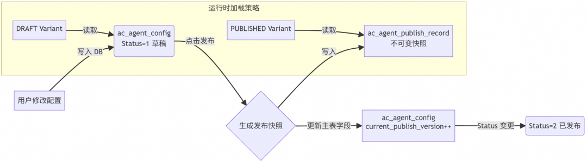

**草稿阶段 (Drafting)**：

- 操作：用户在页面修改 Prompt、模型参数或绑定关系。
- 持久化：所有变更直接更新至主表 `ac_agent_config` 及其关联的绑定表。
- 状态标记：`ac_agent_config.status` 保持为 `1` (Enabled/Draft)。
- 影响范围：仅影响开发/测试环境或明确指定读取草稿的调试会话，不影响线上正式流量。

**发布阶段 (Publishing)**：

- 触发：用户点击"发布"按钮。
- 快照生成：系统将当前主表及所有绑定表的完整配置序列化为 JSON，写入 `ac_agent_publish_record`。此记录为不可变 (Immutable)，用于审计与回滚。
- 版本晋升：
  1. `ac_agent_config.current_publish_version` 自增。
  2. `ac_agent_config.status` 更新为 `2` (Published)。
- 影响范围：线上正式流量立即切换至新发布的快照版本。

**运行时加载 (Runtime Loading)**：

- DRAFT Variant：主要用于 DevTool 调试或灰度测试场景，直接读取 `ac_agent_config` 中的最新草稿数据。
- PUBLISHED Variant：生产环境标准模式，根据 `current_publish_version` 从 `ac_agent_publish_record` 中加载对应的不可变快照。

**优势**：

- 安全隔离：配置修改过程中的中间状态（如未完成的 Prompt 编辑）不会污染线上服务。
- 即时回滚：若发布后出现异常，可通过将 `current_publish_version` 指向前一个版本号，或重新发布旧快照，实现秒级回滚。
- 审计追溯：`ac_agent_publish_record` 保留了每一次发布的完整现场，配合 `ac_agent_config_audit_log` 可实现全链路配置变更追溯。

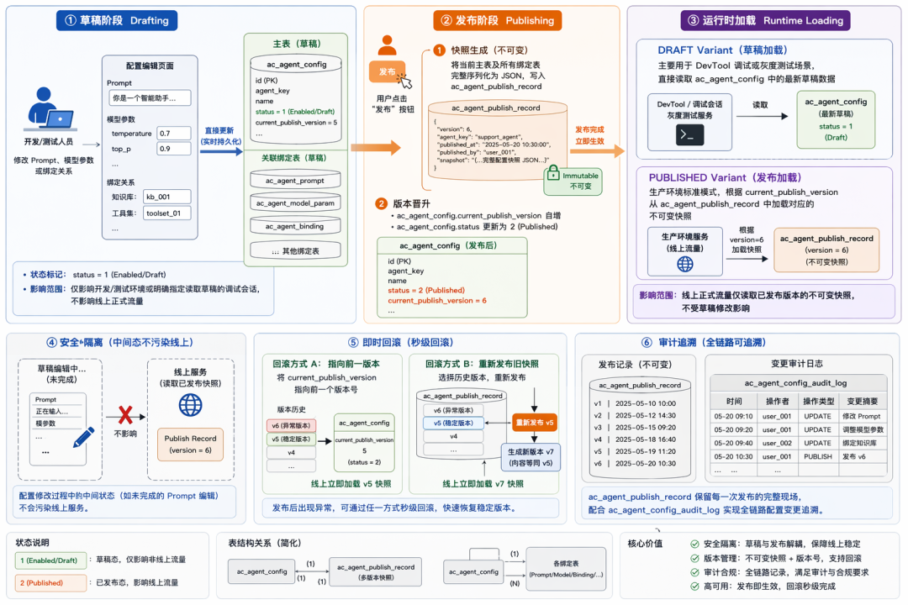

###### 5.1.3.3 核心链路三：运行态 —— 复用层全链路 SPI 定制

前面第四章定义了复用层的运行链路，这是为了让后续所有的后续 Agent 的运营链路保持着一致！而 `AguiMvcController` 正是掌管着复用层的整体运行入口！

`UnifiedAguiRestController` 是我们定义用于处理 chat 请求的核心 controller，它会将请求直接委托给复用层框架的 `AguiMvcController`，完整复用 AG-UI 协议的 SSE 流式处理、ReAct 循环、Tool 调用等运行时能力。

复用层的能力无法覆盖定制场景怎么办？复用层的定制通过框架预定义的 SPI 接口实现：

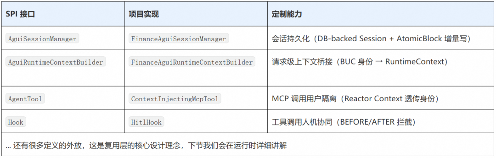

**关键设计**：我们既不改框架运行链路也不充血链路，而是在框架留的 SPI 点上替换默认实现。框架负责协议解析和 ReAct 编排，项目负责业务逻辑和基础设施对接。

##### 5.1.4 运行时详解

上节我们说到运行链路复用复用层全链路，但也说明了他链路的所有关卡都充斥着大量的 SPI，本节我们是分析这条链路，以及说明我们是如何达成设计目标：

目标：轻量级隔离运行时 Runtime：采用"即用即建"机制，运行时动态构建轻量级 Agent 实例外壳。既要复用了底层的 Skill、SKILL 及 MCP 实例（前面说的 snapshot），也要确保：

①资源高效共享

②性能卓越

同时还要实现 Agent 会话执行环境的完全隔离，保障稳定性与安全性。

链路的部分概念明细在第四章的运营链路层，会有详细内容，这里重点还是分析如何结合实际场景进行运行设计。

再看看复用层运行时的核心类以及关键 SPI：

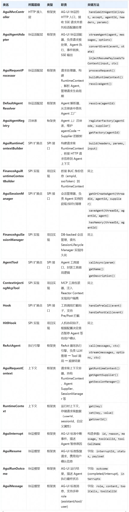

复用层 SPI 关键设计模式：

1. **策略模式**：`AguiRuntimeContextBuilder`、`AguiSessionManager`、`AgentTool`、`Hook` 都是可替换的策略。
2. **工厂模式**：`AguiAgentRegistry` 存储 `Supplier<Agent>` 工厂，每次请求创建新实例。
3. **适配器模式**：`AguiAgentAdapter` 将 ReActAgent 的内部事件转换为 AG-UI 标准事件。
4. **观察者模式**：`Hook` 通过事件监听实现工具调用拦截。

读者如果不 care 技术细节，可以通过下图看看复用层 SPI 设计的节点所在：

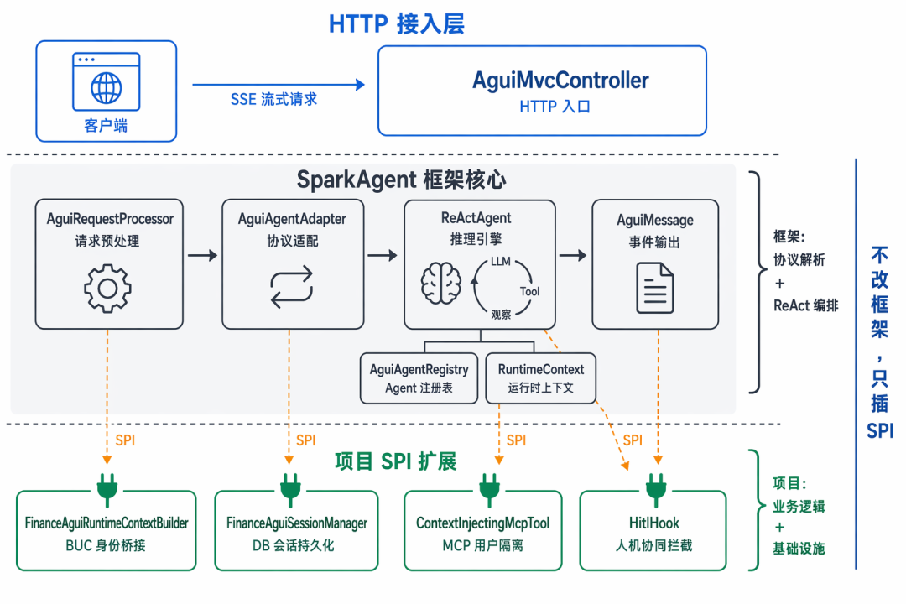

如果您是技术的话，建议看看在完整的调用链路图中，这些核心类所在节点：

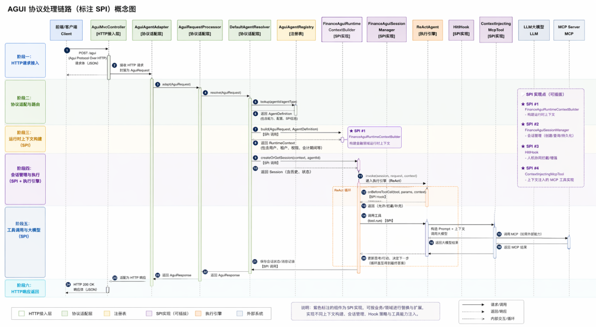

再看看我们如何结合运行链路 4 大 SPI 的能力，扩展出符合即用即建、身份传递、人机精准协同、回话持久的核心能力：

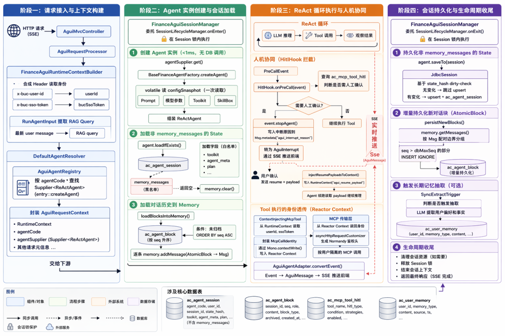

4 个 SPI 都会推出定制的 Finance 级别的实例，请看下面的详细说明。

###### 5.1.4.1 FinanceAguiRuntimeContextBuilder（SPI1）

FinanceAguiRuntimeContextBuilder 是我们针对运行链路定制的第一个 SPI：

```java
public ProcessResult process(RunAgentInput input, String headerAgentId, String pathAgentId) {
        String threadId = input.getThreadId();
        String agentId = this.resolveAgentId(input, headerAgentId, pathAgentId);
        RunAgentInput effectiveInput = input;
        if (this.agentResolver.hasMemory(threadId) && !input.hasResume()) {
            logger.debug("Using server-side memory for thread {}, extracting latest user message", threadId);
            effectiveInput = this.extractLatestUserMessage(input);
        }
        // 在运行之前构建的上下文
        RuntimeContext runtimeContext = this.buildRuntimeContext(effectiveInput);
        Agent agent = this.agentResolver.resolveAgent(agentId, threadId);
        AguiAgentAdapter adapter = new AguiAgentAdapter(agent, this.config, runtimeContext);
        Flux<AguiEvent> events = adapter.run(effectiveInput).doFinally((signal) -> {
            logger.debug("Request completed for thread {}, signal: {}", threadId, signal);
            this.agentResolver.onComplete(threadId, agent);
        });
        return new ProcessResult(agent, events);
}
```

它本质上是构建了一个贯穿 AgentScope 整条请求链路的上下文对象。复用层框架将 `RuntimeContext` 的创建通过 `AguiRuntimeContextBuilder` SPI 开放给业务层定制。

本项目实现了通过继承 `AguiRuntimeContextBuilder` 开发了 `FinanceAguiRuntimeContextBuilder`，将每次 AG-UI 请求的上下文数据组装进框架的 `RuntimeContext`，包含 4 个字段：

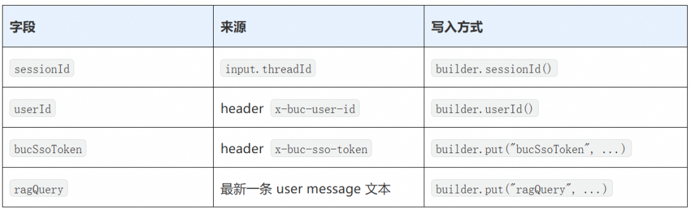

为什么这么做？

**原因一：线程安全。** 复用层底层是异步线程池模型，线程会被多个会话复用。如果通过 `ThreadLocal` 传递请求级数据，线程归还线程池后残留数据可能污染后续其他会话。`RuntimeContext` 由框架绑定到 `AgentBase` 实例上（per-agent-instance），随请求创建、随请求销毁，天然隔离，不存在跨会话串数据的风险。

**原因二：全链路可达。** `RuntimeContext` 贯穿 Agent 从创建到执行的完整生命周期，下游工具和中间件通过方法参数显式接收当次调用的上下文：

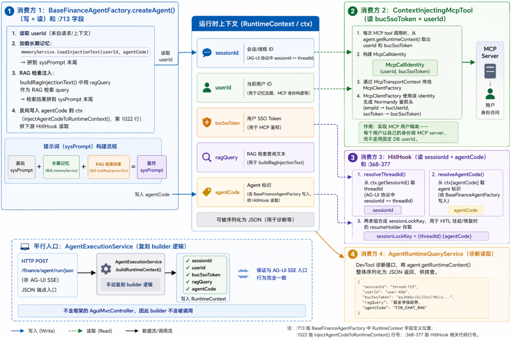

两条设计优势合在一起：既避免了线程池复用导致的数据串扰，又让请求级数据在全链路任意节点随手可取——这是选择 `RuntimeContext` 而非 `ThreadLocal` 或方法参数透传的根本原因。

###### 5.1.4.2 FinanceAguiSessionManager（SPI2）

光听名字，可能你会以为它只是一个 session 的管理者，但其实并不完全是，让我们看看它的 interface 就知道了：

```java
public interface AguiSessionManager {
    Agent getOrCreateAgent(String var1, String var2, Supplier<Agent> var3);
    boolean hasMemory(String var1, String var2);
    boolean removeSession(String var1, String var2);
    void cleanupExpiredSessions();
    int getSessionCount();
    default void saveAgent(String threadId, String agentId, Agent agent) {
    }
    void clear();
}
```

**1）AguiSessionManager 的设计初衷**

AguiSessionManager 是复用层的核心设计之一，它本质上是 Agent 实例与持久化存储之间的桥梁——解决 AG-UI 协议下无状态 HTTP 与有状态 Agent 之间的矛盾。框架通过 5 个方法定义了完整的会话生命周期契约：

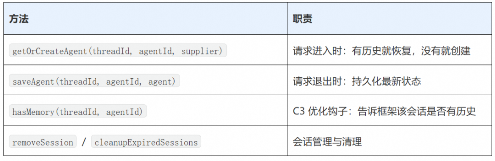

复用层框架默认提供 `InMemoryAguiSessionManager`（ConcurrentHashMap 缓存，进程重启丢数据）和 `SessionAwareAguiSessionManager`（走框架 Session SPI，但每次全量序列化/反序列化 memory）。两者都无法满足生产级需求。

我们在复用层设计 `AguiSessionManager` 的 `getOrCreateAgent` 方法时，既是为了实现"即用即建"机制的，当然也可以使用缓存机制。

很显然复用层在运营链路上支持定义实时的 Agent 创建入口——框架把 Agent 的创建权通过 `Supplier<Agent>` 参数交给业务层，而我们的 `AgentConfigSnapshot` 其实也是为了缓存机制才设计的。

前面说了 snapshot 构建了包含 Agent 的所有相关能力：MCP、Skills、SkillBox、modelParams、Toolkit 等等。所以我们可以快速创建一个轻量级的 agent，并且达到以下几点：

- **资源高效共享**：snapshot 是 volatile 引用，所有请求共享同一份配置快照，创建 Agent 时只做一次 volatile 读，零 DB/网络开销。
- **性能卓越**：`createAgent()` 不触发任何远程调用，只是从 snapshot 中组装 prompt + model + tools，毫秒级完成。
- **完全隔离，保障稳定性与安全性**：每个请求拿到独立的 ReActAgent 实例（PROTOTYPE scope），per-request 的 memory、RuntimeContext 互不干扰。

目标确定后，我们还要理解 AguiSessionManager 是什么；要理解 AguiSessionManager，就要理解 `AguiRequestProcessor` 的核心作用。

**2）复用层 AguiRequestProcessor：运营链路前两大阶段的管控中枢**

复用层的运营链路如果拆细的话会有 20 多个节点，但粗略分类可以分成 4 个阶段：

1. **请求预处理** — 构建请求上下文、初始化各类核心组件。
2. **Agent 创建和会话/记忆加载** — 实例化 Agent 并恢复历史状态。
3. **ReAct 循环机制** — LLM 推理 → tool 调用 → 观察结果 → 再推理。
4. **会话持久化和收尾工作** — 保存状态、触发异步任务。

`AguiRequestProcessor` 是除了 ReAct 循环机制阶段以外的核心管控类。从框架代码结果看，它持有三个关键组件和一个核心方法，让我们一起来看看：

```java
public class AguiRequestProcessor {
    private final AgentResolver agentResolver;              // → 桥接 AguiSessionManager
    private final AguiAdapterConfig config;                 // 适配器配置
    private final AguiRuntimeContextBuilder runtimeContextBuilder;  // → 我们的 FinanceAguiRuntimeContextBuilder
}
```

它有一个核心方法是 process，我们来看看：

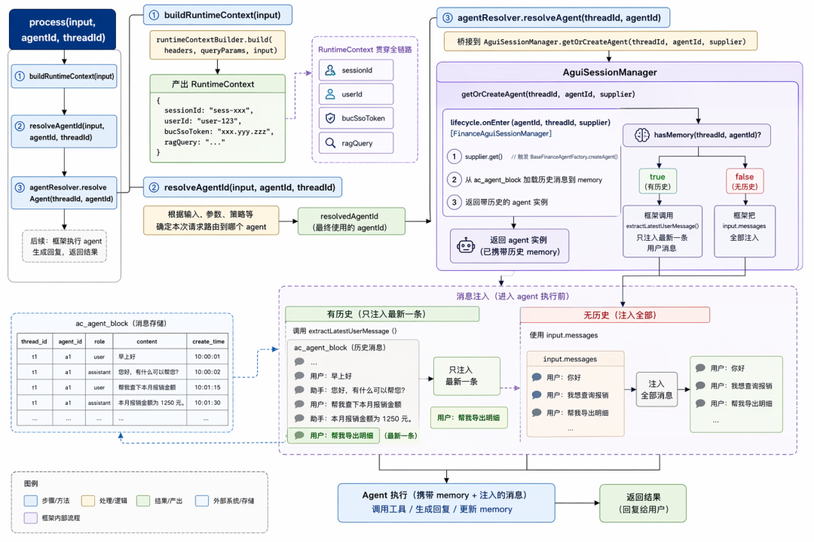

这个核心方法编排清晰地展示了 `AguiRequestProcessor` 的角色：它不负责具体的 Agent 创建、状态加载或上下文构建，而是编排这些 SPI 的调用顺序。每个 SPI 各司其职：

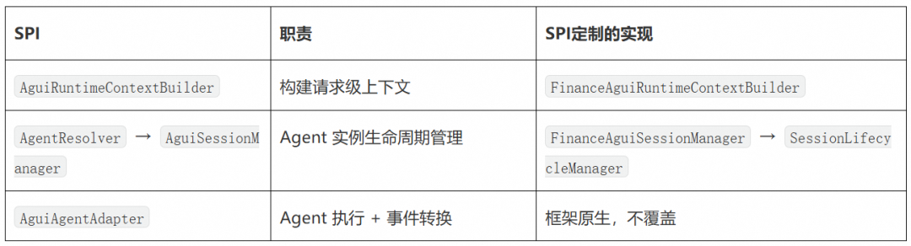

`AgentResolver` 管理着获取 Agent 实例的生杀大权，spark 是支持自定义的，这里我们默认用了复用层的 `DefaultAgentResolver`，不做任何改造。

`DefaultAgentResolver` 的设计初衷是解决一个核心矛盾：`AguiRequestProcessor` 只关心"给我一个 Agent"，但 Agent 的获取方式在不同部署模式下可以完全不同。

`DefaultAgentResolver` 做了两件事：

1. 缓存 threadId 和 agentId 的关系。
2. sessionManager.getOrCreateAgent 的方法。
   a. 并且传递给 getOrCreateAgent 的 `AguiAgentRegistry 获取 Agent` 的权限。

由此可见创建 Agent 的方式是完全可以定义的。

来理一理关系：`AguiRequestProcessor` 通过 `DefaultAgentResolver` 管理 Agent，`DefaultAgentResolver` 又将周期托给 sessionManager，sessionManager 本质是可以进行 SPI 定制，所以我们决定定制一个 sessionManager，来真正管理 FinanceAgent 的 Agent 实例和历史、记忆。

来看看我们 FinanceAguiSessionManager 的设计是如何达到轻量、隔离的目标：

`getOrCreateAgent` 方法的组装过程分为三个阶段，全程只依赖一次 volatile 读拿到的：

1. 通过 agentSnapshot 轻量组装 Agent。
2. 加载历史 session + 长期记忆。
3. 检测是否需要提交异步压缩任务。

其中 agentSnapshot 的设计需要一些考量，前面我们讲过 `BaseFinanceAgentFactory` 会构建 snapShot，所以我们最好是快速定位到对应的 `BaseFinanceAgentFactory`，所以我们在项目初始化的时候就会把 `BaseFinanceAgentFactory` 专门通过 snapshot 创建 Agent 的方法 createAgent 注册到 sparkRegistry：

```java
 sparkRegistry.registerFactory(agentCode, entry::createAgent);
```

然后 registry.get 就可以拿到对应创建函数，执行即可！

而 createAgent 核心逻辑就是组装 ReactAgent；具体而言，`createAgent()` 的组装过程分为三个阶段，全程只依赖一次 volatile 读拿到的 `AgentConfigSnapshot`，不再触发任何 DB 或远程调用：

**阶段一：Prompt 增强**

```text
原始 prompt（来自 snapshot）
    ↓ 拼接用户长期记忆（memoryService.loadInjectionText）
    ↓ 拼接 RAG 检索结果（ragRetriever.retrieve，mode=inject）
    = finalPrompt
```

两步增强都是非致命的：任何一步失败都只打 warn 日志，降级为原始 prompt，绝不阻断请求。这里有个关键设计——长期记忆和 RAG 的注入时机选在了 `createAgent()` 而非 `refreshFromDb()`，因为它们依赖请求级的 `userId` 和 `ragQuery`（来自 `RuntimeContext`），而不是配置级的静态数据。

**阶段二：ReActAgent.Builder 组装**

```java
ReActAgent.builder()
    .name(agentName())                    // snapshot.agentName
    .sysPrompt(finalPrompt)               // 阶段一的增强 prompt
    .model(getModel())                    // qwenModel bean（Spring 单例）
    .generateOptions(buildGenerateOptions(snap))  // temperature/topP/maxTokens/modelName
    .maxIters(resolveMaxIters(snap.modelParams()))
    .toolkit(snap.toolkit())              // 预构建的 Toolkit（MCP + App Tools + RAG Tools）
    .skillBox(snap.skillBox())            // 预构建的 SparkSkillBox
    .hook(hitlHook)                       // Human-In-The-Loop 拦截钩子
    .build();
```

注意 `toolkit` 和 `skillBox` 都是 snapshot 里已经构建好的对象。这就是 snapshot 的核心价值：把耗时的 MCP 客户端建连、Tool 注册、Skill 加载全部前置到 `refreshFromDb()` 阶段，`createAgent()` 只做引用传递，真正实现每次请求的 Agent 组装是纯内存操作。

**阶段三：参数覆盖级联**

`temperature`、`topP`、`maxTokens`、`maxIters`、`enablePlan`、`modelName` 六个参数都遵循同一优先级链：

```text
HTTP Header（X-Temperature 等） > DB JSON 字段（modelParams） > DEFAULT 常量
```

这使得同一份 DB 配置可以支撑按请求粒度的参数微调，而不需要修改 DB 或触发 refresh。

**3）snapshot 不可变设计**

`AgentConfigSnapshot` 是一个 `final` 类，所有 List 字段用 `Collections.unmodifiableList()` 包装，对外只暴露 getter，没有 setter。`BaseFinanceAgentFactory` 持有一个 `volatile AgentConfigSnapshot configSnapshot` 字段：

- **写**：只在 `refreshFromDb()` 中整体替换引用（`this.configSnapshot = newSnapshot`），不存在局部修改。
- **读**：`createAgent()` 开头做一次 volatile 读到局部变量 `snap`，后续全程用这个局部引用。

这保证了跨字段一致性——同一次 `createAgent()` 调用中，prompt、toolkit、skillBox 一定来自同一版本，不会出现 prompt 是新版本而 toolkit 还是旧版本的中间态。

**4）FinanceAguiSessionManager 的整体设计**

除了 `createAgent()` 的轻量级别的创建设计，还有 `saveAgent` 和 `removeSession`、`hasMemory` 的定制，对于 financeAgent 的整体轻量也有功不可没的作用。

- `hasMemory()` — 双检存在性探测：先查 `ac_agent_session`，再查 `ac_agent_block.maxSeq`，避免全量加载对话历史即可判断"是否有历史"。这是复用层决定是否走 `extractLatestUserMessage` 的关键钩子。
- `saveAgent()` — 增量持久化：通过 JdbcSession 黑名单跳过 `memory_messages` 的全量写入，只增量 append 新 block（`seq > dbMaxSeq`），写放大从 O(N) 降到 O(Δ)。
- `removeSession()` — 级联清理：单次锁获取内完成 `ac_agent_session` + `ac_agent_block` 的批量删除，并同步清理 `tailSnapshot` 缓存。

完整生命周期性能画像表，汇总 `createAgent` → `hasMemory` → `onEnter` → `saveAgent` → `removeSession` 各阶段的耗时与 DB 操作。

这四个方法共同构成了 finance agent 的轻量级运行时：`createAgent` 解决创建轻（&lt; 1ms，零 DB），`hasMemory` 解决探测轻（索引命中），`saveAgent` 解决持久化轻（增量写），`removeSession` 解决清理轻（批量删除）。

###### 5.1.4.3 工程级别的 human in the loop（SPI3）

hitl 本身存在两种方式，一种是模型级别的方式，另一种是工程级别的。

他们的区别：

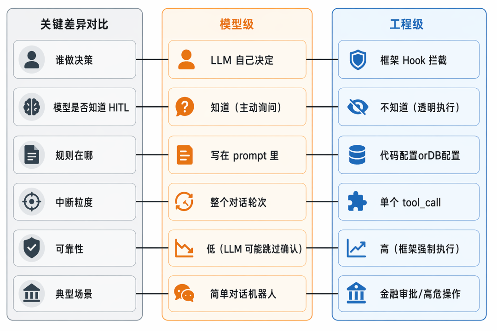

举个例子：

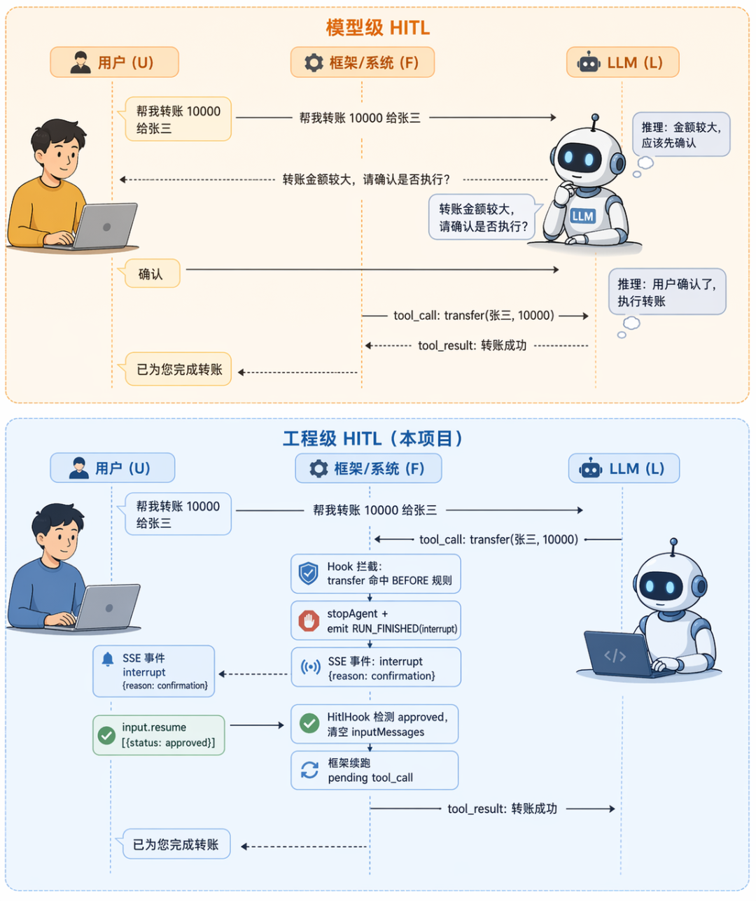

为什么要用工程级别 hitl？如果使用模型级别的 hitl 会有什么问题？

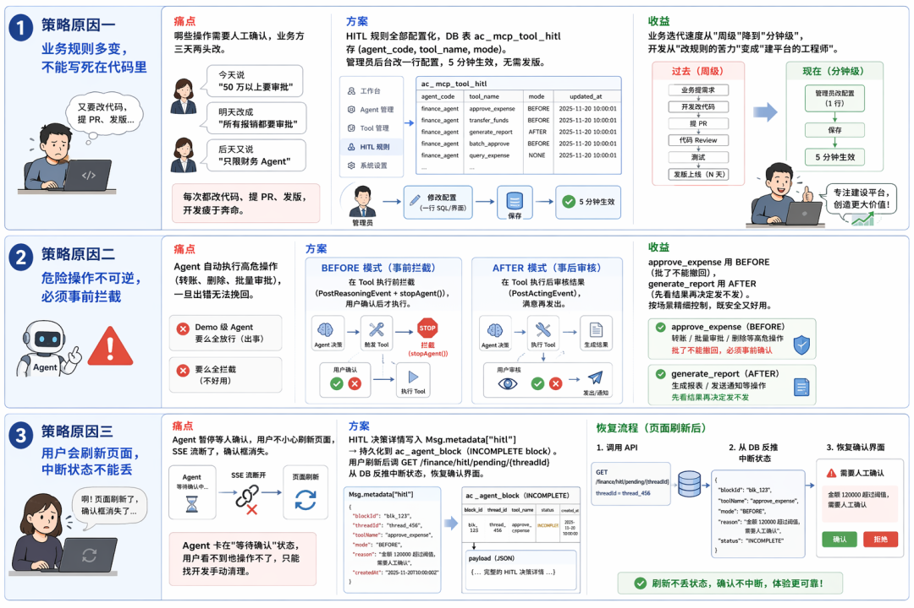

由于模型是不感知工程级别的 hitl，可见工程级别的 hitl 是需要做拦截操作，拦截点如下：

1. 如何确认用户在做确认操作？
2. 如何确认用户在使用工具前、后需要做拦截操作？
   a. 发现拦截点，如何停止 Agent 的所有行为！等待确认结果才能继续之前的链路；

非常荣幸的是 AgentScope 的 hooks 系统非常强大：

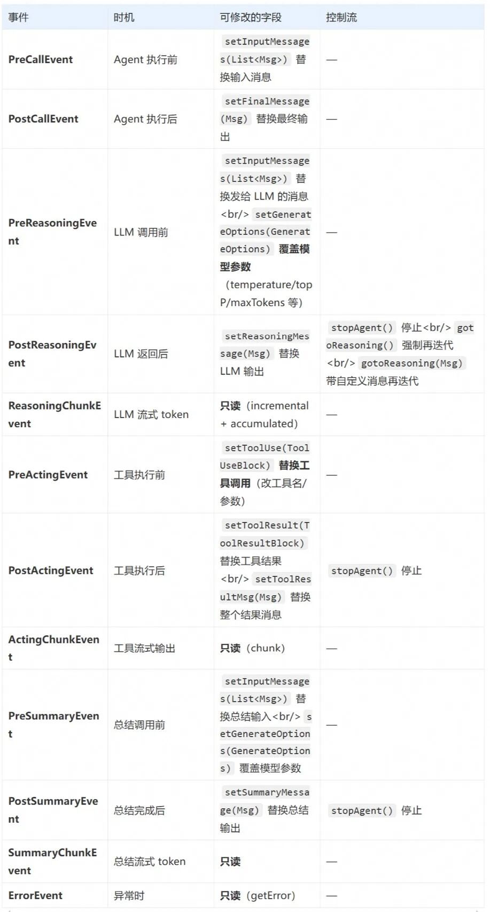

整体链路呈现方式：

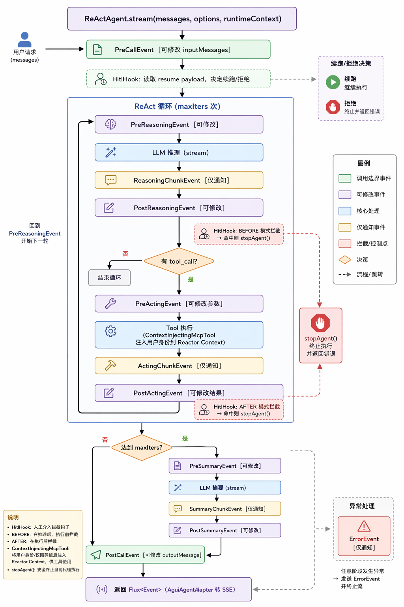

总结一下：

1. 可识别用户传递的 message 格式，约定好 hitl 确定格式即可。
2. PostReasoningEvent 是在调用工具之前，并具备工程级 stopAgent。
3. PostActingEvent 在调用工具之后，并具备工程级 stopAgent。

工程级 HITL 的完整拦截时序如图 43-2 所示。

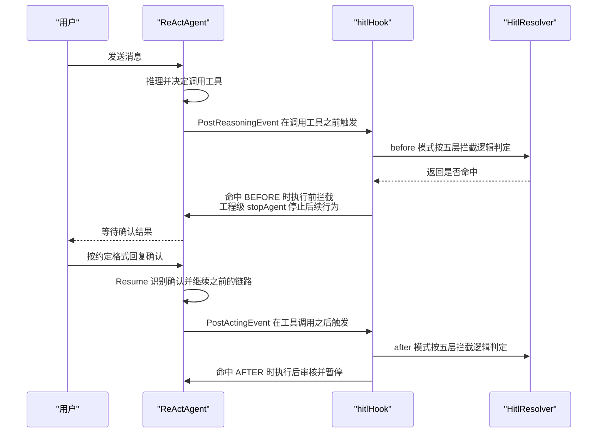

*图 43-2：工程级 HITL 拦截与恢复时序*

解决了 hitl 的基础能力，我们还要定义具体的优先级策略和工作模式！

**HitlResolver 的决策优先级**：before 和 after 模式，我们都会由 HitlResolver 来确定命中那个 hitl，具体 5 层拦截逻辑如下：

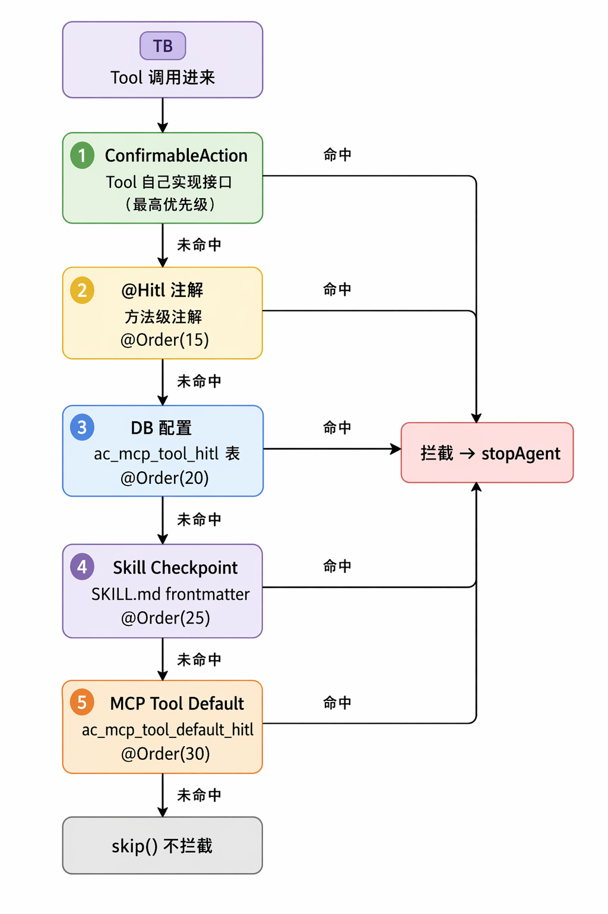

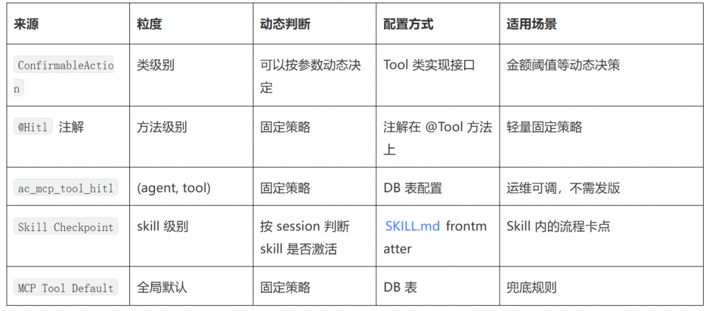

三种工作模式详解：

**BEFORE（执行前拦截）**

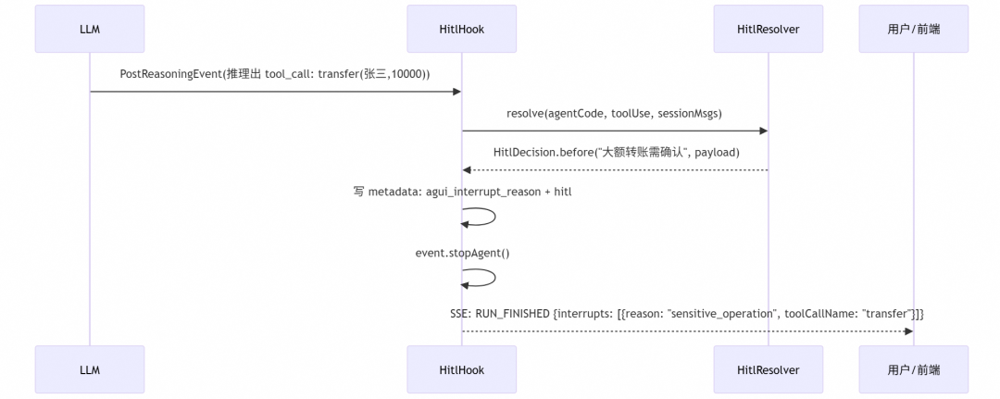

**AFTER（执行后审核）**

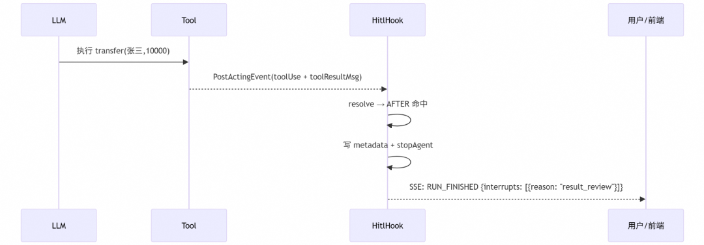

**Resume（用户确认后恢复）**

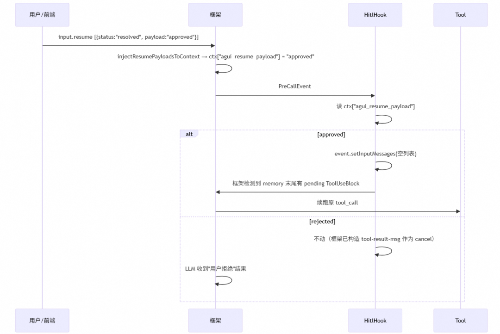

###### 5.1.4.4 ContextInjectingMcpTool（SPI4）

AgentTool 是 AgentScope 作为工具级别的 SPI 扩展点，可以定义封装工具调用逻辑：

```java
public interface AgentTool {
    String getName();
    String getDescription();
    Map<String, Object> getParameters();
    Mono<ToolResultBlock> callAsync(ToolCallParam param);
}
```

`ContextInjectingMcpTool` 实现该接口，以装饰器模式包装框架原生的 `McpTool`，解决一个核心问题：**MCP Server 的鉴权身份不能在构建期焊死，必须在每次调用时动态绑定到当前请求用户**。

**1）问题背景**

AgentScope 原生 `McpTool` 的身份在 `AoneMcpClientBuilder.buildSync()` 构建期就已确定（DB `ac_mcp_server.user_id`），所有用户共享同一个身份调用 MCP Server。这在金融场景下不可接受——不同用户调用同一个 MCP 工具（如查询审批单），MCP Server 必须看到调用者本人的身份才能做权限校验和数据隔离。

**2）设计：调用时身份注入**

`ContextInjectingMcpTool` 不改变工具的对外契约（`getName` / `getDescription` / `getParameters` 全部透传 delegate），仅在 `callAsync` 边界完成身份注入：

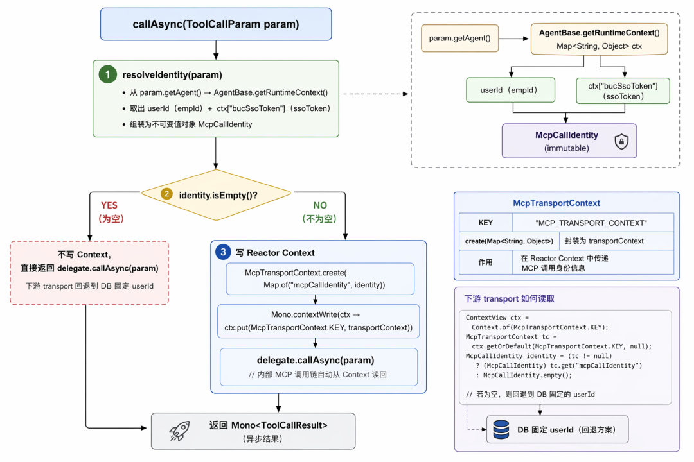

关键点：身份传递走 Reactor Context（响应式线程安全的上下文传播机制），而非 ThreadLocal。这是因为 MCP 调用链全异步（`Mono` / `Flux`），ThreadLocal 在跨线程调度时会丢失。

**3）McpCallIdentity：调用级身份载体**

```java
public final class McpCallIdentity {
    public static final String CONTEXT_KEY = "mcpCallIdentity";
    private final String empId;        // BUC 工号 → Normandy bucUserId
    private final String ssoToken;     // BUC SSO token → Normandy bucSsoToken
    private final Map<String, String> extras;  // 预留扩展位
}
```

设计为不可变值对象而非散键的原因：身份字段会增长（empId → +ssoToken → 未来可能 +sessionId / 租户号）。收敛为一个对象后，传输链中间层（`ContextInjectingMcpTool` → `McpTransportContext`）无需随字段增减改动，只有组装端（RuntimeContext 读取）和消费端（鉴权头生成）两头需要动。

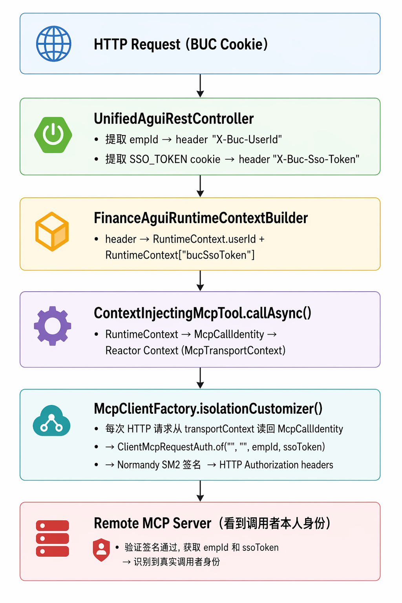

##### 5.1.5 七条设计哲学总结

1. 约定优于配置。
2. DB 与应用层同构（消除转换层）。
3. 草稿/发布双轨（修改不影响线上）。
4. 乐观锁全覆盖（防并发冲突）。
5. 组件市场 + 绑定分离（复用 + 独立演进）。
6. 异步任务解耦（不阻塞主流程）。
7. 增量持久化（减少写压力）。

#### 5.2 要点二：低成本兼容各个生态平台

##### 5.2.1 SkillSourceLoader

当前系统已建立 `SkillSourceLoader` SPI 抽象层，将 Skill 来源的差异封装在接口实现层，上层 `SkillRegistry` + `BaseFinanceAgentFactory` 完全不感知底层来源细节。这意味着接入新生态平台的成本被压缩到"实现一个 `@Component` 类"的量级。

> **对照教材**：AgentScope 原生的 Skill 定义与技能市场接入见第 15 章；本节讲的是在其上扩展多 Skill 来源（Aone、OSS）的企业实践。

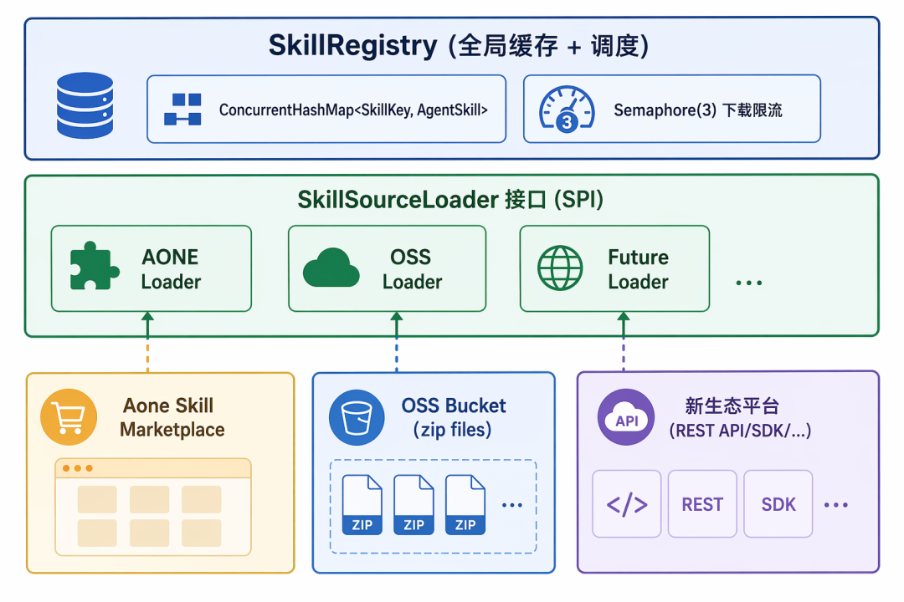

**关键接口契约**：

```java
public interface SkillSourceLoader {
    String skillSource();              // 来源标识: "AONE" / "OSS" / "GITHUB" / ...
    AgentSkill load(SkillKey key);     // 加载技能（下载+解析）
    default int purgeLocalCache();     // 清理全部本地缓存
    default Path localCacheDir();      // 本地缓存根目录
    default void purgeLocalCacheForKey(SkillKey key); // 清理单个缓存
}
```

**SkillKey 三元组**：`(skillSource, skillName, skillVersion)` — source 是一等公民，天然支持多来源共存。

###### 5.2.1.1 AoneSkillSourceLoader


**生产级保障**：

- **强约束层**：`ac_agent_skill` 的每一行必须指向一个 `enabled=1` 的 `ac_skill` 行，否则启动时 fail-fast（`IllegalStateException`），杜绝"配置了但加载不到"的隐患。
- **弱失败层**：Aone 服务暂时不可用时，Agent 仍能启动（跳过该 Skill），后台定时重试恢复。
- **版本管理**：`ac_skill.skill_version` 支持语义化版本，升级 Skill 只需在 DB 中新增一行 + 更新 `ac_agent_skill` 绑定。

###### 5.2.1.2 OssSkillSourceLoader


**研发加速价值**：

- **零审批迭代**：开发者修改 SKILL.md → 打包 zip → 上传 OSS → DB 新增一行 `ac_skill(source=OSS)` → 刷新 Agent，全程无需走 Aone 发布审批。
- **版本快速切换**：同一 Skill 可在 OSS 上维护多个版本，开发者通过修改 `ac_agent_skill.skill_version` 秒级切换。
- **本地调试友好**：OSS Skill 的本地缓存目录与 AONE 隔离，互不干扰。

###### 5.2.1.3 扩展新生态平台的成本分析

接入一个新 Skill 市场的步骤：


**不需要改动的部分**：

- `SkillRegistry` — 自动发现新 Loader，无需修改。
- `SkillKey` — 已包含 source 维度，天然兼容。
- `BaseFinanceAgentFactory.resolveSkills()` — 只关心 `SkillKey`，不关心 source 实现。
- `ac_agent_skill` / `ac_skill` 表结构 — `skill_source` 字段已是开放字符串。
- 前端管理页面 — 下拉选择新增 source 值即可。

###### 5.2.1.4 标准化 Skill 驱动流程


###### 5.2.1.5 如何监控 Agent 绑定 Skill 完整驱动的生命周期

**1）Skill 生命周期全景图**


**2）ac_agent_skill_task 状态机详解**

这是 Skill 生命周期的核心驱动引擎，当前实现的状态流转：


阶梯式的 6 次重试策略：


**调度器双轨制**：

- 生产环境：`AgentSkillTaskScheduler`（SchedulerX2），推荐 cron `0/20 * * * * ?`（20 秒一轮）。
- 开发环境：`AgentSkillTaskLocalScheduler`（Spring `@Scheduled`），`fixedDelay=20s`，需手动开启。

##### 5.2.2 MCP

`McpClientFactory.build()` 只做一件事——把 DB 行逐字段映射到复用层框架的 `AoneMcpClientBuilder`：

```java
// McpClientFactory.java:69-101
AoneMcpClientBuilder builder = AoneMcpClientBuilder
    .create(server.getMcpServerName())
    .mcpId(server.getMcpServerId());
// 每个 DB 列 → 一个 builder setter，全是 if-not-blank 映射
if (isNotBlank(server.getMcpServerType())) builder.type(parseEnum(AoneMcpType, ...));
if (isNotBlank(server.getAuthMode()))      builder.authMode(parseEnum(AoneMcpAuthMode, ...));
if (isNotBlank(server.getRegion()))        builder.region(parseEnum(AoneMcpRegion, ...));
// ... 共 8 个字段
return builder.buildSync();  // transport/auth/URL解析 全交给框架
```

**关键点**：URL 解析、transport 选择、auth 实现全部在复用层框架内部。项目代码只做"DB → Builder"的哑映射。框架新增一个 `AoneMcpType` 枚举值，这边零行代码变更——`parseEnum()` 是泛型反射，自动识别新枚举。

##### 5.2.3 Skill vs MCP 两种兼容策略


**设计取舍很清晰**：Skill 各平台差异大（仓库协议、文件格式、版本模型都不同），必须自建插件化；MCP 协议本身是标准化的（MCP schema + HTTP transport），差异只在 URL 解析和鉴权方式，这些恰好是框架已经解决的问题，所以选择让渡给框架，自己只做数据驱动的配置层。

#### 5.3 要点三：Agent 整体效果进化

##### 5.3.1 思考

2026 年被视为 AI 爆发的元年，Hermes 现象级的走红让"进化"一词成为行业热词。尽管各类技术文章铺天盖地地分析着各种"闭环进化"的策略，但业界似乎鲜少有人能清晰界定：究竟什么是真正的"进化？"其核心衡量指标又是什么？

我们需要回归本质，厘清一个关键命题：如何区分"变化"与"进化"？以 Hermes 的 Skill 创建策略为例，从严格意义上讲，这更多是一种随机的"变化"。由于缺乏有效的价值验证机制，我们很难判断新生成的 Skill 是否真正提升了系统能力——没有正向反馈的变化，只能称为扰动，而非进化。

我翻阅了部分 Hermes 的源码，也查看了相关的资料，得出了一个结论：


而 Hermes 并没有做到的是：


Hermes 的"进化"本质上是"自组织的知识治理"——它擅长控制熵（合并冗余、归档过时、去重命名），但没有闭环的效果反馈来证明变化是改善。Curator Prompt 自己明确承认 "DO NOT use usage counters as a reason to skip consolidation"，说明系统知道自己无法从遥测数据判断 Skill 质量。这是设计上的有意取舍（优先结构治理），还是能力上的待补全缺口，取决于产品定位。

##### 5.3.2 如何定义进化

在构建自主智能体（Agent）及其底层技能（Skill）的过程中，我们常陷入一个误区：认为存在一个完美的、终极的模型状态。然而，Agent 和 Skill 进化的核心驱动力并非抽象的自我完善，而是基于具体场景的效果反馈，尤其是可量化的效果对比。

必须明确一个核心认知："绝对进化"是一个伪命题，只有"相对进化"才是工程实践中真实且可执行的命题。

**1）为什么"绝对进化"是伪命题？**

在开放域的自然语言处理或复杂任务规划中，不存在唯一的"标准答案"。同一个用户意图，可能有多种合法的执行路径；同一段代码，可能有多种等效的实现方式。因此，试图定义一个放之四海而皆准的"完美 Agent"不仅理论上不可行，工程上也无意义。

真正的进化，发生在有限边界内的比较优势中。我们需要将无限的现实世界映射到有限的评测集（Benchmark）上。只有通过构建高质量的测试用例，并引入如 3 分制、6 分制或 9 分制等细粒度的打分机制，才能将模糊的"好与坏"转化为可追踪、可优化的"高与低"。

这种相对进化的逻辑链条如下：

- 基线确立：在当前版本的评测集上建立性能基线。
- 差异对比：新版本相对于旧版本，或在不同策略之间，在特定指标上的得分差异。
- 迭代导向：根据得分差距定位短板，驱动下一轮的参数调整或逻辑优化。

**2）定义指标**


权重设计：


**3）定义评测**


##### 5.3.3 如何研发进化闭环的能力？

人工闭环 vs 自动闭环

**1）人工闭环：最小可行的进化系统**

在讨论自动化之前，必须先承认一件事：**人工闭环不是自动闭环的低级形态，它是自动闭环的原型验证。**

人工闭环的流程是直观的：


这个流程看起来很原始，但它在特定阶段是不可替代的。

**人工闭环的真正价值**

第一，它建立了归因的心智模型。

在系统早期，你甚至不知道"失败"长什么样。用户的抱怨可能是路由问题，也可能是底层数据源的问题，还可能是用户自己的预期不合理。这些分类，必须由人肉 review 几百个 case 之后才能形成稳定的判断框架。

跳过这一步直接做自动化，等于是在没有标注数据的情况下训练分类器——你不知道自己在优化什么。

第二，它验证了干预是否有效。

早期最大的风险不是"进化太慢"，而是"进化方向错了"。人工闭环让你能直接感知：修改 skill description 之后，路由真的变准了吗？还是只是你构造的测试 case 碰巧过了？

这种直觉，在系统不成熟时，比任何自动评测都可靠。

第三，它发现了"不可修复"的 case。

有些失败不是 Skill 的问题，是系统架构的问题，甚至是产品定义的问题。这些 case 需要人工识别后推动上游变更，自动闭环没有这个判断力。

决策是否需要自动闭环：


**2）人工闭环的瓶颈：为什么它必然会到达天花板？**

人工闭环的瓶颈不是"慢"——慢只是表象。真正的瓶颈有三个：

**瓶颈 1：评估一致性**

同一个 bad case，两个开发者可能给出不同的归因结论。这不是能力问题，是认知偏差。

```text
Case：用户问"上个月供应商的账期分布"
开发者 A：归因为路由问题——应该走 financial-analysis-skill，
         结果被路由到了 data-query-skill
开发者 B：归因为能力缺失——financial-analysis-skill 存在，
         但没有"账期分析"的子能力
```

两种归因都合理，但干预方向完全不同。如果归因不一致，后续的所有优化都会互相抵消——今天 A 改了路由描述，明天 B 又给 Skill 加了新能力，系统的演化方向变成了随机游走。

自动闭环解决这个问题不是通过"消除分歧"，而是通过固化一套评估标准，让所有决策在同一个标尺下做出。

**瓶颈 2：评估覆盖率**

人工 review 永远只能覆盖样本，而不是全量。当系统每天处理几千次请求时，人工 review 的可能只有 5%。

这 5% 里还有严重的选择偏差——被 review 的往往是"用户投诉了"的 case，大量"用户没投诉但其实效果一般"的 case 被忽略了。

自动闭环可以处理全量流量。它不需要用户投诉——它可以根据预定义的评估指标，主动发现效果不佳的 case。

**瓶颈 3：反馈延迟**

人工闭环的反馈循环是天级别的：今天发现问题，明天分析，后天修改，大后天发布。

但 Skill 的问题可能是小时级别的——一个底层数据源的 schema 变了，导致 SQL 生成 Skill 产出的 SQL 全部报错。等人工发现时，已经影响了几百次请求。

自动闭环可以把反馈延迟压缩到分钟级别：评测持续运行，指标一出现偏移就触发告警和自动干预。

**3）自动闭环**


这三层的关系是：数据管道提供原料，执行引擎提供算力，策略层提供评估逻辑。任何一层缺失，自动闭环都无法运转。

**评测数据管道：从 Trace 到评测资产**——这是自动闭环中最容易被低估，但最重要的部分。

**L1: Trace：结构化执行记录**

Trace 不是日志，Trace 是结构化执行记录。两者的区别在于：日志是给人看的，Trace 是给机器分析的。一条合格的 Trace 必须包含：


**Outcome Signals：结果信号体系**


需要用数据管道，把这些异构信号统一为标准化的 outcome label。

**打分机制**：


**几个容易踩的坑**

**坑 1：评测数据集的偏差**

如果评测数据集主要来自用户投诉（显式反馈），它会有严重的偏差——只覆盖了"用户愿意投诉"的场景。大量"效果一般但用户懒得反馈"的 case 不在数据集中。

解法：主动采样。按 Skill、按意图类型、按时间段分层采样，确保评测数据集的分布接近真实流量分布。

**坑 2：LLM-as-judge 的稳定性**

用 LLM 评估 LLM 的回答，评分会有随机性。同一个回答，两次评估可能给出不同的分数。

解法：

- 使用四维 rubric（而非开放式打分），每个维度有明确的 1-5 分标准，减少评分随机性。
- 多次评估取均值（至少 3 次）。
- 定期用人工标注校准，确保自动评分与人工评分的 Pearson 相关系数 > 0.7。
- 性能维度完全走自动化指标，不经过 LLM-as-judge，避免不必要的评分噪声。

**坑 3：过度优化**

自动闭环可能会让系统"过拟合"到评测数据集。Skill 在评测中表现很好，但线上效果一般。

解法：

- 评测数据集定期更新（每月至少替换 20%）。
- 保留一个"隐藏"评测集，永远不用于优化，只用于验证。
- 线上指标和评测指标同时监控，两者出现背离时立即排查。

**坑 4：忽视评测系统自身的成本**

评测不是免费的。每次评测消耗 LLM API 调用、计算资源、存储资源。如果评测频率过高或评测集过大，成本可能失控。

解法：

- 增量评测优先：只评测受影响的 Skill，不全量回归。
- 评测集分层：核心集（必须每次都跑）+ 扩展集（低频跑）。
- 用小模型做 LLM-as-judge，只在不确定时升级到大模型。

**坑 5：四维权重的校准缺失**

默认权重（相关性 0.30 / 准确性 0.35 / 完整性 0.20 / 性能 0.15）是起点，不是终点。不同业务场景、不同用户群体的真实权重可能差异很大。如果长期不校准，综合分会与用户真实感受脱节。

解法：

- 收集人工标注的"整体满意度"评分，与四维加权分做回归分析，反推真实权重。
- 按 Skill 类型维护差异化权重（如告警类 Skill 性能权重上调至 0.30）。
- 每季度回顾一次权重配置，确保与用户体感一致。

#### 5.4 要点四：上下文压缩策略和长期记忆的策略

##### 5.4.1 目的

一句话说明目的：

- **上下文压缩**：防止单次请求的 LLM context window 随对话轮次无限增长。核心思路：**旧对话 → LLM 摘要 → 替换原 block，保留最近 N 个 block 完整不压缩**。
- **长期记忆**（User 级）：管"跨会话记住用户是谁、偏好什么"。

> **对照教材**：框架内置的上下文压缩见第 13 章，两层记忆与大工具结果卸载见第 14 章。本节的压缩与长期记忆是自建平台上的对应实现，表结构与触发机制都是该团队自己的设计，思路可与框架机制互相印证。

##### 5.4.2 压缩


Block 的 `seq` = 首条 Msg 的 `timestamp(ms)`，保证严格递增且幂等。

什么时机开始？答：还是 FinanceAguiSessionManager 的能力。


压缩时机发生在 createAgent 阶段，同步探测，三阈值任一超限即触发：


**幂等保证**：`INSERT IGNORE` + UK `(agent_code, thread_id, status)` → 同 thread 同时只有一条 PENDING。

完整设计：


**关键设计点**：

1. **异步执行**：压缩不在请求链路上，不影响用户延迟。
2. **CAS 抢占**：多 worker 并发安全（`updateStatus(id, PENDING, RUNNING)` 返回 0 = 别人已抢）。
3. **Session 锁内执行**：避免与 onEnter/onExit 并发操作 block 表。
4. **失败重试**：最多 5 次，超限后保持 RUNNING + last_error 等运维介入。
5. **SUMMARY seq 冲突保护**：`INSERT IGNORE` 返回 0 时放弃，避免重复归档。
6. **下次 `createAgent` 加载时**：
   a. `blockMapper.selectActiveAsc()` 只取 `archived=0` 的 block
   b. 返回：`[SUMMARY block] + [最近 5 个 NORMAL block]`
   c. SUMMARY block 的 `role=SYSTEM`，文本以 `[Conversation Summary]` 开头，LLM 能识别为历史摘要

##### 5.4.3 长期记忆的策略

从对话中自动抽取用户偏好和事实，跨会话持久化，在每次请求时注入 system prompt，使 Agent "认识"老用户。


#### 5.5 要点五：和业财平台综管打通，自由化定制页面


#### 5.6 要点六：全链路身份标识和建立细粒度权限控制机制

设计权限体系，重点考虑以下方面：

- 如何在 Agent 调用链路中嵌入权限校验逻辑。
- 如何实现基于用户身份和上下文的数据隔离。
- 如何支持动态、可视化、可审计的权限申请与授权流程。
- 如何确保 MCP/Skill 层与底层数据服务之间的权限策略一致。

该问题的解决将直接影响系统的安全性、合规性与可扩展性，需在架构演进中同步规划与落地。

##### 5.6.1 梳理了现有权限体系的四个纵深防御切面


##### 5.6.2 全链路身份统一

**现状**：financeAgent 工程内部的身份传递链路已基本打通——BUC SSO 在入口层完成认证，`empId` + `ssoToken` 通过 HTTP Header 桥接至 AG-UI 的 `RuntimeContext`，MCP 调用层通过 `McpCallIdentity` + Normandy SM2 签名实现了 per-request 的身份隔离（`ContextInjectingMcpTool` → `McpClientFactory.buildIsolated()`）。这条链路在工程内部是闭环的。

**问题**：但当调用链走出本工程边界时，身份上下文存在断裂：


**规划**：

1. **HSF 调用链身份透传**：在 `HsfUtil` 泛化调用层注入 EagleEye RpcContext，将 `empId` 作为 caller context 透传至下游 HSF 服务。下游服务可据此做用户级鉴权和审计，而非仅识别调用方应用。优先覆盖 AMDP 数据查询链路（当前所有用户查询共享同一 `AuthParam`，存在越权查询风险）。
2. **MCP 身份隔离全覆盖**：当前 `shouldIsolate()` 仅对 `NORMANDY_AUTH` + `AONE/ZETTA` 类型生效。未来应扩展至所有 MCP Server 类型，对于不支持 per-request 身份的 MCP Server，推动其接入 Normandy Auth 或 OAuth2 token exchange 模式，逐步消除共享 token 的安全面。
3. **统一身份上下文（Identity Context）**：抽象一层 `CallerIdentity`（超越当前 `McpCallIdentity` 的 MCP 范畴），覆盖 HSF / MCP / HTTP 回调用 / MetaQ 消息生产者等所有出站调用场景。确保无论请求从哪个通道进入、从哪个通道出去，终端用户身份始终可追溯。

##### 5.6.3 灰度体系建设

**现状**：灰度路由的核心框架已搭建完成——`ac_agent_gray_config` 表 + `GrayMatcher` 三维度匹配（百分比 / 白名单 / 环境）+ `BaseFinanceAgentFactory.buildPublishedSnapshot()` 的版本分流逻辑，支持灰度发布 → 验证 → 全量推进（`promoteToStable`）的完整生命周期。

**当前短板与演进方向**：

1. **百分比路由用户粘性**：`GrayMatcher.matchPercentage()` 当前使用 `ThreadLocalRandom` 逐请求随机，同一用户可能前一次请求命中灰度、后一次命中稳定版。这对问题排查和用户体验都不友好。改为 `hash(workNo) % 100 < percentage` 的确定性分桶，保证同一用户在灰度周期内始终路由到同一版本。
2. **灰度可观测性**：当前灰度命中结果仅体现在版本加载逻辑中，缺乏显式的埋点和指标。需要：
   - 在 AG-UI 响应 Header 中标记 `X-Gray-Hit: true/false` 和 `X-Agent-Version`，便于前端感知和调试。
   - 按灰度/稳定版维度拆分核心指标（成功率、平均耗时、工具调用失败率），接入 Sunfire Dashboard。
   - 灰度命中日志结构化输出，支持按 `empId` + `agentCode` + `version` 三维检索。
3. **多级灰度编排**：当前灰度粒度是单个 Agent 级别。未来需支持：
   - Skill 级灰度：同一 Agent 内，部分 Skill 使用灰度版本（如新 prompt 模板），其余保持线上版本。
   - MCP Server 级灰度：新版本 MCP Server 仅对灰度用户开放，避免新工具的不稳定性影响全量用户。
   - 组合策略：白名单 + 百分比可叠加（先白名单内部验证 → 再百分比放量），当前三种策略是互斥的。
4. **灰度自动推进与回滚**：
   - 设定灰度阶段的自动推进条件：灰度用户量 ≥ N 且成功率 ≥ 阈值 → 自动扩大百分比 → 全量。
   - 设定自动回滚条件：灰度版本错误率突增（相对稳定版 > X%）→ 自动将灰度流量切回稳定版，发出 Sunfire 报警。
   - 当前 `promoteToStable` 是手动操作，需要在此基础上增加自动化决策层。
5. **灰度与 HITL 联动**：灰度版本的新工具/Skill 应自动提升 HITL（Human-in-the-Loop）确认级别——灰度流量中的工具调用默认走 BEFORE 模式确认，稳定版则可降级为 AFTER 或免确认，降低灰度版本的爆炸半径。

##### 5.6.4 其他安全基建


以上规划基于当前代码实际状态（`GrayMatcher`、`McpClientFactory.buildIsolated()`、`HitlHook`、`UserUtils` 等），每项改进都有明确的代码切入点，可按优先级分阶段落地。

#### 5.7 全链路可观测的实现


### 06 最后整体框架总结


> **本书读者可以带走什么**：这是全书唯一从"教训"出发的案例——七类坏味道可以直接当作自己代码库的自查清单；它的平台设计（DB 驱动快照、草稿/发布双轨、四大 SPI 定制）与第五篇的 AgentScope Service 互为镜像：一个是业务团队的自建答案，一个是官方平台答案，结论高度一致。对犹豫"要不要自建"的读者，它最大的价值是把为什么要自建、要付什么代价完整摊开。
>
> 案例一是一个业务团队在框架之上"自己造"。案例二来自另一个方向：阿里云新金融技术服务团队把 AgentScope 底座产品化，服务多家金融机构。值得注意的是，案例一里的自建设计几乎都能在案例二中找到产品化的对应物——配置热更新对应 DB 驱动配置，权限透传对应身份注入，HITL 体系对应工程级人工确认。

## 案例二 FinXScope：基于 AgentScope 构建金融级智能体底座

> 作者：孟辰(半堂)，文军(思越)，凌乐真(乐真)，徐磊(崇树)，林源(逆仞)

### 01 产品定位与核心愿景

#### 1.1 FinXScope 是什么

FinXScope 是阿里云新金融技术服务团队**基于 AgentScope Java 构建的金融级 AI 原生智能体底座。**作为整个 Agent Harness 体系的核心组成部分，FinXScope 充分复用 AgentScope Java 在智能体编排、工具集成、多模型接入及可扩展运行时等方面的成熟能力，并在此基础上针对金融行业的合规性、安全性与高可用要求进行了深度定制与增强。完整的 Agent Harness 体系由 FinXScope 运行底座、AI 服务资产平台、全链路评测平台和运营管理平台共同构成，FinXScope 在其中承担着最核心的智能体运行与管理职责。


理解 FinXScope 的核心定位，需要把握四个关键层面：


**一句话概括**：FinXScope 是金融级 AI 原生智能体底座的核心引擎。专家服务团队与金融机构深度共创，围绕企业实际场景共同打造符合金融级要求的 AI 原生应用搭建、运行与运营体系。基于它构建的智能体应用，让用户只需一句话描述目标，系统即可自主规划路径、动态调度上百个技能完成任务，真正实现"对话即服务"的全新交互范式。

#### 1.2 客户进展与市场验证

自推出以来，FinXScope 获得多家金融机构的高度关注和实质性合作进展，已经在 10 个金融头部客户投产上线，20 多个客户交付中，覆盖 60 个以上的金融客户群体，包括国有大行、股份制银行、保险公司及证券机构等多类金融业态。

实际落地场景涵盖财富管理、客户经理赋能、智能核保、合规审查、投研分析等核心金融业务。在已投产的项目中，AI 原生 App 已触达千万级用户群体，验证了 FinXScope 在真实生产环境下的稳定性和业务价值。

这些实践验证了一个核心判断：金融机构需要的不是又一个聊天机器人框架，而是一个能够真正支撑企业级智能体从概念验证到规模化投产的运行底座。

### 02 行业背景与挑战

#### 2.1 从"功能导航"到"对话即服务"的范式跃迁

金融 AI 正在经历一次根本性的范式变化。2024 年以来，以 Manus、Claude Code、Hermes Agent 等为代表的自主智能体产品引爆了全球市场的关注，OpenClaw 在 3 个月内获得超过 23 万 GitHub Stars 成为现象级项目。这些标志性事件证明：大模型已经从"聊天助手"进化为能够自主规划和执行复杂任务的"工作搭档"。


对金融行业而言，这个变化的影响是深远的。传统的智能服务研发路径是在已有系统上"叠加"AI 能力：AI 的定位更像是帮助传统工作流的辅助工具，它没有打破原有的服务路径。用户依然需要在层级菜单、按钮和表单间手动跳转，只不过多了一个"AI 问答"入口。这种方式导致了一个尴尬的局面：客户用了所谓的"智能服务"，但使用方式和体验与传统模式并无本质区别。

但随着大模型能力跨越临界点，AI 已经具备参与甚至主导业务流程的能力。这意味着金融机构对 AI 的期待发生了根本性转变：不再是简单地自动化固定工作流，而是希望 AI 能够自主理解用户意图、动态调度企业级金融服务资产、解决客户的复杂问题。


这个跃迁的本质是：从"以企业功能为中心"转向"以用户问题为中心"——用户不再需要知道系统有哪些功能、该走哪个流程，而是直接描述自己的目标，AI 自主完成从理解到执行的全过程。这就是"对话即服务"的新范式。

#### 2.2 金融机构构建智能体面临的结构性挑战

据安永《AI 银行白皮书》分析，AI 技术在银行业的规模化落地已具备战略紧迫性。普华永道 2026 年金融 AI 调研也指出，银行与保险机构在 AI 治理方面最关注的是可追溯性与可解释性。然而，金融机构在从 POC 验证走向规模化投产的过程中，面临着一系列深层次的结构性挑战，而这些挑战恰恰是 FinXScope 所针对性解决的：


上述挑战的本质是一个系统性问题：金融机构需要的不是某个单点能力的增强，而是一套完整的智能体运行底座。

一个容易被忽视的事实是：智能体的最终业务效果，并不完全取决于大模型本身的能力，同样取决于承载它运行的底座（Agent Harness）的质量。意图是否被精准理解、工具是否被正确调度、上下文是否被有效管理、执行过程是否可靠可控——这些"模型之外"的工程能力，才是决定智能体能否在真实场景中稳定交付价值的关键。同一个大模型，运行在不同质量的底座之上，呈现的业务效果可能天差地别。这正是金融机构需要一套专业级 Agent Harness 的根本原因。

### 03 AI 原生六层架构

#### 3.1 6 层架构设计

FinXScope 是整个 Agent Harness 体系的核心引擎，也是首个面向金融行业的企业级智能体运行底座。它提供的是系统性的完整能力组合，而非散点式的技术组件：基于已在阿里巴巴大规模验证的 AgentScope 框架，叠加完全自研的十大核心能力和金融级增强，形成了一个既有坚实技术根基、又能快速适配金融场景的智能体运行平台。围绕 FinXScope，Agent Harness 体系进一步延伸出 AI 服务资产平台（FinXSkillHub）、全链路评测平台（FinXVantage）和运营管理平台，共同覆盖智能体从开发、运行到持续优化的完整生命周期。而 FinXScope 的六层架构，不仅是这套体系的技术实现骨架，更是面向 AI 原生时代对企业应用架构的全新定义与规范。

六层架构的层级划分与对应能力如图 43-3 所示。


*图 43-3：FinXScope 的 AI 原生六层架构*


为什么需要重新定义企业架构？传统企业架构（SOA、微服务）是围绕"人操作系统"的范式设计的：人通过界面发起操作，系统按照预设流程执行，返回确定结果。但在 AI 原生范式下，"AI 自主规划和执行任务"成为核心驱动力。这要求所有的服务能力、数据资产、功能组件都必须面向"如何更好地被 AI 理解和调用"而重新组织。这是一次底层设计范式的转变，而非在原有架构上的修补。

#### 3.2 架构设计详解


#### 3.3 AI 原生架构的战略意义

六层架构的意义远超技术实现层面，它回答了金融机构在智能化转型中面临的一个根本性问题：当 AI 从"辅助工具"升级为"核心驱动力"时，企业的技术架构应该如何重新组织？


### 04 核心能力深度解析

以下十大核心能力是 FinXScope 的技术护城河，它们既包含完全自研的原创能力，也包含在 AgentScope 基础上进行深度增强。这些能力源自实际金融客户场景的刚性需求，经过了多个生产环境的打磨验证。

#### 4.1 意图引擎：金融语义的精准理解

**场景痛点**：在金融对话场景中，用户的表达往往是口语化、模糊的、带有强上下文依赖的。"茅台最近咋样"需要被理解为"贵州茅台（600519）近期股价走势"；"昨天说的那个产品帮我买 5 万"需要结合历史对话还原完整指令。传统的关键词匹配或浅层分类模型，在这种复杂金融对话中表现出明显的不适应性。


**解决方案**：FinXScope 的意图引擎实现了完整的四阶段处理管道，每个阶段可独立开关、灵活配置，形成"模块化、可配置的金融意图引擎"：

**第一阶段**：NER 实体识别——基于金融领域词典与规则引擎，自动识别股票代码、企业名称、金额、时间、百分比等金融实体。采用异步处理和小模型推理保证高性能（毫秒级响应），同时通过可配置的词典机制支持企业自定义实体类型扩展。

**第二阶段**：问题改写——将口语化输入转化为结构化查询请求。改写管道串联四个处理器：上下文增强（从历史消息和用户画像中提取上下文实现指代消解）、术语标准化（"年涨"→"年度涨幅"）、语义纠错（修正歧义和错误）、LLM 重写（在必要时调用大模型生成更清晰的结构化表达）。改写规则支持管理端在线配置。

**第三阶段**：意图分类——基于动态意图树实现多级意图判定。支持 LLM 智能分类（高精度）与规则回退（高性能）两种模式自动切换。意图树支持管理端在线配置和版本管理，支持运行时动态覆盖。

**第四阶段**：Skill 映射——按识别出的意图精确路由到对应技能。支持多技能组合和优先级配置，映射关系支持管理端在线配置。

在意图树路由之外，意图引擎还支持基于 Skill 文档的 LLM 自主规划模式。当用户问题无法被意图树精确匹配时，系统自动切换到 LLM 自主规划：大模型基于 SkillPool 中所有可用技能的文档描述（SKILL.md），自主判断需要调用哪些技能、以何种顺序执行。两种模式在同一智能体中共存，由引擎根据问题特征自动路由。

**2.0 新增能力**：支持调用方通过请求参数覆盖预设意图树，实现多租户场景下的差异化意图策略；支持意图切换追踪；意图树管理接口支持完整 CRUD 和版本回滚。

#### 4.2 三层记忆系统：从提示词工程到上下文工程的进化

> **对照教材**：AgentScope 框架的记忆与上下文机制见第 13、14 章；FinXScope 的三层记忆是在框架能力之上的金融级扩展，STM / LTM / UserProfile 是本产品的术语定义。

**场景痛点**：传统 AI 系统要么没有记忆（每次对话从零开始），要么只有原始消息堆砌（无法提取高价值信息），且记忆实现深度耦合于业务逻辑，缺乏统一的读写接口和生命周期管理。


**解决方案**：提示词工程关注的是"如何写好一个提示词"，而上下文工程关注的是"如何系统性地管理 LLM 接收到的所有上下文信息"：上下文的质量和组织方式，直接决定了智能体的决策质量。三层记忆不是三个独立的"存储箱"，而是一套完整的"存储→压缩→召回→注入"运行循环：

**短期记忆（STM）**：对话级上下文的窗口管理与智能压缩。STM 采用滑动窗口机制管理当前会话的对话轮次。当对话持续进行、上下文逐步膨胀超过 Token 阈值时，STM 触发智能压缩：优先使用 LLM 摘要（让大模型提取对话中的关键信息和决策要点，压缩为简洁的摘要），规则摘要作为回退策略（按时间衰减丢弃较早的低重要性消息）。压缩后的摘要替代原始消息继续参与对话，确保每次注入模型的上下文既保留了关键语义，又不会因过长而影响推理质量。多维度容量控制（轮次限制、Token 限制、时间限制）协同工作。

**2.0 升级**：STM 支持 Redis 持久化，实现跨实例会话恢复。

**长期记忆（LTM）**：跨会话知识的结构化存储与语义召回。LTM 基于 PostgreSQL + pgvector 实现持久化向量存储。在每次对话结束后，系统自动评估本次交互中哪些信息具有长期价值（通过 LLM 驱动的重要性评分，过滤冗余和低价值内容），将有价值的信息向量化后存入 LTM。在新对话开始时，系统将当前用户输入向量化，通过语义相似度检索，召回与当前对话最相关的历史片段（如"用户上周咨询过的基金产品""用户表达过的投资偏好"）。同时支持关键词检索（带时间衰减评分）作为补充通道，向量检索失败时自动降级。召回的记忆片段被注入到当前对话的上下文中，让智能体"记住"跨会话的关键信息。

**2.0 升级**：LTM 完整迁移到 PostgreSQL，支持集群化部署。

**用户画像（UserProfile）**：构建在 LTM 之上的结构化金融属性层。UserProfile 不是第三类独立"记忆"，而是从长期交互中自动提取和更新的结构化用户认知。它将 LTM 中散落的交互信息提炼为标准化的金融属性：静态属性（年龄、职业、资产规模）、动态属性（风险等级变化、投资偏好演进）、行为偏好（交互风格、决策习惯）和标签体系（高净值、稳健型、关注科技板块等）。每次交互自动更新，整体画像注入系统提示词指导对话策略。UserProfile 的运行时注入让不同用户获得完全不同的服务策略——同样问"推荐基金"，保守型和激进型用户获得的产品组合和话术完全不同。

**异步零感知**：三层记忆的读写操作完全异步化，不影响主流程的响应速度。用户感知到的是即时响应，系统在后台默默完成记忆的评估、压缩、存储和画像更新。

#### 4.3 双模智能执行架构：灵活性与可控性的统一

场景痛点：金融业务场景的复杂度跨度极大：从简单的余额查询到复杂的投资组合分析。单一执行模式无法覆盖所有场景：纯自主规划模式在简单场景中效率低且不可预测，纯工作流模式在开放性问题中过于僵化。


**解决方案**：首先支持两种执行模式，然后通过共享执行底座实现两者的融合。

**OneAgent 模式**：自主智能执行。基于 ReAct（Reasoning-Acting）循环，让单个智能体自主规划并闭环执行任务。AI 在每一步都进行"思考→行动→观察"的循环，充分释放大模型的创造力和推理能力，适合开放性、探索性任务。

**Multi-Agent 模式**：协作编排执行。2.0 全新构建的统一工作流执行引擎，支持八种编排策略：并行执行（Parallel）、顺序执行（Sequential）、循环执行（Loop）、消息中心（MsgHub）、辩论模式（Debate）、图编排（Graph，基于 DAG）、动态路由（Routing）、监督者模式（Supervisor）。每种策略都实现标准化接口，支持流式输出。

**核心创新**：共享执行底座使两种模式深度融合。实现两种执行模式本身并不是最难的部分。真正的技术亮点在于：OneAgent 和 Multi-Agent 共享同一套统一执行引擎（AgentProcessEngine）作为底座。这意味着两种模式在权限校验、审计留痕、执行管理等横切关注点上保持一致，不会因为切换执行模式而丧失金融级保障能力。

正是因为共享执行底座，FinXScope 才能实现更进一步的创新——工作流挂载到 OneAgent。通过 MountableResource 机制，将 Multi-Agent 工作流封装为 Tool，供 OneAgent 在自主推理过程中按需调用。AI 自主决策何时需要启动一段确定性工作流（如合规审查子流程），工作流执行完毕后结果返回给 OneAgent 继续推理。这种"自主智能 + 确定流程"的融合之所以能够实现，正是因为两种模式运行在同一套执行引擎之上——上下文可以无缝传递、事件可以跨模式透传、审计可以统一记录。支持工作流挂起/恢复和子流程事件透传（避免主 Agent 复述导致的信息衰减和时延增加）。

#### 4.4 统一执行引擎：智能体的"操作系统内核"

**场景痛点**：每个智能体各自实现执行逻辑，导致代码重复、行为不一致、审计不完整，在金融级场景中这是不可接受的合规风险。不同 Agent 的上下文装配方式参差不齐，记忆读写时机不统一，异常处理链路各行其是，使得全链路日志无法穿透、工具调用缺乏统一拦截，既无法满足"每一步决策可回溯"的审计要求，也极大增加了多编排模式下的维护与演进成本。

**解决方案**：AgentProcessEngine 作为统一执行入口，整个引擎包含前置通用层、策略路由层、后置通用层，形成"统一入口 → 统一调度 → 统一收官"的闭环架构：

**前置通用层**：

- 权限校验：用户-Agent-Skill 三级权限验证。
- 输入预处理：文件 ID、运行标识统一补齐，保证后续任何一层都能拿到完整可追踪的输入。
- 上下文加载：从历史消息装配短期记忆（STM），从 MemoryManager 召回相关长期记忆（LTM），从用户画像读出风险偏好等静态属性，统一注入执行上下文。
- 审计启动：打开全链路结构化日志、记录意图决策链与耗时度量，为后续拦截点提供统一的上下文锚。

**策略路由层**：

- 灵活策略选择：根据 patternType 自动选择执行策略（OneAgent ReAct / Multi-Agent 八种编排）处理。
- MountableResource 生命周期：记忆管理器、Toolkit、Skill 包、预编译图等"可挂载资源"按需在策略启动时接入、结束时释放，由执行上下文统一托管。

**后置通用层**：

- 结果格式化：所有策略的输出统一收敛为标准的 AG-UI 事件流，对前端是一套协议。
- 记忆写入：用户原文 + 助手完整回复 + 元数据（session、改写文本、意图类型、命中 Skill、工具调用明细）异步回写 STM / LTM / UserProfile，用户画像随每次交互持续打磨。
- 审计关闭：闭合未结束的流式消息段、发送终态事件、打印结构化日志（实例、模式、耗时、文本长度），与前置层的 traceId 完成闭环。
- 指标采集：Prometheus 指标端点已打通，采集引擎总耗时、各阶段耗时、LLM 调用量等指标。

全面支持同步、流式、AG-UI 三种执行模式。完整拦截器链（12 个拦截点）支持自定义逻辑注入。执行全程自动记录决策链、工具调用、Skill 日志，满足金融审计合规要求。

**2.0 新增**：模型运行时覆盖、Skill 级超时配置和重试策略、执行上下文跨实例透明迁移。

- 模型运行时覆盖：系统提示词、模型类型、skills 等支持热更新，同一个 Agent 配置可按用户/场景动态变身。
- Skill 级超时与重试：按 Skill 粒度配置独立超时阈值与重试策略，避免长尾工具拖垮整条对话链。
- 执行上下文跨实例透明迁移：支持多副本部署下请求路由到任意实例都能恢复状态，为灰度发布与故障切换提供底座。

#### 4.5 AG-UI 全链路流式交互：跨渠道一致的实时服务体验

> **对照教材**：AG-UI 与 A2A 协议本身见第 26 章；本节讲协议在金融多渠道场景下的落地价值。

**场景痛点**：传统 AI 应用"问一句等半天"的交互模式让用户无法感知 AI 正在做什么。多渠道各自定制交互协议导致体验不一致和管理成本高。同时有些金融数据是结构化的，纯文本输出无法有效传达趋势、对比、占比等信息。

**解决方案**：FinXScope 全面适配 AG-UI 标准协议，基于 Spring WebFlux 响应式流式架构，通过 SSE（text/event-stream）实现全链路异步流式传输。AG-UI 协议定义了 15 种细粒度事件类型，覆盖推理过程、工具调用、中间结果、最终输出等完整交互链路。AG-UI 标准化交互带来四重核心价值：

**跨渠道复用**：新渠道接入时，前端只需按统一标准消费 AG-UI 事件流，无需为每个渠道单独定制交互协议。同一套事件流在各渠道前端直接复用，显著降低管理成本和开发成本，确保跨终端一致的智能服务体验。

**前后端解耦**：前端只消费标准事件流，后端切换模型、增减工具、调整策略时前端无需任何改动。这让后端可以独立快速迭代，前端只需维护对标准事件类型的渲染能力。

**统一可观测**：所有 Agent 基于同一套事件类型做监控、告警和性能分析。事件流天然提供了全链路的执行追踪能力。

**工具生态可扩展**：新增工具只需按协议输出标准事件，即可被前端自动识别和消费，无需跨团队联动改造。

渲染层面内置多种标准渲染工具（折线图、柱状图、饼图、指标卡片、数据表格、成交量图、可选列表、确认操作卡片等），支持占位符式增量渲染和个性化组件扩展。

**2.0 新增**：workflow_command_agent 自然语言到控件操作指令转化；WorkflowToolRegistry 前端动态声明控件、运行时注册为智能体可调用工具。

#### 4.6 三层技能定义体系：从配置到代码的渐进式复杂度适配

> **对照教材**：SKILL.md 的结构与技能加载机制见第 15 章；按复杂度分三层定义是本产品的做法。

**场景痛点**：金融业务技能复杂度跨度大，从简单的汇率查询到复杂的信贷审批，单一定义方式无法兼顾简洁性和表达力。

**解决方案**：三层技能定义体系按复杂度递进：

**YAML 配置文件（轻量查询类）**：在配置文件中声明技能名称、描述、关联工具和内容。框架启动时自动读取并批量注册，无需编写任何代码。适合汇率查询、余额查询等内容固定、逻辑简单的技能。

**SKILL.md + 脚本（中等复杂度，"文档即契约"）**：在 skills 目录下为每个技能建立独立文件夹，核心是一份 SKILL.md 文档，可配套 Python/Shell 脚本使用。OneAgent 完全依赖这份 Markdown 文档决定何时调用该技能、如何传参，让行为可预测、可审计。适合客户洞察、产品推荐、风险评估等中等复杂场景。

**Java @Bean 注册（复杂业务逻辑）**：标准 Spring Bean 方式，具备完整类型检查和 IDE 支持，同时作为底层工具的注册方式（如多步事务封装、强一致性保障的业务工具）。适合多步事务封装、合规审查、信贷审批等强一致性业务场景。

**2.0 新增**：

- SkillsHub 远程加载：由管理平台统一管控版本。服务启动时全量拉取上线技能，运行期间管理平台发布变更，整个过程无停机时间，支持版本管理和灰度发布。
- 技能自动权限过滤：支持 NONE、FILTER、REJECT 三种模式管控用户对于技能的使用权限。

#### 4.7 工具与知识对接：标准化连接企业存量资产

**场景痛点**：金融机构经过多年信息化建设，积累了大量业务系统和知识资产，但它们接口标准各异、分散在不同平台中，逐个编写适配代码工作量大。与此同时，大量非结构化知识难以被智能体有效利用。

**解决方案**：通过标准化协议和配置化接入机制，将工具对接、知识检索和权限透传统一为平台级基础能力，最大限度减少适配改造工作量：

**工具接入**：提供 MCP（Model Context Protocol）和 API Schema 两种标准配置方式，企业只需声明服务地址和认证信息即可完成工具注册。McpClientRegistry 统一管理所有 MCP 连接的配置、健康检查和生命周期，确保工具可用性；同时支持配置化接入任意符合 MCP 协议的客户自定义 Bean，无缝对接客户存量系统能力，无需额外开发。

**知识接入**：统一的 Knowledge 接口支持多知识源的配置化路由——百炼通用 RAG、点金金融专业知识库、客户自建知识库均可通过配置接入。智能体通过统一的 Knowledge 工具调用知识检索，底层自动屏蔽不同知识库的实现差异，并对标签检索、召回重排、查询改写等核心能力提出统一的质量标准。

**权限透传**：无缝对接企业安全体系。为工具调用和知识召回接口提供标准化的数据透传通道，支持身份信息、渠道标识等上下文的端到端传递，让智能体的每一次外部调用都自动继承用户的权限边界，无需重复建设鉴权逻辑。

**2.0 新增**：McpClientRegistry 支持动态管理：工具连接的增删改在运行时即可完成，秒级生效，无需重启服务；新注册的工具自动注入到 Agent 可用列表，运营团队可以独立完成工具的上下线操作。

#### 4.8 接入网关引擎：多渠道统一入口与安全管控

**场景痛点**：多渠道输入格式各异需要统一处理，AI 系统面临的 Prompt 注入等安全威胁需要在入口层统一防护。

- **协议碎片化**：不同客户端（Web/移动端/第三方系统）提交的请求格式不同后端需逐一适配。
- **安全威胁**：Prompt 注入、敏感内容输入、违规操作等安全威胁如不在入口层统一拦截，将扩散至意图引擎和执行引擎，造成不可控风险。
- **多模态预处理缺失**：图片/视频/音频/文档等非结构化内容如果直接透传给 LLM，无法获得有效理解；需在网关层完成内容提取并增强 Prompt。
- **流式输出不一致**：不同处理分支（纯文本/多模态/TodoList）的 SSE 事件格式和生命周期管理各自为政，前端对接成本高。
- **会话状态管理松散**：消息持久化、会话标题生成、上下文恢复等散落在各模块，缺少统一编排点。

**解决方案**：实现六重核心职责：协议适配、多模态处理、安全管控、请求路由、流式输出编排、会话持久化。集成完整拦截器链和权限检查。安全策略支持后台动态配置，变更秒级生效。

- **协议适配**：兼容 4 种输入格式，统一解析为标准内部表示。
- **多模态处理**：图片理解、视频理解、音频 ASR、文档解析，并行提取并增强 Prompt。
- **安全管控**：策略匹配 + 风险评分 + 行动执行（pass/warn/block），支持白名单、5 分钟策略缓存。
- **请求路由**：三路分发：纯文本 → OneAgent / 多模态 → 提取+OneAgent / TodoList → 直接执行。
- **流式输出编排**：统一 AG-UI Protocol 事件格式，过滤重复控制事件，网关层统一发送生命周期事件。
- **会话持久化**：用户消息/助手回复自动保存，会话标题自动生成，多模态内容兜底保存。

**2.0 新增**：DocumentParserService 多格式文档解析（PDF/DOCX/DOC/MD/TXT），支持大文件分块、格式保真、元数据提取，让用户可以直接基于上传文档与智能体对话，权限控制体系、TodoList 智能路由、可观测埋点。

#### 4.9 TodoList 任务管理（2.0 全新构建）：长流程任务的可视化进度追踪

**场景痛点**：针对跨境汇款、贷款审批等长流程金融任务（耗时 30s 至数分钟），解决用户对 Agent 执行过程"完全不可见"的问题——不知道进展到哪、不知道拆解得对不对、中断后无法继续。

- **进度可见性**：实时同步执行状态（如"2/4 完成，正在执行第 3 步"），消除等待焦虑，减少无效追问。
- **规划可校验**：透明化 Agent 的任务拆解逻辑，允许用户在执行前/中识别遗漏或偏差并介入纠偏，变被动等待为主动审视。
- **中断可恢复**：持久化存储任务状态，支持跨会话/跨天自动断点续传，保障复杂业务流程连续性。

**解决方案**：基于两级步骤模型 + Hook 自动注入 + Pipeline 状态同步，构建从规划到恢复的执行闭环。

**两级步骤管理**：Level-1 由 LLM 自主拆解顶层步骤序列（如"查询 → 校验 → 确认 → 转账"），通过 TodoListToolkit 提供的 7 个标准工具全生命周期管理 5 种状态；Level-2 由执行引擎在 Pipeline 层面自动填充，将并行调度的子 Agent 名称、任务及状态写入对应 Level-1 步骤的 subSteps，实现多智能体协作细节的可视化。框架内置一致性约束：强制通过 finish_todo_step 标记完成、同一时刻仅允许一个步骤处于 IN_PROGRESS 以防止并发混乱，步骤完成后引擎自动激活下一个 TODO 步骤，实现状态的自然流转，显著降低 Agent 的编排复杂度。

**Hook 自动状态注入（无感记忆）**：通过 TodoListHintHook 拦截 PreReasoningEvent，在每轮 LLM 推理前动态追加包含固定工具说明与实时任务状态（如进度统计、当前/下一步骤详情）的系统提示，使 Agent 在无需独立记忆模块的情况下实现全局进度的"无感"感知，并在任务完成后自动引导进入总结阶段。

**Pipeline 策略的 Multi-Agent 状态同步**：基于 ParallelAgentStrategy 引擎监听子 Agent 的分配与完成事件，自动调用 updateTodoSubStepStatus 将状态同步至 TodoList 存储，使主 Agent 能通过 Hint Hook 即时感知子任务进展，从而实现零通信成本的高效 Multi-Agent 编排状态同步。

#### 4.10 全链路配置热更新与运营管理平台（2.0 全新构建）：运行时秒级生效的持续优化

场景痛点：配置变更需要走完整发布流程导致效率低下；缺乏统一管理界面让运营人员难以调整智能体行为。


**解决方案**：

- 配置热更新：覆盖 Agent/Skill/Tool/意图树/模型/网关全部核心配置。Redis Pub/Sub 多实例同步，秒级生效。ConfigVersionRegistry 版本管理支持精确回滚。
- 运营管理平台：对智能体、技能、意图、工具及网关实现全生命周期管理：可视化编辑意图树、配置映射关系、注册/启停技能、管理 MCP 连接、配置安全策略。支持搭建镜像运行环境进行配置试跑验证，多版本对比评测后择优发布。未来与全链路评测体系打通，实现"配置→试跑→评测→择优发布"的自动化运营闭环。

### 05 为什么基于 AgentScope 构建

#### 5.1 AgentScope：为智能体而生的开发框架

AgentScope 是阿里巴巴开源的 AI 原生应用开发框架，专为构建自主规划智能体而设计。选择它作为底座框架，基于三个关键维度：技能动态治理（Tool Group 按需激活，避免上下文过载）、高并发架构（AgentPool 工厂模式天然无状态）、执行可靠性（指数退避重试、完整 Hook 系统实现熔断限流）。

#### 5.2 与传统框架的全面对比


#### 5.3 AgentScope 之上的核心扩展

AgentScope 提供了坚实的基础框架能力，但通用框架到金融级产品之间仍有显著的能力鸿沟。FinXScope 在 AgentScope 之上构建了六大扩展：


**2.0 新增扩展**：多智能体工作流引擎（八种编排策略）、工作流挂载机制（MountableResource）、配置热更新引擎（Redis Pub/Sub + ConfigVersionRegistry）、三级权限体系、可观测性框架（BizLogger + Prometheus + ObservabilityHook）、远端存储改造（完全无状态化）。

### 06 高码与低码的协同关系

#### 6.1 正确理解高码与低码的定位

在金融行业，"高码还是低码"不是一个二选一的问题，而是"在什么阶段、什么场景用什么工具"的问题。两者本质上是同一个技术体系中的不同角色，服务于智能体从"想法"到"投产"的不同阶段。

**低代码平台的核心优势与适用场景**：可视化编排让业务人员直观参与设计；快速原型验证让想法可以很快的变为 Demo；所见即所得的调试体验让问题定位直观。低码平台是业务验证阶段的最佳选择，也适合变化频次较低、流程节点不长（5-10 步以内）、对可靠性容错率比较宽容的场景。

**低代码面临的挑战**：当场景涉及复杂工作流编排、多轮交互和跨会话状态管理、AI 自主规划、以及金融级生产保障时，低码平台的维护成本和构建复杂度急剧飙升。

#### 6.2 FinXScope 的高码价值

FinXScope 选择高码路线解决低码难以覆盖的场景，同时极力降低使用门槛：


#### 6.3 "低码孵化、高码投产"的完整闭环


### 07 金融级能力保障

#### 7.1 面向高可用的架构设计

FinXScope 从设计之初将高可用内化为基础架构特性。最终的高可用保障依赖客户基础设施能力，但 FinXScope 确保自身不会成为高可用瓶颈。


#### 7.2 安全合规体系

**三级权限管控**：用户-Agent-Skill 三级权限，FILTER/REJECT 双模式，缓存优化，fail-open/fail-close 容错策略可配置。

**输入安全**：Prompt 注入防护、敏感词过滤、内容审核，策略支持后台动态配置。

**全链路审计**：决策过程、工具调用、Skill 日志完整留痕。MDC 上下文自动注入 traceId/spanId，全链路可追踪。

#### 7.3 可观测性体系

FinXScope 提供了一套覆盖接入、意图、以及智能体执行的全链路可观测体系，核心功能包括：

**分布式链路追踪**：基于 Micrometer Tracing 实现全链路追踪，自动为每个请求生成唯一 traceId，贯穿从网关接入到 Agent 执行的全生命周期。traceId 自动注入到所有日志输出中，支持跨异步线程的上下文传播，便于在分布式环境下快速定位请求链路和排查问题。

**业务指标监控**：通过 BizLogger 统一 API 实现业务埋点，自动生成 Prometheus 标准指标。指标体系按系统架构划分为六个层级（接入层、表现层、意图层、执行层、工具层、知识层），每层独立定义指标枚举，覆盖事件计数、耗时统计、活跃请求数、错误分类等维度。通过独立管理端口暴露 `/actuator/prometheus` 端点，供 Prometheus Server 拉取。

**Agent 生命周期可观测**：深度集成 AgentScope Hook 机制，通过 ObservabilityHook 追踪 Agent 执行的 5 个生命周期阶段：调用入口、LLM 推理、工具执行、摘要生成、异常处理。每个阶段自动采集耗时和 Token 用量，支持三级开关精细控制（全局开关 → 事件类型开关 → Agent 级覆盖），可在生产环境按需开启或关闭特定 Agent 或特定阶段的观测数据采集。

**结构化日志**：BizLogger 提供双模日志输出：每条业务日志同时以人类可读格式输出到控制台，以结构化 JSON 格式写入独立文件。日志自动携带 traceId、sessionId、userId 等上下文信息，支持机器解析和日志平台对接。

**SPI 扩展机制**：框架提供三层 SPI 扩展点，支持用户自定义可观测行为而无需修改框架代码。

- 日志输出扩展：通过注册自定义 BizLoggerProvider 替换或增补默认的日志处理逻辑。
- Hook 注册扩展：通过实现 AgentHookProvider 为 Agent 注入自定义生命周期钩子。
- 数据提取扩展：通过实现 HookLogFormatter 自定义 Hook 事件的数据提取和格式化逻辑。

### 08 落地实践指南

#### 8.1 四步集成路径


#### 8.2 部署方式与资源预估

**1. FinXScope 支持两种使用方式：**

- **独立应用**：打包为可执行 Fat JAR / Docker 镜像，独立运行并对外提供 API。
- **依赖引入**：作为 Spring Boot Starter 被其他应用通过 Maven 引入，自动装配 Agent 能力。

**2. FinXScope 的运行态始终依附于具体的场景应用：**

**作为独立应用时**，FinXScope 本身即是场景应用，直接容器化部署后对外提供服务。

**作为依赖引入时**，FinXScope 随宿主场景应用一并打包、一并部署，不需要独立的运行实例，其资源消耗包含在宿主应用中。

**在没有具体场景应用的情况下：**

- 代码仓库中的一份参考实现/源码。
- Maven 仓库中的一个依赖包（JAR）。

换言之，FinXScope 不存在脱离场景的独立"常驻运行"状态。部署规划应围绕实际的场景应用来制定。

**3. 部署架构参考**


**4. 所需数据资源**

项目运行依赖以下数据型资源。所有数据型资源优先复用客户现有的基础设施，仅在客户环境中无对应产品时才考虑单独部署。


**核心原则**：客户有什么用什么，不重复建设。数据型资源（PostgreSQL、Redis、向量库、OSS）全部优先对接客户既有基础设施，项目本身通过配置文件适配即可。仅在客户确实缺少某类资源时，才为其单独部署对应组件。

**5. 资源预估参考**


表中标注 (复用) 的资源，可考虑对接客户现有实例，无需单独部署。

#### 8.3 快速启动建议


### 09 FinXScope 2.0 版本演进

FinXScope 2.0 完成了从"单智能体运行框架"到"企业级智能体运行与管理平台"的跨越：

- **多智能体协作体系（全新构建）**：统一工作流执行引擎支持八种编排策略；工作流挂载到 OneAgent（MountableResource 机制）；子流程事件透传（GraphNodeEmitter）；DAG 图执行器（拓扑排序，层内并行层间串行）。
- **权限与安全体系（全新构建）**：用户-Agent-Skill 三级权限，FILTER/REJECT 双模式，权限缓存优化，fail-open/fail-close 容错。JWT 认证集成。
- **可观测性体系（全新构建）**：BizLogger 双模输出，ObservabilityHook 自动观测，BizLoggerProvider SPI 扩展。
- **高可用与无状态化（重大升级）**：STM → Redis，LTM → PostgreSQL，配置热更新引擎（Redis Pub/Sub + ConfigVersionRegistry），完全无状态。
- **意图层增强**：意图树运行时覆盖，模型运行时覆盖，意图树管理接口（CRUD + 版本回滚 + 意图切换追踪）。
- **接入层与表现层增强**：网关引擎重构，DocumentParserService 多格式文档解析，workflow_command_agent，WorkflowToolRegistry 动态工具注入。
- **TodoList 任务管理（全新构建）**：两级步骤管理，7 个 Tool，Hook 自动注入，Pipeline 集成。
- **MCP 配置管理增强**：McpClientRegistry 动态管理，CustomMcpToolsInjector 自动注入，配置同步。
- **HITL 人工介入体系**：工具级敏感操作拦截与人工确认；Agent 记忆快照与断点续传；分布式挂起状态持久化；用户确认/拒绝意图自动判定。
- **A2A 多智能体协作协议**：标准 Agent-to-Agent 协议服务端与消费端；AgentCard 自动生成与多模式服务发现；同步/流式双通道跨 Agent 调用；AG-UI 与 A2A 事件双向翻译；Nacos 注册中心集成与动态刷新。
- **沙箱安全执行体系**：支持多种主流沙箱后端；沙箱异步创建与会话级实例复用；文件上传/下载与工作区同步；命令执行隔离与超时管控；技能资源自动部署与保活管理。

### 10 典型应用场景


### 11 总结与展望

FinXScope 代表了金融级智能体底座的一种全新范式。它不试图成为一个"万能的 AI 应用"，而是专注于做好一件事：为金融机构提供一个可靠的、高性能的、易扩展的智能体运行与管理底座，让任何金融应用都能以极低的成本获得 AI 原生能力。

FinXScope 的底层完全构建于 AgentScope Java 2.0 之上，深度复用了其面向企业级生产环境的核心能力——包括 ReAct 推理-行动循环、六阶段中间件链、统一消息模型与类型化事件流、工具与技能框架、分层记忆与状态持久化、三态权限引擎以及优雅停机与中断机制等。在此基础上，FinXScope 针对金融行业的合规审计、数据安全与高可用要求进行了系统性的行业化增强。

回顾 FinXScope 的核心价值：六层标准化架构为企业 AI 建设提供了清晰的架构蓝图和规划路径；双模执行架构在灵活性与可控性之间找到了最佳平衡；配置驱动的设计将高码的能力上限与低使用门槛结合；高可用、安全合规、可观测的企业级保障让金融级投产不再是难题。

从 1.0 到 2.0，FinXScope 完成了从"单智能体框架"到"企业级智能体运行与管理平台"的跨越。多智能体协作体系、权限安全体系、可观测性体系、配置管理平台等核心能力的加入，标志着它已具备支撑金融机构规模化智能体落地的完整能力，为金融企业的智能化转型提供坚实的底座。

> **本书读者可以带走什么**：案例二与案例一对照着读最有收获——案例一自建的平台能力，在这里几乎都有产品化形态。它也给出了与第 29 章 Service 不同的另一种组织答案：Service 把 Agent 运行收敛为独立平台，FinXScope 则让底座内嵌进金融机构自己的场景应用（见其"部署方式与资源预估"一节的"常驻运行"说明）。两种形态没有优劣，取决于组织对自主可控与维护成本的权衡。
>
> 下一节只有一段同稿说明，没有正文。

## 案例三 AIDC 物流：企业级 Agent 开发实践（同稿说明）

> **说明**：官方文档中的《AIDC 物流：企业级 Agent 开发实践》（blogs/usecases/aidc-logistics.md）与本章案例一《从配置驱动到业务原生：企业级 Agent 开发实践》是同一篇实践文章的两个发布版本：全文 1445 行中仅 21 行不同——2 行是 frontmatter 的 title 与 en_link，其余 19 行只是列表缩进差异；忽略空白后 diff 只剩 title 与 en_link 两行。两者讲述的都是同一个海外物流业财团队基于 AgentScope 构建 DB 驱动 Agent 平台的完整过程，配图也完全相同。为避免全书重复约一千五百行同文，本节不再重复收录正文，请直接阅读本章案例一。

> 前三个案例都在讲"服务型 Agent"：Agent 替业务处理付款审批、金融业务、物流成本。案例四换到研发场景——当 Coding Agent 从个人工具变成组织级研发基础设施，执行隔离、状态续接、上下文治理这些问题会以更尖锐的形式回来。它也是四个案例中与教材正文贴得最近的一篇，几乎每一面墙都能在前面各章找到对应的框架章节。

## 案例四 Coding Agent 的下半场：从个人提效到组织级研发体系

当下还在古法手搓代码的开发者都是在奔着非遗传承人的目标去了，绝大多数都已经用上了 Claude Code、Cursor 这类 Coding Agent。方向对了，但场景不同，解法也不同——开发者自己在本地装个 AI 助手提效，和在组织内部搭起一套 AI 驱动的研发协作体系，是完全两个维度的事情。前者已经有成熟的产品了，后者才刚刚开始。本节聊的就是后者。

---

### 不是你一个人在想这件事

2025 年底到 2026 年初，一件有意思的事情发生了：Stripe、Ramp、Coinbase 这三家公司几乎同时公开了各自的内部 Coding Agent——Stripe 叫 [Minions](https://stripe.com/engineering)，Ramp 叫 Inspect，Coinbase 叫 Cloudbot。三家公司独立开发，没有互相参考，最终却收敛到了几乎相同的架构上。

这不是巧合。当你把 Coding Agent 从"一个人在终端里用"升级成"整个团队通过 Slack / GitHub Issue 随时触发"，你就会被同一组工程问题逼到同一条路上。LangChain 团队看到了这个规律，2026 年 3 月发布了 [Open SWE](https://github.com/langchain-ai/open-swe)——把 Stripe/Ramp/Coinbase 的共同模式提炼成开源框架。Open SWE 的 README 开头写得很直接：

> Elite engineering orgs like Stripe, Ramp, and Coinbase are building their own internal coding agents — Slackbots, CLIs, and web apps that meet engineers where they already work.

"Meet engineers where they already work"——不是让工程师学一个新工具，而是让 agent 钻进工程师已经在用的 Slack 频道、GitHub Issue、IM 对话里，变成团队工作流的一部分。

我们做 AgentScope Harness 的时候，走的也是这条路。本节以官方示例 `agentscope-codingagent` 为线索，讲清楚一个生产级 Coding Agent 在落地过程中会撞到哪些墙，我们是怎么翻过去的。

> **对照教材**：本节的"五面墙"在教材正文中各有系统讲解——执行隔离与沙箱见第 18 章，上下文压缩与大工具结果卸载见第 13、14 章，AgentState 持久化与会话恢复见第 19 章，多入口通道接入见第 25 章，workspace 与 `AGENTS.md` 见第 12 章，子 agent 见第 16 章，Plan Mode 见第 17 章。本节不重复框架细节，讲的是这些能力在组织级场景下为什么缺一不可、如何组合。

---

### 两个维度的 Coding Agent

先把定位理清楚。Claude Code 优化的是 **"我一个人写代码更快"**——你打字、它干活、你看着它干活、你随时打断纠正。状态在你本机，触发者就是你自己，信任边界就是你信你自己的机器。

我们要搭的东西解决的是另一个问题：**"团队里某个小任务我都不用自己看，扔给 agent 跑完开 PR 我 review 一下就行"**。触发者可能是任何一个 Issue 评论者，agent 在远端跑十几分钟到一小时，没人盯着。Stripe 的工程师在 Slack 里 @Minions 说句"帮我修这个 bug"，回头收到一个 draft PR——这就是组织级 Coding Agent 该有的样子。

两种形态的功能集有交集——都能写代码、跑命令、改文件——但工程约束完全不同。Claude Code 是你自己的私家车，你信任驾驶员（你自己），所以不需要安全气囊以外的防护。组织级 Coding Agent 是出租车公司的运营车辆——乘客不是车主，驾驶发生在远端，你需要行车记录仪、GPS 追踪、里程限制、紧急制动，还得保证一辆车坏了不影响整个车队。

Open SWE 把这个哲学总结成一句话：**"Isolate first, then give full permissions inside the boundary."** 先隔离，再放权。

事实上厂商也在往这个方向走。GitHub Copilot Coding Agent 已经可以在 Issue 上 assign 触发，在云端跑完自动开 draft PR；Claude Code 也有 headless 模式，能在 CI 里被程序化调用。理念上没有本质区别——沙箱隔离、异步触发、PR 驱动产出——厂商是把头部公司验证过的模式产品化了，做成了开箱即用的 SaaS 服务。而 Stripe、Ramp、Coinbase 选择自建，更多是出于自身工程体系的特殊性：内部系统的深度集成、数据合规的要求、工作流的定制程度。两条路不矛盾，哪条更合适，取决于组织自身的约束和需求。

AgentScope Harness 要做的事情是把这条路上共性的工程问题抽象成可组合的基础能力，让选择自建的团队不用从零开始。

---

### 先跑起来再说

最快的体验路径——一个环境变量、一个 Maven 命令，本地跑起来一个交互式 REPL。无需 Docker、无需 webhook、无需 GitHub App。

```bash
export DASHSCOPE_API_KEY=sk-...
cd agentscope-java
mvn install -pl agentscope-examples/agents/agentscope-codingagent -am -DskipTests -q
mvn exec:java -pl agentscope-examples/agents/agentscope-codingagent
```

启动后到 `You>` 提示符，agent 工作在自己的 workspace `~/.agentscope/codingagent/workspace/`。什么都没配，跑起来就有完整的工作区、会话持久化和长期记忆。

```
You> write hello.txt with a haiku about Java
You> clone https://github.com/owner/repo into the workspace and tell me what it does
You> review https://github.com/owner/repo/pull/42
```

到这一步，本地 demo 就跑通了。但 demo 和生产之间的距离，比大多数人想的远得多。

---

### 第一面墙：执行隔离

你给 agent 装了 `execute` 工具，让它能跑 shell 命令。第一天很兴奋——它能 `git clone`、能 `mvn test`、能自己跑通整个构建流程。第二天你意识到一个问题：**触发者不是你自己了。** 任何一个 GitHub Issue 评论者、任何一个 Slack 用户都能让 agent 跑代码，你的宿主机直接暴露在模型决定的命令下面。

这就是所有做组织级 Coding Agent 的团队第一个撞到的墙。Coinbase 用自建的沙箱基础设施解决，Ramp 用 Modal 的云端容器，Open SWE 做了一层抽象支持 Modal、Daytona、Runloop 等多种后端。我们也做了同样的抽象——`FilesystemSpec` 是统一接口，Docker 容器、远端 KV、本机文件系统都是可插拔的实现。以 Docker 为例：

```java
HarnessAgent agent = HarnessAgent.builder()
    .name("coding")
    .model(model)
    .workspace(workspace)
    .filesystem(new DockerFilesystemSpec()
        .image("agentscope/coding-sandbox:latest")
        .isolationScope(IsolationScope.SESSION))
    .build();
```

加了这一行，`read_file`、`write_file`、`execute` 等所有内置工具自动改走沙箱后端，agent 代码完全不用动。`IsolationScope.SESSION` 保证每个 GitHub Issue / PR / IM 对话各跑各的。

沙箱解决了"不能伤宿主"。但马上下一个问题来了。

---

### 第二面墙：状态续不上

用户在 PR 上又评了一条"再补个测试"。agent 得接着上一轮的环境继续干——重新 `git clone` + `npm install` 等五分钟，谁也受不了。

Open SWE 用"persistent sandbox"解决——同一个 thread 的 follow-up message 复用同一个沙箱。我们的方案更精细，沙箱在每次 `call()` 结束时把工作区状态打包成快照，下次按需恢复：容器还在就直接接着用，容器没了就拿快照重新起一个，没快照就全量初始化。快照后端可选本地文件、OSS、Redis，生产环境加一行配置：

```java
.snapshotSpec(new OssSnapshotSpec(ossClient, "my-bucket", "agentscope/"))
```

不光是沙箱的状态要续上。**对话历史、压缩摘要、Plan 状态、todo 列表、权限规则——整个 AgentState 每次 `call()` 结束自动落盘，下次同 `(userId, sessionId)` 的 `call()` 自动加载。** 默认存本地文件，多副本生产切 Redis 一行搞定。切到 Redis 之后，节点崩了会话漂到另一个节点，滚动发布新 pod 自动恢复，甚至 GitHub Issue 里聊到一半切到钉钉继续——只要 `sessionId` 一致，记忆都在。

---

### 第三面墙：上下文爆了

一个长 Issue 跑几十轮对话，`git diff` 输出上万字符，`mvn test` 日志几十 K——模型上下文窗口很快撑爆。这是所有做长任务 Coding Agent 的团队都会撞到的问题。Open SWE 底层的 Deep Agents 框架用 file-based memory 做卸载，把大结果写到文件而不是留在对话历史里。

我们的解法是四套独立可组合的机制：**对话摘要压缩**在消息条数过多时自动触发，保留尾部原文、前面压缩成摘要；**大工具结果卸载**把超长输出写到工作区文件，上下文里只留首尾各约 2K + 一个 `read_file` 路径提示；**参数截断**把 `write_file` 的大入参也截掉；**溢出兜底**在真撞到 `context_length_exceeded` 时做紧急压缩后重试。

```java
.compaction(CompactionConfig.builder()
    .triggerMessages(50).keepMessages(20)
    .truncateArgs(CompactionConfig.TruncateArgsConfig.builder()
        .maxArgLength(2000).build())
    .build())
.toolResultEviction(ToolResultEvictionConfig.defaults())
```

**这不是可选项。** Coding Agent 一定会跑长会话，一定会输出大 diff，不开这两个早晚撞墙。

同时，`MEMORY.md` 会从每天的对话流水账里周期性合并出长期事实。跑久了，agent 自己学会了团队的规矩——"这个仓库的测试命令是 `mvn -pl module test`，根目录 `mvn test` 太慢不要用"——下次就不用再问了。

---

### 第四面墙：多人同时用

上面三面墙——隔离、续状态、管上下文——解决的是"一个 agent session 能跑住"。但组织级服务从第一天起就是多租户的：几十个 Issue、几十个 PR、几十个 IM 对话同时在跑，每个都有自己的代码仓库、依赖目录、对话历史和长期记忆，**绝不能串台**。

这时候才真正理解为什么 Open SWE 的 README 里把 "Multiple tasks run in parallel — each in its own sandbox, no queuing" 列为核心 feature。不是炫技，是刚需。

我们用 `IsolationScope` 控制隔离粒度。`SESSION` 让每个 sessionId 独立一个沙箱，`USER` 让同一用户的多个对话共享一份仓库克隆。隔离不只是沙箱层面的——会话状态、记忆、子 agent 任务也都按同样的粒度走，不用开发者自己操心。

并发控制也是这一层的事：`RunDispatcher` + `MessageQueueHook` 强制保证同一个 thread 同一时间只跑一个推理。用户在 agent 跑着的时候又评了一条，新消息不会打断当前推理，而是入队等下一轮开始前注入——和 Open SWE 的 `check_message_queue_before_model` middleware 是同一个思路。`ThreadBudgetHook` 管住每个 thread 的模型调用上限，`ModelCallLimitHook` 管住全局——**一个用户的失控循环不能把全公司的额度烧光**。

---

### 第五面墙：agent 要接得住各种入口

Stripe 的 Minions 走 Slack，Coinbase 的 Cloudbot 也走 Slack，Open SWE 同时接 Slack + Linear + GitHub。国内场景还要加钉钉和飞书。组织级 Coding Agent 的一个共识是：**不要让用户换到一个新界面去找 agent，让 agent 出现在用户已经在用的地方。**

我们在 Harness 之上加了一层通道适配器，把不同入口的事件统一映射到 `(threadId, message)`。`github:issue:owner/repo#42` 通过 SHA-256 收敛成 UUID，钉钉和飞书同理。这个确定性映射保证同一个 Issue 的所有评论都路由到同一个 agent session，对话历史自动恢复。

五面墙翻过之后，一次组织级任务的完整执行链路如图 43-4 所示。


*图 43-4：组织级 Coding Agent 的执行链路*

---

### 翻过这些墙之后，有几个认知

#### Context Engineering 不是概念，是工程必需品

行业里现在把"怎么给 agent 喂上下文"这件事叫 Context Engineering。有意思的是，几乎所有主流 Coding Agent 都独立走到了同一个模式：Claude Code 有 `CLAUDE.md`，GitHub Copilot 有 `.github/copilot-instructions.md`，Open SWE 有 `AGENTS.md`。**repo 级别的规约不应该硬编码在 system prompt 里，而应该是文件——能版本化、能 CR、能独立更新。**

我们的 workspace 把这个思路推得更远：不只有 `AGENTS.md` 定义人格和行为约定，还有 `skills/` 放团队 SOP（提交规范、测试规范）、`subagents/` 声明子 agent、`knowledge/` 放领域知识、`MEMORY.md` 积累长期事实。workspace 当 Git 管理，CI 验证，部署时 hydrate 进所有副本。**频繁变化的应该是这些文件，而不是 Java 代码。**

#### 工具精选比工具数量重要

Stripe 公开分享 Minions 经验时说过：他们的 agent 有约 500 个工具，但强调 "tool curation matters more than tool quantity"。Open SWE 也跟进了这个理念，只暴露约 15 个核心工具。我们的做法类似——内置工具集控制在文件操作 + shell 执行 + 记忆检索这个范围内，业务工具通过 `toolkit.register(...)` 按需注册。

#### 关键步骤不能只靠 prompt

**不能只靠 prompt 告诉模型"记得跑测试"，关键步骤要用确定性逻辑保证。** GitHub Copilot Coding Agent 跑完后走 repo 现有的 CI pipeline 做验证；Open SWE 有一个 `open_pr_if_needed` middleware 作为兜底——agent 忘了开 PR，middleware 自动补上。Harness 的 middleware 机制（`MessageQueueHook`、`ThreadBudgetHook` 等）也是同一思路：**哪些事交给模型决定，哪些事用确定性代码保证，这条线要画清楚。**

Open SWE 博客里有一句提炼很准确：agentic（模型驱动）和 deterministic（middleware 驱动）的分离，是让 agent 从"demo 能跑"到"生产可靠"的关键。

还有一点：**Draft PR 作为输出契约。** 无论是 Copilot Coding Agent、Open SWE 还是 Stripe Minions，agent 的产出都是 draft PR，永远需要人类 review 后才能 merge。agent 不直接改生产代码——这是组织级 Coding Agent 的一个基本安全假设。

#### 大改之前先想清楚

让 agent 直接上手做"重构整个鉴权模块"是高风险的——它可能边想边改、改坏一片。Harness 的 Plan Mode 把这件事固化成"先想 → 写计划 → 人确认 → 再动手"的流程。开启后 agent 进入只读阶段，退出 plan 需要人类确认。Coinbase Cloudbot 的"Agent Councils"是同一理念——在高风险操作前加入人类审批节点，**用流程约束代替祈祷模型别出错**。

#### 子 agent 不是锦上添花

Open SWE 用 Deep Agents 的 `task` tool 做子 agent 派发，Stripe 用 Blueprints 编排，Ramp 用 Sessions + Child Sessions。Harness 的子 agent 用法很轻量——在 workspace 里写一个 markdown 文件声明职责和工具集，主 agent 调 `agent_spawn` 就能委派。后台调用加个 `timeout_seconds=0`，主 agent 不 block，跑完后框架自动把结果注入下一轮推理。

---

### 从单机到企业：一条演进路线

这些墙不需要一次全翻。Harness 的设计让你从最简的形态开始，按需升级：

**Stage 1：本机 CLI。** 什么都不配，`execute` 在宿主 `sh -c` 跑，状态存本地文件。只在你信任的本机环境用。

**Stage 2：加沙箱。** 一行 `.filesystem(new DockerFilesystemSpec()...)`，所有执行进容器。每个 Issue/PR 一个临时容器，宿主不暴露攻击面。

**Stage 3：多副本分布式。** `stateStore` 换 Redis，沙箱快照存 OSS，加 `executionGuard` 做并发控制。到这一步就能横向扩展——挂在负载均衡器后面跑 N 个副本，任何副本都能接住任何用户的任何对话。

```java
.filesystem(new DockerFilesystemSpec()
    .image("agentscope/coding-sandbox:latest")
    .isolationScope(IsolationScope.USER)
    .snapshotSpec(new OssSnapshotSpec(ossClient, "bucket", "prefix/"))
    .executionGuard(RedisSandboxExecutionGuard.builder(jedis)
        .leaseTtl(Duration.ofMinutes(30)).build()))
.stateStore(RedisAgentStateStore.builder().lettuceClient(redisClient).build())
```

**Stage 4：可观测与限流。** Prometheus 指标、模型预算、上游限流重试——这些组合在一起就是一个"上线后能跑住"的系统该有的样子。

---

### 趋同说明了什么

回顾一下本节提到的这些项目——Stripe Minions、Ramp Inspect、Coinbase Cloudbot、LangChain Open SWE、GitHub Copilot Coding Agent、Claude Code，再加上 AgentScope Harness——它们在语言、生态、部署形态上各不相同，但在核心架构决策上高度一致：per-session 隔离沙箱、确定性的 thread ID 路由、middleware 拦截链、agent 运行时的 message queue 注入、repo 级指令文件、draft PR 作为输出契约。

这种趋同不是互相参考的结果。**它是被同一组问题逼出来的工程必然。**

---

### 写在最后

Coding Agent 的上半场是个人提效——模型更聪明、补全更准、本地工具更顺手。下半场的战场转到了工程：怎么把"能跑一次 demo"变成"7×24 稳定服务一整个团队"。从 Stripe 到 GitHub，从 LangChain 到 AgentScope，大家在不同的起点上走向了相同的架构。这种趋同本身就是最好的路标。

文中提到的 codingagent 是一个完整且可读的示例，建议直接 clone 下来跑一遍再翻源码——它把本节讲的这些工程问题都对应到了真实代码。

> **本书读者可以带走什么**：案例四是前面各章的一次"组织级场景串讲"——各章讲单个机制怎么用，本案例讲它们在多租户、多入口的真实负载下为什么缺一不可。文中那条从本机 CLI 到可观测限流的演进路线，也可以直接当作读完教材后的动手实践清单。

继续深入：第 11 章（Harness 架构深入） · 第 12 章（工作区与文件系统） · 第 18 章（沙箱执行） · 第 13 章（上下文管理） · 第 16 章（子 Agent 协作） · 第 15 章（技能（Skill）） · 第 17 章（计划模式）

## 四案例要点回顾

- **案例一（从配置驱动到业务原生）**："付款审批 Agent 其实只是 Chatbox"的反省引出七类坏味道；解法是自建配置驱动的运行引擎——DB 注册与快照、草稿/发布双轨版本管理、运行链路四大 SPI 定制、工程级 HITL、带评测指标的进化闭环与灰度体系。观点与结论归原团队。
- **案例二（FinXScope）**：金融级智能体底座的六层架构与十大核心能力；其核心判断是"智能体的最终业务效果，同样取决于承载它运行的底座质量"。与案例一对照读，自建设计几乎都有产品化对应。
- **案例三（AIDC 物流）**：与案例一同一篇实践文章的另一个发布版本，无独立内容，读案例一即可。
- **案例四（组织级 Coding Agent）**：五面墙——执行隔离、状态续接、上下文治理、多租户并发、多入口接入——加上从本机 CLI 到可观测限流的演进路线；各团队的架构趋同说明这些是被同一组生产问题逼出来的工程必然。
