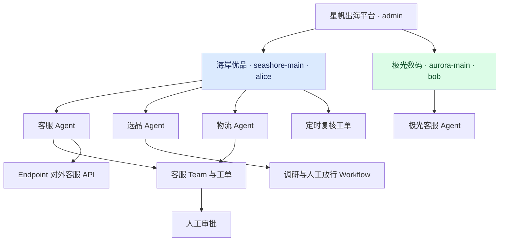
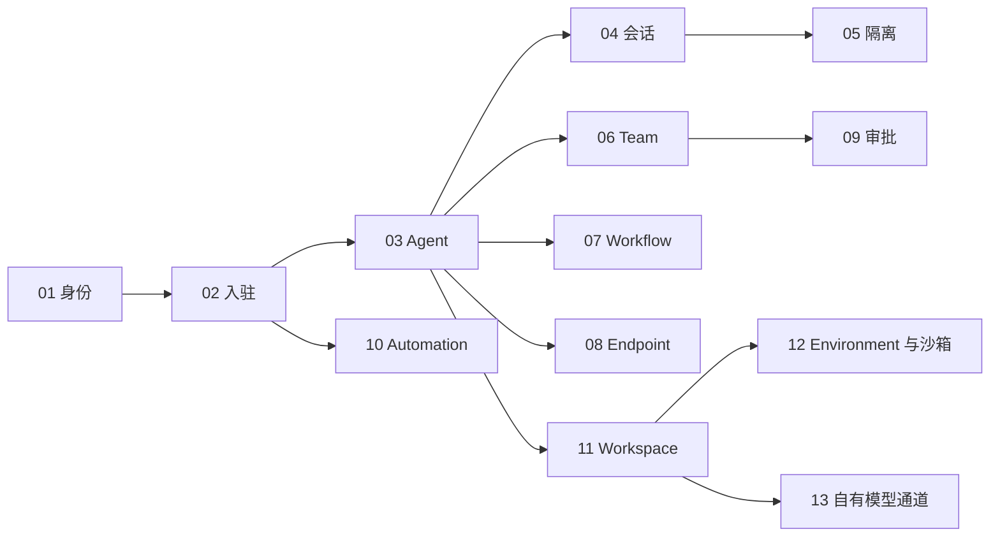

# 跨境电商 Agent 多租户平台 Demo

用 REST API 演示两家商家的入驻、Agent 配置、会话、隔离验证、团队协作、流程、对外 API、审批与定时工单。**按 01–13 连续编号，共 13 步，每步教程与 Bash 脚本成对**。客户端依赖 Bash、curl、jq；服务端仍需完整 AgentScope Service dev 栈。

版本基线：2026-10-13 本地 agentscope-service 源码栈。教程正文基于 2.1.0-BETA1 文档；API 存在演进，本目录以实测为准，主要使用 `/api/v1/agents` Catalog、`/api/v1/chats` 与 `/invoke/v1`。



*图 1：单个部署 tenant 下，以 namespace 隔离商家。*

## 场景与角色

| 角色 | 本地种子账号 | 职责 |
| --- | --- | --- |
| 星帆出海运营 | admin / admin | 入驻、资源治理、审批 |
| 海岸优品 | alice / alice | 家居出海，选品、客服、物流 |
| 极光数码 | bob / bob | 3C 配件客服，隔离对照 |

这些账号仅用于本地开发栈。`tenant=default` 是部署级配置，本例不是多个独立 tenant 部署。

## 步骤目录

| 步骤 | 教程（同目录有同名 `.sh`） | 验证内容 |
| --- | --- | --- |
| 01 | [平台初始化](steps/step-01-platform-init.md) | 版本、登录、身份 |
| 02 | [商家入驻](steps/step-02-tenant-onboarding.md) | namespace 与成员隔离 |
| 03 | [Agent 矩阵](steps/step-03-agent-matrix.md) | 4 个 Catalog Agent，自动关联环境 |
| 04 | [Session 调用](steps/step-04-session-api.md) | Chat、Turn、SSE、新回复 |
| 05 | [隔离检查](steps/step-05-isolation-check.md) | 9 项断言，包括跨商家负向检查 |
| 06 | [Team 编排](steps/step-06-team-orchestration.md) | Issue → AgentTask → attempt；终态另行报告 |
| 07 | [Workflow 流水线](steps/step-07-workflow-pipeline.md) | agent → signal → succeeded |
| 08 | [Endpoint 发布](steps/step-08-endpoint-publish.md) | API Key 外部调用与真实回复 |
| 09 | [人工审批](steps/step-09-hitl-approval.md) | 工单共享、决批、409、评论回写 |
| 10 | [Automation](steps/step-10-automation.md) | cron 预览、测试工单、异步终态与幂等 |
| 11 | [Workspace](steps/step-11-workspace.md) | 资料文件、发布 revision、Agent 版本绑定与升级方法 |
| 12 | [Environment 与沙箱](steps/step-12-sandbox.md) | local/E2B/remote/Worker 区别、控制面初始化阿里云沙箱与真实执行隔离验收 |
| 13 | [自有模型通道](steps/step-13-model-channel.md) | Dataplane 适配类、网关参数、模型别名、可选探针、会话级模型切换 |



*图 2：单步执行前须先完成对应前置步骤。*

## Workspace、沙箱与自有模型，应该先学哪一节？

| 你的问题 | 从这里开始 |
| --- | --- |
| 公司的售后规则放哪里，更新后会不会直接影响所有 Agent？ | 11：草稿 → 发布 → 固定版本；附资料文件与回滚方法 |
| 文件和命令运行在我的电脑、服务容器还是云沙箱？ | 12：查询当前 Environment，用阿里云沙箱（E2B 兼容）真实执行并验证会话隔离 |
| 已有公司模型网关，怎么替换示例中的 DashScope？对话时怎么按需选模型？ | 13：扩展依赖、Java 注册类、YAML、配置回读、上游探针与会话级模型切换 |

先完成 01–03，再执行 11 → 12/13。Step 11 创建独立 `xbd-workspace-lab` Agent，不替换主线的 4 个角色；Step 12/13 默认只读核对，Step 12 的 `--create/--bind/--run` 才会初始化沙箱环境并真实执行（需在 `demo/.env` 配置沙箱四项与可用模型 Key）。三个步骤可以绕过尚有额度阻塞的 04–08 单独学习。

```bash
./run-all.sh --only 11
./run-all.sh --only 12
./run-all.sh --only 13
# 或顺序运行三个配置实验：
./run-all.sh --from 11
```

配套资产位于 `examples/workspace/` 和 `examples/model-channel/`。保存配置、Java 编译与真实运行是不同验收级别，详见各节与验证记录。

## 快速开始

1. 按相邻 `agentscope-java/agentscope-service` 的 README 配置 Docker、JDK、Maven、Go 等依赖，并启动服务。若已有可用 dev 栈，直接复用，勿反复启动。
2. 模型 API Key 必须注入服务进程，同时提供给 demo 的前置检查。使用可用的 DashScope 模型；默认模型见 Step 03，可通过 `XBD_MODEL` 覆盖（只影响新建 Agent，已有定义不会自动更新）。
3. 配置并运行：

```bash
cd demo/cross-border-commerce
cp .env.example .env
# 编辑 .env：BASE_URL 指向服务 Gateway；设置 DASHSCOPE_API_KEY。
./run-all.sh
```

当前本机实测使用独立 Gateway 端口 `28080`，`.env.example` 默认 `18080`，请按自己的栈配置。不要在已占用的端口重复拉起服务。

```bash
./run-all.sh --list        # 列出全部 13 步，不连接服务
./run-all.sh --dry-run                # 打印全部 13 步动作，不读取密钥、不写服务
./run-all.sh --from 6       # 从 Team 接着跑
./run-all.sh --only 9       # 只跑人工审批（先完成 Step 06）
./teardown.sh                        # 默认预览
./teardown.sh --apply                # 停用 demo Endpoint 和 Automation
```

`--from` / `--only` 接受 1..13（也可写 01..09），默认按顺序执行全部 13 步，无需额外开关。失败即停止，保留 `.state.env` 并打印续跑命令。预览可以离线执行。

## 重跑和清理的边界

| 对象 | 重跑行为 |
| --- | --- |
| namespace、4 个 Agent、Team、Workflow 定义、Endpoint、Automation | 按名称复用 |
| Chat | 复用 Chat，每次发送新一轮咨询；校验新增回复与 idle 事件 |
| Team Issue / AgentTask | 每次新建工单与任务 |
| Workflow | 每次发布 revision、创建工单与 Run；Run 键序号递增 |
| 审批与评论 | 每次新建，属于业务增量 |
| Endpoint invocation | 固定幂等键复用已有会话结果 |
| Automation 测试运行 | 固定幂等键复用同一运行与工单 |
| Workspace 实验 | 按名称复用 Workspace/实验 Agent，相同内容重复发布复用版本；实验会恢复样例文件 |
| 沙箱与模型通道 | 默认只读；显式 --create/--bind/--run、--set-model、--session-model、--probe-* 才执行相应操作 |

`.state.env` 含 JWT 与 Endpoint secret，已被 Git 忽略；不要输出或提交它。Endpoint secret 只在签发时返回，删除本地状态可能需要重新签发凭据。

清理采用**可逆停用**：仅停用本例 Endpoint 与 Automation，读取当前版本后写入并回读验证。保留 namespace、账号、Agent、Team、Workflow、会话、工单、审批与共享环境。它不是数据库清空工具，也不会删除开发栈或其他任务的资源。这是相对原计划“全量归档后重建”的明确调整；本轮回归验证的是停用后恢复和重复运行，不是全新数据库冷启动。

## 验证记录与能力边界

完整回归结果见 [验证记录](verification.md)。主线脚本成功退出也不代表所有业务链路都已闭环：

- Step 06 验收门槛是任务产生执行 attempt；若任务最终失败，脚本会输出警告。它不能证明物流成员完成并由 Lead 汇总成功。
- Step 09 验证审批中心与评论，不执行真实退款，也没有验证敏感工具暂停/恢复。
- Step 10 验证排程计算与测试触发，不抓取真实价格；规则默认停用，没有等待次日 cron 到点触发。
- Agent 没有接入真实订单、物流或市场数据，本例模型回复不能作为真实业务事实。
- Step 11 已验证文件、发布与绑定，尚未验证模型实际读取；Step 12 已在阿里云沙箱（E2B 兼容）实测写入回读与 SESSION 隔离，超时回收与快照恢复留作手动观察；Step 13 已核对并编译适配示例，会话级模型切换已实测（下一 Turn 生效、无效模型即报错），未连接用户自有网关。
- API 与隔离实测覆盖 REST；不包含 Console 浏览器端验证。

## 与教程的关系

[第 43 章：跨境电商 Agent 多租户平台实战](../../chapters/43-cases.md)以本 Demo 为主线，讲解业务关系、设计取舍和验收边界；本目录提供逐步 API 操作与可执行脚本。

| 教程主题 | Demo 对应 |
| --- | --- |
| 第 29–30 章 Service 架构与平台 | 01–03 |
| 第 31 章调用面 | 04、08 |
| 第 32 章编排 | 06、07 |
| 第 33 章审批与自动化 | 09、10 |
| 第 34 章跨层约束 | 05、作用域、幂等与乐观锁 |
| 第 12 / 30 章 Workspace | 11 |
| 第 18 / 29 章沙箱与执行环境 | 12 |
| 第 6 / 21 / 30 章模型接入 | 13 |

当前版本不使用教程旧示例的 `/api/v1/agent-sessions` + Application Key。平台会话使用 JWT；对外 Endpoint 使用独立 API Key。商家资源列表需要显式 namespace 查询参数，详情访问还受到资源/工单权限校验。

## 常见问题

**服务不可达？** 检查 `.env` 的 Gateway 端口和 `/api/v1/version`，先修复 dev 栈再续跑。

**缺少模型 Key 或出现模型错误？** `.env` 只供 demo 检查，不会给已运行服务注入 Key。服务进程也必须配置可用 Key、模型与额度。

**遇到 403 / 404？** 核实身份、namespace 成员和工单共享策略；404 也可能表示无权查看。不要通过覆写成员表排障。

**登录过期？** 重新调用登录并更新缓存，或仅清空 `.state.env` 对应 `XBD_TOKEN_*` 行后运行 Step 01；保留 Endpoint secret 与资源 ID。

**为什么审批可通过，Team 仍失败？** 审批中心、任务执行和模型工具调用是不同链路。按 Step 06 文档检查任务状态、attempt 与服务日志，不能把其中一个成功当成整个系统成功。
