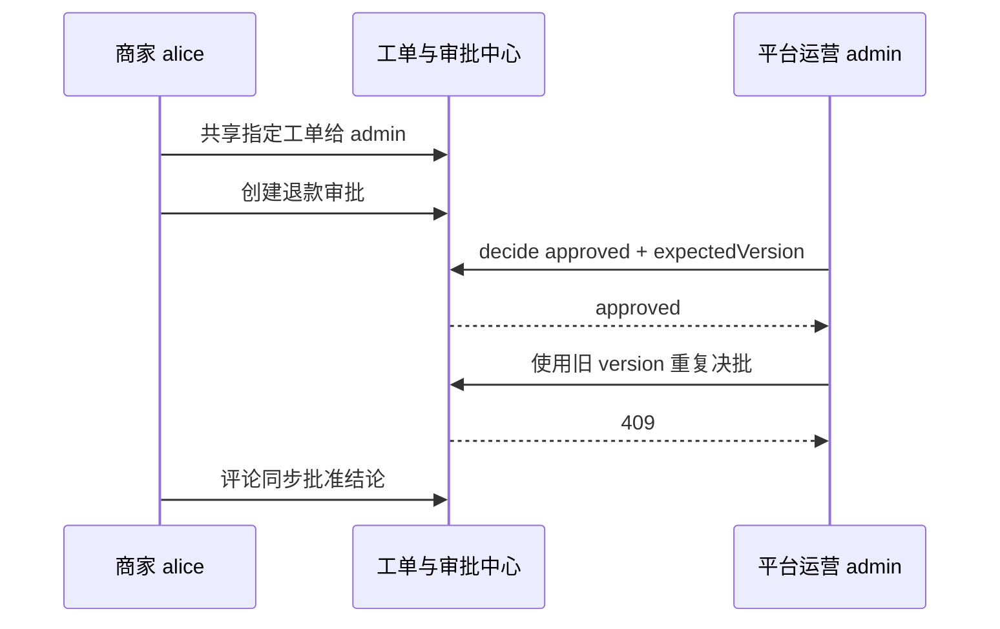

# 延伸 A · HITL 人工审批

> 本步导读：商家对退款发起审批，平台运营在可访问的工单内复核，再把结论写回。运行 `bash steps/ext-a-hitl-approval.sh`，前置为 Step 06。



*图 A-1：工单共享、审批与乐观锁。*

## 为什么 admin 也会遇到 404？

namespace 成员资格与工单访问策略是两道不同的检查。平台管理员不是私有工单的默认参与者。此前排查尝试把审批搬到 `default` namespace，仍然无法解决其关联工单的权限问题。

脚本先用 alice 读取 `/api/v1/issues/$ISSUE_ID`，保留已有 `access.members`，加入 `admin: contributor`，再提交当前版本：

```bash
source lib/common.sh
require_env
login_as alice alice XBD_TOKEN_ALICE
ISSUE_ID=$(state_get XBD_ISSUE_1)
ISSUE=$(api GET "/api/v1/issues/$ISSUE_ID" "" XBD_TOKEN_ALICE)
SHARE=$(jq -c --arg admin "${ADMIN_USER:-admin}" \
  '.issue | {version,access:(.access // {})} | .access.mode="shared" | .access.members[$admin]="contributor"' <<<"$ISSUE")
api PUT "/api/v1/issues/$ISSUE_ID/access" "$SHARE" XBD_TOKEN_ALICE
```

`api` 是 `lib/common.sh` 中的 curl 封装，第四个参数指定身份。不要省略 GET 的空 body 参数，否则会误用默认 admin 身份。资源详情由 ID 定位，脚本不强加另一个 namespace。

> **注意**：共享成员必须先属于同一 namespace。脚本不会覆写 namespace 成员表。当前本地 `seashore-main` 已包含 alice 和 admin；若自行建立环境时缺少运营成员，应保留所有既有成员后再授权。

## 如何发起与批准？

alice 向 `POST /api/v1/approvals` 提交 `tenant`、`namespace: seashore-main`、`targetType: issue`、`targetRef`、`issueId`、`approverRef: admin` 和退款原因。admin 登录后，用创建响应中的 `.approval.version` 决批：

```bash
login_as "${ADMIN_USER:-admin}" "${ADMIN_PASS:-admin}" XBD_TOKEN_ADMIN
APPROVAL_ID=$(state_get XBD_APPROVAL_1)
AP=$(api GET "/api/v1/approvals/$APPROVAL_ID" "" XBD_TOKEN_ADMIN)
# 仅对 pending 审批执行；脚本每次创建一个新审批后执行同样操作。
VER=$(jq -er '.approval.version' <<<"$AP")
api POST "/api/v1/approvals/$APPROVAL_ID/decide" \
  "$(jq -n --argjson v "$VER" '{status:"approved",expectedVersion:$v,decision:{note:"同意，走部分退款流程"}}')" XBD_TOKEN_ADMIN
```

2026-10-13 实测脚本输出（摘录）：

```text
+ approval=869e2517-e65e-4abe-8745-806a4edff570（初始 version=1，approver=admin）
✓ 审批已批准
✓ HTTP 409 —— 重复决批被乐观锁拒绝
✓ 审批结论已同步至商家工单
```

## 审批通过就退款了吗？

没有。当前脚本通过 `POST /api/v1/issues/{id}/comments` 写回批准结论，不连接支付或退款系统。这里验证的是审批中心；没有验证运行中的敏感工具挂起、批准后恢复。工具执行级 HITL 还需配置确认工具与 runtime-approvals 的 request → decision → ack 协议。

重复执行会创建新的审批及评论，属于业务增量；同一个审批使用旧版本再次决批返回 409。

## 本步小结

1. 私有工单需要创建者明确共享，不能靠管理员身份绕过。
2. 审批使用 `expectedVersion` 避免重复或并发决批。
3. 审批中心通过不等于真实退款完成，也不等于工具挂起恢复已验证。

**验收清单**

- ☑ alice 共享指定工单，保留已有共享成员。
- ☑ admin 决批成功，旧版本重复请求返回 409。
- ☑ 评论回写成功，两次独立运行均通过。
