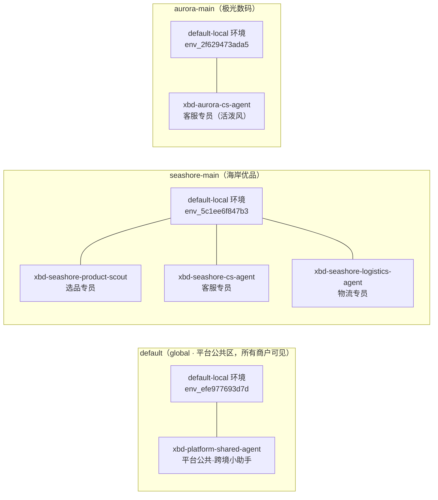

# Step 03 · 商家 Agent 矩阵：租户配置与平台公共区

> **本步导读**：两家商家入驻后，各自开始配置自己的 Agent 矩阵。本步让你看到多租户平台的核心卖点——**同一平台、同名能力、按租户定制**：海岸优品配齐选品/客服/物流三个 Agent，极光数码只配一个客服 Agent，但同样是"客服"，两家的人设（system prompt）、语气、职责完全不同。每个 Agent 的工具执行环境（Environment）由平台按 namespace 自动开通。租户矩阵之外还有一层：平台运营可以把 Agent 上架到 **global 公共区**，让所有商户零配置可见可用。



*图 3-1：平台公共区与两家商家的 Agent 矩阵与环境归属*

## 创建租户 Agent：v5 Agent Catalog

Agent 管理走 **v5 Agent Catalog API**（`/api/v1/agents`）。一个 Managed Agent 由三部分组成：`agent`（稳定身份）、`binding`（运行绑定，`kind:"managed"` 表示全托管）、`definition`（可移植定义：人设、模型、工具）。创建请求：

```bash
curl -sS -X POST "$BASE_URL/api/v1/agents" \
  -H "Authorization: Bearer $ALICE_TOKEN" -H 'Content-Type: application/json' \
  -H "X-AgentScope-Tenant: default" -H "X-AgentScope-Namespace: seashore-main" \
  -d '{
    "agentKey": "xbd-seashore-cs-agent",
    "displayName": "海岸优品·客服专员",
    "binding": { "kind": "managed" },
    "definition": {
      "name": "xbd-seashore-cs-agent",
      "system": "你是海岸优品店铺客服，语气亲切专业，只回答与订单、物流、售后相关的问题。",
      "model": "qwen-plus"
    }
  }' | jq '{id:.agent.id, key:.agent.agentKey, ns:.agent.namespace, env:.definition.defaultEnvironmentId}'
```

真实响应：

```json
{
  "id": "c5c56dc3-8edf-41dc-92f6-aff8f5394756",
  "key": "xbd-seashore-cs-agent",
  "ns": "seashore-main",
  "env": "env_5c1ee6f847b3"
}
```

三个要点：

1. **`agentKey` 是稳定业务键**（demo 用 `xbd-` 前缀 + 商家域 + 用途），`agent.id` 是平台 UUID。后续步骤用 id 引用，脚本用 agentKey 先查后建保证幂等。
2. **请求作用域用请求头通道**——Agent 落到哪个 namespace 由 `X-AgentScope-Namespace` 决定。
3. **Environment 无需手动创建**：managed 绑定的工作流会按 namespace 自动开通 `default-local` 环境（type: local，即数据面容器内执行）。同一商家的多个 Agent 共享该环境，不同商家的环境相互独立（见上图两个 env id）。

demo 脚本依次创建四个租户 Agent，真实输出：

```
  + 创建 xbd-seashore-product-scout (77bd3fc7-…)  环境: env_5c1ee6f847b3
  + 创建 xbd-seashore-cs-agent (c5c56dc3-…)  环境: env_5c1ee6f847b3
  + 创建 xbd-seashore-logistics-agent (6994d2be-…)  环境: env_5c1ee6f847b3
  + 创建 xbd-aurora-cs-agent (6560111d-…)  环境: env_2f629473ada5
```

对比两家客服的 `definition.system`：同一个"客服"能力，海岸优品要求"亲切专业、只答订单物流售后"，极光数码要求"活泼年轻化、专注 3C 配件"——**这就是租户级配置**。

## 平台公共 Agent：global namespace（default）

场景：平台运营想在租户矩阵之外上架一个**所有商户开箱即用**的公共助手——解答平台功能、入驻流程与规则，不接触任何单一商家的私有数据。这不需要新的 API：namespace 本身分三种 kind——`personal`（个人）、`shared`（两家商家的 namespace 属于此类）、`global`（平台公共区）。每个部署自带**唯一的** global namespace `default`，由服务启动时自动创建（owner 为 `system`，成员表由平台管理），并对所有登录用户自动授予 `member`/`developer`/`operator` 三个角色——`discover`、`read`、`use` 因此对全部商家成员放行。平台运营要做的只是：创建 Agent 时把作用域指向它。

```bash
curl -sS -X POST "$BASE_URL/api/v1/agents" \
  -H "Authorization: Bearer $ADMIN_TOKEN" -H 'Content-Type: application/json' \
  -H "X-AgentScope-Tenant: default" -H "X-AgentScope-Namespace: default" \
  -d '{
    "agentKey": "xbd-platform-shared-agent",
    "displayName": "平台公共·跨境小助手",
    "binding": { "kind": "managed" },
    "definition": {
      "name": "xbd-platform-shared-agent",
      "system": "你是星帆出海平台的公共助手，为所有入驻商家解答平台功能、入驻流程与规则问题。不涉及任何单一商家的私有数据。",
      "model": "qwen-plus"
    }
  }' | jq '{id:.agent.id, key:.agent.agentKey, ns:.agent.namespace, env:.definition.defaultEnvironmentId}'
```

真实响应——与租户 Agent 完全同构，Environment 同样按 namespace 自动开通：

```json
{
  "id": "6e04b24a-08cc-4fb9-8baf-1e11d429e304",
  "key": "xbd-platform-shared-agent",
  "ns": "default",
  "env": "env_efe977693d7d"
}
```

demo 脚本输出：

```
  + 创建 xbd-platform-shared-agent (6e04b24a-…)  环境: env_efe977693d7d
```

商户侧零配置。alice 的 namespace 目录自动出现公共区，角色直接就是那三个全局角色：

```bash
curl -sS "$BASE_URL/api/v1/me/namespaces" \
  -H "Authorization: Bearer $ALICE_TOKEN" \
  | jq '[.items[] | select(.kind == "global") | {name, kind, owner, roles}]'
```

```json
[
  {
    "name": "default",
    "kind": "global",
    "owner": "system",
    "roles": ["member", "developer", "operator"]
  }
]
```

于是商家成员可以直接在公共区建会话、发咨询——会话落在 `namespace=default`，`creatorRef` 是商家成员自己（Turn 用法见 Step 04）：

```bash
curl -sS -X POST "$BASE_URL/api/v1/chats?tenant=default&namespace=default" \
  -H "Authorization: Bearer $ALICE_TOKEN" -H 'Content-Type: application/json' \
  -d '{"agentId": "6e04b24a-08cc-4fb9-8baf-1e11d429e304", "title": "xbd-step03-平台公共助手体验"}'
```

alice 发起"平台公共助手和商家专属客服有什么区别？"后的真实回复（截断）：

> 平台公共助手是面向所有入驻商家的通用型支持角色，负责解答星帆出海平台共性问题（如入驻流程、功能使用、平台规则等），不接触任何商家私有数据；而商家专属客服是由平台为单个签约商家配备的定制化服务人员……

三个边界值得记住：

1. **发现路径是"显式查公共区"**：列表按单 namespace 过滤，自家 `seashore-main` 列表不会混合出现公共 Agent；带自家 namespace 作用域头对公共 Agent 做单资源读取同样 404（作用域头须与存储作用域一致——与上一节通道不对称是同一条规则）。
2. **Agent 公共、会话私有**：bob 查询公共区的 chats 列表看不到 alice 的会话——工作对象按创建者过滤。共享的是能力，不是对话记录。
3. **global 不是只读货架**：所有商户在公共区都有 `developer` 角色，技术上也能在公共区创建/修改 Agent；平台也没有"把公共定义复制进自家 namespace"的 API（definition 可移植，商家可按需重建副本）。当前模型的公共区是共享工作台，不是只读目录。

## 列表与读取：通道不对称（实测）

一个容易踩的坑：**这个 API 家族的读写作用域通道不对称**。

```bash
# 列表：按查询参数过滤（请求头不影响列表结果）
curl -sS "$BASE_URL/api/v1/agents?tenant=default&namespace=seashore-main" \
  -H "Authorization: Bearer $ALICE_TOKEN" | jq '[.items[] | .agentKey]'
```

真实输出：

```json
[
  "xbd-seashore-product-scout",
  "xbd-seashore-cs-agent",
  "xbd-seashore-logistics-agent"
]
```

单资源读取则按作用域头严格隔离——alice 带 seashore 作用域读取极光的 Agent：

```bash
curl -sS "$BASE_URL/api/v1/agents/$AURORA_CS_ID" \
  -H "Authorization: Bearer $ALICE_TOKEN" \
  -H "X-AgentScope-Tenant: default" -H "X-AgentScope-Namespace: seashore-main"
```

真实响应（HTTP 404）：

```json
{"error":"resource not found in authorized scope"}
```

列表是"目录"（可发现），单资源是"边界"（可操作）——Step 05 将把这套隔离语义做成完整的负向测试。

## 归属验证

demo 脚本最后由两家商家各自在**自家作用域**读取自家客服 Agent 并断言归属：

```
  ✓ 海岸客服 Agent 归属 seashore-main
  ✓ 极光客服 Agent 归属 aurora-main
```

## 脚本执行

```bash
bash steps/step-03-agent-matrix.sh
```

> **注意**：本步的 `/api/v1/agents`（Agent Catalog）与教程第 30 章写作时点的 `/api/agents` 产品层接口是不同版本形态（后者已从当前源码移除）；`definition` 的字段（system/model/maxIters/tools/workspaceId 等）以本 demo 实测与源码为准。`agentKey` 在创建后不可变，是跨版本稳定的引用键。

## 本步小结

1. Managed Agent = 身份（agentKey）+ 绑定（binding.kind=managed）+ 定义（definition：人设/模型/工具）。
2. Environment 按 namespace 自动开通（`default-local`），同商家共享、跨商家隔离。
3. 通道不对称实测：POST 创建看请求头、GET 列表看查询参数、GET 单资源按作用域硬隔离（404）。
4. `agentKey` 是幂等先查后建的匹配键，`agent.id` 是运行时引用键。
5. namespace 分 `personal`/`shared`/`global` 三种 kind：`default` 是唯一的 global 公共区，对全部登录用户自动授予 member/developer/operator——平台公共 Agent 放这里，商户零配置可见可用；"Agent 公共、会话私有"（工作对象按创建者过滤）。

**验收清单**

- ☐ 五个 Agent 创建成功且归属正确（3 个 seashore / 1 个 aurora / 1 个平台公共 default）
- ☐ 同能力不同配置：两家客服 `definition.system` 不同
- ☐ 两家商户的 namespace 目录均自动含 global 公共区，default 列表均可见公共 Agent，自家列表均不含
- ☐ 商户带自家作用域读公共 Agent 返回 404；bob 看不到 alice 的公共区会话
- ☐ 跨租户单资源读取返回 404（预告 Step 05）
- ☐ 脚本连跑两遍第二遍全部 `↺ 复用`（幂等）

> **延伸阅读**：Agent 定义全字段与 Workspace/技能/子 Agent 体系见教程第 30 章。下一步 → [Step 04 Session 调用面](step-04-session-api.md)。
