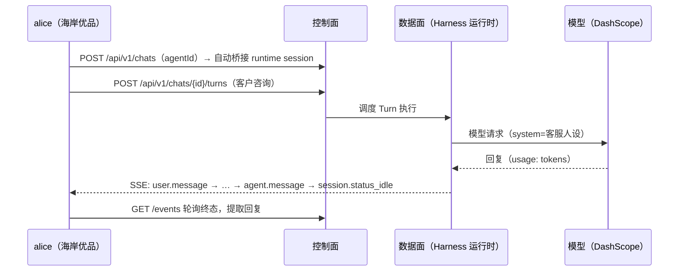

# Step 04 · Session 调用面：从对话到事件流

> **本步导读**：Agent 配好了，真正的考验是"客户的第一个问题"。海岸优品的客服 Agent 迎来咨询：「订单 OD-2049 为什么还没到？」本步走通完整调用链——**创建会话（Chat）→ 提交一轮对话（Turn）→ 旁听事件流（SSE）→ 轮询终态、提取回复**，并顺带看清平台的会话观测模型：每个事件都带序号与模型用量，可回放、可审计。



*图 4-1：一次客户咨询的完整调用链*

## 开一个会话：Chat 是 catalog 与运行时的桥

`POST /api/v1/chats` 用 Step 03 的客服 Agent 开一个会话：

```bash
curl -sS -X POST "$BASE_URL/api/v1/chats?tenant=default&namespace=seashore-main" \
  -H "Authorization: Bearer $ALICE_TOKEN" -H 'Content-Type: application/json' \
  -d '{"agentId":"'"$CS_AGENT_ID"'","title":"xbd-step04-客服演示"}' | jq '.chat'
```

真实响应（截取）：

```json
{
  "id": "fd0fe7f8-99ca-4131-bbf9-f9f7cbf0167b",
  "agentId": "c5c56dc3-8edf-41dc-92f6-aff8f5394756",
  "agentName": "海岸优品·客服专员",
  "sessionId": "9b486a68-9e6b-478e-9219-0da3a2bcdc21",
  "runtimeSessionId": "sess_4cb0f8574414",
  "title": "xbd-step04-客服演示",
  "status": "active"
}
```

`chat` 自动桥接出一个**运行时会话**（`runtimeSessionId: sess_…`）——你不用（也不能）手工先建 session 再绑定，Chat 一步完成。后续所有事件都挂在 `sessionId` 下。

## 提交客户咨询：Turn

```bash
curl -sS -X POST "$BASE_URL/api/v1/chats/$CHAT_ID/turns?tenant=default&namespace=seashore-main" \
  -H "Authorization: Bearer $ALICE_TOKEN" -H 'Content-Type: application/json' \
  -d '{"message":"订单 OD-2049 为什么还没到？预期三天前就该送达了。"}' | jq .
```

真实响应：

```json
{
  "chatId": "fd0fe7f8-…",
  "sessionId": "9b486a68-…",
  "status": "running",
  "eventStreamUrl": "/api/v1/sessions/9b486a68-…/events/stream?chatId=fd0fe7f8-…",
  "eventsUrl": "/api/v1/sessions/9b486a68-…/events?chatId=fd0fe7f8-…"
}
```

`status: "running"`——**提交 ≠ 完成**，响应即时返回两个地址：`eventStreamUrl`（SSE 推流）与 `eventsUrl`（轮询拉取）。两种消费方式任选，demo 两个都演示。

## 旁听事件流：SSE

```bash
curl -sN --max-time 90 "$BASE_URL$EVENT_STREAM_URL" \
  -H "Authorization: Bearer $ALICE_TOKEN" \
  -H "X-AgentScope-Tenant: default" -H "X-AgentScope-Namespace: seashore-main"
```

真实事件序列（节选，共 25+ 个）：

```
event: user.message            ← 客户咨询入账（role=user, content=原文）
event: session.status_running  ← 会话进入运行态
event: session.run_started     ← Harness 运行开始
event: span.model_request_start
event: span.model_request_end  ← frameworkMeta.usage: {inputTokens:6983, outputTokens:221, …}
event: agent.message           ← 回复（role=assistant, content=…）
event: session.status_idle     ← 本轮结束（终态信号）
: heartbeat                    ← 空闲心跳
```

每个事件都有 `id` 与 `seq`（会话内单调递增），`span.model_request_end` 携带真实模型用量——**会话天然可观测、可审计**。

## 轮询终态与提取回复

SSE 适合实时界面；后台任务用轮询更稳。终态信号是 `session.status_idle`，回复在 `agent.message` 事件的 `content` 字段：

```bash
curl -sS "$BASE_URL/api/v1/sessions/$SESSION_ID/events?chatId=$CHAT_ID&tenant=default&namespace=seashore-main" \
  -H "Authorization: Bearer $ALICE_TOKEN" \
  | jq -r '[.events[] | select(.eventType == "agent.message")] | last | .content'
```

真实回复（截断）：

```
感谢您的耐心等待。非常抱歉，目前系统中暂无订单 OD-2049 的物流数据记录——既未在本地知识库、工作区文件，也未在历史记忆中找到该订单相关信息。…
```

注意两件事：客服 Agent **如实回答没有数据**（没有编造物流信息——system prompt 约束了它只答订单物流），以及模型用量随轮次增长（第二轮输入 7234 tokens > 第一轮 6983，因为上下文在累积）。

> **多轮上下文实测**：脚本连跑第二遍时，同一 Chat 再次提问，回复开头变成「您好～感谢您**再次**咨询订单 OD-2049…」——Chat 的会话记忆自动生效。这正是"复用同一会话"与"每次新开"的业务差异。

## 作用域通道结论（chats 家族）

实测 `/api/v1/chats` 家族（列表/详情/turns）**读写都按查询参数通道**解析作用域；带错误作用域的详情请求会得到 `404 {"error":"Chat not found in scope"}`。统一带 `?tenant=&namespace=` 最稳。

## 脚本执行

```bash
bash steps/step-04-session-api.sh
```

> **注意**：本步的 Chat API（`/api/v1/chats`）是当前版本实测的会话调用面，与教程第 31 章写作时点的 `/api/v1/agent-sessions` + `X-API-Key` 体系属不同版本形态；SSE 事件类型命名（`agent.message`/`session.status_idle` 等）亦以实测为准。

## 本步小结

1. Chat 一步完成"会话创建 + 运行时桥接"，Agent 身份来自 Step 03 的 catalog。
2. Turn 提交即时返回 `running` 与两个事件地址——提交 ≠ 完成。
3. SSE 与轮询两种事件消费方式；终态信号 `session.status_idle`；回复在 `agent.message.content`。
4. 事件带序号与模型用量，会话天然可观测；多轮 Chat 自动累积上下文。

**验收清单**

- ☐ Chat 创建成功且桥接出 runtimeSessionId
- ☐ Turn 提交后 status=running，终态轮询到 session.status_idle
- ☐ 提取到真实模型回复（内容与客服人设一致）
- ☐ SSE 原文落盘可回放（/tmp/xbd-step04-sse.log）
- ☐ 脚本连跑两遍：chat 复用、回复体现多轮上下文

> **延伸阅读**：事件模型与 SSE 续传语义见教程第 31 章（机制相通，端点以本步实测为准）。下一步 → [Step 05 多租户隔离验证](step-05-isolation-check.md)。
