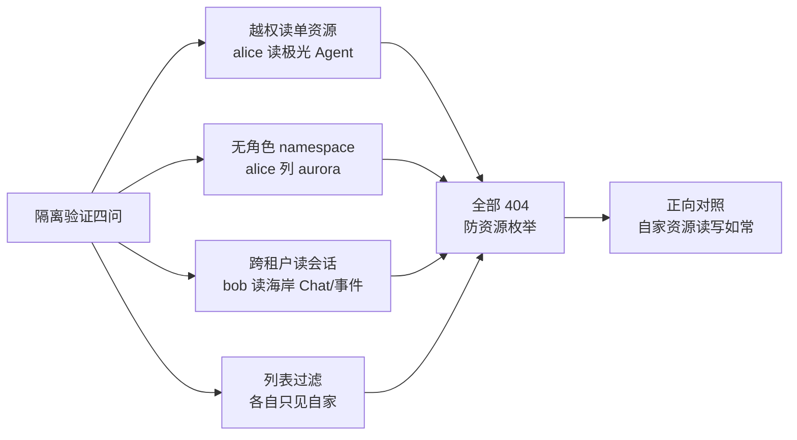

# Step 05 · 多租户隔离验证（负向测试）

> **本步导读**：前四步搭建的所有能力，如果租户之间互相看得见，平台就失去了存在意义。这一步**故意做坏事**：alice 假装越权读极光数码的 Agent、bob 偷看海岸优品的客服会话——用一组负向测试证明隔离真实存在，再用正向对照确认"该看到的都能看到"。多租户平台的信任基础，靠负向测试做实。



*图 5-1：隔离验证矩阵——负向全 404，正向全通过*

## 越权读单资源

alice（携带 seashore 作用域头）尝试读取极光数码的客服 Agent：

```bash
curl -sS "$BASE_URL/api/v1/agents/$AURORA_AGENT_ID" \
  -H "Authorization: Bearer $ALICE_TOKEN" \
  -H "X-AgentScope-Tenant: default" -H "X-AgentScope-Namespace: seashore-main" \
  -w '\nHTTP %{http_code}\n'
```

真实响应：

```
{"error":"resource not found in authorized scope"}
HTTP 404
```

注意是 **404 而非 403**——平台不确认"这个资源存在但你没权限"，而是让它在你的世界里**根本不存在**。这防住了资源枚举攻击（猜 ID 也猜不到别的租户的东西）。

## 无角色 namespace：成员关系即边界

alice 对 `aurora-main` 没有任何角色，直接用查询参数通道列它的资源：

```bash
curl -sS "$BASE_URL/api/v1/agents?tenant=default&namespace=aurora-main" \
  -H "Authorization: Bearer $ALICE_TOKEN" -w '\nHTTP %{http_code}\n'
```

真实响应：

```
{"error":"resource not found in authorized scope"}
HTTP 404
```

**namespace 成员关系是第一道边界**：不是你的 namespace，连列表都不存在。

## 跨租户读会话

bob 尝试用查询参数通道读取海岸优品的客服会话（Step 04 创建）：

```bash
# Chat 详情
curl -sS "$BASE_URL/api/v1/chats/$CHAT_ID?tenant=default&namespace=aurora-main" \
  -H "Authorization: Bearer $BOB_TOKEN" -w '\nHTTP %{http_code}\n'
# 会话事件流
curl -sS "$BASE_URL/api/v1/sessions/$SESSION_ID/events?chatId=$CHAT_ID&tenant=default&namespace=aurora-main" \
  -H "Authorization: Bearer $BOB_TOKEN" -w '\nHTTP %{http_code}\n'
```

真实响应：

```
{"error":"Chat not found in scope"}                     HTTP 404
{"error":"resource not found in authorized scope"}      HTTP 404
```

客户对话记录（含可能的隐私信息）对其他租户完全不可见。

## 列表过滤：各自的世界

```bash
curl -sS "$BASE_URL/api/v1/agents?tenant=default&namespace=seashore-main" \
  -H "Authorization: Bearer $ALICE_TOKEN" | jq '[.items[] | select(.agentKey | startswith("xbd-"))] | length'
# → 3（海岸的选品/客服/物流）
curl -sS "$BASE_URL/api/v1/agents?tenant=default&namespace=aurora-main" \
  -H "Authorization: Bearer $BOB_TOKEN" | jq '[.items[] | select(.agentKey | startswith("xbd-"))] | length'
# → 1（极光的客服）
```

## 正向对照

隔离的代价不能是"谁也看不见谁"：两家商家各自在**自家作用域**读取自家 Agent 全部正常（HTTP 200）——demo 脚本的最后两个断言验证这一点。

## 隔离语义小结（实测）

| 场景 | 结果 |
| --- | --- |
| 有角色 namespace + 自家资源 | 正常读写 |
| 有角色 namespace + 引用别家资源 ID | 404 `resource not found in authorized scope` |
| 无角色 namespace（任何操作） | 404 同上 |
| 作用域与资源错配的会话访问 | 404 `Chat not found in scope` |
| 列表 | 按 namespace 过滤，只含该租户资源 |

> **注意**：统一 404（而非 403）是刻意的安全设计——对无权方隐藏资源存在性。排障时若收到 `resource not found in authorized scope`，先检查作用域头/查询参数是否指对了 namespace，再查资源 ID 是否拼错。

## 脚本执行

```bash
bash steps/step-05-isolation-check.sh
```

真实输出：

```
  ✓ HTTP 404 —— alice 读极光 Agent 被拒（resource not found in authorized scope）
  ✓ HTTP 404 —— alice 列 aurora 资源被拒（namespace 成员关系硬隔离）
  ✓ HTTP 404 —— bob 读海岸 Chat 被拒（Chat not found in scope）
  ✓ HTTP 404 —— bob 读海岸会话事件流被拒
  ✓ alice 列表只含海岸的 3 个 Agent
  ✓ bob 列表只含极光的 1 个 Agent
  ✓ 海岸列表不含极光 Agent
  ✓ alice 自家 Agent 读取正常
  ✓ bob 自家 Agent 读取正常
隔离验证全部通过（404 = 资源对无授权作用域不可见，防资源枚举）
```

## 本步小结

1. 隔离的三层实现：namespace 成员关系 → 作用域声明（头/查询参数）→ 资源归属判定。
2. 统一 404 语义防资源枚举；两种错误文案对应两种错配方式（资源 vs 会话作用域）。
3. 负向测试是多租户平台的验收底线：每一次改版都应重跑本步。

**验收清单**

- ☐ 四组负向断言全部 404
- ☐ 双向列表过滤断言通过（3 vs 1）
- ☐ 正向对照全部 200
- ☐ （进阶）故意把脚本中的作用域改错，确认断言会变红

> **延伸阅读**：四层权限模型（账号 → namespace 角色 → 资源权限 → 可见性）见教程第 29 章。下一步 → [Step 06 Team 编排](step-06-team-orchestration.md)。
