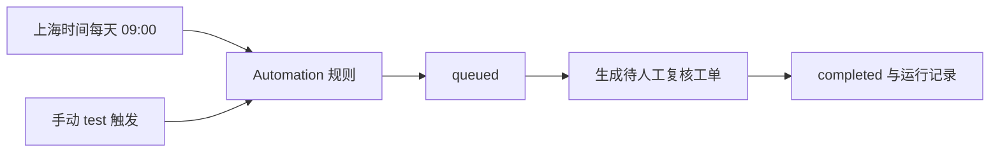

# Step 10 · Automation 定时任务

> 本步导读：配置每天上海时间 9 点的竞品复核工单，预览排程，再用测试触发验证运行记录。运行 `bash steps/step-10-automation.sh`，前置为 Step 02。



*图 10-1：排程与手动测试共用规则，执行结果异步查询。*

## 如何定义每天 9 点？

脚本以 alice 身份先查同名 `xbd-seashore-price-watch`，不存在才创建：

```json
{
  "tenant": "default",
  "namespace": "seashore-main",
  "name": "xbd-seashore-price-watch",
  "enabled": false,
  "triggerType": "cron",
  "triggerConfig": {"schedule": "0 9 * * *", "timezone": "Asia/Shanghai"},
  "actionType": "create_issue",
  "actionConfig": {
    "title": "每日竞品价格监控",
    "description": "请人工收集竞品 SKU 价格并复核。Demo 不含真实价格抓取工具。"
  }
}
```

默认停用，避免演示结束后继续产生工单。`create_issue` 只建立待处理工作，不含电商站点抓取、真实价格数据或 Agent 自动比价。

## 如何验证时区？

预览接口在集合上，不是 `/automations/{id}/schedule-preview`：

```bash
source lib/common.sh
require_env
login_as alice alice XBD_TOKEN_ALICE
api POST /api/v1/automations/schedule-preview \
  '{"schedule":"0 9 * * *","timezone":"Asia/Shanghai"}' XBD_TOKEN_ALICE
```

2026-10-13 实测响应：

```json
{"nextRuns":["2026-10-14T01:00:00Z","2026-10-15T01:00:00Z","2026-10-16T01:00:00Z","2026-10-17T01:00:00Z","2026-10-18T01:00:00Z"]}
```

UTC 01:00 即上海 09:00。

## 手动触发什么时候算完成？

```bash
AU_ID=$(state_get XBD_AUTOMATION_1)
curl -fsS -X POST "$BASE_URL/api/v1/automations/$AU_ID/trigger?test=true" \
  -H "Authorization: Bearer $(state_get XBD_TOKEN_ALICE)" \
  -H 'Content-Type: application/json' \
  -H 'Idempotency-Key: xbd-ext-b-trigger-001' -d '{}'
```

> **注意**：`test=true` 可以测试停用规则，但仍实际创建测试工单，不是 dry-run。当前版本 HTTP 202 返回 `queued`，必须轮询 `GET /api/v1/automations/{id}/runs/{runId}` 等待 `completed`；不能把 202 当成完成。

实测最终响应选取业务字段：

```json
{"run":{"id":"fe7ba72c-5f72-4c69-86ab-e15b764110da","status":"completed","issueId":"7b60500f-ea2e-5a0e-86ed-c8744f47830a","source":"test"}}
```

相同 `Idempotency-Key` 与相同输入重跑时返回同一运行。运行列表为 `.items`，不是 `.runs`。

## 怎样正式启用排程？

完成测试后，可读取规则当前 `.automation.version`，向 `PATCH /api/v1/automations/{id}` 提交 `{"expectedVersion":当前版本,"enabled":true}`。这会开始持续排程；示例脚本不自动启用。`teardown.sh --apply` 会停用该规则。

入站 webhook 是另一类触发器，与向外部系统发送 Session 事件的出站 webhook 不同。本步没有实测 webhook 或等待次日 cron 自动触发。

## 本步小结

1. cron 表达式和时区需一起配置并预览。
2. 202 只表示受理，应查询运行终态与生成工单。
3. 固定幂等键防止重复测试产生重复工单。

**验收清单**

- ☑ 规则先查后建，默认停用。
- ☑ 预览五次上海 09:00 排程。
- ☑ 测试运行 completed，存在工单 ID 与可查询运行记录。
- ☑ 重复触发复用同一运行。

编号调整不改变已有测试运行的幂等键：示例中的 `xbd-ext-b-trigger-001` 保留历史值，避免重跑创建重复工单。

下一步 → [Step 11 Workspace 文件与版本](step-11-workspace.md)。
