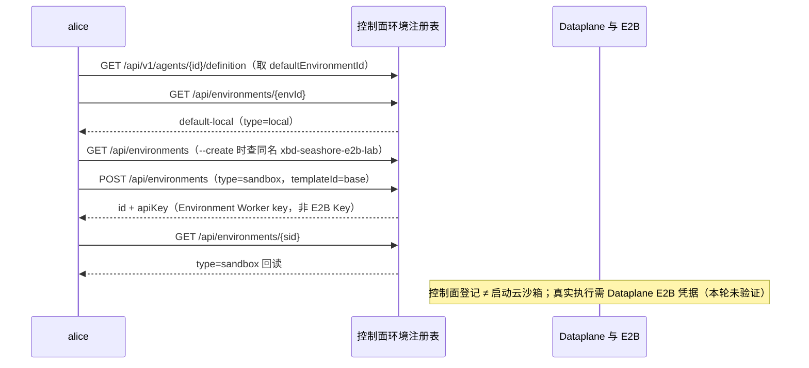

# Step 12 · 文件和命令究竟在哪里执行？

> 本步导读：主线创建 Agent 时自动关联了 `default-local`。这不代表已经启用了沙箱。本节从实际 Environment 反查执行位置，再讲如何登记 E2B 沙箱、绑定独立实验 Agent，以及验收隔离。前置：Step 11。先看下方调用链全景图。



*图 12-1：Environment 反查与 E2B 登记的调用链；凭据配置、Agent 绑定与执行隔离验收见正文第三至五步。*

## ⓪ 四种 Environment 怎么选？

| Service 类型 | 文件 / 命令执行方式 | 前提与用途 |
| --- | --- | --- |
| `local` | Dataplane 所在主机或容器上的本地文件系统 / Shell | 需部署允许 local；适合开发验证，不提供独立沙箱边界 |
| `sandbox` | 当前版本映射到 `E2bFilesystemSpec` | E2B 凭据、可达服务与正确模板；用于隔离执行 |
| `remote` | 共享 KV 文件系统 | 服务需共享存储；没有本地 Shell 执行能力 |
| `self_hosted` | 外部 Environment Worker 领取工具任务 | 自建 Worker 在线，使用 Environment key 认证；隔离强度由 Worker 部署决定 |

SDK 第 18 章还提供 Docker、Kubernetes 等后端，但**SDK 支持某种沙箱，不表示 Service 的 `type` 字段也接受该值**。当前 Service 的 `sandbox` 是 E2B；`type: docker` 会被拒绝。把 `image`、`cpus`、`network` 等 Docker 字段塞进 E2B config，也不会产生预期的 Docker 配置。

## ① 第一步：核对当前默认环境

```bash
cd demo/cross-border-commerce
bash steps/step-12-sandbox.sh
```

默认只读并打印配置样例。实测实验 Agent 当前环境的选取字段：

```json
{"id":"env_5c1ee6f847b3","name":"default-local","type":"local","ownerId":"namespace:default:seashore-main"}
```

文件写入发生在 Dataplane 的执行环境中，不会落到你运行 curl 的 Mac 当前目录。即使 Dataplane 本身运行在 Docker 内，也不等于每个商家的每次执行都有独立容器。

## ② 第二步：登记一个 E2B Environment

```bash
bash steps/step-12-sandbox.sh --create
```

脚本先查后建 `xbd-seashore-e2b-lab`，提交：

```json
{
  "name": "xbd-seashore-e2b-lab",
  "type": "sandbox",
  "config": {
    "templateId": "base",
    "workspaceRoot": "/home/user",
    "sandboxTimeoutSeconds": 300,
    "isolationScope": "SESSION"
  }
}
```

`POST /api/environments` 是控制面登记，不会在这里执行模型任务或证明 E2B 能连通。本轮已登记并回读 `env_9eabd64e9e27`，未启动云沙箱。

| 配置 | 含义 |
| --- | --- |
| `templateId` | E2B 模板，决定基础镜像和预装程序；示例 `base` 是否满足任务需另行验证 |
| `workspaceRoot` | 沙箱内部工作路径，不是宿主机路径 |
| `sandboxTimeoutSeconds` | 沙箱存活超时；不等于模型超时或业务截止时间 |
| `isolationScope` | 当前 Service 默认 SESSION；其它 scope 改变状态复用范围，不能替代 API 授权 |

当前源码将不识别的 isolationScope 回退到 SESSION，所以写错后请求成功也不代表选择生效。课程建议显式使用 `SESSION`，再通过两个独立会话的文件读写检查隔离。

## ③ 第三步：给 Dataplane 配 E2B 凭据

当前优先级是：Environment 的 `config.apiKey` → Dataplane `builder.e2b.api-key` / `BUILDER_E2B_API_KEY` → `E2B_API_KEY`。本教程采用服务端配置，不把云服务密钥写入 Git 或样例 JSON。

```bash
# 在真正启动 Dataplane 的进程/容器配置中设置，不是只在 demo shell 中 export。
export BUILDER_E2B_API_KEY='在本地填入凭据'
# 可选部署默认值：BUILDER_E2B_TEMPLATE_ID、BUILDER_E2B_WORKSPACE_ROOT
```

Environment 创建响应中的 `.apiKey` 是平台签发给 Environment Worker 的身份凭据，**不是 E2B 云服务 Key**。同样，平台 JWT、模型网关 Key 也不能互换使用。

修改启动配置后，需要按自己的部署方式重建或重启 Dataplane；不要在有进行中任务时直接重置整套 dev 栈。E2B 凭据和模型额度都要有效，才具备真实执行的前提。

## ④ 第四步：只给实验 Agent 绑定环境

在 `demo/cross-border-commerce` 下的同一个 Bash 终端执行：

```bash
source lib/common.sh
require_env
login_as alice alice XBD_TOKEN_ALICE
scope_as "$XBD_TENANT" seashore-main
ID=$(state_get XBD_AGENT_WORKSPACE_LAB)
SANDBOX_ID=$(state_get XBD_ENV_SANDBOX_LAB)
CURRENT=$(api GET "/api/v1/agents/$ID/definition" '' XBD_TOKEN_ALICE)
# 保存原环境，之后可用同样的 GET/合并/PATCH 流程恢复。
state_set XBD_ENV_LAB_PREVIOUS "$(jq -er '.definition.defaultEnvironmentId' <<<"$CURRENT")"
PATCH=$(jq -c --arg env "$SANDBOX_ID" \
  '.definition | .defaultEnvironmentId=$env' <<<"$CURRENT")
api PATCH "/api/v1/agents/$ID/definition" "$PATCH" XBD_TOKEN_ALICE
```

保留完整 definition 与当前 version，不要只发 `defaultEnvironmentId`。旧 Session 不会自动迁移，切换环境也不会复制原后端的工作文件。

> **当前 API 差异**：`POST /api/v1/chats` 的请求结构没有 `environmentId` 字段。本 Demo 通过 Agent 默认环境配置后创建新 Chat，不能把旧教程 `/api/v1/agent-sessions` 的环境参数直接搬过来。

## ⑤ 第五步：真实执行怎么验收？

Step 11 的实验 Agent 只启用 read 工具。要做下面的写入实验，先在 **实验 Workspace** 上通过 `PUT /api/workspaces/{id}/tools` 按 Step 11 的版本发布/采纳流程增加 write 工具；Shell 实验另加 bash 工具。可参考 [第 30 章](../../../chapters/30-managed-agents.md) 的 agent_toolset 配置，避免在主线 Agent 上开放不需要的工具。

下面只修改实验 Workspace 的 `read` / `write` 开关，保留其它工具组和 MCP 配置。该命令保存草稿后，仍需按 Step 11 发布并让实验 Agent 显式采纳新 revision。

```bash
WS_ID=$(state_get XBD_WORKSPACE_LAB)
TOOLS=$(api GET "/api/workspaces/$WS_ID/tools" '' XBD_TOKEN_ALICE)
TOOLS_PATCH=$(jq -c '.tools |= map(if .type=="agent_toolset" then
  .configs = ((.configs // [] | map(select(.name!="read" and .name!="write"))) +
    [{name:"read",enabled:true,permissionPolicy:{type:"always_allow"}},
     {name:"write",enabled:true,permissionPolicy:{type:"always_allow"}}])
  else . end)' <<<"$TOOLS")
api PUT "/api/workspaces/$WS_ID/tools" "$TOOLS_PATCH" XBD_TOKEN_ALICE
```

| 验收 | 操作与证据 | 不能作为成功证据的情况 |
| --- | --- | --- |
| 后端就绪 | 新 Chat 提交读取工作区文件任务，检查 E2B 实例/日志和工具事件 | 只保存 Environment 返回 200 |
| 文件落点 | 让工具写入随机标记文件并读回，对照沙箱内文件 | 模型直接说“写好了” |
| 会话隔离 | Chat A 写入运行文件，Chat B 尝试读取同一路径，核对是否按 SESSION 隔离 | 用另一个 API token 读配置返回 404 |
| 模板投影 | Step 11 的政策资料在沙箱内可读，标记正确 | 只在控制面 Workspace API 读到文件 |
| 生命周期 | 检查超时、回收和再次执行时的持久化表现 | 假定销毁沙箱后全部文件自动保留 |

运行文件不要放进共享 Workspace 发布模板，否则 Chat B 通过模板读到同名文件会污染隔离实验。Scope、快照和存储组合应分别验证；“选择 SESSION”不是所有层面隔离的完整证明。

## 常见问题怎么定位？

| 现象 | 检查位置 |
| --- | --- |
| `missing_e2b_api_key` | Dataplane 进程是否收到 E2B Key，不能只看 demo `.env` |
| Environment 已创建但任务失败 | E2B 服务可达性、模板、模型额度与工具开关 |
| 命令不存在 | E2B 模板预装程序；修改提示词不会安装依赖 |
| 工具等待人工确认 | 工具 permissionPolicy 与审批状态；不是 E2B 网络问题 |
| self_hosted 一直等待 | Worker 是否在线、Environment ID/key 是否匹配 |
| remote 不能执行 Shell | 后端本就不提供 Shell，需选择其它类型 |

## 本步小结

1. Workspace 定义“带什么材料”，Environment 定义“在哪里执行”。
2. Service 的 E2B 配置与 SDK Docker/Kubernetes 配置必须分开。
3. 资源保存、后端连通、实际工具执行和隔离验证是逐层验收。

**验收清单**

- ☑ 当前默认 local 环境回读、E2B 配置登记与重复复用。
- ☐ Dataplane E2B 凭据与模板可用（本轮未验证）。
- ☐ 新会话工具执行、文件落点、跨会话隔离与回收（本轮未执行）。

**继续阅读**：[第 18 章](../../../chapters/18-sandbox.md)、[第 29 章](../../../chapters/29-service-deploy.md)、[Step 13](step-13-model-channel.md)。

源码核对：`aistio/internal/product/handlers_env.go`、`aistio/internal/httpapi/chat_handler.go`、`service-dataplane/src/main/java/io/agentscope/builder/web/managed/EnvironmentSpecFactory.java`。
