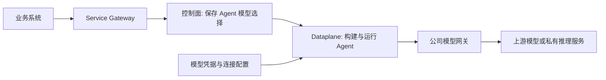

# Step 13 · 把公司模型网关接到托管 Agent

> 本步导读：你已经有一个公司统一网关、私有部署模型或兼容 Chat Completions 的服务，希望 Agent 的请求走自己的通道。本节拆解连接配置、Dataplane 扩展、模型注册、Agent 选择和真实请求验收。前置：Step 11；默认检查不消耗模型额度。

## 先厘清：我们要改的是哪条链路？



*图 13-1：模型请求从 Dataplane 发出，Service Gateway URL 与模型网关 URL 是两个地址。*

| 名称 | 示例 | 谁使用 |
| --- | --- | --- |
| `BASE_URL` | `http://localhost:28080` | 教学脚本调用 AgentScope Service |
| `XBD_MODEL_BASE_URL` | `https://llm.example.com` | Dataplane 适配代码与可选探针访问模型网关 |
| `XBD_MODEL_ENDPOINT_PATH` | `/v1/chat/completions` | 模型网关的协议路径 |
| `XBD_MODEL_NAME` | 网关实际公布的模型 ID | 上游请求体中的 `model` |
| 平台模型别名 | `merchant-gateway` | Agent definition 的 `model`，由 ModelRegistry 解析 |
| `XBD_MODEL_API_KEY` | 本地提供，不入库 | 仅用于上游模型鉴权 |

`merchant-gateway` 是本示例定义的应用内别名，不是上游模型名，也不是 Service 自动内置的 provider。

## 为什么只设置 OPENAI_BASE_URL 或改 model 不够？

核对当前源码后，有三个前提：

1. 标准 `service-dataplane/pom.xml` 默认引入 DashScope 模型扩展，没有自动打包所有 SDK provider。
2. Agent 的 `model` 是字符串。非空时 Dataplane 调用 `HarnessAgent.Builder.model(modelName)`，由注册表解析；空值才回退到 Dataplane 的默认 Model bean。
3. 当前 `OpenAIModelProvider` 从 `ModelCreationContext.baseUrl` 或默认地址取 baseUrl；它不会自动读取任意名为 `OPENAI_BASE_URL` 的环境变量。必须用代码或项目已有的配置层把连接参数真正传进去。

因此本节提供一个小型 Dataplane 适配类，而不是虚构“控制台填三个字段即完成接入”的接口。控制面的 ModelConfig 等资源也不能在缺少消费链路证据时，直接当作当前托管 Agent 的热更新模型配置。

## 第一步：确认网关协议与运行位置

本示例针对 **Chat Completions 兼容协议**：请求包含 `model`、`messages`，工具用 `tools/tool_calls`，流式通常采用 SSE。只提供 Responses 或其它协议的网关不能直接套用这份适配类。

先向网关维护者确认模型 ID、接口路径、认证方式、流式和工具调用支持。不仅要从你的电脑访问成功，还要从 Dataplane 所在网络访问成功。

| 部署 | 常见地址问题 |
| --- | --- |
| Dataplane 是宿主进程 | `localhost` 指该主机 |
| Dataplane 在容器里 | `localhost` 指容器自身；同网络服务用服务名，宿主网关按容器平台配置可达地址 |
| Kubernetes | Service DNS、出口访问与 TLS 信任需在集群环境验证 |

探针统一使用“纯 scheme + host + port 的根地址”加完整 endpoint path。例如 `https://llm.example.com` + `/proxy/v1/chat/completions`。不要在根地址和路径重复写 `/v1`；实际 Java 客户端有版本路径处理逻辑，但教学探针不依赖它。

## 第二步：把模型扩展加入 Dataplane

示例文件在 [examples/model-channel](../examples/model-channel/MerchantModelConfig.java)：

| 文件 | 放到哪里 / 做什么 |
| --- | --- |
| [dependency.xml](../examples/model-channel/dependency.xml) | 将 dependency 加到 `service-dataplane/pom.xml` 的 dependencies |
| [MerchantModelConfig.java](../examples/model-channel/MerchantModelConfig.java) | 放到 `service-dataplane/src/main/java/io/agentscope/builder/web/config/` |
| [application-merchant.yml](../examples/model-channel/application-merchant.yml) | 合并到 Dataplane 已加载配置，或放入 resources 并启用 merchant profile |

扩展 Maven 版本必须与目标源码版本一致，不要把教程当前版本号复制进另一套 Service 项目。当前源码构建可从 agentscope-java 根目录执行：

```bash
mvn -pl agentscope-service/service-dataplane -am -DskipTests package
```

这是读者实施命令；本轮没有修改、重新构建或重启正在运行的相邻 Service。示例 Java 类已用本地源码构建产物与 Spring 依赖通过 `javac` 编译核对，尚未验证其在自定义镜像中的完整启动。

适配类的核心动作：

```java
ModelRegistry.register("merchant-gateway", OpenAIChatModel.builder()
        .baseUrl(baseUrl)
        .endpointPath(endpointPath)
        .apiKey(apiKey)
        .modelName(modelName)
        .stream(true)
        .build());
```

类使用 `InitializingBean` 在应用初始化时注册，包路径属于当前 DataApp 的扫描范围；由 `merchant.model.enabled=true` 开启。本示例不替换默认 Model bean，避免改变其他 Agent 的默认模型。

如果目标服务要求额外鉴权 Header、自定义签名或非兼容报文，需要继续适配客户端；本示例只演示 Bearer Key，不承诺覆盖所有网关。

## 第三步：在服务端加载连接配置

填写到真正启动 Dataplane 的环境配置或 Secret 中：

```bash
XBD_MODEL_ENABLED=true
XBD_MODEL_BASE_URL=https://llm.example.com
XBD_MODEL_ENDPOINT_PATH=/v1/chat/completions
XBD_MODEL_NAME=填网关提供的真实模型ID
XBD_MODEL_API_KEY=填本地密钥
```

这些 `XBD_*` 名称是本教程 YAML 的映射，不是 Service 原生内置环境变量。只在 demo 的 `.env` 填写它们，仅能供探针使用，不会自动注入已经运行的 Dataplane。

如果使用独立的 `application-merchant.yml`，还要将 `merchant` 加入已有的 Spring profiles，而不是覆盖其它必需 profile。所有可能承接任务的 Dataplane 副本都要加载相同扩展和别名，否则请求可能时好时坏。

不要把模型 Key 放进 `AGENTS.md`、Workspace 知识文件、system prompt 或 Agent model 字符串。它不是平台登录 token，也不是 Endpoint 对外 API Key。

## 第四步：先做上游探针，再改实验 Agent

默认只读核对：

```bash
cd demo/cross-border-commerce
bash steps/step-13-model-channel.sh
```

把上一节连接配置填入本地 `.env` 后，可明确选择发起请求：

```bash
bash steps/step-13-model-channel.sh --probe-text
bash steps/step-13-model-channel.sh --probe-tools
```

第一个请求验证文本协议；第二个要求返回名为 `demo_echo` 的工具调用及 JSON 参数。探针不会执行真实业务工具，但会发起模型请求并消耗网关额度。

| 探针结果 | 已证明 | 仍未证明 |
| --- | --- | --- |
| text 通过 | 当前终端到上游的文本调用可用 | Dataplane 网络、流式、工具 |
| tools 通过 | 上游返回可解析工具调用 | 工具执行、结果回传及下一轮回复 |
| 两者通过 | 基础协议与声明的工具调用可用 | Service 接入、Workspace 与沙箱链路 |

部署适配类并配置好后，仅把独立实验 Agent 切换到注册别名：

```bash
bash steps/step-13-model-channel.sh --set-model merchant-gateway
```

脚本 GET 完整 definition → 只改 `model` → 带原 version PATCH → 回读，额外比较 Workspace、工具与默认环境没有变化。配置保存成功只证明控制面接受字符串；如果没有部署注册代码，真正发起 Turn 时仍会失败。

回退时传入之前记录的模型 ID，使用同一脚本。当前主线 4 个业务 Agent 不会被这条命令修改。Step 03 的 `XBD_MODEL` 只影响新建 Agent，不会更新已有资源；原主线仍含 DashScope 的前置检查，整体迁移需要逐个确认模型定义和检查条件，不能把实验 Agent 的切换当成整个平台完成迁移。

## 第五步：在 Service 里验收，而不是停在 curl 网关

按Step 11 最后一节用实验 Agent **新建 Chat** 并提交读取政策的任务。依次检查：

1. Dataplane 不再出现 provider 未注册、别名不存在或 API Key 缺失。
2. 网关日志中出现对应模型请求，模型 ID 与目标通道一致；记录 request ID 时不记录密钥。
3. Session 事件包含本轮模型事件、读取工具及返回结果，最终回复包含政策标记。
4. SSE 流式输出、工具结果续写、超时/取消等按实际业务进一步验证。
5. 如同时切了沙箱，分别检查模型连通和沙箱执行，避免把两种问题混在一起。

历史 Endpoint conversation 会因固定幂等键而被复用。若要验证新模型的外部调用，必须显式发布目标 Agent/定义并使用新的业务幂等键，不能把旧回复当作新通道已生效。

## 常见错误怎么分层排查？

| 错误 | 优先检查 |
| --- | --- |
| provider / model 无法解析 | 扩展是否在运行镜像中、配置类是否被扫描、是否每个 Dataplane 都注册别名 |
| 401 / 403 | Key、网关授权和上游额度；403 不一定是 Service namespace 权限错误 |
| `AllocationQuota.FreeTierOnly` | 上游免费额度耗尽，换 Agent 名字不能解决；本 Demo 之前遇到的阻塞仍保留 |
| 404 | 根地址与 endpoint path、模型 ID、网关路由；不要直接断言模型下线 |
| 普通文本正常，工具调用失败 | 模型/网关是否支持 tools 与 tool_choice、arguments 是否可解析 |
| 探针成功，Service 失败 | Dataplane 网络、镜像依赖、环境变量是否真的注入、Session 是否仍固定旧定义 |
| Agent 改完后旧 Chat 没变化 | 用新 Chat 复核版本快照；已有 Session 不应假定自动切换 |

## 本步小结

1. 自有通道接入包括扩展、连接参数、注册与 Agent 选择四层。
2. 上游模型名、平台别名、Service URL 与网关 URL 要分开。
3. 配置回读、上游探针、Service 真执行应依次验收。

**验收清单**

- ☑ 读取当前模型配置、适配示例 Java 编译核对。
- ☐ 自有网关文本、工具调用与流式请求（本轮未提供该通道凭据）。
- ☐ 自定义 Dataplane 部署、别名注册、新 Chat 与工具链实测。

**继续阅读**：[第 6 章](../../../chapters/06-model.md)、[第 21 章](../../../chapters/21-model-providers.md)、[第 30 章](../../../chapters/30-managed-agents.md)。

源码核对：Service 的 `service-dataplane/pom.xml`、`DataApp.java`、`DataPlaneConfig.java`、`HarnessAgentBuildService.java`；SDK 的 `ModelRegistry.java`、`OpenAIModelProvider.java`、`OpenAIChatModel.java`、`OpenAIClient.java`。这些是本地源码核对，不等同外部模型服务实测。
