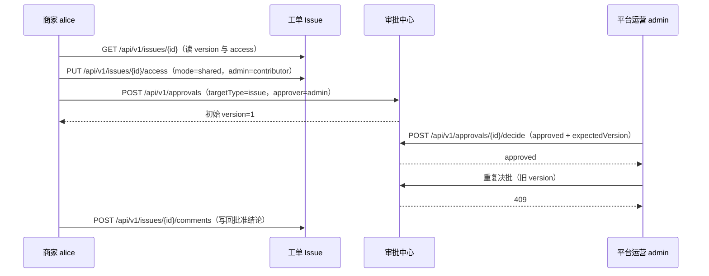
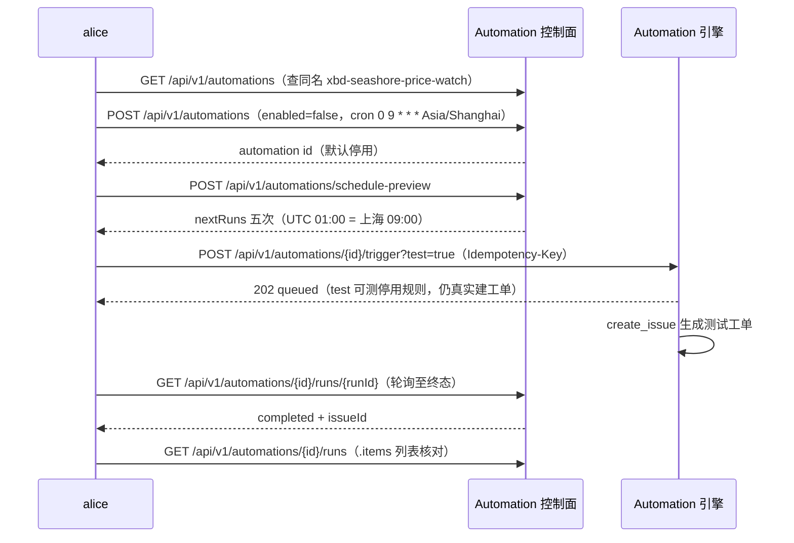
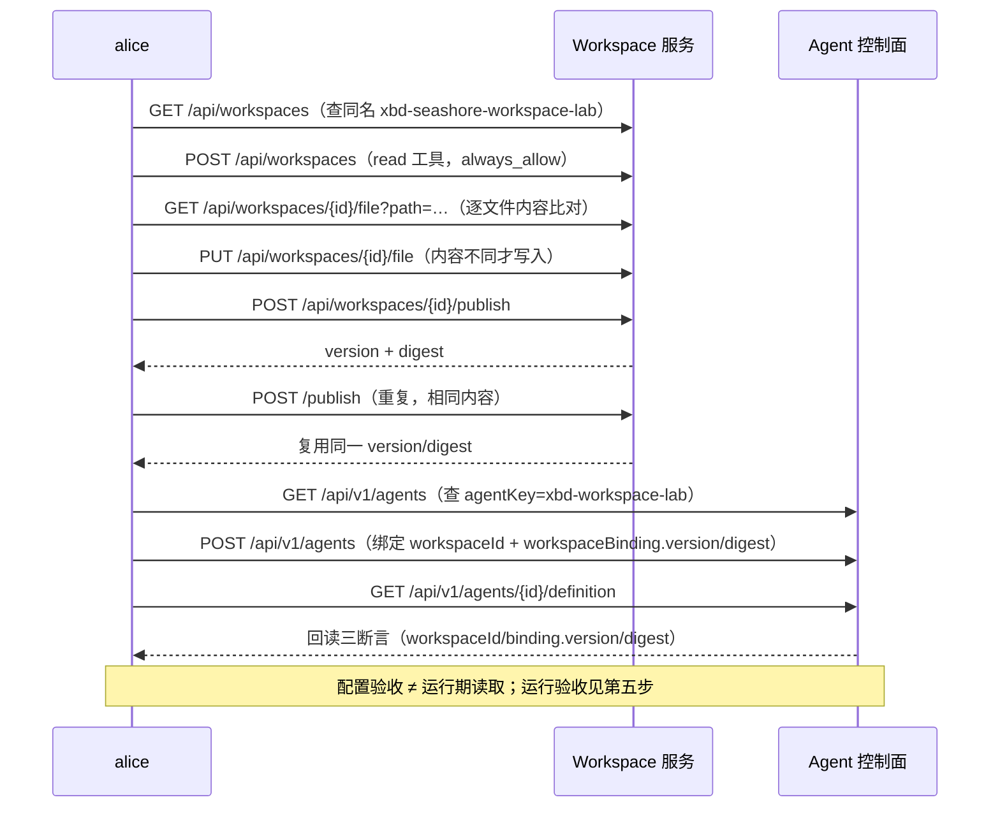
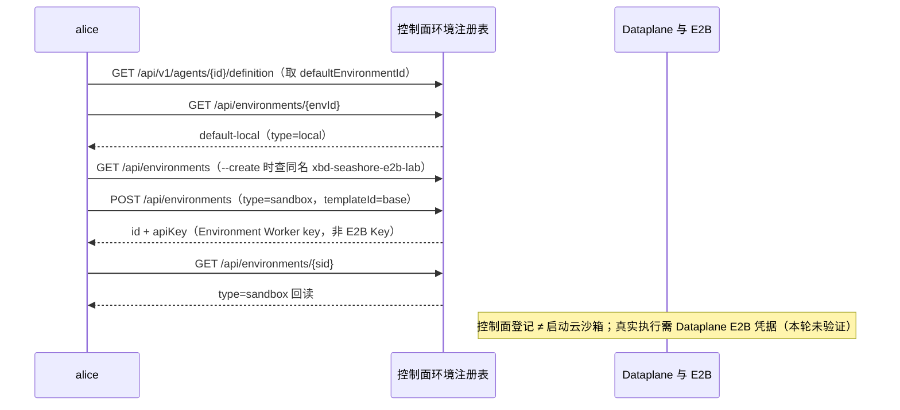
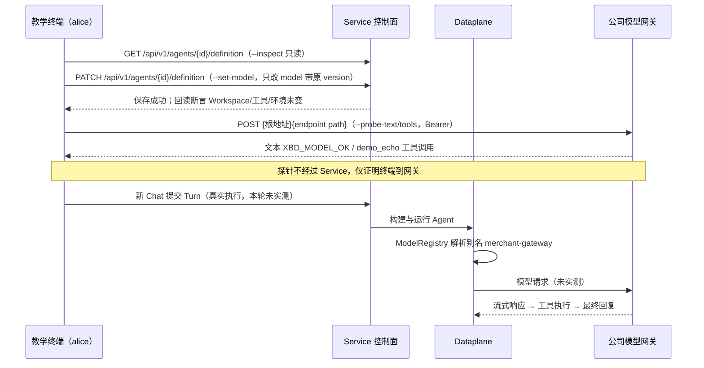

# steps 09~13 时序图开篇与正文重排 实现计划

> **For agentic workers:** REQUIRED SUB-SKILL: Use superpowers:subagent-driven-development (recommended) or superpowers:executing-plans to implement this plan task-by-task. Steps use checkbox (`- [ ]`) syntax for tracking.

**Goal:** `demo/cross-border-commerce/steps/` 第 09~13 章每章开篇一张端点级时序图，正文小节按图中调用顺序整体重排，内容零删减。

**Architecture:** 纯 Markdown 内容重排，不改任何 `.sh` 脚本。每章独立一个任务（Write 全文替换），末尾一个全局验收任务（README 悬空引用检查 + `build.mjs --check`）。依据 spec：`docs/superpowers/specs/2026-10-13-steps-09-13-sequence-diagram-redesign-design.md`。

**Tech Stack:** Markdown + Mermaid sequenceDiagram（页面端由 `build/assets/vendor/mermaid.min.js` v12 渲染）。

## Global Constraints

- Mermaid 仅用现有章节已验证构件：`sequenceDiagram`、`participant X as 名`、`A->>B:`、`B-->>A:`、`Note over X[,Y]:`。**禁止** `autonumber`、`activate/deactivate`、`rect`、`loop`（全书现有图未用，避免渲染回归）。
- 图注格式：`*图 0X-1：<一句话点题>*`，紧跟 mermaid 代码块后的空行。
- 消息文本格式：`METHOD /path（关键参数）`，中文括注，与 Step 06 风格一致。
- 小节标题格式：`## ① 环节名：原疑问句`（①②③ 只进小节标题，不进图）；无原疑问句的环节直接 `## ② 环节名`。
- **内容零删减**：每章原文的脚本片段、实测输出、`> **注意**` 块、表格、验收清单条目、"本轮未验证"声明、源码核对行全部保留，仅重新挂载；发现与 `.sh` 不符的描述一并修正。
- 原样保留不动的块：frontmatter、`# 章标题`、`## 本步小结`+验收清单、章尾链接（下一步/继续阅读）、源码核对行。（导读可微调一句预告"先看调用链全景图"。）
- **不修改**任何 `.sh` 脚本、Step 01~08、`chapters/43-cases.md`。
- 每章任务完成标准：该章重写 + 内容点清单核对通过 + 图-脚本核对通过 + 单独 commit。

---

### Task 1: 重排 Step 09（HITL 人工审批）

**Files:**
- Modify: `demo/cross-border-commerce/steps/step-09-hitl-approval.md`（全文重写）
- 只读参照: `demo/cross-border-commerce/steps/step-09-hitl-approval.sh`

**Interfaces:**
- Consumes: 原文全部内容点（见步骤 1 清单）
- Produces: 新开篇时序图（图 09-1）、4 个环节小节；章尾 `XBD_APPROVAL_1` 产出说明与链接不变

- [ ] **Step 1: 建立内容点清单（改前核对基准）**

原文实质内容点（重排后必须逐项有落点）：

1. 导读（商家发起审批→运营复核→写回；运行命令；前置 Step 06）
2. 时序图（升级为下方新图）
3. namespace 成员资格与工单访问是两道不同检查；平台管理员不是私有工单默认参与者；此前排查搬 namespace 无效
4. 共享代码块（alice GET issue → 保留 access 加 admin:contributor → PUT access）
5. "`api` 是 `lib/common.sh` 中的 curl 封装…不要省略 GET 的空 body 参数"说明
6. 注意块：共享成员必须先属于同一 namespace；脚本不覆写 namespace 成员表；seashore-main 已含 alice/admin
7. 创建审批参数（tenant、namespace、targetType、targetRef、issueId、approverRef、reason）
8. admin 用 `.approval.version` 决批代码块
9. 实测输出块（approval id、✓审批已批准、✓409、✓评论同步）
10. "审批通过就退款了吗：没有…不连支付退款系统…工具执行级 HITL 还需 runtime-approvals 协议"
11. "重复执行会创建新审批及评论属于业务增量；同审批旧版本再决批 409"
12. 本步小结 3 条 + 验收清单 3 条 + 下一步链接

- [ ] **Step 2: 全文重写**

目标结构（内容按原文搬移，粗体为小节标题，全文一次 Write）：

```
frontmatter（原样）→ # 章标题（原样）
> 导读（原样，句末追加一句："先看下方调用链全景图，再按 ①→④ 逐步拆解。"）
[新时序图 + 图注]
## ① 共享工单：为什么 admin 也会遇到 404？
    ← 原内容点 3、4、5、6 整体搬入
## ② 创建审批
    ← 原内容点 7（创建参数段与代码块）
## ③ 决批与乐观锁：如何发起与批准？
    ← 原内容点 8、9（决批代码块 + 实测输出块）
## ④ 结论写回：审批通过就退款了吗？
    ← 原内容点 10、11
## 本步小结（原样）→ 验收清单（原样）→ 下一步链接（原样）
```

新时序图（全文给出，直接使用）：



*图 09-1：工单共享、决批与结果回写的完整调用链；脚本开头的两次 `login_as` 不上图。*

- [ ] **Step 3: 内容点核对**

逐项核对步骤 1 清单 12 项在新文有落点；确认无对旧 flowchart 的引用（本章原图本来就是时序图，无此项，仍检查一遍"图 09-1"仅出现一次）。

- [ ] **Step 4: 图-脚本核对**

新图每条消息对照脚本：`GET /issues`→行 14；`PUT /issues/access`→行 16；`POST /approvals`→行 18-21；`decide approved`→行 28-29；重复决批→行 33-35；`POST comments`→行 39-40。核对括注参数与脚本一致（如 `mode=shared`、`admin=contributor`、`expectedVersion`）。

- [ ] **Step 5: Commit**

```bash
git add demo/cross-border-commerce/steps/step-09-hitl-approval.md
git commit -m "docs: Step 09 开篇时序图并按调用链重排正文"
```

---

### Task 2: 重排 Step 10（Automation 定时任务）

**Files:**
- Modify: `demo/cross-border-commerce/steps/step-10-automation.md`（全文重写）
- 只读参照: `demo/cross-border-commerce/steps/step-10-automation.sh`

**Interfaces:**
- Consumes: 原文全部内容点
- Produces: 新开篇时序图（图 10-1，替换原 flowchart）、4 个环节小节

- [ ] **Step 1: 建立内容点清单**

1. 导读（每天上海 9 点竞品复核工单；预览排程；测试触发验证运行记录；命令；前置 Step 02）
2. 原 flowchart（删除，换时序图）
3. 规则定义 JSON（tenant/namespace/name/enabled:false/cron/Asia-Shanghai/actionType:create_issue/actionConfig）
4. "默认停用，避免演示结束后继续产生工单；不含真实价格抓取"说明
5. schedule-preview 代码块 + "预览接口在集合上，不是 /automations/{id}/schedule-preview"
6. 实测响应 JSON（nextRuns 5 条）+ "UTC 01:00 即上海 09:00"
7. trigger curl 代码块（test=true、Idempotency-Key: xbd-ext-b-trigger-001）
8. 注意块：test=true 可测停用规则但实际建工单非 dry-run；202=queued 须轮询不能当完成
9. 实测运行 JSON（run.id/status:completed/issueId/source:test）
10. "相同 Idempotency-Key 与相同输入重跑返回同一运行；运行列表为 .items 不是 .runs"
11. "怎样正式启用排程"（读 .automation.version → PATCH expectedVersion+enabled:true；脚本不自动启用；teardown --apply 会停用）
12. "入站 webhook 与出站 webhook 不同；本步未实测 webhook 与次日 cron"
13. 小结 3 条 + 验收清单 4 条 + 尾注（编号调整不改变幂等键，保留 xbd-ext-b-trigger-001）+ 下一步链接

- [ ] **Step 2: 全文重写**

```
frontmatter → # 章标题（原样）
> 导读（原样，追加："先看下方调用链全景图。"）
[新时序图 + 图注]
## ① 先查后建：规则为什么默认停用？
    ← 原内容点 3、4（原"如何定义每天 9 点？"节）
## ② 预览时区：如何验证上海 9 点？
    ← 原内容点 5、6（原"如何验证时区？"节）
## ③ 测试触发：为什么 202 不是完成？
    ← 原内容点 7、8、9、10（原"手动触发什么时候算完成？"节）
## ④ 运行记录与正式启用
    ← 原内容点 11、12（原"怎样正式启用排程？"节）
## 本步小结（原样）→ 验收清单（原样）→ 尾注（原样）→ 下一步链接（原样）
```

新时序图（直接使用）：



*图 10-1：规则先查后建、排程预览、测试触发与异步完成的调用链；202 只表示受理，终态需轮询运行记录。*

- [ ] **Step 3: 内容点核对**

清单 13 项逐项核对；原 flowchart 与"图 10-1"旧引用已由新图替换，正文无残留旧引用。

- [ ] **Step 4: 图-脚本核对**

`GET /automations`→行 9；`POST /automations`→行 12-15；`schedule-preview`→行 22-23；`trigger?test=true`→行 28-31；轮询 runs/{runId}→行 33-38；`GET runs`→行 44-45。幂等键值（`xbd-ext-b-trigger-001`）只出现在正文/脚本，图上写"（Idempotency-Key）"不带具体值。

- [ ] **Step 5: Commit**

```bash
git add demo/cross-border-commerce/steps/step-10-automation.md
git commit -m "docs: Step 10 开篇时序图并按调用链重排正文"
```

---

### Task 3: 重排 Step 11（Workspace 文件、发布与版本绑定）

**Files:**
- Modify: `demo/cross-border-commerce/steps/step-11-workspace.md`（全文重写；原文本身按"第一步~第五步"组织，与调用顺序基本吻合，改动集中在图前置与序号统一）
- 只读参照: `demo/cross-border-commerce/steps/step-11-workspace.sh`

**Interfaces:**
- Consumes: 原文全部内容点
- Produces: 新开篇时序图（图 11-1，替换原 flowchart）、0~5 序号小节

- [ ] **Step 1: 建立内容点清单**

1. 导读（售后政策不能只存在于一次聊天；建 Workspace→文件→发布不可变版本→绑定实验 Agent；前置 01-03；不调用模型）
2. 原 flowchart（删除，换时序图）
3. 概念表（namespace/Workspace/Environment/Session-Chat 四行）+ "Workspace 不是另一种商家账号…"段 + "SDK 第 12 章 .workspace(Path)…不要把客户端目录当作 Dataplane 路径"段
4. examples/workspace 文件树 + AGENTS.md 要求段（"回答退款规则前读取资料"等）+ "资料放进工作区不等于全文进上下文"段
5. 运行完整实验命令 + "已存在同名资源则复用"说明
6. lib/common.sh 逐条 API 块 + "`api` 的参数顺序…GET 第三个参数保留空字符串"说明
7. PUT file + publish + jq 选取代码块
8. "草稿 version 与发布 version 不是同一个计数器…以发布响应的 .version 绑定"加粗段
9. "发布快照排除 memory/sessions/artifacts"段
10. workspaceBinding JSON（version 仅示意、overrides 支持项说明）
11. 实测回读 JSON（ws_1f00115de267 等）+ "连续两遍运行复用"说明
12. 升级/回滚代码块 + "PATCH 必须带 name 和 version…409 重新读取"段 + 回滚说明
13. 运行验收代码块（创建 Chat→turns→events）+ "按 Step 04 方式轮询…标记不能写进问题里"
14. "本轮没有执行这一模型步骤：额度阻塞"声明
15. 小结 3 条 + 验收清单（☑1 项 ☐2 项）+ 继续阅读 + 源码核对

- [ ] **Step 2: 全文重写**

```
frontmatter → # 章标题（原样）
> 导读（原样，追加："先看下方调用链全景图。"）
[新时序图 + 图注]
## ⓪ 先分清：namespace、Workspace、Environment 管什么？
    ← 原内容点 3（原第一节整体前移至此）
## ① 第一步：把业务规范写成文件
    ← 原内容点 4
## ② 第二步：创建、写文件并发布
    ← 原内容点 5、6、7、8、9
## ③ 第三步：固定版本，避免草稿变更悄悄影响 Agent
    ← 原内容点 10、11
## ④ 第四步：政策更新时，如何显式升级与回滚？
    ← 原内容点 12
## ⑤ 第五步：怎样证明模型真的用了这份资料？
    ← 原内容点 13、14
## 本步小结（原样）→ 验收清单（原样）→ 继续阅读（原样）→ 源码核对（原样）
```

新时序图（直接使用）：



*图 11-1：从文件写入、发布固定版本到 Agent 绑定回读的调用链；升级、回滚与运行验收见正文第四、五步。*

- [ ] **Step 3: 内容点核对**

清单 15 项逐项核对；注意"同内容不重写草稿"脚本注释语义已在②的比对逻辑中（脚本行 19-31），图上"内容不同才写入"括注与其一致。

- [ ] **Step 4: 图-脚本核对**

`GET /workspaces`→行 10；`POST /workspaces`→行 13；逐文件 GET 比对→行 19-28；PUT→行 29；publish→行 32；重复 publish→行 34-36；`GET /agents`→行 39；`POST /agents`→行 43-44；definition 回读→行 48-52。

- [ ] **Step 5: Commit**

```bash
git add demo/cross-border-commerce/steps/step-11-workspace.md
git commit -m "docs: Step 11 开篇时序图并统一环节序号"
```

---

### Task 4: 重排 Step 12（Environment 与沙箱执行）

**Files:**
- Modify: `demo/cross-border-commerce/steps/step-12-sandbox.md`（全文重写；原文步骤式，改动集中在图前置与换图）
- 只读参照: `demo/cross-border-commerce/steps/step-12-sandbox.sh`

**Interfaces:**
- Consumes: 原文全部内容点
- Produces: 新开篇时序图（图 12-1，替换原 flowchart）

- [ ] **Step 1: 建立内容点清单**

1. 导读（主线自动关联 default-local ≠ 启用沙箱；反查执行位置；登记 E2B；绑定实验 Agent；验收隔离；前置 Step 11）
2. 原 flowchart（删除，换时序图）
3. 四种 Environment 表（local/sandbox/remote/self_hosted）+ "SDK 支持不等于 Service type 接受；sandbox=E2B；type:docker 会被拒绝"段
4. 运行命令（默认只读）+ 实测 JSON（env_5c1ee6f847b3 default-local）+ "文件写入发生在 Dataplane 执行环境…Docker 内也不等于每商家独立容器"段
5. --create 命令 + E2B JSON（templateId/workspaceRoot/sandboxTimeoutSeconds/isolationScope）+ "控制面登记不执行任务不证明连通"段
6. 配置含义表（4 行）+ "isolationScope 回退 SESSION…显式用 SESSION 再验证"段
7. 凭据优先级（config.apiKey → builder.e2b.api-key/BUILDER_E2B_API_KEY → E2B_API_KEY）+ export 代码块 + "重建/重启 Dataplane"段
8. "Environment 返回的 .apiKey 是 Worker 身份凭据不是 E2B Key"加粗辨析段
9. 绑定代码块（GET definition → state_set 保存原环境 → PATCH defaultEnvironmentId）+ "保留完整 definition…旧 Session 不迁移"段
10. API 差异注意块（chats 无 environmentId 字段）
11. 第五步：工具开关 PATCH 代码块（read/write always_allow）+ "仍需按 Step 11 发布并采纳"说明
12. 验收表（5 行：后端就绪/文件落点/会话隔离/模板投影/生命周期）+ "运行文件不要放进共享模板…SESSION 不是所有层面隔离的完整证明"段
13. 常见问题表（6 行）
14. 小结 3 条 + 验收清单（☑1 ☐2）+ 继续阅读 + 源码核对

- [ ] **Step 2: 全文重写**

```
frontmatter → # 章标题（原样）
> 导读（原样，追加："先看下方调用链全景图。"）
[新时序图 + 图注]
## ⓪ 四种 Environment 怎么选？
    ← 原内容点 3（原第一节前移）
## ① 第一步：核对当前默认环境
    ← 原内容点 4
## ② 第二步：登记一个 E2B Environment
    ← 原内容点 5、6
## ③ 第三步：给 Dataplane 配 E2B 凭据
    ← 原内容点 7、8
## ④ 第四步：只给实验 Agent 绑定环境
    ← 原内容点 9、10
## ⑤ 第五步：真实执行怎么验收？
    ← 原内容点 11、12
## 常见问题怎么定位？
    ← 原内容点 13
## 本步小结（原样）→ 验收清单（原样）→ 继续阅读（原样）→ 源码核对（原样）
```

新时序图（直接使用）：



*图 12-1：Environment 反查与 E2B 登记的调用链；凭据配置、Agent 绑定与执行隔离验收见正文第三至五步。*

- [ ] **Step 3: 内容点核对**

清单 14 项逐项核对；participant "D"（Dataplane 与 E2B）只出现在 Note，不出现在任何 `->>` 消息——脚本没有对 Dataplane 的直接调用，图不得虚构。

- [ ] **Step 4: 图-脚本核对**

`GET definition`→行 15；`GET /environments/{envId}`→行 17；`GET /environments` 查同名→行 26-27；`POST /environments`→行 29；回读→行 35-37。`--create` 前置分支括注与脚本行 21-25 的只读退出一致。

- [ ] **Step 5: Commit**

```bash
git add demo/cross-border-commerce/steps/step-12-sandbox.md
git commit -m "docs: Step 12 开篇时序图并按调用链重排正文"
```

---

### Task 5: 重排 Step 13（对接自有模型通道）

**Files:**
- Modify: `demo/cross-border-commerce/steps/step-13-model-channel.md`（全文重写）
- 只读参照: `demo/cross-border-commerce/steps/step-13-model-channel.sh`

**Interfaces:**
- Consumes: 原文全部内容点
- Produces: 新开篇时序图（图 13-1，替换原 flowchart；全书唯一 4 participant 图）

- [ ] **Step 1: 建立内容点清单**

1. 导读（公司统一网关/私有模型/Chat Completions 兼容；拆解连接配置、Dataplane 扩展、模型注册、Agent 选择、验收；前置 Step 11；默认检查不耗额度）
2. 原 flowchart（删除，换时序图）
3. 变量表（BASE_URL/XBD_MODEL_BASE_URL/XBD_MODEL_ENDPOINT_PATH/XBD_MODEL_NAME/平台别名/XBD_MODEL_API_KEY 六行）+ "merchant-gateway 是应用内别名"段
4. 三个前提（pom 默认 DashScope；model 字符串→HarnessAgent.Builder.model→注册表解析；OpenAIModelProvider 不读 OPENAI_BASE_URL）+ "提供适配类而非虚构控制台三字段"结论
5. Chat Completions 协议要求段 + "向网关维护者确认…Dataplane 网络也要可达"段 + 部署地址表（3 行）+ 探针地址规则段
6. 示例文件表（dependency.xml/MerchantModelConfig.java/application-merchant.yml 放置位置）+ 版本一致警示 + mvn 构建命令 + "本轮没有修改重建重启"声明
7. ModelRegistry.register 代码块 + InitializingBean/merchant.model.enabled 说明 + "不替换默认 Model bean" + 额外鉴权适配说明
8. XBD_* 环境变量代码块 + "本教程 YAML 映射非原生内置…只在 .env 填不注入 Dataplane"段 + merchant profile 说明 + "所有 Dataplane 副本加载相同扩展"段
9. "不要把模型 Key 放进 AGENTS.md/知识文件/system prompt/model 字符串"段
10. 默认只读命令 + --probe-text/--probe-tools 命令 + "探针会消耗网关额度"说明
11. 探针结果表（3 行：text 通过/tools 通过/两者通过 各自已证明与未证明）
12. --set-model 命令 + "GET 完整 definition→只改 model→带原 version PATCH→回读比较"说明 + "配置保存成功≠别名已注册"段
13. 回退说明 + "主线 4 个业务 Agent 不会被修改…Step 03 的 XBD_MODEL 只影响新建"段
14. 第五步 5 条验收清单（provider 错误消失/网关日志/Session 事件/SSE 流式/沙箱分离检查）
15. "历史 Endpoint conversation 幂等键复用…必须新幂等键"段
16. 常见错误表（7 行）
17. 小结 3 条 + 验收清单（☑1 ☐2）+ 继续阅读 + 源码核对

- [ ] **Step 2: 全文重写**

```
frontmatter → # 章标题（原样）
> 导读（原样，追加："先看下方调用链全景图。"）
[新时序图 + 图注]
## ⓪ 先厘清：我们要改的是哪条链路？
    ← 原内容点 3（原第一节保留变量表，原 flowchart 由开篇新图取代）
## 为什么只设置 OPENAI_BASE_URL 或改 model 不够？
    ← 原内容点 4（保留原疑问句标题，不加序号——它是铺垫而非调用环节）
## ① 第一步：确认网关协议与运行位置
    ← 原内容点 5
## ② 第二步：把模型扩展加入 Dataplane
    ← 原内容点 6、7
## ③ 第三步：在服务端加载连接配置
    ← 原内容点 8、9
## ④ 第四步：先做上游探针，再改实验 Agent
    ← 原内容点 10、11、12、13
## ⑤ 第五步：在 Service 里验收，而不是停在 curl 网关
    ← 原内容点 14、15
## 常见错误怎么分层排查？
    ← 原内容点 16
## 本步小结（原样）→ 验收清单（原样）→ 继续阅读（原样）→ 源码核对（原样）
```

新时序图（直接使用）：



*图 13-1：模型选择保存与上游探针已验证；Dataplane 解析别名并向网关发起真实请求的链路未经本轮实测。*

- [ ] **Step 3: 内容点核对**

清单 17 项逐项核对；确认"为什么只设置…"节保留原疑问句标题且不加序号（铺垫节）；探针段"探针不经过 Service"在图 Note 与正文均有着落。

- [ ] **Step 4: 图-脚本核对**

`GET definition`→行 45；`PATCH`→行 48-49；回读断言→行 50-53；探针 `POST $ROOT$PATH_PART`→行 25-27；文本校验→行 34；工具校验→行 31。图上 `demo_echo`/`XBD_MODEL_OK` 与脚本行 21-23 的 BODY 一致。真实执行链路（Turn→Dataplane→网关）为教程描述非脚本内容，图上已用"（本轮未实测）"括注与 Note 区分。

- [ ] **Step 5: Commit**

```bash
git add demo/cross-border-commerce/steps/step-13-model-channel.md
git commit -m "docs: Step 13 开篇时序图并按调用链重排正文"
```

---

### Task 6: 全局验收（README 检查 + build 体检）

**Files:**
- Modify（仅当发现悬空引用）: `demo/cross-border-commerce/README.md`
- 只读检查: `demo/cross-border-commerce/steps/step-09..13.md`

**Interfaces:**
- Consumes: Task 1~5 的重排结果
- Produces: `node build.mjs --check` 通过的全局确认

- [ ] **Step 1: README 与交叉引用检查**

在仓库根执行：

```bash
grep -n "图 09-1\|图 10-1\|图 11-1\|图 12-1\|图 13-1\|steps/step-09\|steps/step-10\|steps/step-11\|steps/step-12\|steps/step-13" demo/cross-border-commerce/README.md chapters/43-cases.md
```

预期：README 中如有对这些步骤小节结构/旧图的引用描述则修正；`43-cases.md` 仅为链接与脚本命令引用（已确认），不需改。若 grep 无 README 命中且无悬空描述，本步零改动并在 commit message 注明"README 无需改动"。

- [ ] **Step 2: build 体检**

```bash
cd build && npm install && node build.mjs --check
```

预期：`[check] mermaid 代码块: N 个` 计数正常（含新增 5 张时序图），无 JSX 残留/内链悬空报错，退出码 0。

（spec 验收第 5 条"完整 `node build.mjs` 构建"为可选项：环境具备 Chrome/CDP 时可追加运行，确认无"图未渲染为 SVG"错误；不具备则以本步体检为准。）

- [ ] **Step 3: 全书图类型一致性抽查**

```bash
grep -A1 '^```mermaid' demo/cross-border-commerce/steps/step-*.md | grep -c sequenceDiagram
```

预期：09~13 五章开篇均为 sequenceDiagram（共 ≥5 处），无残留 flowchart 于 09~13 章。

- [ ] **Step 4: Commit（仅当 Task 6 有改动）**

```bash
git add demo/cross-border-commerce/README.md
git commit -m "docs: 清理 steps 09~13 重排后的交叉引用"
```
