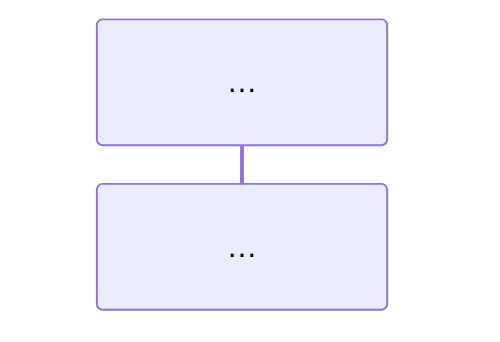

# 设计：steps 09~13 开篇时序图与正文调用逻辑重排

日期：2026-10-13
状态：已与用户逐节确认（结构模板 / 每章消息清单 / 写作规范）

## 背景与目标

`demo/cross-border-commerce/steps/` 中 09~13 章开篇图不统一：

- Step 09 已有端点级时序图，但正文按 Q&A 组织，未围绕图展开调用逻辑；
- Step 10~13 开篇是 flowchart（11、12 的图还在第二节），没有"谁调谁"的时序语义。

目标：09~13 每章开篇一张**端点级时序图**（范本：Step 06），正文小节顺序 = 图中调用顺序，逐环节讲清"谁调谁、传什么关键参数、正常返回什么、失败会怎样"。

用户已确认的决策：

1. **整体重排**——正文小节按图中消息顺序重新编排（不只是追加走读节）；
2. **替换**——原 flowchart 全部删除，每章只保留开篇一张时序图；
3. **内容零删减**——实测输出、坑位提醒、源码核对、"本轮未验证"声明全部保留，只重新挂载；发现与脚本不符的描述一并修正；
4. **方案 A**——端点级时序图 + 逐环节走读，与 01~08 章已有的 5 张时序图口径一致。

## 范围

**修改**：`demo/cross-border-commerce/steps/step-09-hitl-approval.md` 至 `step-13-model-channel.md` 共 5 个 `.md` 文件。

**不修改**：

- 5 个 `.sh` 脚本——图必须忠实于脚本现状，不改脚本去凑图；
- Step 01~08——不在本次范围；
- `chapters/43-cases.md`——仅以链接与表格引用 steps，无正文复制，本次重排不改变步骤事实内容，摘要仍准确；
- `demo/cross-border-commerce/README.md`——实现时检查是否有对旧图编号/旧小节结构的引用，若有悬空引用则一并清理（预期没有）。

## 章节统一结构模板

```markdown
---
frontmatter（不动）
---

# 标题（不动）

> 本步导读：……（保留，可微调一句预告"先看调用链全景图"）



*图 0X-1：<一句话点题>*

## ① 环节一小节：原疑问句 ← 按图的调用顺序编排
   谁调谁 / 关键参数 / 正常返回 / 失败形态
   原有小节内容（脚本片段、实测输出、注意块）挂到对应环节下

## ② 环节二小节：…
   …

## 概念铺垫表 / 边界与未验证声明 ← 不属于调用链的内容，放图后首节或尾部集中
## 本步小结 + 验收清单 ← 保留（仅当条目归属变化时微调措辞）
## 下一步链接 / 继续阅读 / 源码核对 ← 不动
```

关键规则：

1. **图从脚本核对绘制**：每条消息能在对应 `.sh` 中指出调用点；图上没有的调用正文不虚构；脚本有而图上省略的（如 `login_as`、查重复用的 `GET`）在正文首节说明。
2. **小节顺序 = 图中消息顺序**；原 Q&A 疑问句标题保留价值，挂到所属环节下（`环节名：原疑问句`），不再作为顶层组织逻辑。
3. **内容零删减**。
4. **图注沿用 `*图 0X-1：…*` 格式**；删除 flowchart 后清理正文对其的悬空引用。

## 每章时序图消息清单（已从 `.sh` 逐条核对）

### Step 09 · HITL 人工审批（4 环节）

participant 拆分为：alice / 工单（issues）/ 审批中心（approvals）/ admin——两个资源域分开，路径归属更准确。

| 环节（新小节） | 图上消息 |
| --- | --- |
| ① 共享工单：为什么 admin 也会遇到 404？ | alice→工单：`GET /api/v1/issues/{id}`（读 version+access）；alice→工单：`PUT /api/v1/issues/{id}/access`（admin=contributor，保留已有成员） |
| ② 创建审批 | alice→审批：`POST /api/v1/approvals`（approver=admin，返回初始 version=1） |
| ③ 决批与乐观锁：如何发起与批准？ | admin→审批：`POST /api/v1/approvals/{id}/decide`（approved+expectedVersion→approved）；admin→审批：重复决批（旧 version）`-->> 409` |
| ④ 结论写回：审批通过就退款了吗？ | alice→工单：`POST /api/v1/issues/{id}/comments`（写回批准结论） |

脚本首部两次 `login_as` 不上图，正文①说明。

### Step 10 · Automation 定时任务（4 环节）

participant：alice / Automation 控制面 / Automation 引擎（表现 202 后的异步执行）。

| 环节 | 图上消息 |
| --- | --- |
| ① 先查后建停用规则 | alice→控制面：`GET /api/v1/automations`（查同名）；首次 `POST /api/v1/automations`（enabled=false，cron `0 9 * * *` Asia/Shanghai，actionType=create_issue） |
| ② 预览时区排程 | alice→控制面：`POST /api/v1/automations/schedule-preview`（返回未来 5 次，UTC 01:00=上海 09:00） |
| ③ 测试触发与异步完成：202 不是完成 | alice→引擎：`POST /api/v1/automations/{id}/trigger?test=true`（Idempotency-Key）`-->> 202 queued`；引擎→引擎：create_issue 生成测试工单；alice→控制面：轮询 `GET /api/v1/automations/{id}/runs/{runId}` `-->> completed`（+issueId） |
| ④ 运行记录与幂等 | alice→控制面：`GET /api/v1/automations/{id}/runs`（`.items` 列表核对；相同幂等键复用同一运行） |

"怎样正式启用排程"（PATCH `enabled:true`，脚本不自动做）保留为图后正文，图上不画。

### Step 11 · Workspace 文件、发布与版本绑定（3 环节 + 铺垫）

participant：alice / Workspace 服务 / Agent 控制面。

| 环节 | 图上消息 |
| --- | --- |
| ⓪ 概念铺垫：namespace/Workspace/Environment 分工表 | 保留为图后首节，不占消息 |
| ① 写入资料并发布 | alice→WS：`GET /api/workspaces`（查同名）→`POST /api/workspaces`（read 工具）；逐文件 `GET .../file?path=`（内容比对）→差异才 `PUT .../file`；`POST .../publish` `-->> version+digest`；重复 publish `-->> 复用同一版本` |
| ② 创建实验 Agent 并固定版本 | alice→控制面：`GET /api/v1/agents`（查 agentKey）→`POST /api/v1/agents`（definition 绑定 workspaceId+workspaceBinding.version/digest）；`GET /api/v1/agents/{id}/definition` `-->> 回读三断言` |
| ③ 政策升级与回滚（教程练习，脚本不自动做） | 不上图，正文保留 |
| ④ 运行验收：模型是否真读了资料（本轮未执行） | 不上图；图尾 Note 标注"配置验收 ≠ 运行期读取" |

### Step 12 · Environment 与沙箱执行（3 环节 + 铺垫）

participant：alice / 控制面（Environment 注册表）/ Dataplane↔E2B（仅以 Note 出现，标未验证边界）。

| 环节 | 图上消息 |
| --- | --- |
| ⓪ 概念铺垫：四种 Environment 对比表 | 保留为图后首节 |
| ① 反查当前默认环境 | alice→控制面：`GET /api/v1/agents/{id}/definition`→`GET /api/environments/{envId}` `-->> local` |
| ② 登记 E2B 环境（--create） | alice→控制面：`GET /api/environments`（查同名）→`POST /api/environments`（type=sandbox）`-->> id + apiKey(Worker key，非 E2B Key)`；`GET /api/environments/{sid}` `-->> type=sandbox 回读` |
| ③ 真实执行：凭据、Agent 绑定、隔离验收（本轮未执行） | 不上图；Note over 标注"控制面登记 ≠ 启动云沙箱 ≠ 执行隔离已验证" |

### Step 13 · 对接自有模型通道（4 环节）

participant：教学终端（alice，demo shell）/ Service 控制面 / Dataplane / 公司模型网关——`--set-model` 走"终端→控制面"，`--probe-*` 走"终端→网关"（探针不经过 Service），合并发起方控制图宽在 4 个 participant。

| 环节 | 图上消息 |
| --- | --- |
| ⓪ 链路厘清：变量表（BASE_URL / XBD_MODEL_* / 别名） | 保留为图后首节 |
| ① 保存模型选择（--set-model，已验证） | alice→控制面：`GET /api/v1/agents/{id}/definition`→`PATCH`（只改 model，带原 version）`-->> 保存成功`；回读断言 Workspace/工具/环境未变 |
| ② 上游探针（--probe-text/tools，已验证） | 教学终端→网关：`POST {根地址}{endpoint path}`（Bearer XBD_MODEL_API_KEY）`-->> 文本 / demo_echo 工具调用` |
| ③ 真实执行链路（本轮未实测） | alice→控制面：创建新 Chat/Turn `->>` Dataplane（ModelRegistry 解析 merchant-gateway）`->>` 网关 `->>` 上游——虚线箭头或 Note 标注"未经本轮实测" |
| ④ 排障分层表 / 未验证声明 | 正文保留 |

## 写作规范

1. **Mermaid 语法约束**：仅使用现有章节已用构件——`sequenceDiagram`、`participant X as 名`、`A->>B: 消息`、`B-->>A: 响应`、`Note over X,Y:`。不用 `autonumber`（方案 C 已否）、不用 activate/deactivate 生僻写法，保证 mermaid v12 页面渲染兼容。
2. **消息文本格式**：`METHOD /path（关键参数）`，中文括注，与 Step 06 一致。
3. **失败形态上图**：`-->>` 响应标注状态码或结果（`409`、`202 queued`、`复用同一版本`），细节留给对应小节。
4. **小节标题**：`## ① 环节名：原疑问句`——①②③ 只进小节标题，不进图。
5. **图注**：`*图 0X-1：…*` 一句话点题。

## 验收

1. `cd build && node build.mjs --check` 通过（mermaid 块计数、内链体检无悬空）。
2. 每章图上每条消息能在对应 `.sh` 找到调用点（人工逐条核对）。
3. **内容零丢失核对**：实现时逐章列出原文实质内容点清单（小节要点、脚本片段、实测输出、注意块、验收清单条目、源码核对行），改完后逐项确认在新文中有落点。
4. 5 章均无对已删除 flowchart 的悬空引用（`图 10-1`/`图 11-1`/`图 12-1`/`图 13-1` 等编号被新图沿用或正文不再引用）。
5. （可选，环境允许时）完整 `node build.mjs` 构建，确认无"图未渲染为 SVG"错误。

## 风险

- **Step 13 图过宽**（4 个 participant × 多消息）：合并同组消息控制条目；participant 别名取短。
- **内容搬移遗漏**：以第 3 条验收的内容点清单兜底。
- **图与正文重复**：图只写"谁调谁+关键参数"，请求体细节、响应 JSON 留给正文，不把正文整段塞进图。
